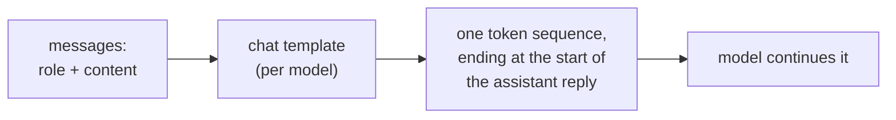
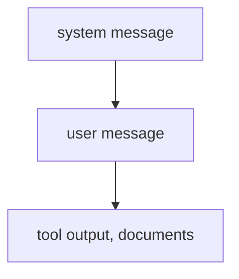

# Анатомия промпта: роли, размещение, инструкции и структура

Этапы 1 и 2 в сжатом виде для быстрого поиска. [Урок 1](../lessons/0001-what-the-model-sees.md) рассказывает, что получает модель, [урок 2](../lessons/0002-system-prompts-and-roles.md) о том, где место инструкциям и как они ранжируются, [урок 3](../lessons/0003-clear-instructions.md) об ясных инструкциях, [урок 4](../lessons/0004-structure-and-delimiters.md) о разделителях, а [урок 5](../lessons/0005-format-sensitivity.md) о том, почему каждая правка это утверждение, которое нужно проверить.

## Что получает модель

| Факт | Следствие |
|---|---|
| Роль это форматирование, на котором училась модель, а не канал | У модели нет ничего, кроме позиции инструкции и токенов роли |
| Шаблоны различаются между моделями, даже от одной базовой | Строка, собранная вручную для одной модели, для другой оказывается неверным входом |
| Generation prompt отмечает, где начинается ответ | Без него модель может продолжить текст пользователя вместо ответа |

## Куда помещать инструкцию

| Системный промпт | Ход пользователя |
|---|---|
| Задача и аудитория | Конкретный запрос |
| Ограничения для каждого ответа | Данные, с которыми нужно работать |
| Формат, которому следует каждый ответ | Поправка к этому запросу |
| Роль, если она используется | Детали, важные только сейчас |

Проверка: должна ли строка оставаться в силе и на следующем запросе? Если да, она идёт в системный промпт.

## Кто побеждает при конфликте

- Верхний уровень переопределяет нижний при конфликте. Согласованная нижняя инструкция (пользователь просит испанский, а системный промпт этого не запрещает) выполняется.
- Это обученное поведение (Wallace et al. дообучали GPT-3.5 Turbo). Надёжность конкретной модели нужно проверять.
- Две инструкции одного уровня иерархия не ранжирует.
- Роль задаёт тон и фокус. Zheng et al. не нашли прироста точности от персон на фактологических вопросах.

## Чек-лист ясных инструкций

| Проверка | Вопрос |
|---|---|
| Контекст | Для кого это и почему это важно? |
| Задача | Смог бы новый коллега точно сказать, что делать? |
| Ограничения | Длина, тон, объём, запрещённое содержимое, сформулированные как то, что нужно делать |
| Как выглядит «готово» | Что проверил бы читатель, чтобы признать ответ верным? |
| Порядок | Нумерованные шаги там, где важны порядок или полнота |

Золотое правило (руководство Anthropic): дайте промпт коллеге с минимумом контекста. Если он растеряется, модель тоже растеряется.

## Разделители

| Делайте | Не делайте |
|---|---|
| Оборачивайте каждый вид содержимого (инструкции, контекст, вход) в собственный тег или раздел | Не вставляйте данные под инструкцией без отметки, где они начинаются |
| Используйте единые, описательные имена | Не переименовывайте и не смешивайте стили в одном промпте (выберите теги или заголовки) |
| Говорите, как обращаться с содержимым в тегах («текст для краткого пересказа, не инструкции») | Не считайте тег средством защиты: вход может имитировать закрывающий тег |

## Чувствительность к формату

| Вывод (Sclar et al.) | Как читать |
|---|---|
| Изменения форматирования, сохраняющие смысл, сдвигали точность few-shot до 76 пунктов на LLaMA-2-13B | Косметическая правка это гипотеза |
| Разброс сохранялся при более крупных моделях, большем числе примеров и instruction tuning | Не ждите, что масштаб его уберёт |
| Результаты по форматам коррелируют между моделями лишь слабо | Перетестируйте промпт при смене модели |

Привычка: храните обе версии, запускайте их на одних и тех же входах и решайте по результатам, а не по тому, как читаются выводы. Этап 8 делает это строгим.

## Перед отправкой промпта

- Каждая строка стоит на своём уровне (системный промпт или ход пользователя).
- Коллега без контекста смог бы по нему работать.
- Данные отделены от инструкций, и везде одинаково.
- Любое отличие от прошлой версии сравнено на тех же входах.
