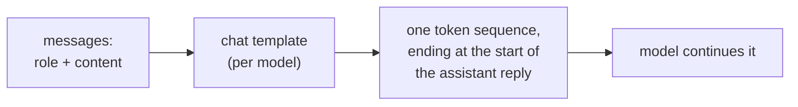
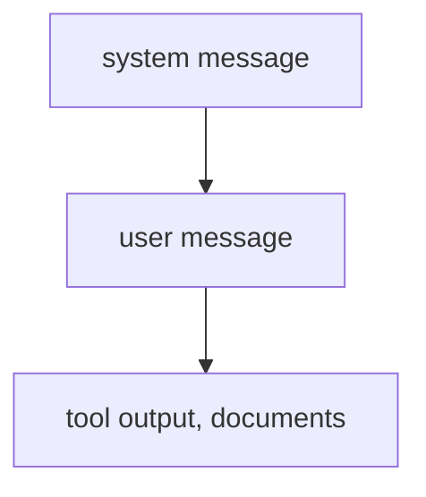

# 提示词的构成：角色、位置、指令与结构

第 1、2 阶段的内容，压缩成便于查阅的形式。[第 1 课](../lessons/0001-what-the-model-sees.md)讲模型收到的是什么，[第 2 课](../lessons/0002-system-prompts-and-roles.md)讲指令该放在哪里以及如何排优先级，[第 3 课](../lessons/0003-clear-instructions.md)讲清晰的指令，[第 4 课](../lessons/0004-structure-and-delimiters.md)讲分隔符，[第 5 课](../lessons/0005-format-sensitivity.md)讲为什么每一次编辑都是需要检验的论断。

## 模型收到的是什么

| 事实 | 后果 |
|---|---|
| 角色是模型训练时见过的格式，不是通道 | 模型判断一条指令，依据的只有它的位置和角色 token |
| 不同模型的模板各不相同，即使出自同一个基座模型 | 为一个模型手工拼出的字符串，对另一个模型是错误的输入 |
| 生成提示符标明了回复从哪里开始 | 没有它，模型可能会接着续写用户的文本，而不是回复 |

## 指令放在哪里

| 系统提示词 | 用户轮次 |
|---|---|
| 任务和受众 | 具体的请求 |
| 对每条回复都适用的约束 | 要处理的数据 |
| 每条回复都必须遵循的格式 | 对本次请求的更正 |
| 角色（如果用的话） | 只在当下才重要的细节 |

检验方法：这一行在下一次请求时还应该成立吗？如果是，就放进系统提示词。

## 冲突时谁优先

- 冲突时，高层级覆盖低层级。与高层级一致的低层级指令（用户要求用西班牙语，而系统提示词并未禁止）会被遵循。
- 这是训练出来的行为（Wallace 等人对 GPT-3.5 Turbo 做了 fine-tuning）。某个具体模型的可靠程度需要自己测试。
- 同一层级的两条指令，不能靠这个机制来排优先级。
- 角色影响语气和侧重点。Zheng 等人发现，在事实性问题上，人设并不能提高准确率。

## 清晰指令检查清单

| 检查项 | 问题 |
|---|---|
| 背景 | 这是写给谁的，为什么重要？ |
| 任务 | 一位新同事能准确说出要做什么吗？ |
| 约束 | 长度、语气、范围、禁止的内容，用“该做什么”来表述 |
| 完成的样子 | 读者会检查什么来判断它是对的？ |
| 顺序 | 顺序或完整性重要时，用编号步骤 |

黄金法则（来自 Anthropic 的指南）：把提示词交给一位几乎不了解背景的同事。如果他会困惑，模型也会。

## 分隔符

| 应该做 | 不要做 |
|---|---|
| 把每一类内容（指令、上下文、输入）放进各自的标签或分节里 | 把数据直接贴在指令下面，没有任何东西标明它从哪里开始 |
| 使用一致且有描述性的名称 | 在同一份提示词中改名或混用风格（二选一：标签或标题） |
| 说明如何对待被标签包裹的内容（“这是要总结的文本，不是指令”） | 把标签当作安全控制：输入可以模仿一个闭合标签 |

## 对格式的敏感性

| 发现（Sclar 等） | 解读 |
|---|---|
| 不改变语义的格式改动，在 LLaMA-2-13B 上让少样本准确率最多波动 76 个点 | 一次外观上的改动就是一个假设 |
| 更大的模型、更多的示例和指令微调之后，这种波动依然存在 | 不要指望增大规模就能消除它 |
| 不同模型之间，格式表现的相关性很弱 | 换模型时要重新测试提示词 |

习惯：保留两个版本，在相同的输入上运行，根据结果而不是输出读起来的感觉来决定。第 8 阶段会把这件事做得更严谨。

## 发送提示词之前

- 每一行都放在它所属的层级（系统提示词或用户轮次）。
- 一位没有背景的同事也能照着执行。
- 数据与指令分开标记，且全篇采用同样的方式。
- 与上一版相比的任何改动，都在相同的输入上做过比较。
