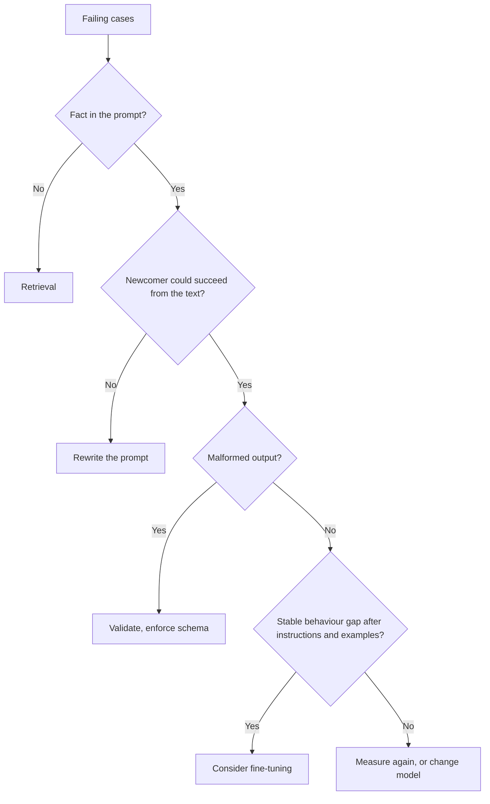

# Lista de revisión de prompts: costos, palancas y consejos en disputa

La etapa 10 condensada para consulta rápida. La [lección 22](../lessons/0022-prompt-rag-or-fine-tune.md) cubre cómo elegir la palanca, la [lección 23](../lessons/0023-reviewing-a-production-prompt.md) cubre la revisión y el cambio de un prompt del que otros dependen, y la [lección 24](../lessons/0024-when-the-usual-advice-is-wrong.md) cubre cómo resolver consejos en disputa.

## Preguntas de revisión

Nombra el costo y luego haz la pregunta que lo resolvería.

| Decisión en el prompt | Costo | Pregunta |
|---|---|---|
| Valor por petición al principio | Rompe el prefijo cacheable | ¿Qué es lo primero que cambia entre peticiones? |
| Ejemplos few-shot | Tokens por llamada, sesgo de etiqueta, de recencia o de orden | ¿Hay equilibrio de etiquetas? ¿Mover el orden cambia la precisión? |
| Texto no confiable en línea | Inyección, estructura rota | ¿Qué huecos puede influir alguien ajeno? ¿Están delimitados y con escape? |
| Alias de modelo como "latest" | El comportamiento cambia sin ninguna edición | ¿Qué snapshot? |
| Sin conjunto de regresión | Cada edición es una corazonada | ¿Qué fallos deben seguir corregidos? |
| Salida de texto libre que lee un programa | Lecturas erróneas silenciosas | ¿Qué la valida? |
| Persona o redacción enfática | Tokens, sin beneficio medido | ¿Qué cambió en el conjunto de regresión? |
| Pregunta enterrada en un contexto largo | Peor aprovechamiento de la parte media | ¿Dónde están los documentos y la pregunta? |

Indica también qué está bien y debe quedarse. Una revisión que solo enumera fallos está a medias.

## Qué palanca usar

| Fallo | Palanca |
|---|---|
| Interpreta mal o ignora algo del prompt | Reescribir el prompt |
| Inventa hechos que nunca se le dieron (privados, recientes, cambiantes) | Recuperación |
| Acierta en los ejemplos, pero se desvía a escala | Primero few-shot, luego considerar fine-tuning |
| Instrucciones claras, salida mal formada | Validación, salida estructurada, decodificación restringida |
| Necesita un cálculo o una acción | Una herramienta |
| Calidad correcta, pero lento o costoso | Un prompt más corto o un modelo distinto |

La recuperación superó al fine-tuning no supervisado tanto para conocimiento nuevo como existente en [Ovadia et al.](https://arxiv.org/abs/2312.05934). Es un resultado sobre conocimiento, no sobre comportamiento. Consulta el [track de RAG](../../rag/README.md) y el [track de fine-tuning con adaptadores](../../finetuning/README.md). Ni la recuperación ni el fine-tuning eliminan la inyección de prompt, y la recuperación añade una vía indirecta.

## Cambiar un prompt del que otros dependen

1. Un nuevo id de versión: texto, snapshot del modelo y esquema de salida como una sola unidad.
2. Ejecuta el anterior y el nuevo sobre el conjunto de regresión, de forma pareada.
3. Criterio de paso: ningún caso que no deba romperse falla, y la mejora supera al ruido.
4. Trata el esquema de salida como un contrato: añadir una clave opcional suele ser seguro, renombrar una etiqueta no.
5. Despliega a una pequeña proporción, comprueba y amplía.
6. El rollback consiste en "servir la versión anterior", así que mantenla direccionable y fijada.
7. Avisa a quienes dependen de él antes de que vean el cambio.

## Consejos en disputa

| Consejo | Qué respalda la fuente | Alcance a comprobar |
|---|---|---|
| Dale un rol al modelo | [Zheng et al.](https://arxiv.org/abs/2311.10054): sin mejora de precisión en 2.410 preguntas factuales, el efecto de una persona es en gran parte aleatorio. Anthropic: un rol enfoca el comportamiento y el tono | Precisión frente a tono; modelos de 2023 |
| Piensa paso a paso | Anthropic: instrucciones generales en lugar de pasos prescritos con el razonamiento activado; en algunos modelos concretos puede rechazarse pedir razonamiento escrito | Razonamiento activado o desactivado; qué modelo; fecha |
| Grita las reglas importantes | Anthropic: en Claude Opus 4.5 y 4.6, el lenguaje agresivo puede provocar un uso excesivo de herramientas | Dos modelos concretos; activación de herramientas |
| Más ejemplos | Anthropic: de 3 a 5. [Lu et al.](https://arxiv.org/abs/2104.08786): el orden por sí solo puede llevar los resultados casi al azar y no se transfiere entre modelos | El orden y el formato son variables |

Método: encuentra la fuente primaria, comprueba el modelo y la fecha, comprueba qué cubre la afirmación y prueba sobre el conjunto de regresión.
