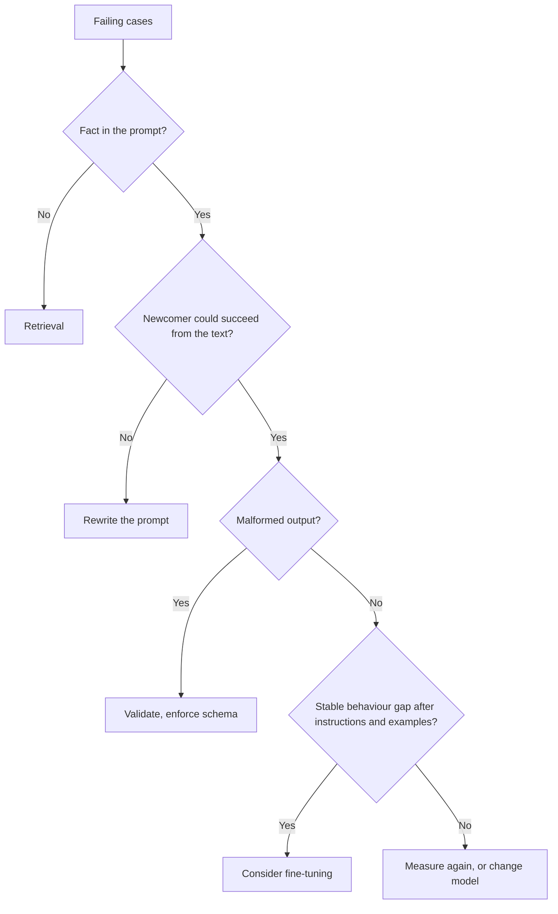

# Liste de contrôle de relecture d'un prompt : coûts, leviers et conseils contestés

L'étape 10 condensée pour la consultation. La [leçon 22](../lessons/0022-prompt-rag-or-fine-tune.md) traite du choix du levier, la [leçon 23](../lessons/0023-reviewing-a-production-prompt.md) de la relecture et de la modification d'un prompt dont d'autres dépendent, et la [leçon 24](../lessons/0024-when-the-usual-advice-is-wrong.md) de la façon de trancher les conseils contestés.

## Questions de relecture

Nommez le coût, puis posez la question qui permettrait de trancher.

| Choix dans le prompt | Coût | Demander |
|---|---|---|
| Valeur propre à la requête placée tôt | Casse le préfixe cacheable | Quelle est la première chose qui change d'une requête à l'autre ? |
| Exemples few-shot | Des tokens par appel, biais de label, de récence ou d'ordre | Équilibre des labels ? Un mélange fait-il bouger la précision ? |
| Texte non fiable en ligne | Injection, structure cassée | Quels emplacements un tiers peut-il influencer ? Délimités et échappés ? |
| Alias de modèle comme « latest » | Le comportement change sans modification | Quel snapshot ? |
| Pas de jeu de régression | Chaque modification est une impression | Quels échecs doivent rester corrigés ? |
| Sortie en texte libre lue par un programme | Mauvaises lectures silencieuses | Qu'est-ce qui la valide ? |
| Persona ou formulation emphatique | Des tokens, aucun bénéfice mesuré | Qu'est-ce que cela a changé sur le jeu de régression ? |
| Question enfouie dans un long contexte | Moins bonne exploitation du milieu | Où se trouvent les documents et la question ? |

Dites aussi ce qui est bien et doit rester. Une relecture qui ne liste que des défauts est à moitié faite.

## Quel levier

| Échec | Levier |
|---|---|
| Comprend mal ou ignore quelque chose dans le prompt | Réécrire le prompt |
| Invente des faits qu'on ne lui a jamais donnés (privés, récents, changeants) | Récupération |
| Juste dans les exemples, dérive à grande échelle | Few-shot d'abord, puis envisager le fine-tuning |
| Instructions claires, sortie mal formée | Validation, sortie structurée, décodage contraint |
| Demande un calcul ou une action | Un outil |
| Qualité correcte, lent ou coûteux | Prompt plus court ou autre modèle |

La récupération a battu le fine-tuning non supervisé pour les connaissances nouvelles et existantes chez [Ovadia et al.](https://arxiv.org/abs/2312.05934). C'est un résultat sur la connaissance, pas sur le comportement. Voir le [parcours RAG](../../rag/README.md) et le [parcours fine-tuning](../../finetuning/README.md). Ni la récupération ni le fine-tuning ne suppriment l'injection de prompt, et la récupération ajoute une voie indirecte.

## Modifier un prompt dont d'autres dépendent

1. Nouvel identifiant de version : texte, snapshot du modèle et schéma de sortie comme une seule unité.
2. Exécuter l'ancien et le nouveau sur le jeu de régression, de façon appariée.
3. Barrière : aucun cas à ne pas casser n'échoue, et le gain dépasse le bruit.
4. Traiter le schéma de sortie comme un contrat : ajouter une clé optionnelle est généralement sans risque, renommer un label ne l'est pas.
5. Déployer sur une petite part, vérifier, élargir.
6. Le retour en arrière consiste à « servir la version précédente » : gardez-la donc adressable et épinglée.
7. Prévenir les dépendants avant qu'ils ne voient la modification.

## Conseils contestés

| Conseil | Ce que la source soutient | Portée à vérifier |
|---|---|---|
| Donner un rôle au modèle | [Zheng et al.](https://arxiv.org/abs/2311.10054) : aucun gain de précision sur 2 410 questions factuelles, effet d'un persona largement aléatoire. Anthropic : un rôle concentre le comportement et le ton | Précision contre ton ; modèles de 2023 |
| Think step by step | Anthropic : instructions générales plutôt qu'étapes prescrites avec thinking activé ; demander un raisonnement écrit peut être décliné sur certains modèles nommés | Thinking activé ou non ; quel modèle ; date |
| Crier les règles importantes | Anthropic : sur Claude Opus 4.5 et 4.6, un langage agressif peut sur-déclencher l'usage d'outils | Deux modèles nommés ; déclenchement d'outils |
| Plus d'exemples | Anthropic : 3 à 5. [Lu et al.](https://arxiv.org/abs/2104.08786) : l'ordre seul peut faire tomber les résultats près du hasard et ne se transfère pas d'un modèle à l'autre | L'ordre et le format sont des variables |

Méthode : trouver la source primaire, vérifier le modèle et la date, vérifier ce que couvre l'affirmation, tester sur le jeu de régression.
