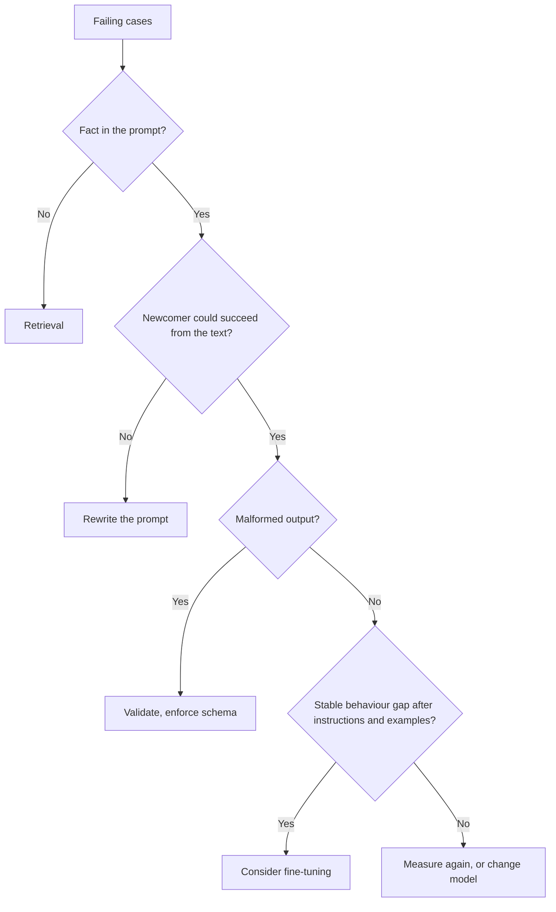

# Prompt Review Checklist: क़ीमतें, उपाय और विवादित सलाह

चरण 10 का संक्षिप्त रूप, खोजने के लिए। [पाठ 22](../lessons/0022-prompt-rag-or-fine-tune.md) उपाय चुनने को कवर करता है, [पाठ 23](../lessons/0023-reviewing-a-production-prompt.md) समीक्षा और ऐसे prompt को बदलने को जिस पर दूसरे निर्भर हैं, और [पाठ 24](../lessons/0024-when-the-usual-advice-is-wrong.md) विवादित सलाह का निपटारा।

## समीक्षा के सवाल

क़ीमत का नाम लें, फिर वह सवाल पूछें जो उसे सुलझाए।

| Prompt में पसंद | क़ीमत | पूछें |
|---|---|---|
| जल्दी आने वाला हर-request का मान | Cache हो सकने वाला prefix तोड़ता है | Requests के बीच सबसे पहले क्या बदलता है? |
| Few-shot examples | हर call पर tokens, label, recency या क्रम का bias | Label संतुलन? क्या फेंटने से accuracy हिलती है? |
| Untrusted text inline | Injection, बिगड़ा structure | कौन-से slots को कोई बाहरी व्यक्ति प्रभावित कर सकता है? क्या delimited और escaped हैं? |
| "latest" जैसा model alias | बिना edit के व्यवहार बदलता है | कौन-सा snapshot? |
| कोई regression set नहीं | हर edit एक एहसास है | कौन-सी विफलताएँ ठीक रहनी चाहिए? |
| Free-text output जिसे program पढ़ता है | चुपचाप ग़लत पढ़ना | उसे क्या validate करता है? |
| Persona या ज़ोरदार शब्दावली | Tokens, कोई मापा हुआ फ़ायदा नहीं | Regression set पर उसने क्या बदला? |
| सवाल लंबे context में दबा | बीच का कमज़ोर इस्तेमाल | Documents और सवाल कहाँ बैठे हैं? |

यह भी बताएँ कि क्या ठीक है और रहना चाहिए। जो समीक्षा सिर्फ़ दोष गिनाती है वह आधी हुई है।

## कौन-सा उपाय

| विफलता | उपाय |
|---|---|
| Prompt में कुछ ग़लत पढ़ता या नज़रअंदाज़ करता है | Prompt दोबारा लिखें |
| वे तथ्य गढ़ता है जो उसे कभी दिए नहीं गए (निजी, हाल के, बदलते) | Retrieval |
| Examples में सही, बड़े पैमाने पर भटकता है | पहले few-shot, फिर fine-tuning पर विचार करें |
| Instructions साफ़, output बिगड़ा | Validation, structured output, constrained decoding |
| गणना या कार्रवाई चाहिए | Tool |
| गुणवत्ता ठीक, धीमा या महँगा | छोटा prompt या अलग model |

[Ovadia et al.](https://arxiv.org/abs/2312.05934) में retrieval ने नए और मौजूदा ज्ञान, दोनों के लिए unsupervised fine-tuning को हराया। यह ज्ञान के बारे में नतीजा है, व्यवहार के बारे में नहीं। [RAG track](../../rag/README.md) और [fine-tuning track](../../finetuning/README.md) देखें। न retrieval और न fine-tuning prompt injection को हटाता है, और retrieval एक indirect रास्ता जोड़ता है।

## जिस prompt पर दूसरे निर्भर हैं उसे बदलना

1. नया version id: text, model snapshot और output schema एक इकाई के रूप में।
2. पुराने और नए को regression set पर चलाएँ, paired।
3. Gate: कोई must-not-break case fail नहीं होता, और सुधार noise से बड़ा है।
4. Output schema को अनुबंध मानें: वैकल्पिक key जोड़ना आमतौर पर सुरक्षित है, label का नाम बदलना नहीं।
5. छोटे हिस्से में rollout करें, जाँचें, चौड़ा करें।
6. Rollback का मतलब "पिछला version फिर से serve करो" है, इसलिए उसे पहुँच में और pin किया हुआ रखें।
7. निर्भर लोगों को बदलाव देखने से पहले बताएँ।

## विवादित सलाह

| सलाह | स्रोत क्या समर्थित करता है | जाँचने का दायरा |
|---|---|---|
| Model को role दें | [Zheng et al.](https://arxiv.org/abs/2311.10054): 2,410 तथ्यात्मक सवालों पर accuracy में कोई बढ़त नहीं, persona का असर काफ़ी हद तक random। Anthropic: role व्यवहार और tone को केंद्रित करता है | Accuracy बनाम tone; 2023 के models |
| Think step by step | Anthropic: thinking चालू होने पर निर्देशात्मक चरणों के बजाय सामान्य instructions; कुछ नामित models पर लिखी हुई reasoning माँगना ठुकराया जा सकता है | Thinking चालू या बंद; कौन-सा model; तारीख़ |
| ज़रूरी नियमों पर चिल्लाएँ | Anthropic: Claude Opus 4.5 और 4.6 पर आक्रामक भाषा tool के इस्तेमाल को ज़रूरत से ज़्यादा चला सकती है | दो नामित models; tool का चलना |
| ज़्यादा examples | Anthropic: 3 से 5। [Lu et al.](https://arxiv.org/abs/2104.08786): अकेला क्रम नतीजों को लगभग संयोग तक झुला सकता है और models के बीच नहीं जाता | क्रम और format variables हैं |

तरीक़ा: primary source खोजें, model और तारीख़ जाँचें, जाँचें कि दावा क्या कवर करता है, regression set पर परखें।
