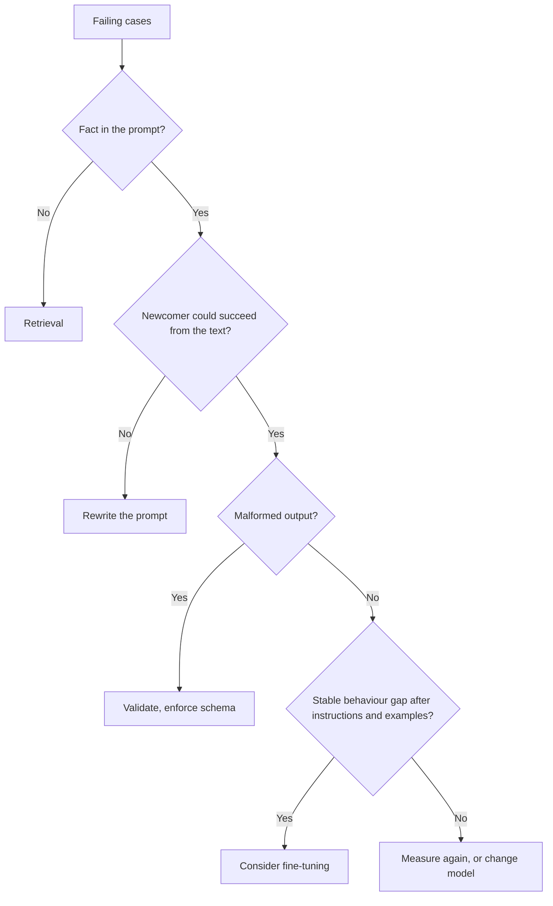

# Prompt Review Checklist: Costs, Levers and Disputed Advice

Stage 10 compressed for lookup. [Lesson 22](../lessons/0022-prompt-rag-or-fine-tune.md) covers choosing the lever, [lesson 23](../lessons/0023-reviewing-a-production-prompt.md) covers review and changing a prompt others depend on, and [lesson 24](../lessons/0024-when-the-usual-advice-is-wrong.md) covers settling disputed advice.

## Review questions

Name the cost, then ask the question that would settle it.

| Choice in the prompt | Cost | Ask |
|---|---|---|
| Per-request value early | Breaks the cacheable prefix | What is the first thing that changes between requests? |
| Few-shot examples | Tokens per call, label, recency or order bias | Label balance? Does a shuffle move accuracy? |
| Untrusted text inline | Injection, broken structure | Which slots can an outsider influence? Delimited and escaped? |
| Model alias such as "latest" | Behaviour changes with no edit | Which snapshot? |
| No regression set | Every edit is a feeling | Which failures must stay fixed? |
| Free-text output a program reads | Silent misreads | What validates it? |
| Persona or emphatic wording | Tokens, no measured benefit | What did it change on the regression set? |
| Question buried in a long context | Weaker use of the middle | Where do documents and question sit? |

Also say what is fine and should stay. A review that only lists faults is half done.

## Which lever

| Failure | Lever |
|---|---|
| Misreads or ignores something in the prompt | Rewrite the prompt |
| Invents facts it was never given (private, recent, changing) | Retrieval |
| Right in examples, drifts at scale | Few-shot first, then consider fine-tuning |
| Clear instructions, malformed output | Validation, structured output, constrained decoding |
| Needs calculation or an action | A tool |
| Quality fine, slow or costly | Shorter prompt or a different model |

Retrieval beat unsupervised fine-tuning for new and existing knowledge in [Ovadia et al.](https://arxiv.org/abs/2312.05934). That is a result about knowledge, not behaviour. See the [RAG track](../../rag/README.md) and the [fine-tuning track](../../finetuning/README.md). Neither retrieval nor fine-tuning removes prompt injection, and retrieval adds an indirect route.

## Changing a prompt others depend on

1. New version id: text, model snapshot and output schema as one unit.
2. Run old and new on the regression set, paired.
3. Gate: no must-not-break case fails, and the gain beats noise.
4. Treat the output schema as a contract: adding an optional key is usually safe, renaming a label is not.
5. Roll out to a small share, check, widen.
6. Rollback is "serve the previous version", so keep it addressable and pinned.
7. Tell dependents before they see the change.

## Disputed advice

| Advice | What the source supports | Scope to check |
|---|---|---|
| Give the model a role | [Zheng et al.](https://arxiv.org/abs/2311.10054): no accuracy gain on 2,410 factual questions, effect of a persona largely random. Anthropic: a role focuses behaviour and tone | Accuracy against tone; 2023 models |
| Think step by step | Anthropic: general instructions over prescribed steps with thinking on; asking for written reasoning may be declined on some named models | Thinking on or off; which model; date |
| Shout important rules | Anthropic: on Claude Opus 4.5 and 4.6, aggressive language can overtrigger tool use | Two named models; tool triggering |
| More examples | Anthropic: 3 to 5. [Lu et al.](https://arxiv.org/abs/2104.08786): order alone can swing results to near chance and does not transfer between models | Order and format are variables |

Method: find the primary source, check model and date, check what the claim covers, test on the regression set.
