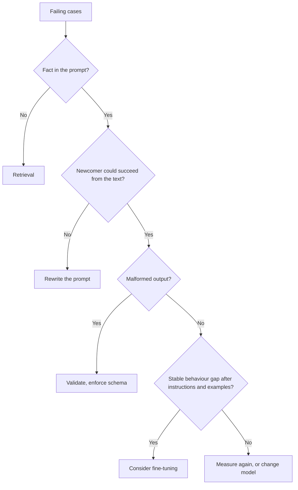

# Checklist de Revisão de Prompt: Custos, Alavancas e Conselhos Contestados

O estágio 10 condensado para consulta. A [lição 22](../lessons/0022-prompt-rag-or-fine-tune.md) trata de escolher a alavanca, a [lição 23](../lessons/0023-reviewing-a-production-prompt.md) de revisar e de alterar um prompt do qual outros dependem, e a [lição 24](../lessons/0024-when-the-usual-advice-is-wrong.md) de resolver conselhos contestados.

## Perguntas de revisão

Dê nome ao custo e depois faça a pergunta que o resolveria.

| Escolha no prompt | Custo | Pergunte |
|---|---|---|
| Valor por requisição logo no início | Quebra o prefixo cacheável | Qual é a primeira coisa que muda entre as requisições? |
| Exemplos few-shot | Tokens por chamada, viés de rótulo, de recência ou de ordem | Os rótulos estão equilibrados? Embaralhar move a acurácia? |
| Texto não confiável inserido diretamente | Injeção, estrutura quebrada | Quais slots um agente externo pode influenciar? Estão delimitados e com escape? |
| Alias de modelo como "latest" | O comportamento muda sem nenhuma edição | Qual snapshot? |
| Sem conjunto de regressão | Toda edição é um palpite | Quais falhas precisam continuar corrigidas? |
| Saída em texto livre que um programa lê | Leituras erradas silenciosas | O que a valida? |
| Persona ou redação enfática | Tokens, sem benefício medido | O que isso mudou no conjunto de regressão? |
| Pergunta enterrada em um contexto longo | Uso mais fraco do meio | Onde ficam os documentos e a pergunta? |

Diga também o que está bom e deve ficar. Uma revisão que só lista defeitos está pela metade.

## Qual alavanca

| Falha | Alavanca |
|---|---|
| Lê errado ou ignora algo no prompt | Reescrever o prompt |
| Inventa fatos que nunca recebeu (privados, recentes, mutáveis) | Recuperação |
| Acerta nos exemplos, mas se desvia em escala | Few-shot primeiro, depois considere fine-tuning |
| Instruções claras, saída malformada | Validação, saída estruturada, decodificação restrita |
| Precisa de cálculo ou de uma ação | Uma ferramenta |
| Qualidade boa, lento ou caro | Prompt mais curto ou outro modelo |

A recuperação superou o fine-tuning não supervisionado tanto para conhecimento novo quanto para o existente em [Ovadia et al.](https://arxiv.org/abs/2312.05934). Esse é um resultado sobre conhecimento, não sobre comportamento. Veja a [trilha de RAG](../../rag/README.md) e a [trilha de fine-tuning](../../finetuning/README.md). Nem a recuperação nem o fine-tuning eliminam a injeção de prompt, e a recuperação acrescenta uma via indireta.

## Alterando um prompt do qual outros dependem

1. Novo id de versão: texto, snapshot do modelo e schema de saída como uma unidade só.
2. Rode a versão antiga e a nova no conjunto de regressão, de forma pareada.
3. Portão: nenhum caso que não pode quebrar falha, e o ganho supera o ruído.
4. Trate o schema de saída como um contrato: adicionar uma chave opcional costuma ser seguro, renomear um rótulo não.
5. Faça o rollout para uma pequena parcela, verifique e amplie.
6. O rollback é "servir a versão anterior", então mantenha-a endereçável e fixada.
7. Avise os dependentes antes que eles vejam a mudança.

## Conselhos contestados

| Conselho | O que a fonte sustenta | Escopo a verificar |
|---|---|---|
| Dê um papel ao modelo | [Zheng et al.](https://arxiv.org/abs/2311.10054): nenhum ganho de acurácia em 2.410 perguntas factuais, efeito de uma persona em grande parte aleatório. Anthropic: um papel foca o comportamento e o tom | Acurácia contra tom; modelos de 2023 |
| Pense passo a passo | Anthropic: instruções gerais em vez de passos prescritos com o thinking ativo; pedir raciocínio escrito pode ser recusado em alguns modelos nomeados | Thinking ligado ou desligado; qual modelo; data |
| Grite as regras importantes | Anthropic: no Claude Opus 4.5 e 4.6, linguagem agressiva pode disparar o uso de ferramentas em excesso | Dois modelos nomeados; acionamento de ferramentas |
| Mais exemplos | Anthropic: 3 a 5. [Lu et al.](https://arxiv.org/abs/2104.08786): só a ordem pode levar os resultados para perto do acaso e não se transfere entre modelos | Ordem e formato são variáveis |

Método: encontre a fonte primária, verifique o modelo e a data, verifique o que a afirmação cobre e teste no conjunto de regressão.
