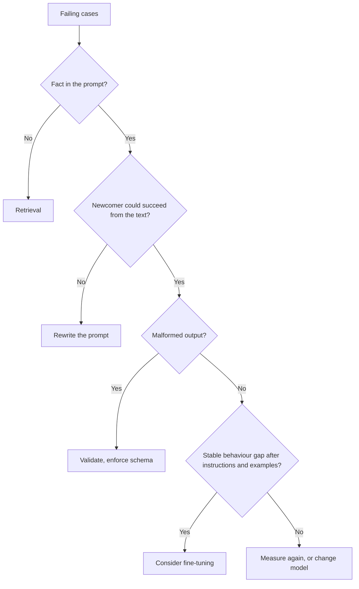

# Чек-лист ревью промпта: цена, рычаги и спорные советы

Этап 10 в сжатом виде для быстрого поиска. [Урок 22](../lessons/0022-prompt-rag-or-fine-tune.md) рассказывает о выборе рычага, [урок 23](../lessons/0023-reviewing-a-production-prompt.md) о ревью и об изменении промпта, от которого зависят другие, а [урок 24](../lessons/0024-when-the-usual-advice-is-wrong.md) о разрешении спорных советов.

## Вопросы для ревью

Назовите цену, затем задайте вопрос, который её прояснит.

| Выбор в промпте | Цена | Вопрос |
|---|---|---|
| Значение для запроса стоит рано | Ломает кешируемый префикс | Что первым меняется от запроса к запросу? |
| Few-shot-примеры | Токены на каждый вызов, смещение по меткам, недавности или порядку | Сбалансированы ли метки? Сдвигает ли перемешивание точность? |
| Недоверенный текст вставлен напрямую | Инъекция, сломанная структура | Какие слоты может задеть посторонний? Есть ли разделители и экранирование? |
| Псевдоним модели вроде «latest» | Поведение меняется без правок | Какой снапшот? |
| Нет регрессионного набора | Каждая правка держится на ощущениях | Какие сбои должны оставаться исправленными? |
| Свободный текст на выходе, который читает программа | Тихие ошибки чтения | Что его проверяет? |
| Персона или подчёркнутые формулировки | Токены, измеренной пользы нет | Что это изменило на регрессионном наборе? |
| Вопрос погребён в длинном контексте | Хуже используется середина | Где стоят документы и вопрос? |

Скажите также, что в порядке и должно остаться. Ревью, перечисляющее только недостатки, сделано наполовину.

## Какой рычаг

| Сбой | Рычаг |
|---|---|
| Неверно читает или игнорирует что-то в промпте | Переписать промпт |
| Выдумывает факты, которых не получал (приватные, свежие, меняющиеся) | Поиск (retrieval) |
| Верно на примерах, но дрейфует в масштабе | Сначала few-shot, затем подумайте о дообучении |
| Инструкции ясны, вывод некорректен | Валидация, структурированный вывод, ограниченное декодирование |
| Нужны вычисления или действие | Инструмент |
| Качество в порядке, но медленно или дорого | Более короткий промпт или другая модель |

В [Ovadia et al.](https://arxiv.org/abs/2312.05934) поиск обошёл неконтролируемое дообучение и по новым, и по уже известным знаниям. Это результат о знаниях, а не о поведении. См. [курс по RAG](../../rag/README.md) и [курс по дообучению](../../finetuning/README.md). Ни поиск, ни дообучение не устраняют промпт-инъекцию, а поиск добавляет косвенный путь.

## Изменение промпта, от которого зависят другие

1. Новый идентификатор версии: текст, снапшот модели и схема вывода как одно целое.
2. Запустите старую и новую версии на регрессионном наборе, парно.
3. Шлюз: ни один случай из числа «нельзя ломать» не падает, а выигрыш больше шума.
4. Относитесь к схеме вывода как к контракту: добавить необязательный ключ обычно безопасно, переименовать метку нельзя.
5. Раскатывайте на малую долю трафика, проверяйте, расширяйте.
6. Откат это «отдавать предыдущую версию», поэтому держите её адресуемой и закреплённой.
7. Предупредите зависимых раньше, чем они увидят изменение.

## Спорные советы

| Совет | Что подтверждает источник | Что проверить по объёму |
|---|---|---|
| Дайте модели роль | [Zheng et al.](https://arxiv.org/abs/2311.10054): нет прироста точности на 2 410 фактологических вопросах, эффект персоны в основном случаен. Anthropic: роль фокусирует поведение и тон | Точность против тона, модели 2023 года |
| Думай шаг за шагом | Anthropic: общие инструкции лучше предписанных шагов при включённом мышлении, просьбу о письменном рассуждении некоторые названные модели могут отклонять | Мышление включено или выключено, какая модель, дата |
| Выделяйте важные правила криком | Anthropic: на Claude Opus 4.5 и 4.6 агрессивные формулировки могут вызывать избыточный вызов инструментов | Две названные модели, срабатывание инструментов |
| Больше примеров | Anthropic: от 3 до 5. [Lu et al.](https://arxiv.org/abs/2104.08786): один лишь порядок может довести результат почти до случайного и не переносится между моделями | Порядок и формат это переменные |

Метод: найдите первичный источник, проверьте модель и дату, проверьте, что именно утверждение покрывает, и протестируйте на регрессионном наборе.
