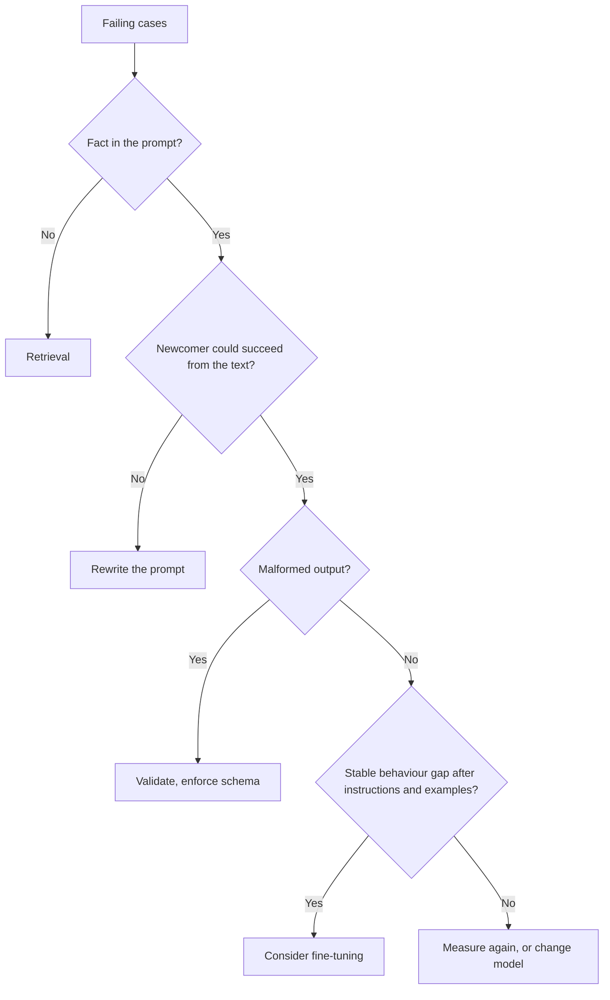

# 提示词评审检查清单：代价、手段与有争议的建议

第 10 阶段的内容，压缩成便于查阅的形式。[第 22 课](../lessons/0022-prompt-rag-or-fine-tune.md)讲如何选择手段，[第 23 课](../lessons/0023-reviewing-a-production-prompt.md)讲评审以及如何修改他人依赖的提示词，[第 24 课](../lessons/0024-when-the-usual-advice-is-wrong.md)讲如何裁定有争议的建议。

## 评审问题

先说出代价，再问能够判定它的那个问题。

| 提示词中的选择 | 代价 | 要问的问题 |
|---|---|---|
| 每次请求都不同的值放在靠前的位置 | 破坏可缓存的前缀 | 请求之间第一个发生变化的是什么？ |
| 少样本示例 | 每次调用的 token、标签偏差、近因偏差或顺序偏差 | 标签是否均衡？打乱顺序会让准确率变化吗？ |
| 不可信的文本直接内联 | 注入、结构被破坏 | 哪些位置可以被外部人员影响？有没有用分隔符包起来并做转义？ |
| 像 “latest” 这样的模型别名 | 没有任何编辑，行为也会改变 | 用的是哪个快照？ |
| 没有回归集 | 每次编辑都只凭感觉 | 哪些失败必须保持已修复？ |
| 由程序读取的自由文本输出 | 悄无声息的误读 | 用什么来验证它？ |
| 人设或强调性措辞 | 耗费 token，却没有测得的收益 | 它在回归集上改变了什么？ |
| 问题埋在长上下文里 | 对中间部分的利用较弱 | 文档和问题分别放在哪里？ |

还要指出哪些做得好、应该保留。只列缺点的评审只做了一半。

## 选哪种手段

| 失败 | 手段 |
|---|---|
| 误读或忽略了提示词中的某些内容 | 重写提示词 |
| 编造了从未给过它的事实（私有的、最新的、会变化的） | 检索 |
| 在示例中是对的，规模上去后就跑偏 | 先用少样本，再考虑 fine-tuning |
| 指令清晰，输出却格式错误 | 验证、结构化输出、约束解码 |
| 需要计算或执行动作 | 工具 |
| 质量没问题，但慢或贵 | 更短的提示词或换一个模型 |

在 [Ovadia 等人](https://arxiv.org/abs/2312.05934)的研究中，无论是新知识还是已有知识，检索都胜过无监督 fine-tuning。这是关于知识的结论，不是关于行为的结论。参见 [RAG 系列](../../rag/README.md)和 [微调系列](../../finetuning/README.md)。检索和 fine-tuning 都不能消除提示词注入，而且检索还会带来一条间接的途径。

## 修改他人依赖的提示词

1. 使用新的版本 ID：文本、模型快照和输出 schema 作为一个整体。
2. 在回归集上以成对的方式运行旧版和新版。
3. 把关：没有任何一个“绝不能破坏”的用例失败，且收益大于噪声。
4. 把输出 schema 当作契约：新增一个可选的键通常是安全的，重命名标签则不是。
5. 先放给一小部分流量，检查后再逐步扩大。
6. 回滚就是“改用上一个版本”，所以要让它保持可寻址并已固定。
7. 在依赖方看到变化之前就告知他们。

## 有争议的建议

| 建议 | 来源能支持的结论 | 需要核对的适用范围 |
|---|---|---|
| 给模型一个角色 | [Zheng 等](https://arxiv.org/abs/2311.10054)：在 2,410 个事实性问题上没有准确率提升，人设的影响基本是随机的。Anthropic：角色能让行为和语气更聚焦 | 准确率还是语气；2023 年的模型 |
| 一步一步地思考 | Anthropic：开启思考时，通用的指令优于规定好的步骤；在某些指明的模型上，要求写出推理可能会被拒绝 | 思考是开还是关；哪个模型；日期 |
| 大喊强调重要规则 | Anthropic：在 Claude Opus 4.5 和 4.6 上，激进的措辞可能导致过度触发工具调用 | 两个指明的模型；工具触发 |
| 示例越多越好 | Anthropic：3 到 5 个。[Lu 等](https://arxiv.org/abs/2104.08786)：仅凭顺序就能让结果摆动到接近随机，而且不能在模型之间迁移 | 顺序和格式都是变量 |

方法：找到一手资料，核对模型和日期，核对论断涵盖的范围，在回归集上测试。
