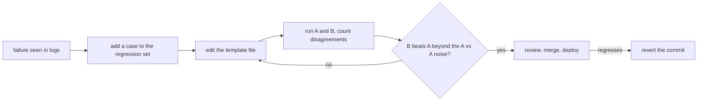

# Prompts en producción: plantillas, versionado, caché y el ciclo de medición

Las etapas 7 y 8 condensadas para consulta rápida: la [lección 15](../lessons/0015-prompt-templates.md) sobre plantillas, la [lección 16](../lessons/0016-versioning-prompts.md) sobre versionado, la [lección 17](../lessons/0017-prompt-caching-and-layout.md) sobre caché y diseño, la [lección 18](../lessons/0018-a-regression-set-for-a-prompt.md) sobre el conjunto de regresión y la [lección 19](../lessons/0019-comparing-two-prompts.md) sobre cómo comparar dos prompts.

## El ciclo

## Reglas de las plantillas

| Regla | Por qué |
|---|---|
| Texto fijo en un archivo, huecos con nombre | El prompt es un dato revisable, no una cadena en el sitio de la llamada |
| Un único `render()` rellena todos los prompts | Un solo lugar donde aplicar escape y fallar ante un hueco faltante |
| Aplica escape a `&`, `<`, `>` en cada valor dentro de una etiqueta | Un valor no puede cerrar ni abrir tus etiquetas |
| Un hueco faltante lanza un error | Nunca se envía un prompt con un hueco |

El escape protege solo la estructura. No es una defensa contra la inyección: consulta la etapa 9.

## Lista de comprobación de versionado

| Elemento | Qué hacer |
|---|---|
| Almacenamiento | Archivo de prompt en git, cargado en tiempo de ejecución, nunca editado en caliente en producción |
| Modelo | ID de modelo exacto en la configuración, no un alias que pueda pasar a un snapshot más nuevo |
| Mensaje de commit | El fallo que se aborda y los casos corregidos o movidos |
| Cambio de modelo | Su propio commit, medido como una edición de prompt |
| Rollback | Revierte el commit: restaura un par probado de prompt y modelo |

Nota sobre la fuente: ninguna fuente revisada por pares cubre esto. Se apoya en la documentación de IDs de modelo de Anthropic (un alias apunta al snapshot con fecha más reciente, un ID fijado no se mueve, cada ID tiene un calendario de retiro) y en la práctica habitual de ingeniería de software.

## Diseño favorable a la caché

| Orden | Contenido | Cambia |
|---|---|---|
| 1 | Definiciones de herramientas | Raramente, y un cambio invalida todo lo que sigue |
| 2 | System prompt | Por versión |
| 3 | Documentos largos, ejemplos few-shot | Por conjunto de documentos |
| 4 | Pregunta, marca de tiempo, valores específicos del usuario | En cada petición |

| Hecho (documentación de Anthropic) | Detalle |
|---|---|
| Orden del prefijo | `tools`, luego `system`, luego `messages`, hasta el bloque marcado |
| Coincidencia | Hash acumulativo: un cambio en el marcador o antes de él rompe la coincidencia |
| El marcador va en | El último bloque idéntico entre peticiones, nunca en un bloque con una marca de tiempo |
| Longitud mínima | De 512 a 4.096 tokens según el modelo; lo más corto queda sin cachear en silencio |
| Comprobar un acierto | `cache_read_input_tokens` mayor que 0 en los campos de uso |
| Duración | 5 minutos por defecto, se renueva en cada lectura, 1 hora con costo adicional |
| Primeras llamadas concurrentes | Una entrada existe solo después de que empieza la primera respuesta |

Para el caso de agentes y concurrencia, consulta la [lección 34 del track de agents](../../agents/lessons/0034-prompt-caching-and-concurrency.md).

## Conjunto de regresión y comparación

| Paso | Qué hacer |
|---|---|
| Construir | Un caso por cada fallo real: la entrada y las aserciones que lo habrían detectado |
| Aserciones | `must_contain`, `must_not_contain`, esquema válido, lo bastante rápidas y baratas para cada cambio |
| Crecer | Añade el caso antes de corregir el prompt y confirma que primero falla |
| Criterio de paso | La tasa de aciertos es una decisión de producto, no necesariamente 100 % |
| Comparar | Los mismos casos, el mismo modelo, solo cambia el prompt |
| Leer | Cuenta los aciertos exclusivos de B y de A, no solo los totales |
| Ruido | Ejecuta A contra A: esos desacuerdos son ruido con temperatura distinta de cero |
| No concluyente | Más ejecuciones o casos, o una prueba de significancia sobre los desacuerdos |

La estadística es la del track de evals: [Go/No-Go](../../evals/reference/go-no-go.md). Si un modelo califica las salidas, calíbralo primero: [lección 5, diseño y calibración del prompt de juez](../../evals/lessons/0005-judge-prompt-design-and-calibration.md).

## Fuentes

- [Docs: "Prompt caching", Claude Platform Docs](https://platform.claude.com/docs/en/build-with-claude/prompt-caching)
- [Docs: "Model IDs and versioning", Claude Platform Docs](https://platform.claude.com/docs/en/about-claude/models/model-ids-and-versions)
- [Article: "Your AI Product Needs Evals", Hamel Husain](https://hamel.dev/blog/posts/evals/)
- [Docs: "Define success criteria and build evaluations", Claude Platform Docs](https://platform.claude.com/docs/en/test-and-evaluate/develop-tests)
- [Recursos](../RESOURCES.md)
