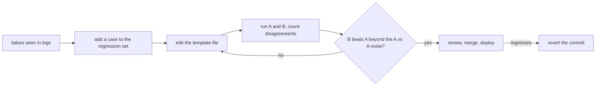

# Prompts en production : gabarits, versionnement, cache et boucle de mesure

Les étapes 7 et 8 condensées pour la consultation : la [leçon 15](../lessons/0015-prompt-templates.md) sur les gabarits, la [leçon 16](../lessons/0016-versioning-prompts.md) sur le versionnement, la [leçon 17](../lessons/0017-prompt-caching-and-layout.md) sur le cache et la disposition, la [leçon 18](../lessons/0018-a-regression-set-for-a-prompt.md) sur le jeu de régression et la [leçon 19](../lessons/0019-comparing-two-prompts.md) sur la comparaison de deux prompts.

## La boucle

## Règles des gabarits

| Règle | Pourquoi |
|---|---|
| Texte fixe dans un fichier, emplacements nommés | Le prompt est une donnée relisible, pas une chaîne à un site d'appel |
| Un seul `render()` remplit chaque prompt | Un seul endroit pour échapper et pour échouer sur un emplacement manquant |
| Échapper `&`, `<`, `>` dans chaque valeur placée dans une balise | Une valeur ne peut ni fermer ni ouvrir vos balises |
| Un emplacement manquant lève une erreur | Un prompt avec un trou n'est jamais envoyé |

L'échappement ne protège que la structure. Ce n'est pas une défense contre l'injection : voir l'étape 9.

## Liste de contrôle du versionnement

| Élément | À faire |
|---|---|
| Stockage | Fichier de prompt dans git, chargé à l'exécution, jamais modifié sur place en production |
| Modèle | Identifiant de modèle exact dans la configuration, pas un alias qui peut passer à un snapshot plus récent |
| Message de commit | L'échec traité et les cas corrigés ou déplacés |
| Changement de modèle | Son propre commit, mesuré comme une modification de prompt |
| Retour en arrière | Annuler le commit : il restaure une paire testée de prompt et de modèle |

Note sur la source : aucune source évaluée par les pairs ne couvre ce sujet. Il repose sur la documentation des identifiants de modèle d'Anthropic (un alias pointe vers le dernier snapshot daté, un identifiant épinglé ne bouge pas, chaque identifiant a un calendrier de retrait) et sur la pratique logicielle ordinaire.

## Disposition adaptée au cache

| Ordre | Contenu | Change |
|---|---|---|
| 1 | Définitions d'outils | Rarement, et une modification invalide tout ce qui suit |
| 2 | System prompt | À chaque version livrée |
| 3 | Longs documents, exemples few-shot | À chaque ensemble de documents |
| 4 | Question, horodatage, valeurs propres à l'utilisateur | À chaque requête |

| Fait (documentation d'Anthropic) | Détail |
|---|---|
| Ordre du préfixe | `tools`, puis `system`, puis `messages`, jusqu'au bloc marqué |
| Correspondance | Hash cumulatif : une modification au niveau du marqueur ou avant rompt la correspondance |
| Le marqueur se place sur | Le dernier bloc identique d'une requête à l'autre, jamais sur un bloc contenant un horodatage |
| Longueur minimale | De 512 à 4 096 tokens selon le modèle, plus court est silencieusement non mis en cache |
| Vérifier un hit | `cache_read_input_tokens` supérieur à 0 dans les champs d'usage |
| Durée de vie | 5 minutes par défaut, rafraîchie à chaque lecture, 1 heure moyennant un coût supplémentaire |
| Premiers appels concurrents | Une entrée n'existe qu'une fois la première réponse commencée |

Pour le cas des agents et de la concurrence, voir la [leçon 34 du parcours agents](../../agents/lessons/0034-prompt-caching-and-concurrency.md).

## Jeu de régression et comparaison

| Étape | À faire |
|---|---|
| Construire | Un cas par vrai échec : l'entrée et les assertions qui l'auraient détecté |
| Assertions | `must_contain`, `must_not_contain`, schéma valide, assez rapides et peu coûteuses pour chaque modification |
| Faire croître | Ajouter le cas avant de corriger le prompt, et confirmer qu'il échoue d'abord |
| Barrière | Le taux de réussite est une décision produit, pas nécessairement 100 % |
| Comparer | Mêmes cas, même modèle, seul le prompt diffère |
| Lire | Compter les réussites propres à B et propres à A, pas seulement les totaux |
| Bruit | Exécuter A contre A : ces désaccords sont du bruit à température non nulle |
| Non concluant | Davantage d'exécutions ou de cas, ou un test de significativité sur les désaccords |

Les statistiques relèvent du parcours évaluations : [fiche go/no-go](../../evals/reference/go-no-go.md). Si un modèle note les sorties, calibrez-le d'abord : [leçon 5, conception et calibration d'un prompt de juge](../../evals/lessons/0005-judge-prompt-design-and-calibration.md).

## Sources

- [Doc : "Prompt caching", Claude Platform Docs](https://platform.claude.com/docs/en/build-with-claude/prompt-caching)
- [Doc : "Model IDs and versioning", Claude Platform Docs](https://platform.claude.com/docs/en/about-claude/models/model-ids-and-versions)
- [Billet : "Your AI Product Needs Evals", Hamel Husain](https://hamel.dev/blog/posts/evals/)
- [Doc : "Define success criteria and build evaluations", Claude Platform Docs](https://platform.claude.com/docs/en/test-and-evaluate/develop-tests)
- [Ressources](../RESOURCES.md)
