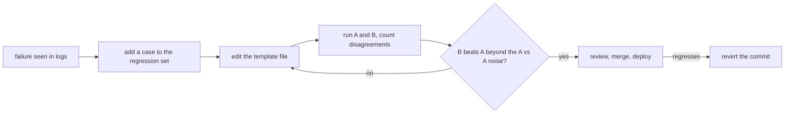

# Production में Prompts: Templates, Versioning, Caching और माप का चक्र

चरण 7 और 8 का संक्षिप्त रूप, खोजने के लिए: templates पर [पाठ 15](../lessons/0015-prompt-templates.md), versioning पर [पाठ 16](../lessons/0016-versioning-prompts.md), caching और layout पर [पाठ 17](../lessons/0017-prompt-caching-and-layout.md), regression set पर [पाठ 18](../lessons/0018-a-regression-set-for-a-prompt.md) और दो prompts की तुलना पर [पाठ 19](../lessons/0019-comparing-two-prompts.md)।

## चक्र

## Template के नियम

| नियम | क्यों |
|---|---|
| स्थिर text file में, slots के नाम तय | Prompt review लायक data है, call site की string नहीं |
| एक `render()` हर prompt भरता है | Escape करने और ग़ायब slot पर विफल होने की एक जगह |
| Tag के भीतर हर मान में `&`, `<`, `>` को escape करें | कोई मान आपके tags को बंद या खोल नहीं सकता |
| ग़ायब slot त्रुटि उठाता है | छेद वाला prompt कभी नहीं भेजा जाता |

Escaping सिर्फ़ structure की रक्षा करती है। यह injection के ख़िलाफ़ बचाव नहीं है: चरण 9 देखें।

## Versioning checklist

| बिंदु | करें |
|---|---|
| Storage | Prompt file git में, runtime पर load, production में कभी जगह पर edit नहीं |
| Model | Config में सटीक model ID, ऐसा alias नहीं जो नए snapshot की ओर खिसक सके |
| Commit message | जिस विफलता को संबोधित किया और जो cases ठीक हुए या खिसके |
| Model का बदलाव | अपना अलग commit, prompt edit की तरह मापा हुआ |
| Rollback | Commit को revert करें: यह prompt और model की परखी हुई जोड़ी बहाल करता है |

स्रोत नोट: कोई peer-reviewed स्रोत इसे कवर नहीं करता। यह Anthropic के model-ID दस्तावेज़ (alias सबसे हाल के dated snapshot की ओर इशारा करता है, pin की हुई ID नहीं खिसकती, हर ID का retirement schedule है) और सामान्य software अभ्यास पर टिका है।

## Cache-friendly layout

| क्रम | Content | कब बदलता है |
|---|---|---|
| 1 | Tool definitions | कभी-कभार, और बदलाव उसके बाद की हर चीज़ को अमान्य करता है |
| 2 | System prompt | हर release पर |
| 3 | लंबे documents, few-shot examples | हर document सेट पर |
| 4 | सवाल, timestamp, उपयोगकर्ता-विशिष्ट मान | हर request पर |

| तथ्य (Anthropic का दस्तावेज़) | ब्योरा |
|---|---|
| Prefix का क्रम | `tools`, फिर `system`, फिर `messages`, चिह्नित block तक |
| Match | संचयी hash: marker पर या उससे पहले का बदलाव match तोड़ देता है |
| Marker कहाँ जाता है | आख़िरी block जो requests के बीच एक जैसा है, timestamp वाले block पर कभी नहीं |
| न्यूनतम लंबाई | Model के हिसाब से 512 से 4,096 tokens, छोटा चुपचाप बिना cache के |
| Hit जाँचें | Usage fields में `cache_read_input_tokens` का 0 से ऊपर होना |
| जीवनकाल | डिफ़ॉल्ट 5 मिनट, हर read पर ताज़ा, अतिरिक्त लागत पर 1 घंटा |
| Concurrent पहली calls | Entry पहला response शुरू होने के बाद ही बनती है |

Agent और concurrency के मामले के लिए, [agents track का पाठ 34](../../agents/lessons/0034-prompt-caching-and-concurrency.md) देखें।

## Regression set और तुलना

| चरण | करें |
|---|---|
| बनाएँ | हर असली विफलता के लिए एक case: input और वे assertions जो उसे पकड़ लेते |
| Assertions | `must_contain`, `must_not_contain`, schema वैध, हर बदलाव के लिए पर्याप्त तेज़ और सस्ते |
| बढ़ाएँ | Prompt ठीक करने से पहले case जोड़ें, और पुष्टि करें कि वह पहले विफल होता है |
| Gate | Pass rate product का फ़ैसला है, ज़रूरी नहीं कि 100% |
| तुलना | वही cases, वही model, सिर्फ़ prompt अलग |
| पढ़ें | सिर्फ़ कुल नहीं, B-only और A-only passes गिनें |
| Noise | A को A के सामने चलाएँ: वे असहमतियाँ शून्य से ज़्यादा temperature पर noise हैं |
| अनिर्णायक | ज़्यादा runs या cases, या असहमतियों पर significance test |

सांख्यिकी evals track की है: [go/no-go sheet](../../evals/reference/go-no-go.md)। अगर कोई model outputs को grade करता है, तो पहले उसे calibrate करें: [पाठ 5, judge-prompt का डिज़ाइन और calibration](../../evals/lessons/0005-judge-prompt-design-and-calibration.md)।

## स्रोत

- [Docs: "Prompt caching", Claude Platform Docs](https://platform.claude.com/docs/en/build-with-claude/prompt-caching)
- [Docs: "Model IDs and versioning", Claude Platform Docs](https://platform.claude.com/docs/en/about-claude/models/model-ids-and-versions)
- [Article: "Your AI Product Needs Evals", Hamel Husain](https://hamel.dev/blog/posts/evals/)
- [Docs: "Define success criteria and build evaluations", Claude Platform Docs](https://platform.claude.com/docs/en/test-and-evaluate/develop-tests)
- [संसाधन](../RESOURCES.md)
