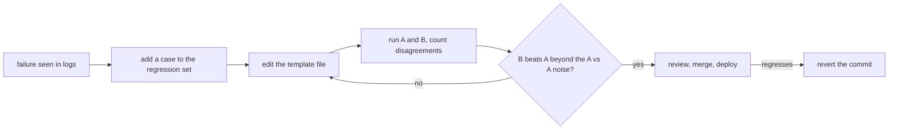

# Prompts in Production: Templates, Versioning, Caching and the Measurement Loop

Stages 7 and 8 compressed for lookup: [lesson 15](../lessons/0015-prompt-templates.md) on templates, [lesson 16](../lessons/0016-versioning-prompts.md) on versioning, [lesson 17](../lessons/0017-prompt-caching-and-layout.md) on caching and layout, [lesson 18](../lessons/0018-a-regression-set-for-a-prompt.md) on the regression set and [lesson 19](../lessons/0019-comparing-two-prompts.md) on comparing two prompts.

## The loop

## Template rules

| Rule | Why |
|---|---|
| Fixed text in a file, slots named | The prompt is reviewable data, not a string at a call site |
| One `render()` fills every prompt | One place to escape and to fail on a missing slot |
| Escape `&`, `<`, `>` in every value inside a tag | A value cannot close or open your tags |
| A missing slot raises an error | A prompt with a hole is never sent |

Escaping protects structure only. It is not a defence against injection: see stage 9.

## Versioning checklist

| Item | Do |
|---|---|
| Storage | Prompt file in git, loaded at runtime, never edited in place in production |
| Model | Exact model ID in config, not an alias that can move to a newer snapshot |
| Commit message | The failure addressed and the cases fixed or moved |
| Model change | Its own commit, measured like a prompt edit |
| Rollback | Revert the commit: it restores a tested pair of prompt and model |

Source note: no peer-reviewed source covers this. It rests on Anthropic's model-ID documentation (an alias points to the latest dated snapshot, a pinned ID does not move, every ID has a retirement schedule) and ordinary software practice.

## Cache-friendly layout

| Order | Content | Changes |
|---|---|---|
| 1 | Tool definitions | Rarely, and a change invalidates everything after |
| 2 | System prompt | Per release |
| 3 | Long documents, few-shot examples | Per document set |
| 4 | Question, timestamp, user-specific values | Every request |

| Fact (Anthropic's documentation) | Detail |
|---|---|
| Prefix order | `tools`, then `system`, then `messages`, up to the marked block |
| Match | Cumulative hash: a change at or before the marker breaks the match |
| Marker goes on | The last block identical across requests, never on a block with a timestamp |
| Minimum length | 512 to 4,096 tokens depending on model, shorter silently uncached |
| Check a hit | `cache_read_input_tokens` above 0 in the usage fields |
| Lifetime | 5 minutes by default, refreshed on each read, 1 hour at extra cost |
| Concurrent first calls | An entry exists only after the first response begins |

For the agent and concurrency case, see [lesson 34 of the agents track](../../agents/lessons/0034-prompt-caching-and-concurrency.md).

## Regression set and comparison

| Step | Do |
|---|---|
| Build | One case per real failure: the input and the assertions that would have caught it |
| Assertions | `must_contain`, `must_not_contain`, schema valid, fast and cheap enough for every change |
| Grow | Add the case before you fix the prompt, and confirm it fails first |
| Gate | Pass rate is a product decision, not necessarily 100% |
| Compare | Same cases, same model, only the prompt differs |
| Read | Count B-only and A-only passes, not just the totals |
| Noise | Run A against A: those disagreements are noise at nonzero temperature |
| Inconclusive | More runs or cases, or a significance test on the disagreements |

The statistics are the evals track's: [go/no-go sheet](../../evals/reference/go-no-go.md). If a model grades the outputs, calibrate it first: [lesson 5, judge-prompt design and calibration](../../evals/lessons/0005-judge-prompt-design-and-calibration.md).

## Sources

- [Docs: "Prompt caching", Claude Platform Docs](https://platform.claude.com/docs/en/build-with-claude/prompt-caching)
- [Docs: "Model IDs and versioning", Claude Platform Docs](https://platform.claude.com/docs/en/about-claude/models/model-ids-and-versions)
- [Article: "Your AI Product Needs Evals", Hamel Husain](https://hamel.dev/blog/posts/evals/)
- [Docs: "Define success criteria and build evaluations", Claude Platform Docs](https://platform.claude.com/docs/en/test-and-evaluate/develop-tests)
- [Resources](../RESOURCES.md)
