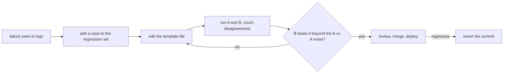

# Prompts em Produção: Templates, Versionamento, Caching e o Ciclo de Medição

Os estágios 7 e 8 condensados para consulta: a [lição 15](../lessons/0015-prompt-templates.md) sobre templates, a [lição 16](../lessons/0016-versioning-prompts.md) sobre versionamento, a [lição 17](../lessons/0017-prompt-caching-and-layout.md) sobre caching e layout, a [lição 18](../lessons/0018-a-regression-set-for-a-prompt.md) sobre o conjunto de regressão e a [lição 19](../lessons/0019-comparing-two-prompts.md) sobre comparar dois prompts.

## O ciclo

## Regras de template

| Regra | Por quê |
|---|---|
| Texto fixo em um arquivo, slots nomeados | O prompt é um dado revisável, não uma string no ponto da chamada |
| Um único `render()` preenche todo prompt | Um só lugar para fazer escape e para falhar diante de um slot ausente |
| Faça escape de `&`, `<`, `>` em todo valor dentro de uma tag | Um valor não consegue fechar nem abrir as suas tags |
| Um slot ausente gera um erro | Um prompt com um buraco nunca é enviado |

O escape protege apenas a estrutura. Ele não é uma defesa contra injeção: veja o estágio 9.

## Checklist de versionamento

| Item | Faça |
|---|---|
| Armazenamento | Arquivo de prompt no git, carregado em tempo de execução, nunca editado no lugar em produção |
| Modelo | ID exato do modelo na configuração, não um alias que possa passar para um snapshot mais novo |
| Mensagem de commit | A falha tratada e os casos corrigidos ou movidos |
| Mudança de modelo | Seu próprio commit, medida como uma edição de prompt |
| Rollback | Reverta o commit: ele restaura um par testado de prompt e modelo |

Nota sobre a fonte: nenhuma fonte revisada por pares cobre isso. Ele se apoia na documentação de IDs de modelo da Anthropic (um alias aponta para o snapshot datado mais recente, um ID fixado não se move, todo ID tem um cronograma de aposentadoria) e na prática comum de software.

## Layout amigável ao cache

| Ordem | Conteúdo | Muda |
|---|---|---|
| 1 | Definições de ferramentas | Raramente, e uma mudança invalida tudo o que vem depois |
| 2 | System prompt | A cada release |
| 3 | Documentos longos, exemplos few-shot | A cada conjunto de documentos |
| 4 | Pergunta, timestamp, valores específicos do usuário | A cada requisição |

| Fato (documentação da Anthropic) | Detalhe |
|---|---|
| Ordem do prefixo | `tools`, depois `system`, depois `messages`, até o bloco marcado |
| Correspondência | Hash cumulativo: uma mudança no marcador ou antes dele quebra a correspondência |
| O marcador vai em | O último bloco idêntico entre as requisições, nunca em um bloco com timestamp |
| Tamanho mínimo | De 512 a 4.096 tokens, conforme o modelo; abaixo disso, fica sem cache silenciosamente |
| Verificar um hit | `cache_read_input_tokens` acima de 0 nos campos de uso |
| Duração | 5 minutos por padrão, renovados a cada leitura, 1 hora com custo extra |
| Primeiras chamadas concorrentes | Uma entrada só existe depois que a primeira resposta começa |

Para o caso de agentes e de concorrência, veja a [lição 34 da trilha de agentes](../../agents/lessons/0034-prompt-caching-and-concurrency.md).

## Conjunto de regressão e comparação

| Passo | Faça |
|---|---|
| Construir | Um caso por falha real: a entrada e as asserções que a teriam detectado |
| Asserções | `must_contain`, `must_not_contain`, schema válido, rápidas e baratas o bastante para toda mudança |
| Crescer | Adicione o caso antes de corrigir o prompt e confirme que ele falha primeiro |
| Portão | A taxa de aprovação é uma decisão de produto, não necessariamente 100% |
| Comparar | Mesmos casos, mesmo modelo, só o prompt difere |
| Ler | Conte as aprovações só de B e só de A, não apenas os totais |
| Ruído | Rode A contra A: essas divergências são ruído com temperatura diferente de zero |
| Inconclusivo | Mais execuções ou casos, ou um teste de significância sobre as divergências |

A estatística fica na trilha de evals: [Go/No-Go](../../evals/reference/go-no-go.md). Se um modelo avalia as saídas, calibre-o primeiro: [lição 5 da trilha de evals](../../evals/lessons/0005-judge-prompt-design-and-calibration.md).

## Fontes

- [Docs: "Prompt caching", Claude Platform Docs](https://platform.claude.com/docs/en/build-with-claude/prompt-caching)
- [Docs: "Model IDs and versioning", Claude Platform Docs](https://platform.claude.com/docs/en/about-claude/models/model-ids-and-versions)
- [Artigo: "Your AI Product Needs Evals", Hamel Husain](https://hamel.dev/blog/posts/evals/)
- [Docs: "Define success criteria and build evaluations", Claude Platform Docs](https://platform.claude.com/docs/en/test-and-evaluate/develop-tests)
- [Recursos](../RESOURCES.md)
