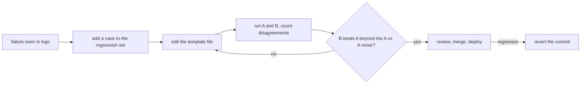

# Промпты в продакшене: шаблоны, версионирование, кеширование и цикл измерений

Этапы 7 и 8 в сжатом виде для быстрого поиска: [урок 15](../lessons/0015-prompt-templates.md) о шаблонах, [урок 16](../lessons/0016-versioning-prompts.md) о версионировании, [урок 17](../lessons/0017-prompt-caching-and-layout.md) о кешировании и раскладке, [урок 18](../lessons/0018-a-regression-set-for-a-prompt.md) о регрессионном наборе и [урок 19](../lessons/0019-comparing-two-prompts.md) о сравнении двух промптов.

## Цикл

## Правила для шаблонов

| Правило | Зачем |
|---|---|
| Неизменяемый текст в файле, слоты названы | Промпт это данные, доступные для ревью, а не строка в месте вызова |
| Один `render()` заполняет каждый промпт | Одно место для экранирования и для сбоя при отсутствующем слоте |
| Экранируйте `&`, `<`, `>` в каждом значении внутри тега | Значение не может закрыть или открыть ваши теги |
| Отсутствующий слот вызывает ошибку | Промпт с дырой никогда не отправляется |

Экранирование защищает только структуру. Это не защита от инъекции: см. этап 9.

## Чек-лист версионирования

| Пункт | Что делать |
|---|---|
| Хранение | Файл промпта в git, загружается во время выполнения, никогда не правится на месте в продакшене |
| Модель | Точный идентификатор модели в конфигурации, а не псевдоним, который может перескочить на более новый снапшот |
| Сообщение коммита | Какой сбой исправлен и какие случаи починены или сдвинулись |
| Смена модели | Отдельный коммит, измеряется как правка промпта |
| Откат | Отмена коммита: она возвращает проверенную пару из промпта и модели |

Примечание об источниках: рецензируемого источника по этому вопросу нет. Рекомендации опираются на документацию Anthropic об идентификаторах моделей (псевдоним указывает на последний датированный снапшот, закреплённый идентификатор не сдвигается, у каждого идентификатора есть график вывода из эксплуатации) и на обычную практику разработки ПО.

## Раскладка с учётом кеша

| Порядок | Содержимое | Как часто меняется |
|---|---|---|
| 1 | Определения инструментов | Редко, а изменение обесценивает всё после него |
| 2 | Системный промпт | С каждым релизом |
| 3 | Длинные документы, few-shot-примеры | С каждым набором документов |
| 4 | Вопрос, метка времени, значения конкретного пользователя | В каждом запросе |

| Факт (документация Anthropic) | Подробности |
|---|---|
| Порядок префикса | `tools`, затем `system`, затем `messages`, до отмеченного блока |
| Совпадение | Накопительный хеш: изменение в маркере или до него ломает совпадение |
| Маркер ставят на | Последний блок, одинаковый во всех запросах, и никогда на блок с меткой времени |
| Минимальная длина | От 512 до 4 096 токенов в зависимости от модели, более короткое молча не кешируется |
| Как проверить попадание | `cache_read_input_tokens` больше 0 в полях usage |
| Время жизни | По умолчанию 5 минут, продлевается при каждом чтении, 1 час за дополнительную плату |
| Одновременные первые вызовы | Запись появляется только после того, как начался первый ответ |

О случае агента и конкурентности см. [урок 34 курса по агентам](../../agents/lessons/0034-prompt-caching-and-concurrency.md).

## Регрессионный набор и сравнение

| Шаг | Что делать |
|---|---|
| Построить | Один случай на каждый реальный сбой: вход и проверки, которые бы его поймали |
| Проверки | `must_contain`, `must_not_contain`, валидность схемы, достаточно быстрые и дешёвые для каждого изменения |
| Растить | Добавляйте случай до исправления промпта и сначала убедитесь, что он падает |
| Шлюз | Доля прохождения это продуктовое решение, не обязательно 100% |
| Сравнить | Те же случаи, та же модель, различается только промпт |
| Читать | Считайте проходы только у B и только у A, а не одни итоги |
| Шум | Запустите A против A: эти расхождения и есть шум при ненулевой температуре |
| Неубедительно | Больше запусков или случаев, или тест значимости на расхождениях |

Статистика относится к курсу по оценке: [шпаргалку «Выпускать или нет»](../../evals/reference/go-no-go.md). Если выводы оценивает модель, сначала откалибруйте её: [урок 5, проектирование и калибровка промпта судьи](../../evals/lessons/0005-judge-prompt-design-and-calibration.md).

## Источники

- [Docs: "Prompt caching", Claude Platform Docs](https://platform.claude.com/docs/en/build-with-claude/prompt-caching)
- [Docs: "Model IDs and versioning", Claude Platform Docs](https://platform.claude.com/docs/en/about-claude/models/model-ids-and-versions)
- [Article: "Your AI Product Needs Evals", Hamel Husain](https://hamel.dev/blog/posts/evals/)
- [Docs: "Define success criteria and build evaluations", Claude Platform Docs](https://platform.claude.com/docs/en/test-and-evaluate/develop-tests)
- [Ресурсы](../RESOURCES.md)
