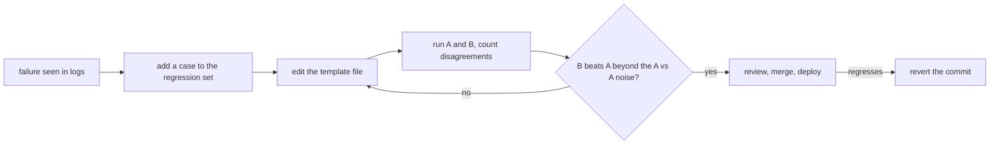

# 生产环境中的提示词：模板、版本管理、缓存与度量闭环

第 7、8 阶段的内容，压缩成便于查阅的形式：[第 15 课](../lessons/0015-prompt-templates.md)讲模板，[第 16 课](../lessons/0016-versioning-prompts.md)讲版本管理，[第 17 课](../lessons/0017-prompt-caching-and-layout.md)讲缓存与布局，[第 18 课](../lessons/0018-a-regression-set-for-a-prompt.md)讲回归集，[第 19 课](../lessons/0019-comparing-two-prompts.md)讲比较两个提示词。

## 闭环

## 模板规则

| 规则 | 原因 |
|---|---|
| 固定文本放在文件里，槽位有名字 | 提示词是可以评审的数据，而不是散落在调用处的字符串 |
| 由一个 `render()` 填充所有提示词 | 只有一处负责转义，也只有一处在槽位缺失时报错 |
| 标签内的每个值都要转义 `&`、`<`、`>` | 值无法关闭或打开你的标签 |
| 槽位缺失就抛出错误 | 绝不会发出带有空洞的提示词 |

转义只保护结构，它不是对注入的防御：见第 9 阶段。

## 版本管理检查清单

| 项目 | 做法 |
|---|---|
| 存储 | 提示词文件放在 git 中，运行时加载，绝不在生产环境中就地编辑 |
| 模型 | 在配置中写明确切的模型 ID，而不是可能指向更新快照的别名 |
| 提交信息 | 写明所处理的失败，以及被修复或发生变化的用例 |
| 更换模型 | 单独一次提交，像对待提示词编辑那样去度量 |
| 回滚 | 回退该提交：它恢复的是一对经过测试的提示词与模型 |

来源说明：没有同行评审的资料涵盖这部分内容。它依据的是 Anthropic 的模型 ID 文档（别名指向最新的带日期快照，固定的 ID 不会移动，每个 ID 都有退役时间表）和普通的软件工程实践。

## 对缓存友好的布局

| 顺序 | 内容 | 变化频率 |
|---|---|---|
| 1 | 工具定义 | 很少变，且一旦变化，其后的内容全部失效 |
| 2 | 系统提示词 | 每次发布 |
| 3 | 长文档、少样本示例 | 每组文档 |
| 4 | 问题、时间戳、与用户相关的值 | 每次请求 |

| 事实（Anthropic 文档） | 细节 |
|---|---|
| 前缀顺序 | 先 `tools`，再 `system`，再 `messages`，直到被标记的块 |
| 匹配 | 累积哈希：标记处或其之前的任何改动都会使匹配失败 |
| 标记放在 | 各次请求之间完全相同的最后一个块上，绝不放在带时间戳的块上 |
| 最小长度 | 视模型而定，为 512 到 4,096 个 token，更短的内容会悄悄地不被缓存 |
| 检查是否命中 | 用量字段中的 `cache_read_input_tokens` 大于 0 |
| 有效期 | 默认 5 分钟，每次读取都会刷新，也可以额外付费换成 1 小时 |
| 并发的首次调用 | 只有第一个响应开始之后，缓存条目才存在 |

关于智能体和并发的情形，见[智能体系列第 34 课：提示词缓存与并发](../../agents/lessons/0034-prompt-caching-and-concurrency.md)。

## 回归集与比较

| 步骤 | 做法 |
|---|---|
| 构建 | 每个真实失败对应一个用例：输入，以及本可以抓住该失败的断言 |
| 断言 | `must_contain`、`must_not_contain`、schema 有效，足够快、足够便宜，可以在每次改动时运行 |
| 增长 | 在修改提示词之前先加上用例，并先确认它会失败 |
| 把关 | 通过率是一个产品决策，不一定要 100% |
| 比较 | 相同的用例、相同的模型，只有提示词不同 |
| 解读 | 统计只有 B 通过的和只有 A 通过的数量，而不是只看总数 |
| 噪声 | 让 A 与 A 对比：在温度不为零时，这些不一致就是噪声 |
| 无定论 | 增加运行次数或用例，或对这些不一致做显著性检验 |

统计方法属于评测课程：[上线与否速查表](../../evals/reference/go-no-go.md)。如果由模型给输出打分，先校准它：[评测系列第 5 课：裁判提示词的设计与校准](../../evals/lessons/0005-judge-prompt-design-and-calibration.md)。

## 来源

- [文档：“Prompt caching”，Claude Platform Docs](https://platform.claude.com/docs/en/build-with-claude/prompt-caching)
- [文档：“Model IDs and versioning”，Claude Platform Docs](https://platform.claude.com/docs/en/about-claude/models/model-ids-and-versions)
- [文章：“Your AI Product Needs Evals”，Hamel Husain](https://hamel.dev/blog/posts/evals/)
- [文档：“Define success criteria and build evaluations”，Claude Platform Docs](https://platform.claude.com/docs/en/test-and-evaluate/develop-tests)
- [资源](../RESOURCES.md)
