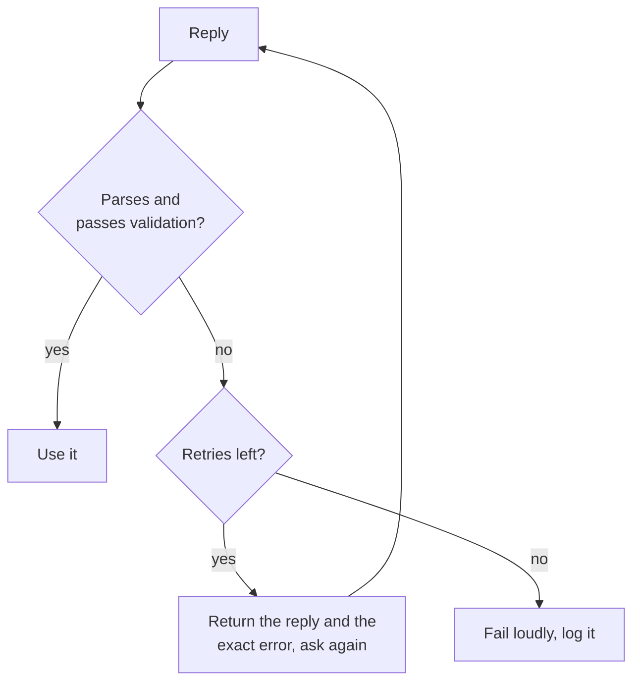

# Salida estructurada y contexto largo: esquemas, orden de campos, diseño

Las etapas 5 y 6 condensadas para consulta rápida. La [lección 11](../lessons/0011-structured-output-from-the-prompt.md) cubre cómo pedir un esquema y validarlo, la [lección 12](../lessons/0012-format-constraints-and-reasoning.md) el costo de las restricciones de formato sobre el razonamiento, la [lección 13](../lessons/0013-position-in-long-context.md) la posición en un contexto largo y la [lección 14](../lessons/0014-working-with-long-documents.md) cómo etiquetar documentos y citar primero.

## Pedir salida estructurada

| Incluye | Por qué |
|---|---|
| Cada campo con una descripción breve | El modelo no puede adivinar qué significa un campo |
| Los valores permitidos de cualquier campo de conjunto fijo | Sin ellos los valores se desvían |
| Una respuesta de ejemplo completa | El ejemplo transmite el formato |
| "Un objeto JSON y nada más" | Un parser falla ante cualquier texto alrededor del objeto |

Pedir es una solicitud, no una garantía. Siempre haz el parsing y luego valida claves, tipos y valores permitidos.



## Pedido frente a forzado

| | Pedido en el prompt | Forzado por una función del proveedor |
|---|---|---|
| Cómo | Instrucciones, lista de campos, ejemplo | Esquema pasado a la API (Anthropic: `output_config.format`) |
| Garantía | Ninguna, así que valida y reintenta | Coincidencia con el esquema en la mayoría de los casos |
| Aun así comprueba | Todo | Rechazos, respuestas cortadas en el límite de tokens, mayúsculas en los enum |

El lado del servicio de la imposición: [Muestreo y decodificación restringida en tiempo de servicio](../../inference/lessons/0019-sampling-and-constrained-decoding-at-serve-time.md).

## Restricciones de formato y razonamiento

| Configuración (Tam et al., 2024) | Qué es | En tareas de razonamiento |
|---|---|---|
| JSON-mode | Decodificación restringida | La peor en la mayoría de los casos |
| Instrucciones que restringen el formato | El prompt pide un formato y un esquema | Entre las dos |
| NL-to-Format | Responder en lenguaje natural y luego convertir | Casi igual que sin restricciones |

- En tareas de clasificación, la decodificación restringida puede mejorar la precisión, así que el costo depende de la tarea.
- Pon `reasoning` antes de `answer`: el objeto se escribe de izquierda a derecha.
- Una llamada: primero el campo de razonamiento. Dos llamadas: respuesta en lenguaje natural y luego conversión. Mide ambas en tu tarea.

## Diseño para contexto largo

| Movimiento | Fuente |
|---|---|
| Tratar la parte media como la posición más débil | Liu et al., 2023: curva en forma de U |
| Documentos primero, instrucciones y pregunta después | Guía de Anthropic (proveedor) |
| Consulta al final: hasta un 30 % de mejora en pruebas | Guía de Anthropic (proveedor) |
| Consulta antes y después de los datos para recuperar un solo hecho | Liu et al., 2023, recuperación clave-valor |
| Pasar menos documentos cuando se pueda | Queda menos material en la parte media |

## Documentos largos

```text
<documents>
  <document index="1">
    <source>name-of-source</source>
    <document_content>
      ...text...
    </document_content>
  </document>
</documents>

Find the quotes relevant to the question, numbered, with their source, in <quotes> tags.
If there are none, write "no relevant quotes" and stop.
Then answer using only those quotes, in <answer> tags.
```

- Comprueba cada cita contra los documentos con una búsqueda de cadena; una cita ausente significa que la respuesta no está fundamentada.
- Fragmentos recuperados: [Generación a partir de la recuperación](../../rag/reference/generation-from-retrieval.md).
