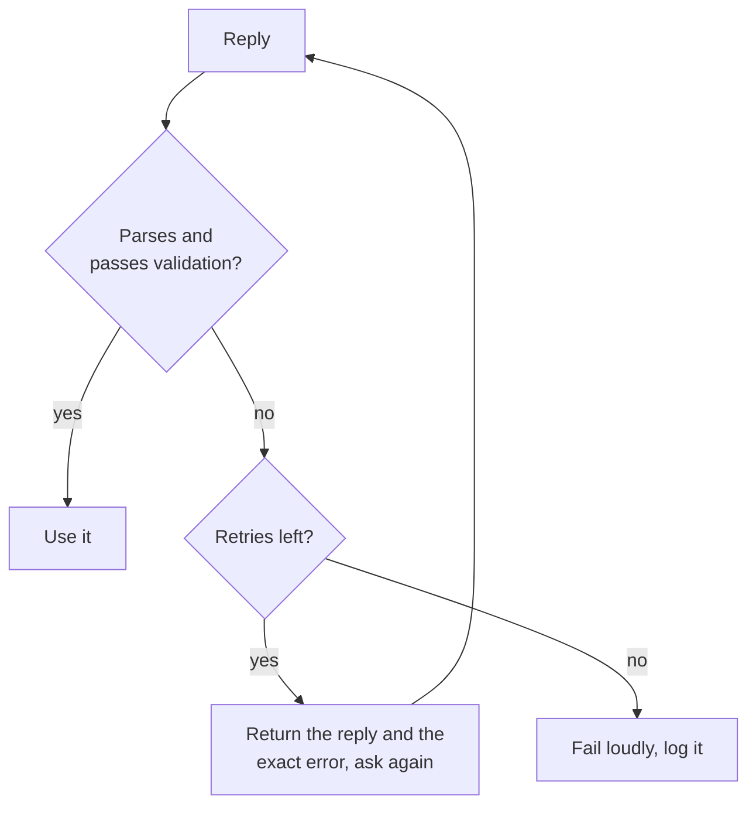

# Sortie structurée et long contexte : schémas, ordre des champs, disposition

Les étapes 5 et 6 condensées pour la consultation. La [leçon 11](../lessons/0011-structured-output-from-the-prompt.md) traite de la demande d'un schéma et de sa validation, la [leçon 12](../lessons/0012-format-constraints-and-reasoning.md) du coût des contraintes de format sur le raisonnement, la [leçon 13](../lessons/0013-position-in-long-context.md) de la position dans un long contexte, et la [leçon 14](../lessons/0014-working-with-long-documents.md) du balisage des documents et de la citation d'abord.

## Demander une sortie structurée

| À inclure | Pourquoi |
|---|---|
| Chaque champ avec une courte description | Le modèle ne peut pas deviner ce que signifie un champ |
| Les valeurs autorisées de tout champ à ensemble fixe | Sans elles, les valeurs dérivent |
| Un exemple complet de réponse | L'exemple porte le format |
| « One JSON object and nothing else » | Un parseur échoue sur tout texte autour de l'objet |

Demander est une requête, pas une garantie. Analysez toujours, puis validez les clés, les types et les valeurs autorisées.



## Demandé contre imposé

| | Demandé dans le prompt | Imposé par une fonctionnalité de fournisseur |
|---|---|---|
| Comment | Instructions, liste de champs, exemple | Schéma passé à l'API (Anthropic : `output_config.format`) |
| Garantie | Aucune, donc valider et réessayer | Correspondance au schéma dans la plupart des cas |
| À vérifier quand même | Tout | Refus, réponses coupées à la limite de tokens, casse des enums |

Côté serving de l'application stricte : [Échantillonnage et décodage contraint au moment du serving](../../inference/lessons/0019-sampling-and-constrained-decoding-at-serve-time.md).

## Contraintes de format et raisonnement

| Configuration (Tam et al., 2024) | Ce que c'est | Sur les tâches de raisonnement |
|---|---|---|
| JSON-mode | Décodage contraint | Le pire dans la plupart des cas |
| Instructions restrictives de format | Le prompt demande un format et un schéma | Entre les deux |
| NL-to-Format | Répondre en langage courant, puis convertir | Presque identique au non restreint |

- Sur les tâches de classification, le décodage contraint peut améliorer la précision : le coût dépend donc de la tâche.
- Placez `reasoning` avant `answer` : l'objet s'écrit de gauche à droite.
- Un appel : champ de raisonnement d'abord. Deux appels : réponse en langage courant, puis conversion. Mesurez les deux sur votre tâche.

## Disposition d'un long contexte

| Geste | Source |
|---|---|
| Traiter le milieu comme la position la plus faible | Liu et al., 2023 : courbe en U |
| Documents d'abord, instructions et question après | Recommandations d'Anthropic (éditeur) |
| Requête à la fin : jusqu'à 30 pour cent d'amélioration dans les tests | Recommandations d'Anthropic (éditeur) |
| Requête avant et après les données pour la récupération d'un fait unique | Liu et al., 2023, récupération clé-valeur |
| Passer moins de documents quand c'est possible | Moins de matière se retrouve au milieu |

## Longs documents

```text
<documents>
  <document index="1">
    <source>name-of-source</source>
    <document_content>
      ...text...
    </document_content>
  </document>
</documents>

Find the quotes relevant to the question, numbered, with their source, in <quotes> tags.
If there are none, write "no relevant quotes" and stop.
Then answer using only those quotes, in <answer> tags.
```

- Vérifiez chaque citation par rapport aux documents par recherche de chaîne ; une citation absente signifie que la réponse n'est pas ancrée.
- Passages récupérés : [Génération à partir de la récupération](../../rag/reference/generation-from-retrieval.md).
