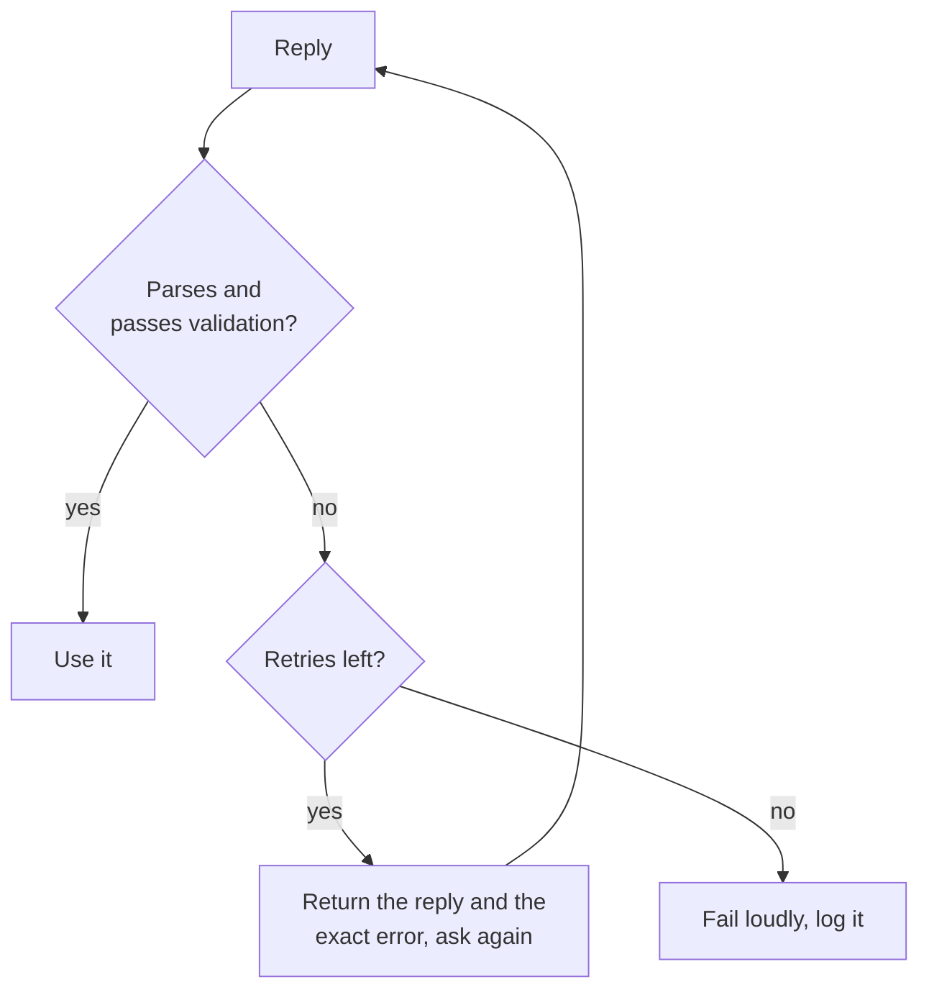

# Structured Output और लंबा Context: Schemas, Fields का क्रम, Layout

चरण 5 और 6 का संक्षिप्त रूप, खोजने के लिए। [पाठ 11](../lessons/0011-structured-output-from-the-prompt.md) schema माँगना और उसे validate करना कवर करता है, [पाठ 12](../lessons/0012-format-constraints-and-reasoning.md) reasoning पर format constraints की क़ीमत, [पाठ 13](../lessons/0013-position-in-long-context.md) लंबे context में position, और [पाठ 14](../lessons/0014-working-with-long-documents.md) documents को tag करना और पहले quote करना।

## Structured output माँगना

| शामिल करें | क्यों |
|---|---|
| हर field, छोटे वर्णन के साथ | Model अंदाज़ा नहीं लगा सकता कि field का मतलब क्या है |
| तय-सेट वाले हर field के अनुमत मान | उनके बिना मान भटकते हैं |
| एक पूरा उदाहरण reply | उदाहरण format ढोता है |
| "One JSON object and nothing else" | Object के आसपास किसी भी text पर parser विफल होता है |

माँगना अनुरोध है, गारंटी नहीं। हमेशा parse करें, फिर keys, types और अनुमत मान validate करें।



## माँगा हुआ बनाम लागू किया हुआ

| | Prompt में माँगा हुआ | Provider के फ़ीचर से लागू |
|---|---|---|
| कैसे | Instructions, field सूची, उदाहरण | API को दिया गया schema (Anthropic: `output_config.format`) |
| गारंटी | कोई नहीं, इसलिए validate और retry करें | ज़्यादातर मामलों में schema का मेल |
| फिर भी जाँचें | सब कुछ | इनकार, token सीमा पर कटे replies, enum capitalization |

Enforcement का serving वाला पक्ष: [Serve समय पर Sampling और Constrained Decoding](../../inference/lessons/0019-sampling-and-constrained-decoding-at-serve-time.md)।

## Format constraints और reasoning

| सेटिंग (Tam et al., 2024) | वह क्या है | Reasoning tasks पर |
|---|---|---|
| JSON-mode | Constrained decoding | ज़्यादातर मामलों में सबसे बुरा |
| Format-restricting instructions | Prompt format और schema माँगता है | दोनों के बीच |
| NL-to-Format | सादी भाषा में उत्तर, फिर बदलना | बिना प्रतिबंध के लगभग बराबर |

- Classification tasks पर constrained decoding accuracy बढ़ा सकती है, इसलिए क़ीमत task पर निर्भर है।
- `reasoning` को `answer` से पहले रखें: object बाएँ से दाएँ लिखा जाता है।
- एक call: reasoning field पहले। दो calls: सादी भाषा का उत्तर, फिर बदलना। अपने task पर दोनों को मापें।

## लंबे context का layout

| क़दम | स्रोत |
|---|---|
| बीच को सबसे कमज़ोर position मानें | Liu et al., 2023: U-आकार का वक्र |
| Documents पहले, instructions और सवाल बाद में | Anthropic की मार्गदर्शिका (vendor) |
| Query अंत में: tests में 30 प्रतिशत तक बेहतर | Anthropic की मार्गदर्शिका (vendor) |
| एक तथ्य निकालने के लिए query data से पहले और बाद में | Liu et al., 2023, key-value retrieval |
| जब हो सके तो कम documents भेजें | बीच में कम सामग्री बैठती है |

## लंबे documents

```text
<documents>
  <document index="1">
    <source>name-of-source</source>
    <document_content>
      ...text...
    </document_content>
  </document>
</documents>

Find the quotes relevant to the question, numbered, with their source, in <quotes> tags.
If there are none, write "no relevant quotes" and stop.
Then answer using only those quotes, in <answer> tags.
```

- हर quote को documents के विरुद्ध string search से जाँचें; ग़ायब quote का मतलब है कि reply आधारित नहीं है।
- Retrieve किए गए passages: [Generation from Retrieval](../../rag/reference/generation-from-retrieval.md)।
