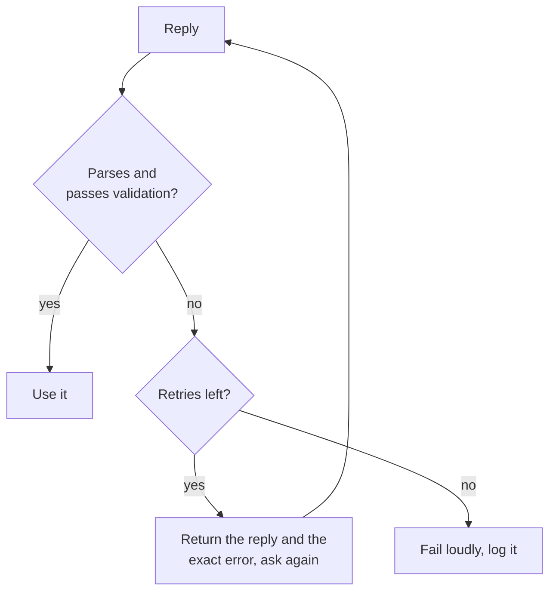

# Structured Output and Long Context: Schemas, Field Order, Layout

Stages 5 and 6 compressed for lookup. [Lesson 11](../lessons/0011-structured-output-from-the-prompt.md) covers asking for a schema and validating it, [lesson 12](../lessons/0012-format-constraints-and-reasoning.md) the cost of format constraints on reasoning, [lesson 13](../lessons/0013-position-in-long-context.md) position in a long context, and [lesson 14](../lessons/0014-working-with-long-documents.md) tagging documents and quoting first.

## Asking for structured output

| Include | Why |
|---|---|
| Each field with a short description | The model cannot guess what a field means |
| The allowed values of any fixed-set field | Without them values drift |
| One complete example reply | The example carries the format |
| "One JSON object and nothing else" | A parser fails on any text around the object |

Asking is a request, not a guarantee. Always parse, then validate keys, types and allowed values.



## Asked versus enforced

| | Asked in the prompt | Enforced by a provider feature |
|---|---|---|
| How | Instructions, field list, example | Schema passed to the API (Anthropic: `output_config.format`) |
| Guarantee | None, so validate and retry | Schema match in most cases |
| Still check | Everything | Refusals, replies cut off at the token limit, enum capitalization |

Serving side of enforcement: [Sampling and Constrained Decoding at Serve Time](../../inference/lessons/0019-sampling-and-constrained-decoding-at-serve-time.md).

## Format constraints and reasoning

| Setting (Tam et al., 2024) | What it is | On reasoning tasks |
|---|---|---|
| JSON-mode | Constrained decoding | Worst in most cases |
| Format-restricting instructions | Prompt asks for a format and schema | Between the two |
| NL-to-Format | Answer in plain language, then convert | Nearly the same as unrestricted |

- On classification tasks constrained decoding can enhance accuracy, so the cost is task-dependent.
- Put `reasoning` before `answer`: the object is written left to right.
- One call: reasoning field first. Two calls: plain-language answer, then convert. Measure both on your task.

## Long-context layout

| Move | Source |
|---|---|
| Treat the middle as the weakest position | Liu et al., 2023: U-shaped curve |
| Documents first, instructions and question after | Anthropic guidance (vendor) |
| Query at the end: up to 30 percent better in tests | Anthropic guidance (vendor) |
| Query before and after the data for retrieval of one fact | Liu et al., 2023, key-value retrieval |
| Pass fewer documents when you can | Less material sits in the middle |

## Long documents

```text
<documents>
  <document index="1">
    <source>name-of-source</source>
    <document_content>
      ...text...
    </document_content>
  </document>
</documents>

Find the quotes relevant to the question, numbered, with their source, in <quotes> tags.
If there are none, write "no relevant quotes" and stop.
Then answer using only those quotes, in <answer> tags.
```

- Check each quote against the documents by string search; a missing quote means the reply is not grounded.
- Retrieved passages: [Generation from Retrieval](../../rag/reference/generation-from-retrieval.md).
