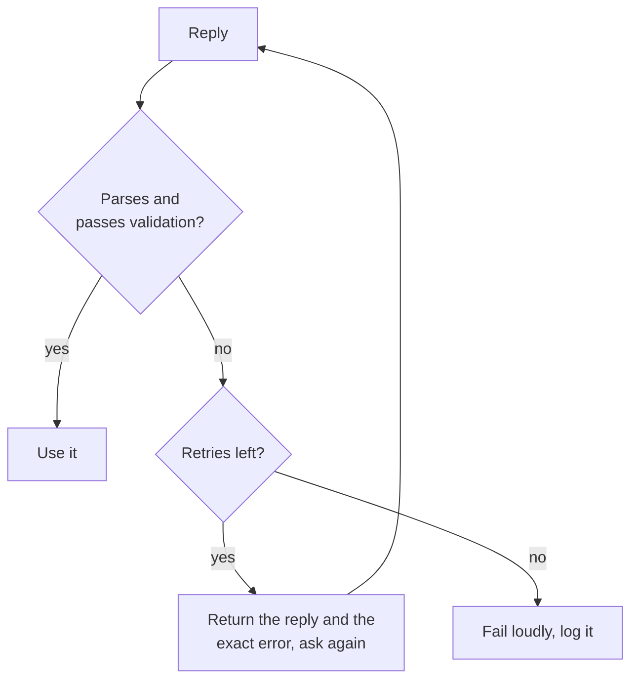

# Saída Estruturada e Contexto Longo: Schemas, Ordem dos Campos, Layout

Os estágios 5 e 6 condensados para consulta. A [lição 11](../lessons/0011-structured-output-from-the-prompt.md) trata de pedir um schema e validá-lo, a [lição 12](../lessons/0012-format-constraints-and-reasoning.md) do custo das restrições de formato sobre o raciocínio, a [lição 13](../lessons/0013-position-in-long-context.md) da posição em um contexto longo e a [lição 14](../lessons/0014-working-with-long-documents.md) de marcar documentos com tags e citar primeiro.

## Pedindo saída estruturada

| Inclua | Por quê |
|---|---|
| Cada campo com uma descrição curta | O modelo não consegue adivinhar o que um campo significa |
| Os valores permitidos de qualquer campo de conjunto fixo | Sem eles, os valores se desviam |
| Um exemplo completo de resposta | O exemplo carrega o formato |
| "Um objeto JSON e nada mais" | Um parser falha com qualquer texto em volta do objeto |

Pedir é uma solicitação, não uma garantia. Sempre faça o parse e depois valide chaves, tipos e valores permitidos.



## Pedido versus imposto

| | Pedido no prompt | Imposto por um recurso do provedor |
|---|---|---|
| Como | Instruções, lista de campos, exemplo | Schema passado à API (Anthropic: `output_config.format`) |
| Garantia | Nenhuma, então valide e tente de novo | Correspondência ao schema na maioria dos casos |
| Ainda verifique | Tudo | Recusas, respostas cortadas no limite de tokens, capitalização de enum |

O lado do serving da imposição: [Amostragem e decodificação restrita no momento do serviço](../../inference/lessons/0019-sampling-and-constrained-decoding-at-serve-time.md).

## Restrições de formato e raciocínio

| Configuração (Tam et al., 2024) | O que é | Em tarefas de raciocínio |
|---|---|---|
| JSON-mode | Decodificação restrita | Pior na maioria dos casos |
| Instruções que restringem o formato | O prompt pede um formato e um schema | Entre os dois |
| NL-to-Format | Responder em linguagem natural e depois converter | Quase igual ao irrestrito |

- Em tarefas de classificação, a decodificação restrita pode melhorar a acurácia, então o custo depende da tarefa.
- Coloque `reasoning` antes de `answer`: o objeto é escrito da esquerda para a direita.
- Uma chamada: campo de raciocínio primeiro. Duas chamadas: resposta em linguagem natural e depois conversão. Meça as duas na sua tarefa.

## Layout em contexto longo

| Ação | Fonte |
|---|---|
| Trate o meio como a posição mais fraca | Liu et al., 2023: curva em U |
| Documentos primeiro, instruções e pergunta depois | Orientação da Anthropic (fornecedor) |
| Consulta no final: até 30 por cento melhor nos testes | Orientação da Anthropic (fornecedor) |
| Consulta antes e depois dos dados para recuperar um único fato | Liu et al., 2023, recuperação de chave-valor |
| Passe menos documentos quando puder | Menos material fica no meio |

## Documentos longos

```text
<documents>
  <document index="1">
    <source>name-of-source</source>
    <document_content>
      ...text...
    </document_content>
  </document>
</documents>

Find the quotes relevant to the question, numbered, with their source, in <quotes> tags.
If there are none, write "no relevant quotes" and stop.
Then answer using only those quotes, in <answer> tags.
```

- Confira cada citação contra os documentos por busca de string; uma citação ausente significa que a resposta não tem fundamento.
- Trechos recuperados: [Geração a partir da recuperação](../../rag/reference/generation-from-retrieval.md).
