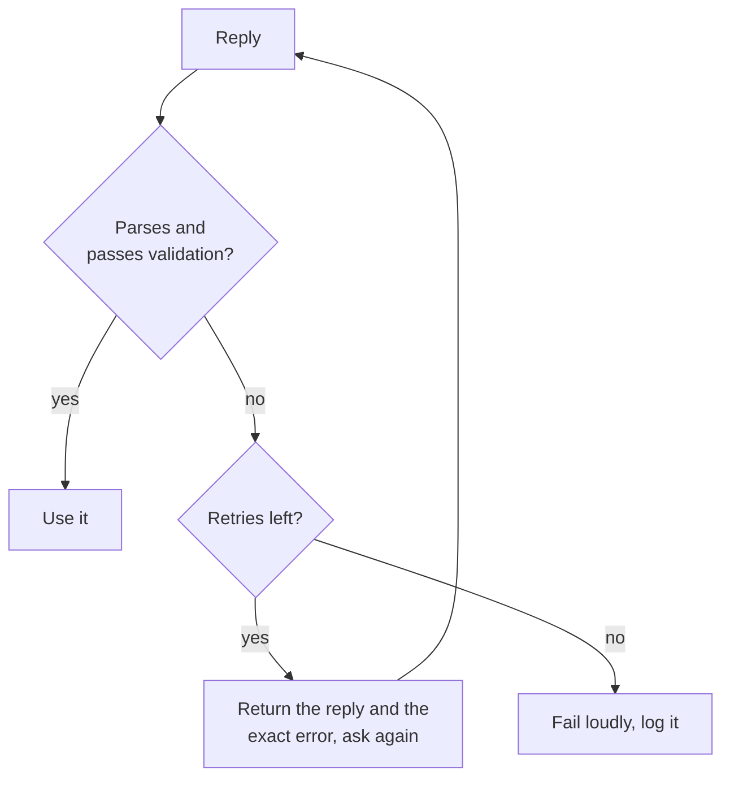

# Структурированный вывод и длинный контекст: схемы, порядок полей, раскладка

Этапы 5 и 6 в сжатом виде для быстрого поиска. [Урок 11](../lessons/0011-structured-output-from-the-prompt.md) рассказывает, как запросить схему и проверить её, [урок 12](../lessons/0012-format-constraints-and-reasoning.md) о цене ограничений формата для рассуждения, [урок 13](../lessons/0013-position-in-long-context.md) о позиции в длинном контексте, а [урок 14](../lessons/0014-working-with-long-documents.md) о разметке документов тегами и цитировании в первую очередь.

## Как запросить структурированный вывод

| Включите | Зачем |
|---|---|
| Каждое поле с коротким описанием | Модель не может угадать, что означает поле |
| Допустимые значения любого поля с фиксированным набором | Без них значения расползаются |
| Один полный пример ответа | Пример несёт формат |
| «Один JSON-объект и ничего больше» | Парсер падает от любого текста вокруг объекта |

Запрос это просьба, а не гарантия. Всегда разбирайте ответ, затем проверяйте ключи, типы и допустимые значения.



## Запрошено или обеспечено принудительно

| | Запрошено в промпте | Обеспечено функцией провайдера |
|---|---|---|
| Как | Инструкции, список полей, пример | Схема передаётся в API (Anthropic: `output_config.format`) |
| Гарантия | Нет, поэтому валидируйте и повторяйте | Соответствие схеме в большинстве случаев |
| Что всё равно проверять | Всё | Отказы, ответы, обрезанные на лимите токенов, регистр значений enum |

Серверная сторона принудительного вывода: [Сэмплирование и ограниченное декодирование при обслуживании](../../inference/lessons/0019-sampling-and-constrained-decoding-at-serve-time.md).

## Ограничения формата и рассуждение

| Настройка (Tam et al., 2024) | Что это | На задачах на рассуждение |
|---|---|---|
| JSON-mode | Ограниченное декодирование | В большинстве случаев хуже всех |
| Инструкции, ограничивающие формат | Промпт просит формат и схему | Между двумя другими |
| NL-to-Format | Ответ простым языком, затем преобразование | Почти так же, как без ограничений |

- На задачах классификации ограниченное декодирование может повышать точность, так что цена зависит от задачи.
- Ставьте `reasoning` перед `answer`: объект пишется слева направо.
- Один вызов: сначала поле рассуждения. Два вызова: ответ простым языком, затем преобразование. Измерьте оба варианта на своей задаче.

## Раскладка длинного контекста

| Приём | Источник |
|---|---|
| Считайте середину самой слабой позицией | Liu et al., 2023: U-образная кривая |
| Сначала документы, потом инструкции и вопрос | Рекомендация Anthropic (вендор) |
| Запрос в конце: до 30 процентов лучше в тестах | Рекомендация Anthropic (вендор) |
| Запрос до и после данных для извлечения одного факта | Liu et al., 2023, извлечение по ключу и значению |
| Передавайте меньше документов, когда можете | Меньше материала оказывается в середине |

## Длинные документы

```text
<documents>
  <document index="1">
    <source>name-of-source</source>
    <document_content>
      ...text...
    </document_content>
  </document>
</documents>

Find the quotes relevant to the question, numbered, with their source, in <quotes> tags.
If there are none, write "no relevant quotes" and stop.
Then answer using only those quotes, in <answer> tags.
```

- Проверяйте каждую цитату по документам строковым поиском: отсутствующая цитата означает, что ответ не обоснован.
- Найденные фрагменты: [Generation from Retrieval](../../rag/reference/generation-from-retrieval.md).
