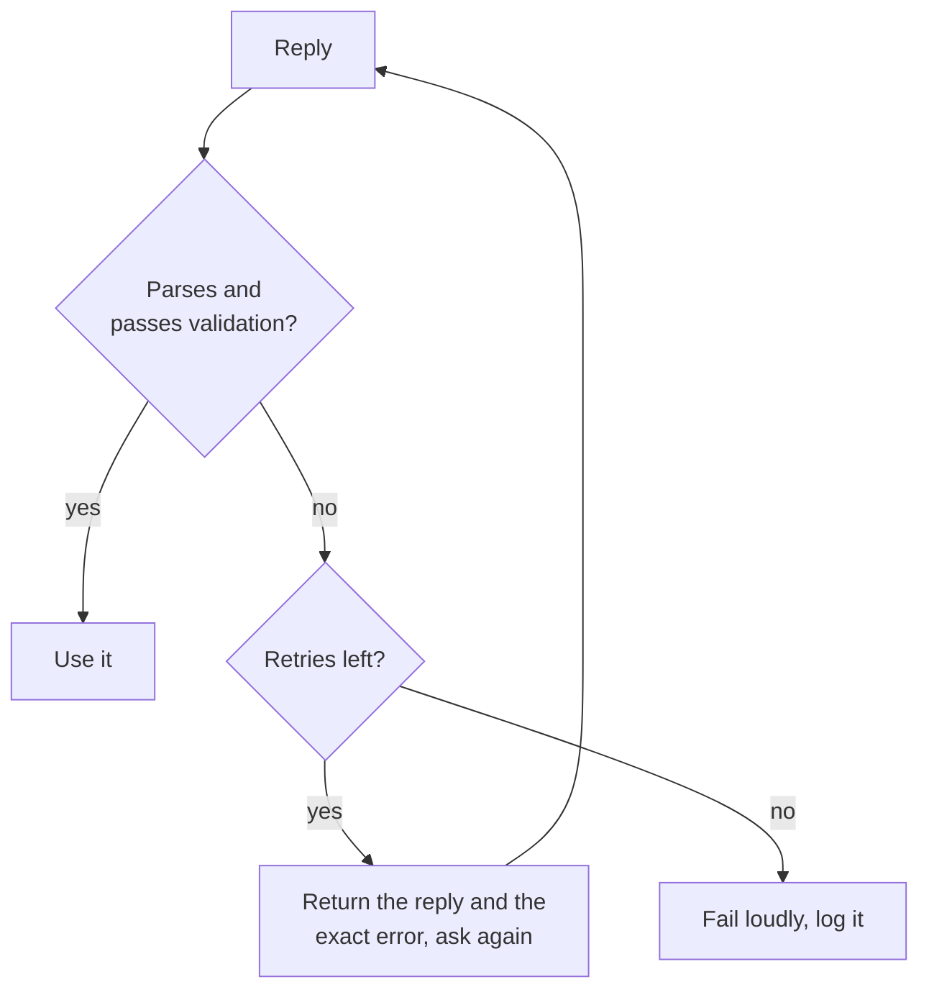

# 结构化输出与长上下文：schema、字段顺序与布局

第 5、6 阶段的内容，压缩成便于查阅的形式。[第 11 课](../lessons/0011-structured-output-from-the-prompt.md)讲要求输出符合 schema 并加以验证，[第 12 课](../lessons/0012-format-constraints-and-reasoning.md)讲格式约束对推理的代价，[第 13 课](../lessons/0013-position-in-long-context.md)讲长上下文中的位置，[第 14 课](../lessons/0014-working-with-long-documents.md)讲给文档加标签和先引用再回答。

## 要求结构化输出

| 应包含 | 原因 |
|---|---|
| 每个字段附一句简短的描述 | 模型无法猜出一个字段是什么意思 |
| 取值固定的字段的所有允许值 | 没有它们，取值就会漂移 |
| 一个完整的示例回复 | 示例承载了格式 |
| “只输出一个 JSON 对象，不要有其他内容” | 对象周围只要有任何文本，解析器就会失败 |

要求只是请求，不是保证。始终先解析，再验证键、类型和允许的取值。



## 提示词中要求与服务商强制

| | 在提示词中要求 | 由服务商功能强制 |
|---|---|---|
| 方式 | 指令、字段列表、示例 | 把 schema 传给 API（Anthropic：`output_config.format`） |
| 保证 | 没有，所以要验证并重试 | 大多数情况下与 schema 匹配 |
| 仍需检查 | 一切 | 拒答、因 token 上限被截断的回复、枚举值的大小写 |

强制在服务端的实现：[服务时的采样与约束解码](../../inference/lessons/0019-sampling-and-constrained-decoding-at-serve-time.md)。

## 格式约束与推理

| 设置（Tam 等，2024） | 它是什么 | 在推理任务上 |
|---|---|---|
| JSON-mode | 约束解码 | 多数情况下最差 |
| 限定格式的指令 | 提示词要求某种格式和 schema | 介于两者之间 |
| NL-to-Format | 先用自然语言回答，再转换 | 与不加限制几乎相同 |

- 在分类任务上，约束解码可以提高准确率，所以代价取决于任务。
- 把 `reasoning` 放在 `answer` 之前：对象是从左到右写出来的。
- 一次调用：先写推理字段。两次调用：先用自然语言回答，再转换。在你的任务上把两种都测一遍。

## 长上下文布局

| 做法 | 来源 |
|---|---|
| 把中间位置视为最弱的位置 | Liu 等，2023：U 形曲线 |
| 文档在前，指令和问题在后 | Anthropic 指南（厂商） |
| 问题放在末尾：测试中最多提升 30% | Anthropic 指南（厂商） |
| 要检索单个事实时，问题放在数据之前和之后 | Liu 等，2023，键值检索 |
| 尽可能少传文档 | 落在中间的材料更少 |

## 长文档

```text
<documents>
  <document index="1">
    <source>name-of-source</source>
    <document_content>
      ...text...
    </document_content>
  </document>
</documents>

Find the quotes relevant to the question, numbered, with their source, in <quotes> tags.
If there are none, write "no relevant quotes" and stop.
Then answer using only those quotes, in <answer> tags.
```

- 用字符串搜索把每条引文与文档核对；引文找不到，说明回复没有依据。
- 检索到的段落：[基于检索的生成速查表](../../rag/reference/generation-from-retrieval.md)。
