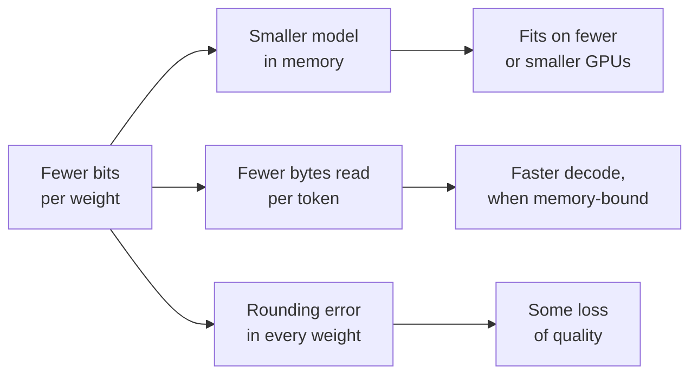

# Lección 1. Qué aporta la cuantización

**Vínculo con la misión:** Toda decisión de cuantización posterior de este track intercambia accuracy por algo, así que la primera habilidad es saber exactamente qué es ese algo y poder ponerle un número.
**Fuente principal:** [Paper: "A White Paper on Neural Network Quantization", Nagel et al., 2021](https://arxiv.org/abs/2106.08295), secciones 1 y 2.1
**Requisitos previos:** [Cuantización](../GLOSSARY.md), [Limitado por el ancho de banda de memoria](../GLOSSARY.md)

## Qué debes saber

### Qué es la cuantización

Un LLM entrenado almacena sus pesos como números de punto flotante, normalmente de 16 bits cada uno. La **cuantización** los almacena, y a veces también las activaciones y la KV cache, sobre un conjunto menor de niveles que necesitan menos bits: 8, 4 o menos. Cada valor se sustituye por el nivel más cercano, así que el modelo pasa a calcular con números ligeramente erróneos. Todo el tema consiste en hacer pequeño ese error donde importa.

Nagel et al. resumen la ganancia en dos números: pasar de 32 a 8 bits reduce la memoria para almacenar tensores en un factor de 4, y el costo de una multiplicación de matrices en un factor de 16, porque ese costo crece con el producto de los anchos de bits de los dos operandos. Su advertencia inicial es la otra mitad del tema: la cuantización "no es gratis", y el ruido que añade puede costar accuracy.

### La aritmética de la memoria

La memoria de los pesos de un modelo es su número de parámetros por los bytes por parámetro. Aprende a hacer esta cuenta de cabeza, porque es el primer número en cualquier conversación sobre cuantización.

| Formato | Bits por peso | Modelo de 8B parámetros | Modelo de 70B parámetros |
|---|---|---|---|
| fp32 | 32 | 32 GB | 280 GB |
| bf16 | 16 | 16 GB | 140 GB |
| int8 | 8 | 8 GB | 70 GB |
| int4 | 4 | 4 GB | 35 GB |

Esas filas son solo los pesos, con el ancho de bits nominal. Los esquemas reales de pocos bits almacenan además un scale por cada grupo pequeño de pesos, algo que la lección 6 pone en cifras. Un scale de 16 bits compartido por 128 pesos añade 16 / 128 = 0.125 bits por peso, así que "4 bits" son en realidad unos 4.125 **bits efectivos por peso**.

Hay dos cosas que cuantizar los pesos no reduce: las activaciones, que son pequeñas en tiempo de inferencia, y la KV cache, que crece con la longitud del contexto y el tamaño de lote. Con contexto largo y lote grande, la KV cache puede pesar más que los pesos. La lección 16 se ocupa de ella.

### Por qué menos bytes significa más velocidad

Generar un token con tamaño de lote 1 multiplica un único vector por cada matriz de pesos del modelo, así que cada peso se lee de la memoria una vez por token mientras que cada uno participa solo en una multiplicación y una suma. La aritmética es barata y la lectura no: este paso de decode está **limitado por el ancho de banda de memoria**. El tiempo por token tiene un piso: los bytes de los pesos divididos por el ancho de banda de memoria.

En una GPU con 2 TB/s de ancho de banda de memoria, un modelo de 8B en bf16 lee 16 GB por token, así que no puede ir más rápido que 8 ms por token, unos 125 tokens por segundo. En int4 lee 4 GB, un techo de unos 500 tokens por segundo. Ese techo no es lo que se obtiene: el kernel debe convertir los valores de 4 bits de vuelta a números de 16 bits sobre la marcha, y además se lee la KV cache. El paper de MARLIN atribuye estas aceleraciones en la inferencia de un solo usuario a "la menor cantidad de movimiento de memoria", y dedica su esfuerzo a conservarlas a medida que crece el lote ([Frantar et al., 2024](https://arxiv.org/abs/2408.11743)). La lección 19 muestra dónde se agota la aceleración.

El diagrama es el intercambio sobre el que discute el resto del track: las ramas de arriba son seguras y fáciles de calcular, la de abajo es incierta y hay que medirla.

## Práctica

1. ▢ Un modelo de 13B parámetros se distribuye en bf16. ¿Cuánta memoria ocupan sus pesos, y cuánta en int8?

Comprobación

26 GB en bf16 (13 mil millones × 2 bytes) y 13 GB en int8 (13 mil millones × 1 byte). Si llegaste a 52 GB, son los 4 bytes por parámetro de fp32.

2. ▢ Un equipo quiere servir un modelo de 70B en una sola GPU de 80 GB. ¿Cuáles de los pesos en bf16, int8 e int4 caben, y cuál deja espacio para algo más?

Pista

Calcula la memoria de pesos de cada formato y pregúntate qué más tiene que vivir en la GPU mientras atiende solicitudes.

Comprobación

bf16 necesita 140 GB y no cabe. int8 necesita 70 GB, que caben sobre el papel pero dejan unos 10 GB para la KV cache, las activaciones y el runtime, así que sirve muy poco contexto. int4 necesita unos 36 GB una vez contados los scales de grupo, y deja espacio para una KV cache útil. "Cabe" tiene que incluir la KV cache, no solo los pesos.

3. ▢ Predice y luego calcula. Un esquema de 4 bits almacena un scale de 16 bits por grupo de 32 pesos. Predice si sus bits efectivos por peso están más cerca de 4.1 o de 4.5, y luego haz la cuenta.

Comprobación

4.5. El scale añade 16 / 32 = 0.5 bits por peso. Con un grupo de 128 añadiría 0.125. Los grupos más pequeños son más precisos (lección 6) y cuestan más almacenamiento, y por eso "4 bits" por sí solo no dice qué tamaño tiene un checkpoint.

4. ▢ En la misma GPU, con tamaño de lote 1, la velocidad de decode de un modelo pasa de 40 a 120 tokens por segundo después de cuantizar sus pesos de bf16 a int4. ¿Qué afirmación explica mejor por qué se aceleró y por qué no llegó a 160?

    - a) La aritmética en int4 corre cuatro veces más rápido, menos la sobrecarga del redondeo
    - b) Se leen menos bytes de pesos, menos la descuantización y las lecturas de KV
    - c) La KV cache se redujo cuatro veces, menos el costo de los pesos
    - d) El modelo ahora cabe en la caché on-chip, menos las activaciones

Comprobación

**b)** El decode con lote 1 está limitado por el ancho de banda de memoria, así que leer una cuarta parte de los bytes de pesos sube el techo unas cuatro veces, y el trabajo de descuantización del kernel más las lecturas intactas de la KV cache lo mantienen por debajo. (a) es incorrecta porque int4 solo de pesos sigue calculando en 16 bits: la aritmética no cambió. (c) es incorrecta porque cuantizar los pesos deja la KV cache en su formato original. (d) es incorrecta porque un modelo de miles de millones de parámetros tampoco cabe en la caché on-chip a 4 bits.

## Prácticas en el mundo real

- [ ] Abre la model card de cualquier modelo abierto del Hugging Face Hub, encuentra su número de parámetros y calcula la memoria de sus pesos en bf16 y en int4. Luego compáralo con el tamaño de los archivos del checkpoint que aparecen en "Files and versions".
- [ ] Busca el ancho de banda de memoria de una GPU o un portátil al que tengas acceso, y calcula el techo de decode con lote 1 para un modelo de 8B en bf16 y en int4.
- [ ] Mañana: sin apuntes, escribe los bytes por parámetro de fp32, bf16, int8 e int4, y la fórmula de la sobrecarga de un scale de grupo en bits por peso.

## Para profundizar

- [Formatos numéricos](../reference/number-formats.md)
- Inferencia: [Cuantización al servir](../../inference/reference/quantization-at-serve-time.md), para ver cómo se defiende el intercambio entre memoria y velocidad dentro de un presupuesto de servicio
- [Paper: "MARLIN: Mixed-Precision Auto-Regressive Parallel Inference on Large Language Models", Frantar et al., 2024](https://arxiv.org/abs/2408.11743)
- [Recursos](../RESOURCES.md)

---

¿No termina de quedar claro? Vuelve a leer la fuente primaria de arriba, ya que esta lección la comprime y en la compresión es donde se escapa la comprensión. Consulta el [glosario](../GLOSSARY.md) por si algún término te resultó resbaladizo.

Si lo poco claro es la propia lección y no el material, eso es un defecto: [abre un issue](https://github.com/TokenCemetery/teach/issues).
