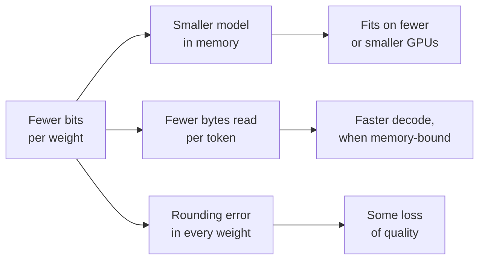

# Leçon 1. Ce que la quantification apporte

**Lien avec la mission :** Chaque décision de quantification plus loin dans ce parcours échange de la précision contre quelque chose, donc la première compétence est de savoir exactement ce que c'est et de pouvoir le chiffrer.
**Source primaire :** [Article : "A White Paper on Neural Network Quantization", Nagel et al., 2021](https://arxiv.org/abs/2106.08295), sections 1 et 2.1
**Prérequis :** [Quantification](../GLOSSARY.md), [Limité par la mémoire](../GLOSSARY.md)

## À savoir

### Ce qu'est la quantification

Un LLM entraîné stocke ses poids sous forme de nombres à virgule flottante, en général sur 16 bits chacun. La **quantification** les stocke, et parfois aussi les activations et le KV cache, sur un ensemble plus petit de niveaux qui demandent moins de bits : 8, 4 ou moins. Chaque valeur est remplacée par le niveau le plus proche, si bien que le modèle calcule désormais avec des nombres légèrement faux. Tout le sujet consiste à rendre cette erreur petite là où elle compte.

Nagel et al. résument le gain en deux chiffres : passer de 32 à 8 bits divise par 4 la mémoire nécessaire pour stocker les tenseurs, et par 16 le coût d'une multiplication de matrices, parce que ce coût croît avec le produit des largeurs en bits des deux opérandes. Leur mise en garde initiale est l'autre moitié du sujet : la quantification « n'est pas gratuite », et le bruit qu'elle ajoute peut coûter de la précision.

### L'arithmétique de la mémoire

La mémoire des poids d'un modèle, c'est son nombre de paramètres multiplié par les octets par paramètre. Apprenez à faire ce calcul de tête, car c'est le premier chiffre de toute conversation sur la quantification.

| Format | Bits par poids | Modèle à 8B paramètres | Modèle à 70B paramètres |
|---|---|---|---|
| fp32 | 32 | 32 GB | 280 GB |
| bf16 | 16 | 16 GB | 140 GB |
| int8 | 8 | 8 GB | 70 GB |
| int4 | 4 | 4 GB | 35 GB |

Ces lignes ne comptent que les poids, à la largeur en bits nominale. Les vrais schémas à faible nombre de bits stockent aussi un scale pour chaque petit groupe de poids, ce que la leçon 6 chiffre. Un scale de 16 bits partagé par 128 poids ajoute 16 / 128 = 0.125 bit par poids, donc le « 4 bits » correspond en réalité à environ 4.125 **bits effectifs par poids**.

Quantifier les poids ne réduit pas deux choses : les activations, qui sont petites à l'inférence, et le KV cache, qui croît avec la longueur de contexte et la taille de batch. À contexte long et à grand batch, le KV cache peut peser plus que les poids. La leçon 16 s'en occupe.

### Pourquoi moins d'octets, c'est plus rapide

Générer un token à une taille de batch de 1 multiplie un seul vecteur par chaque matrice de poids du modèle, donc chaque poids est lu en mémoire une fois par token alors que chacun ne participe qu'à une multiplication et une addition. L'arithmétique est bon marché et la lecture ne l'est pas : cette étape de décodage est **limitée par la mémoire**. Le temps par token a pour plancher les octets de poids divisés par la bande passante mémoire.

Sur un GPU de 2 TB/s de bande passante mémoire, un modèle 8B en bf16 lit 16 GB par token, donc il ne peut pas aller plus vite que 8 ms par token, soit environ 125 tokens par seconde. En int4, il lit 4 GB, soit un plafond d'environ 500 tokens par seconde. Ce plafond n'est pas ce que vous obtenez : le kernel doit retransformer les valeurs de 4 bits en nombres de 16 bits au fil de l'eau, et le KV cache est lu lui aussi. L'article MARLIN attribue ces gains de vitesse pour l'inférence mono-utilisateur à une « réduction des déplacements de mémoire » (« due to reduced memory movement »), et consacre son effort à les conserver quand le batch grandit ([Frantar et al., 2024](https://arxiv.org/abs/2408.11743)). La leçon 19 montre où le gain s'épuise.

Le schéma est l'échange sur lequel le reste du parcours débat : les branches du haut sont certaines et faciles à calculer, celle du bas est incertaine et doit être mesurée.

## Pratique

1. ▢ Un modèle de 13B paramètres est distribué en bf16. Combien de mémoire ses poids prennent-ils, et combien en int8 ?

Vérifier

26 GB en bf16 (13 milliards × 2 octets) et 13 GB en int8 (13 milliards × 1 octet). Si vous avez pensé à 52 GB, ce sont les 4 octets par paramètre du fp32.

2. ▢ Une équipe veut servir un modèle de 70B sur un seul GPU de 80 GB. Parmi les poids en bf16, int8 et int4, lesquels tiennent, et lequel laisse de la place pour autre chose ?

Indice

Calculez la mémoire des poids de chaque format, puis demandez-vous ce qui doit aussi résider sur le GPU pendant qu'il traite des requêtes.

Vérifier

Le bf16 demande 140 GB et ne tient pas. L'int8 demande 70 GB, ce qui tient sur le papier mais ne laisse qu'environ 10 GB pour le KV cache, les activations et le runtime, donc il sert très peu de contexte. L'int4 demande environ 36 GB une fois comptés les scales de groupe, et laisse la place pour un KV cache utile. « Tient » doit inclure le KV cache, pas seulement les poids.

3. ▢ Prédisez, puis calculez. Un schéma en 4 bits stocke un scale de 16 bits par groupe de 32 poids. Prédisez si ses bits effectifs par poids sont plus proches de 4.1 ou de 4.5, puis faites le calcul.

Vérifier

4.5. Le scale ajoute 16 / 32 = 0.5 bit par poids. Avec un groupe de 128, il en ajouterait 0.125. Les petits groupes sont plus précis (leçon 6) et coûtent plus de stockage, ce qui explique que « 4 bits » seul ne dise pas la taille d'un checkpoint.

4. ▢ Sur le même GPU, à une taille de batch de 1, la vitesse de décodage d'un modèle passe de 40 à 120 tokens par seconde après quantification de ses poids du bf16 à l'int4. Quelle affirmation explique le mieux à la fois pourquoi il est devenu plus rapide et pourquoi il n'a pas atteint 160 ?

    - a) L'arithmétique int4 tourne quatre fois plus vite, moins le surcoût de l'arrondi
    - b) Moins d'octets de poids sont lus, moins la déquantification et les lectures du KV cache
    - c) Le KV cache a été divisé par quatre, moins le coût des poids
    - d) Le modèle tient désormais dans le cache sur puce, moins les activations

Vérifier

**b)** Le décodage à batch 1 est limité par la mémoire, donc lire un quart des octets de poids relève le plafond d'environ quatre fois, et le travail de déquantification du kernel ajouté aux lectures inchangées du KV cache le maintient en dessous. (a) est faux parce que l'int4 weight-only calcule toujours en 16 bits : l'arithmétique n'a pas changé. (c) est faux parce que quantifier les poids laisse le KV cache dans son format d'origine. (d) est faux parce qu'un modèle de plusieurs milliards de paramètres ne tient pas non plus dans le cache sur puce en 4 bits.

## Exercices en situation réelle

- [ ] Ouvrez la fiche d'un modèle ouvert sur le Hugging Face Hub, trouvez son nombre de paramètres et calculez la mémoire de ses poids en bf16 et en int4. Comparez ensuite avec la taille des fichiers du checkpoint listés sous « Files and versions ».
- [ ] Cherchez la bande passante mémoire d'un GPU ou d'un portable auquel vous avez accès, et calculez le plafond de décodage à batch 1 pour un modèle 8B en bf16 et en int4.
- [ ] Demain : sans notes, écrivez les octets par paramètre du fp32, du bf16, de l'int8 et de l'int4, ainsi que la formule du surcoût d'un scale de groupe en bits par poids.

## Pour aller plus loin

- [Formats de nombres](../reference/number-formats.md)
- Inférence : [Quantification au moment du serving](../../inference/reference/quantization-at-serve-time.md), pour voir comment le compromis entre mémoire et vitesse se défend dans un budget de serving
- [Article : "MARLIN: Mixed-Precision Auto-Regressive Parallel Inference on Large Language Models", Frantar et al., 2024](https://arxiv.org/abs/2408.11743)
- [Ressources](../RESOURCES.md)

---

Ça ne passe pas ? Relisez la source primaire en haut de page, car cette leçon la condense et c'est dans la condensation que la compréhension s'échappe. Consultez le [glossaire](../GLOSSARY.md) pour tout terme qui vous a paru glissant.

Si c'est la leçon elle-même qui n'est pas claire plutôt que la matière, c'est un défaut : [ouvrez une issue](https://github.com/TokenCemetery/teach/issues).
