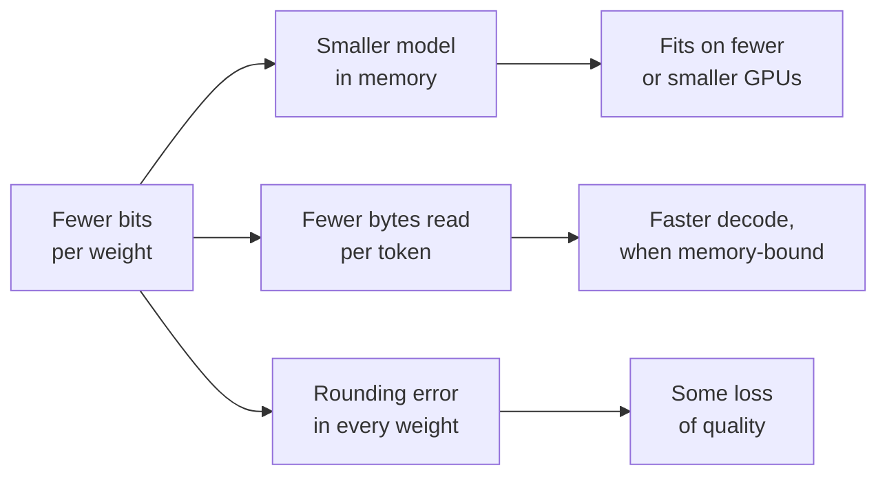

# पाठ 1. Quantization से क्या मिलता है

**मिशन से संबंध:** इस track में आगे का हर quantization फ़ैसला accuracy के बदले कुछ पाता है, इसलिए पहली क्षमता यह जानना है कि वह "कुछ" ठीक-ठीक क्या है और उस पर एक संख्या रख पाना।
**मुख्य स्रोत:** [पेपर: "A White Paper on Neural Network Quantization", Nagel et al., 2021](https://arxiv.org/abs/2106.08295), sections 1 और 2.1
**पूर्व-आवश्यकताएँ:** [Quantization](../GLOSSARY.md), [Memory-bound](../GLOSSARY.md)

## यह जानें

### Quantization क्या है

Train हो चुका LLM अपने weights को floating-point संख्याओं की तरह store करता है, आम तौर पर हर एक 16 bits में। **Quantization** उन्हें, और कभी-कभी activations और KV cache को भी, levels के एक छोटे सेट पर store करता है जिसके लिए कम bits लगते हैं: 8, 4 या उससे भी कम। हर value की जगह उसका सबसे नज़दीकी level आ जाता है, इसलिए model अब थोड़ी-सी ग़लत संख्याओं से compute करता है। पूरा विषय इस बात का है कि वहाँ वह error छोटी रखी जाए जहाँ वह मायने रखती है।

Nagel et al. इसका फ़ायदा दो संख्याओं में बताते हैं: 32 से 8 bits पर जाने से tensors store करने की memory 4 गुना घटती है, और matrix multiplication की लागत 16 गुना, क्योंकि वह लागत दोनों operands की bit widths के गुणनफल के साथ बढ़ती है। उनकी शुरुआती चेतावनी विषय का दूसरा आधा हिस्सा है: quantization "मुफ़्त नहीं है", और जो noise वह जोड़ता है उससे accuracy जा सकती है।

### Memory का हिसाब

Model के weights की memory उसके parameters की संख्या गुणा हर parameter के bytes होती है। इसे मन में करना सीखें, क्योंकि quantization की हर बातचीत में यही पहली संख्या होती है।

| Format | प्रति weight bits | 8B-parameter model | 70B-parameter model |
|---|---|---|---|
| fp32 | 32 | 32 GB | 280 GB |
| bf16 | 16 | 16 GB | 140 GB |
| int8 | 8 | 8 GB | 70 GB |
| int4 | 4 | 4 GB | 35 GB |

ये पंक्तियाँ सिर्फ़ weights की हैं, नाममात्र की bit width पर। असली low-bit schemes weights के हर छोटे group के लिए एक scale भी store करती हैं, जिसकी क़ीमत पाठ 6 आँकता है। 128 weights में साझा 16-bit scale हर weight पर 16 / 128 = 0.125 bits जोड़ता है, इसलिए "4-bit" असल में लगभग 4.125 **effective bits per weight** है।

Weights को quantize करने से दो चीज़ें नहीं घटतीं: activations, जो inference के समय छोटी होती हैं, और KV cache, जो context length और batch size के साथ बढ़ता है। लंबे context और बड़े batch पर KV cache का वज़न weights से ज़्यादा हो सकता है। पाठ 16 इसे सँभालता है।

### कम bytes का मतलब तेज़ क्यों है

Batch size 1 पर एक token generate करना model की हर weight matrix को एक अकेले vector से गुणा करता है, इसलिए हर token पर हर weight memory से एक बार पढ़ा जाता है, जबकि हर एक सिर्फ़ एक multiply और एक add में हिस्सा लेता है। Arithmetic सस्ता है और पढ़ना नहीं: यह decode step **memory-bound** है। हर token के समय की एक न्यूनतम सीमा है: weight bytes को memory bandwidth से भाग देने पर मिला समय।

2 TB/s memory bandwidth वाले GPU पर, bf16 में 8B model हर token पर 16 GB पढ़ता है, इसलिए वह प्रति token 8 ms से तेज़ नहीं जा सकता, यानी लगभग 125 tokens प्रति सेकंड। int4 में वह 4 GB पढ़ता है, यानी लगभग 500 tokens प्रति सेकंड की ऊपरी सीमा। वह सीमा आपको मिलती नहीं: kernel को चलते-चलते 4-bit values को वापस 16-bit संख्याओं में बदलना पड़ता है, और KV cache भी पढ़ा जाता है। MARLIN पेपर single-user inference के इन speed-ups को "कम memory movement के कारण" कहता है, और अपनी मेहनत इसमें लगाता है कि batch बढ़ने पर भी वे बने रहें ([Frantar et al., 2024](https://arxiv.org/abs/2408.11743))। पाठ 19 दिखाता है कि speed-up कहाँ ख़त्म हो जाता है।

यह diagram वही सौदा है जिस पर इस track का बाक़ी हिस्सा बहस करता है: ऊपर की शाखाएँ पक्की हैं और हिसाब लगाने में आसान, नीचे वाली अनिश्चित है और उसे मापना पड़ता है।

## अभ्यास

1. ▢ 13B-parameter model bf16 में शिप होता है। उसके weights कितनी memory लेते हैं, और int8 में कितनी?

जाँचें

bf16 में 26 GB (13 अरब × 2 bytes) और int8 में 13 GB (13 अरब × 1 byte)। अगर आप 52 GB पर पहुँचे, तो वह fp32 का प्रति parameter 4 bytes है।

2. ▢ कोई team 70B model को एक 80 GB GPU पर serve करना चाहती है। bf16, int8 और int4 weights में से कौन-से समाते हैं, और किसमें किसी और चीज़ के लिए जगह बचती है?

संकेत

हर format की weight memory निकालें, फिर पूछें कि requests serve करते समय GPU पर और क्या-क्या रहना है।

जाँचें

bf16 को 140 GB चाहिए और वह नहीं समाता। int8 को 70 GB चाहिए, जो काग़ज़ पर समाता है पर KV cache, activations और runtime के लिए सिर्फ़ लगभग 10 GB छोड़ता है, इसलिए वह बहुत कम context serve करता है। int4 को group scales गिनने के बाद लगभग 36 GB चाहिए, और वह काम लायक़ KV cache के लिए जगह छोड़ता है। "समाता है" में KV cache भी गिना जाना चाहिए, सिर्फ़ weights नहीं।

3. ▢ पहले अनुमान लगाएँ, फिर हिसाब करें। एक 4-bit scheme हर 32 weights के group के लिए एक 16-bit scale store करती है। अनुमान लगाएँ कि उसके effective bits per weight 4.1 के ज़्यादा क़रीब हैं या 4.5 के, फिर निकालें।

जाँचें

4.5। Scale हर weight पर 16 / 32 = 0.5 bits जोड़ता है। 128 के group पर वह 0.125 जोड़ता। छोटे groups ज़्यादा सटीक होते हैं (पाठ 6) और ज़्यादा storage लेते हैं, इसीलिए अकेला "4-bit" यह नहीं बताता कि checkpoint कितना बड़ा है।

4. ▢ उसी GPU पर, batch size 1 पर, weights को bf16 से int4 में quantize करने के बाद model की decode speed 40 से 120 tokens प्रति सेकंड हो जाती है। कौन-सा कथन दोनों बातें सबसे अच्छी तरह समझाता है: वह तेज़ क्यों हुआ और 160 तक क्यों नहीं पहुँचा?

    - a) int4 arithmetic चार गुना तेज़ चलता है, rounding overhead घटाकर
    - b) कम weight bytes पढ़े जाते हैं, dequantization और KV reads घटाकर
    - c) KV cache चार गुना सिकुड़ गया, weights की लागत घटाकर
    - d) Model अब on-chip cache में समा गया, activations घटाकर

जाँचें

**b)** Batch-1 decode memory-bound है, इसलिए weight bytes का चौथाई हिस्सा पढ़ने से ऊपरी सीमा लगभग चार गुना बढ़ती है, और kernel का dequantization का काम तथा KV-cache की न बदली हुई reads उसे उससे नीचे रखते हैं। (a) ग़लत है क्योंकि weight-only int4 अब भी 16-bit में compute करता है: arithmetic बदला नहीं। (c) ग़लत है क्योंकि weights को quantize करने से KV cache अपने मूल format में ही रहता है। (d) ग़लत है क्योंकि अरबों parameters वाला model 4 bits पर भी on-chip cache में नहीं समाता।

## असली दुनिया का अभ्यास

- [ ] Hugging Face Hub पर किसी भी open model का model card खोलें, उसके parameters की संख्या खोजें, और bf16 और int4 में उसकी weight memory निकालें। फिर "Files and versions" के नीचे सूचीबद्ध checkpoint files के आकार से उसकी तुलना करें।
- [ ] किसी ऐसे GPU या laptop की memory bandwidth खोजें जिस तक आपकी पहुँच है, और 8B model के लिए bf16 और int4 में batch-1 decode की ऊपरी सीमा निकालें।
- [ ] कल: बिना नोट्स के fp32, bf16, int8 और int4 के प्रति parameter bytes लिखें, और group scale के overhead का formula प्रति weight bits में लिखें।

## आगे बढ़ने के लिए

- [Number Formats शीट](../reference/number-formats.md)
- [Inference: Serve Time पर Quantization](../../inference/reference/quantization-at-serve-time.md), यह देखने के लिए कि memory और speed का सौदा serving के बजट में कैसे संभाला जाता है
- [पेपर: "MARLIN: Mixed-Precision Auto-Regressive Parallel Inference on Large Language Models", Frantar et al., 2024](https://arxiv.org/abs/2408.11743)
- [संसाधन](../RESOURCES.md)

---

बात नहीं बन रही? ऊपर दिए मुख्य स्रोत को दोबारा पढ़ें, क्योंकि यह पाठ उसे संक्षिप्त करता है और समझ संक्षेप में ही रिसती है। जो शब्द फिसलन भरा लगे, उसके लिए [शब्दावली](../GLOSSARY.md) देखें।

अगर दिक़्क़त सामग्री की नहीं बल्कि पाठ की ही है, तो वह एक खोट है: [issue खोलें](https://github.com/TokenCemetery/teach/issues)।
