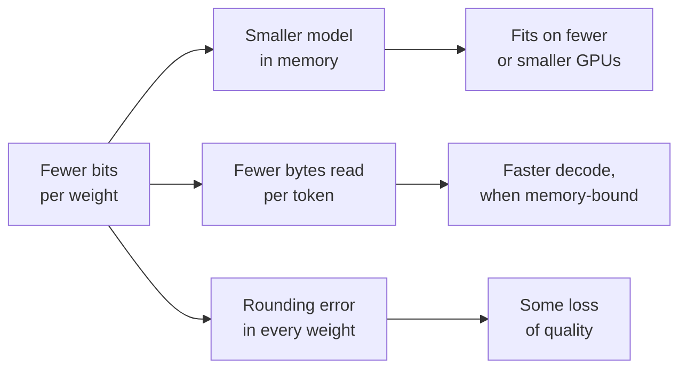

# Lesson 1. What Quantization Buys

**Mission link:** Every quantization decision later in this track trades accuracy for something, so the first skill is knowing exactly what that something is and being able to put a number on it.
**Primary source:** [Paper: "A White Paper on Neural Network Quantization", Nagel et al., 2021](https://arxiv.org/abs/2106.08295), sections 1 and 2.1
**Prerequisites:** [Quantization](../GLOSSARY.md), [Memory-bound](../GLOSSARY.md)

## Know this

### What quantization is

A trained LLM stores its weights as floating-point numbers, usually 16 bits each. **Quantization** stores them, and sometimes the activations and the KV cache too, on a smaller set of levels that need fewer bits: 8, 4, or fewer. Each value is replaced by the nearest level, so the model now computes with slightly wrong numbers. The whole subject is about making that error small where it matters.

Nagel et al. put the payoff in two numbers: moving from 32 to 8 bits cuts the memory for storing tensors by a factor of 4, and the cost of a matrix multiplication by a factor of 16, because that cost grows with the product of the two operands' bit widths. Their opening caveat is the other half of the subject: quantization "is not free", and the noise it adds can cost accuracy.

### The memory arithmetic

A model's weight memory is its parameter count times the bytes per parameter. Learn to do this in your head, because it is the first number in every quantization conversation.

| Format | Bits per weight | 8B-parameter model | 70B-parameter model |
|---|---|---|---|
| fp32 | 32 | 32 GB | 280 GB |
| bf16 | 16 | 16 GB | 140 GB |
| int8 | 8 | 8 GB | 70 GB |
| int4 | 4 | 4 GB | 35 GB |

Those rows are the weights alone, at the nominal bit width. Real low-bit schemes also store a scale for every small group of weights, which lesson 6 prices. A 16-bit scale shared by 128 weights adds 16 / 128 = 0.125 bits per weight, so "4-bit" is really about 4.125 **effective bits per weight**.

Two things quantizing the weights does not shrink: the activations, which are small at inference time, and the KV cache, which grows with context length and batch size. At long context and large batch the KV cache can outweigh the weights. Lesson 16 deals with it.

### Why fewer bytes means faster

Generating one token at batch size 1 multiplies a single vector by every weight matrix in the model, so every weight is read from memory once per token while each one takes part in only a multiply and an add. The arithmetic is cheap and the reading is not: this decode step is **memory-bound**. The time per token has a floor of the weight bytes divided by the memory bandwidth.

On a GPU with 2 TB/s of memory bandwidth, an 8B model in bf16 reads 16 GB per token, so it cannot go faster than 8 ms per token, about 125 tokens per second. In int4 it reads 4 GB, a ceiling of about 500 tokens per second. That ceiling is not what you get: the kernel must turn the 4-bit values back into 16-bit numbers as it goes, and the KV cache is read as well. The MARLIN paper calls these speed-ups for single-user inference "due to reduced memory movement", and spends its effort keeping them as the batch grows ([Frantar et al., 2024](https://arxiv.org/abs/2408.11743)). Lesson 19 shows where the speed-up runs out.

The diagram is the trade the rest of the track argues about: the top branches are certain and easy to compute, the bottom one is uncertain and has to be measured.

## Practice

1. ▢ A 13B-parameter model ships in bf16. How much memory do its weights take, and how much in int8?

Check

26 GB in bf16 (13 billion × 2 bytes) and 13 GB in int8 (13 billion × 1 byte). If you reached for 52 GB, that is fp32's 4 bytes per parameter.

2. ▢ A team wants to serve a 70B model on one 80 GB GPU. Which of bf16, int8 and int4 weights fit, and which leaves room for anything else?

Hint

Compute each format's weight memory, then ask what else has to live on the GPU while it serves requests.

Check

bf16 needs 140 GB and does not fit. int8 needs 70 GB, which fits on paper but leaves about 10 GB for the KV cache, the activations and the runtime, so it serves very little context. int4 needs about 36 GB once group scales are counted, and leaves room for a useful KV cache. "Fits" has to include the KV cache, not just the weights.

3. ▢ Predict, then compute. A 4-bit scheme stores one 16-bit scale per group of 32 weights. Predict whether its effective bits per weight is closer to 4.1 or to 4.5, then work it out.

Check

4.5. The scale adds 16 / 32 = 0.5 bits per weight. With a group of 128 it would add 0.125. Smaller groups are more accurate (lesson 6) and cost more storage, which is why "4-bit" on its own does not say how big a checkpoint is.

4. ▢ On the same GPU, at batch size 1, a model's decode speed goes from 40 to 120 tokens per second after quantizing its weights from bf16 to int4. Which statement best explains both why it got faster and why it did not reach 160?

    - a) int4 arithmetic runs four times faster, minus the rounding overhead
    - b) Fewer weight bytes are read, minus dequantization and KV reads
    - c) The KV cache shrank fourfold, minus the cost of weights
    - d) The model now fits in on-chip cache, minus the activations

Check

**b)** Batch-1 decode is memory-bound, so reading a quarter of the weight bytes raises the ceiling about fourfold, and the kernel's dequantization work plus the unchanged KV-cache reads keep it below that. (a) is wrong because weight-only int4 still computes in 16-bit: the arithmetic did not change. (c) is wrong because quantizing weights leaves the KV cache in its original format. (d) is wrong because a model of billions of parameters does not fit in on-chip cache at 4 bits either.

## Real-world reps

- [ ] Open the model card of any open model on the Hugging Face Hub, find its parameter count, and compute its weight memory in bf16 and int4. Then compare with the size of the checkpoint files listed under "Files and versions".
- [ ] Look up the memory bandwidth of a GPU or laptop you have access to, and compute the batch-1 decode ceiling for an 8B model in bf16 and in int4.
- [ ] Tomorrow: without notes, write down the bytes per parameter of fp32, bf16, int8 and int4, and the formula for a group scale's overhead in bits per weight.

## Going further

- [Number Formats](../reference/number-formats.md)
- [Inference: Quantization at Serve Time](../../inference/reference/quantization-at-serve-time.md), for how the memory and speed trade-off is defended in a serving budget
- [Paper: "MARLIN: Mixed-Precision Auto-Regressive Parallel Inference on Large Language Models", Frantar et al., 2024](https://arxiv.org/abs/2408.11743)
- [Resources](../RESOURCES.md)

---

Not landing? Reread the primary source at the top, since this lesson compresses it and compression is where understanding leaks. Check the [glossary](../GLOSSARY.md) for any term that felt slippery.

If the lesson itself is unclear rather than the material, that is a defect: [open an issue](https://github.com/TokenCemetery/teach/issues).
