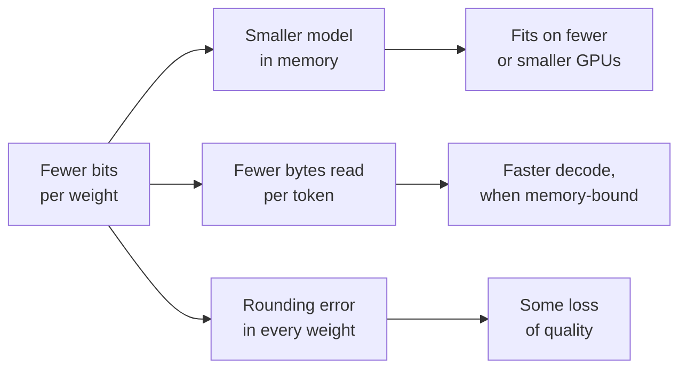

# Lição 1. O que a quantização oferece

**Ligação com a missão:** Toda decisão de quantização mais adiante nesta trilha troca acurácia por alguma coisa, então a primeira habilidade é saber exatamente o que é essa coisa e conseguir dar um número a ela.
**Fonte principal:** [Artigo científico: "A White Paper on Neural Network Quantization", Nagel et al., 2021](https://arxiv.org/abs/2106.08295), seções 1 e 2.1
**Pré-requisitos:** [Quantização](../GLOSSARY.md), [Limitado pela largura de banda de memória](../GLOSSARY.md)

## Saiba isto

### O que é quantização

Um LLM treinado armazena os seus pesos como números de ponto flutuante, normalmente de 16 bits cada. A **quantização** os armazena, e às vezes também as ativações e o KV cache, em um conjunto menor de níveis que precisam de menos bits: 8, 4 ou menos. Cada valor é substituído pelo nível mais próximo, então o modelo passa a calcular com números ligeiramente errados. O assunto inteiro é sobre manter esse erro pequeno onde ele importa.

Nagel et al. resumem o ganho em dois números: passar de 32 para 8 bits reduz a memória para armazenar tensores por um fator de 4, e o custo de uma multiplicação de matrizes por um fator de 16, porque esse custo cresce com o produto das larguras em bits dos dois operandos. O alerta inicial deles é a outra metade do assunto: a quantização "não é de graça", e o ruído que ela acrescenta pode custar acurácia.

### A aritmética de memória

A memória dos pesos de um modelo é o seu número de parâmetros vezes os bytes por parâmetro. Aprenda a fazer essa conta de cabeça, porque é o primeiro número em toda conversa sobre quantização.

| Formato | Bits por peso | Modelo de 8B parâmetros | Modelo de 70B parâmetros |
|---|---|---|---|
| fp32 | 32 | 32 GB | 280 GB |
| bf16 | 16 | 16 GB | 140 GB |
| int8 | 8 | 8 GB | 70 GB |
| int4 | 4 | 4 GB | 35 GB |

Essas linhas são só os pesos, na largura em bits nominal. Os esquemas reais de poucos bits também armazenam uma scale para cada pequeno grupo de pesos, o que a lição 6 precifica. Uma scale de 16 bits compartilhada por 128 pesos acrescenta 16 / 128 = 0.125 bit por peso, então "4 bits" são na verdade cerca de 4.125 **bits efetivos por peso**.

Duas coisas que quantizar os pesos não reduz: as ativações, que são pequenas em tempo de inferência, e o KV cache, que cresce com o tamanho do contexto e o batch size. Em contexto longo e batch grande, o KV cache pode pesar mais que os pesos. A lição 16 trata disso.

### Por que menos bytes significa mais velocidade

Gerar um token com batch size 1 multiplica um único vetor por cada matriz de pesos do modelo, então cada peso é lido da memória uma vez por token enquanto cada um participa de apenas uma multiplicação e uma soma. A aritmética é barata e a leitura não: esse passo de decode é **limitado pela largura de banda de memória**. O tempo por token tem um piso: os bytes dos pesos divididos pela largura de banda de memória.

Em uma GPU com 2 TB/s de largura de banda de memória, um modelo de 8B em bf16 lê 16 GB por token, então não consegue ir mais rápido que 8 ms por token, cerca de 125 tokens por segundo. Em int4 ele lê 4 GB, um teto de cerca de 500 tokens por segundo. Esse teto não é o que você obtém: o kernel precisa converter os valores de 4 bits de volta em números de 16 bits à medida que avança, e o KV cache também é lido. O artigo do MARLIN chama esses ganhos de velocidade na inferência de um único usuário de "devidos à movimentação reduzida de memória" e gasta o seu esforço em mantê-los conforme o batch cresce ([Frantar et al., 2024](https://arxiv.org/abs/2408.11743)). A lição 19 mostra onde o ganho de velocidade se esgota.

O diagrama é a troca sobre a qual o resto da trilha discute: os ramos de cima são certos e fáceis de calcular, o de baixo é incerto e precisa ser medido.

## Prática

1. ▢ Um modelo de 13B parâmetros é distribuído em bf16. Quanta memória os seus pesos ocupam, e quanta em int8?

Verificação

26 GB em bf16 (13 bilhões × 2 bytes) e 13 GB em int8 (13 bilhões × 1 byte). Se você chegou a 52 GB, são os 4 bytes por parâmetro do fp32.

2. ▢ Uma equipe quer servir um modelo de 70B em uma GPU de 80 GB. Quais entre pesos em bf16, int8 e int4 cabem, e qual deixa espaço para mais alguma coisa?

Dica

Calcule a memória dos pesos de cada formato e depois pergunte o que mais precisa viver na GPU enquanto ela atende requisições.

Verificação

O bf16 precisa de 140 GB e não cabe. O int8 precisa de 70 GB, o que cabe no papel mas deixa cerca de 10 GB para o KV cache, as ativações e o runtime, então atende muito pouco contexto. O int4 precisa de cerca de 36 GB quando se contam as scales dos grupos e deixa espaço para um KV cache útil. "Cabe" precisa incluir o KV cache, não apenas os pesos.

3. ▢ Preveja e depois calcule. Um esquema de 4 bits armazena uma scale de 16 bits por grupo de 32 pesos. Preveja se os seus bits efetivos por peso ficam mais perto de 4.1 ou de 4.5 e depois faça a conta.

Verificação

4.5. A scale acrescenta 16 / 32 = 0.5 bit por peso. Com um grupo de 128 ela acrescentaria 0.125. Grupos menores são mais precisos (lição 6) e custam mais armazenamento, e é por isso que "4 bits" por si só não diz o tamanho de um checkpoint.

4. ▢ Na mesma GPU, com batch size 1, a velocidade de decode de um modelo vai de 40 para 120 tokens por segundo depois de quantizar os seus pesos de bf16 para int4. Qual afirmação explica melhor por que ele ficou mais rápido e por que não chegou a 160?

    - a) a aritmética em int4 roda quatro vezes mais rápido, menos o overhead do arredondamento
    - b) menos bytes de pesos são lidos, menos a dequantização e as leituras do KV
    - c) o KV cache encolheu quatro vezes, menos o custo dos pesos
    - d) o modelo agora cabe no cache on-chip, menos as ativações

Verificação

**b)** O decode com batch 1 é limitado pela largura de banda de memória, então ler um quarto dos bytes dos pesos eleva o teto em cerca de quatro vezes, e o trabalho de dequantização do kernel mais as leituras inalteradas do KV cache o mantêm abaixo disso. (a) está errada porque o int4 somente de pesos ainda calcula em 16 bits: a aritmética não mudou. (c) está errada porque quantizar os pesos deixa o KV cache no seu formato original. (d) está errada porque um modelo de bilhões de parâmetros não cabe no cache on-chip nem em 4 bits.

## Prática no mundo real

- [ ] Abra o model card de qualquer modelo aberto no Hugging Face Hub, encontre a sua contagem de parâmetros e calcule a memória dos seus pesos em bf16 e em int4. Depois compare com o tamanho dos arquivos do checkpoint listados em "Files and versions".
- [ ] Procure a largura de banda de memória de uma GPU ou de um laptop a que você tenha acesso e calcule o teto de decode com batch 1 para um modelo de 8B em bf16 e em int4.
- [ ] Amanhã: sem consultar anotações, escreva os bytes por parâmetro de fp32, bf16, int8 e int4, e a fórmula do overhead da scale de um grupo em bits por peso.

## Para ir além

- [Formatos Numéricos](../reference/number-formats.md)
- [Inferência: Quantização no Serving](../../inference/reference/quantization-at-serve-time.md), para ver como a troca entre memória e velocidade é defendida em um orçamento de serving
- [Artigo científico: "MARLIN: Mixed-Precision Auto-Regressive Parallel Inference on Large Language Models", Frantar et al., 2024](https://arxiv.org/abs/2408.11743)
- [Recursos](../RESOURCES.md)

---

Não ficou claro? Releia a fonte principal no topo, já que esta lição a comprime e é na compressão que o entendimento escapa. Consulte o [glossário](../GLOSSARY.md) para qualquer termo que pareceu escorregadio.

Se o problema é a lição em si, e não o material, isso é um defeito: [abra uma issue](https://github.com/TokenCemetery/teach/issues).
