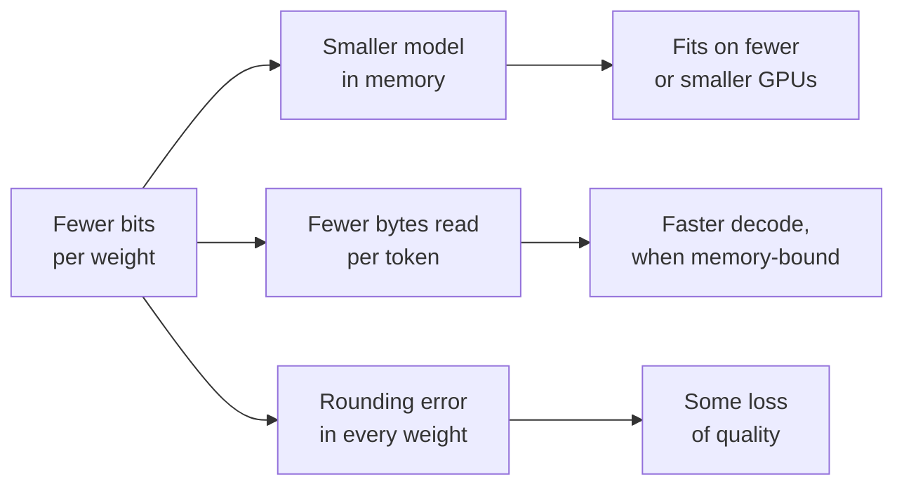

# Урок 1. Что даёт квантизация

**Связь с целью курса:** Каждое последующее решение о квантизации в этом курсе меняет точность на что-то, поэтому первое умение: точно знать, что это за «что-то», и уметь назвать его числом.
**Первоисточник:** [Научная статья: "A White Paper on Neural Network Quantization", Nagel et al., 2021](https://arxiv.org/abs/2106.08295), разделы 1 и 2.1
**Предварительные требования:** [Квантизация](../GLOSSARY.md), [Ограничение памятью](../GLOSSARY.md)

## Что нужно знать

### Что такое квантизация

Обученная LLM хранит веса как числа с плавающей точкой, обычно по 16 бит каждое. **Квантизация** хранит их, а иногда и активации с KV-кешем, на меньшем наборе уровней, которым нужно меньше бит: 8, 4 или ещё меньше. Каждое значение заменяется ближайшим уровнем, поэтому модель теперь считает с чуть неверными числами. Вся тема о том, как сделать эту ошибку малой там, где это важно.

Nagel и соавторы выражают выигрыш двумя числами: переход с 32 на 8 бит сокращает память для хранения тензоров в 4 раза, а стоимость умножения матриц в 16 раз, потому что эта стоимость растёт с произведением разрядностей двух операндов. Их оговорка в самом начале составляет вторую половину темы: квантизация «не бесплатна», и добавляемый ею шум может стоить точности.

### Арифметика памяти

Память под веса модели равна числу параметров, умноженному на число байт на параметр. Научитесь считать это в уме, потому что это первое число в любом разговоре о квантизации.

| Формат | Бит на вес | Модель на 8 млрд параметров | Модель на 70 млрд параметров |
|---|---|---|---|
| fp32 | 32 | 32 ГБ | 280 ГБ |
| bf16 | 16 | 16 ГБ | 140 ГБ |
| int8 | 8 | 8 ГБ | 70 ГБ |
| int4 | 4 | 4 ГБ | 35 ГБ |

Эти строки учитывают только веса при номинальной разрядности. Настоящие схемы с малой разрядностью хранят ещё и масштаб для каждой небольшой группы весов, цену которого оценивает урок 6. 16-битный масштаб на 128 весов добавляет 16 / 128 = 0,125 бита на вес, так что «4-битные» веса на самом деле занимают около 4,125 **эффективных бит на вес**.

Квантизация весов не уменьшает две вещи: активации, которые при инференсе невелики, и KV-кеш, который растёт с длиной контекста и размером батча. При длинном контексте и большом батче KV-кеш может весить больше, чем веса. С ним разбирается урок 16.

### Почему меньше байт значит быстрее

Генерация одного токена при размере батча 1 умножает один вектор на каждую матрицу весов модели, поэтому каждый вес читается из памяти один раз на токен, а участвует лишь в одном умножении и одном сложении. Арифметика дешёвая, а чтение нет: этот шаг декодирования **ограничен памятью**. Время на токен не может быть меньше, чем байты весов, делённые на пропускную способность памяти.

На GPU с пропускной способностью памяти 2 ТБ/с модель на 8 млрд в bf16 читает 16 ГБ на токен, поэтому быстрее 8 мс на токен, около 125 токенов в секунду, она быть не может. В int4 она читает 4 ГБ, а потолок составляет около 500 токенов в секунду. Этот потолок вы не получите: ядру приходится по ходу превращать 4-битные значения обратно в 16-битные числа, и KV-кеш тоже читается. Статья MARLIN называет такое ускорение для однопользовательского инференса достигнутым «благодаря сокращению перемещений памяти» и тратит усилия на то, чтобы сохранить его с ростом батча ([Frantar et al., 2024](https://arxiv.org/abs/2408.11743)). Урок 19 показывает, где ускорение заканчивается.

Диаграмма показывает компромисс, вокруг которого строится остальной курс: верхние ветви надёжны и легко считаются, нижняя неопределённа и требует измерения.

## Практика

1. ▢ Модель на 13 млрд параметров поставляется в bf16. Сколько памяти занимают её веса и сколько в int8?

Проверка

26 ГБ в bf16 (13 миллиардов × 2 байта) и 13 ГБ в int8 (13 миллиардов × 1 байт). Если у вас получилось 52 ГБ, это 4 байта на параметр у fp32.

2. ▢ Команда хочет обслуживать модель на 70 млрд на одном GPU с 80 ГБ. Какие из весов в bf16, int8 и int4 помещаются и какие оставляют место для чего-то ещё?

Подсказка

Посчитайте память весов в каждом формате, затем спросите, что ещё должно находиться на GPU, пока он обслуживает запросы.

Проверка

bf16 требует 140 ГБ и не помещается. int8 требует 70 ГБ, что на бумаге помещается, но оставляет около 10 ГБ на KV-кеш, активации и среду выполнения, так что обслуживается очень мало контекста. int4 требует около 36 ГБ с учётом масштабов групп и оставляет место для полезного KV-кеша. Слово «помещается» должно включать KV-кеш, а не только веса.

3. ▢ Предскажите, затем посчитайте. 4-битная схема хранит один 16-битный масштаб на группу из 32 весов. Предскажите, ближе ли её эффективное число бит на вес к 4,1 или к 4,5, а затем вычислите.

Проверка

4,5. Масштаб добавляет 16 / 32 = 0,5 бита на вес. С группой в 128 он добавил бы 0,125. Меньшие группы точнее (урок 6) и стоят больше места, поэтому «4 бита» само по себе не говорит, насколько велик чекпоинт.

4. ▢ На том же GPU при размере батча 1 скорость декодирования модели выросла с 40 до 120 токенов в секунду после квантизации её весов из bf16 в int4. Какое утверждение лучше всего объясняет и то, почему стало быстрее, и то, почему не получилось 160?

    - a) Арифметика int4 работает в четыре раза быстрее, за вычетом накладных расходов на округление
    - b) Читается меньше байт весов, за вычетом деквантизации и чтения KV
    - c) KV-кеш уменьшился вчетверо, за вычетом стоимости весов
    - d) Модель теперь помещается в кеш на кристалле, за вычетом активаций

Проверка

**b)** Декодирование при батче 1 ограничено памятью, поэтому чтение четверти байтов весов поднимает потолок примерно вчетверо, а работа ядра по деквантизации и неизменное чтение KV-кеша удерживают результат ниже. (a) неверно, потому что int4 только для весов всё равно вычисляет в 16 битах: арифметика не изменилась. (c) неверно, потому что квантизация весов оставляет KV-кеш в исходном формате. (d) неверно, потому что модель с миллиардами параметров не помещается в кеш на кристалле и в 4 битах.

## Практика в реальной работе

- [ ] Откройте карточку любой открытой модели на Hugging Face Hub, найдите число её параметров и посчитайте память её весов в bf16 и в int4. Затем сравните с размером файлов чекпоинта, перечисленных во вкладке «Files and versions».
- [ ] Найдите пропускную способность памяти GPU или ноутбука, к которому у вас есть доступ, и посчитайте потолок декодирования при батче 1 для модели на 8 млрд в bf16 и в int4.
- [ ] Завтра, без заметок, запишите число байт на параметр у fp32, bf16, int8 и int4 и формулу накладных расходов масштаба группы в битах на вес.

## Что почитать дальше

- [Числовые форматы](../reference/number-formats.md)
- [Инференс: Квантизация при обслуживании](../../inference/reference/quantization-at-serve-time.md), о том, как компромисс между памятью и скоростью защищают в бюджете обслуживания
- [Научная статья: "MARLIN: Mixed-Precision Auto-Regressive Parallel Inference on Large Language Models", Frantar et al., 2024](https://arxiv.org/abs/2408.11743)
- [Ресурсы](../RESOURCES.md)

---

Не доходит? Перечитайте первоисточник в начале: этот урок его сжимает, а при сжатии понимание как раз и теряется. Загляните в [глоссарий](../GLOSSARY.md), если какой-то термин показался скользким.

Если неясен сам урок, а не материал, это дефект: [откройте issue](https://github.com/TokenCemetery/teach/issues).
