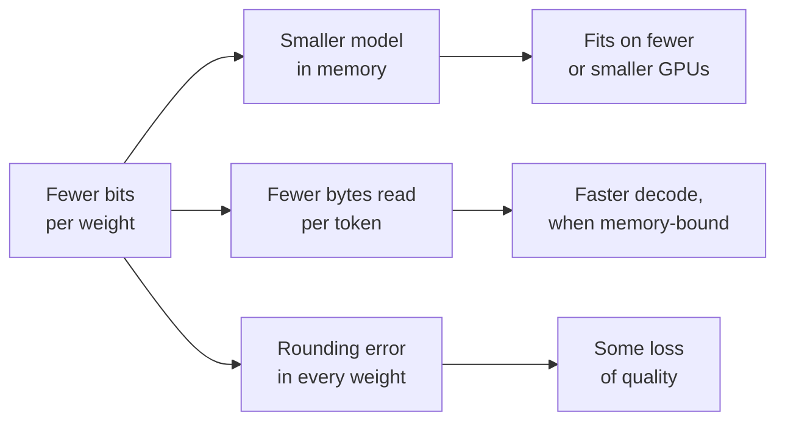

# 第 1 课：量化能带来什么

**使命关联:** 本系列后面的每一个量化决定，都是在拿精度去换某样东西，所以第一项技能，就是确切地知道那样东西是什么，并且能给它标出一个数字。
**主要来源:** [论文：“A White Paper on Neural Network Quantization”，Nagel 等，2021](https://arxiv.org/abs/2106.08295)，第 1 节和第 2.1 节
**前置知识:** [量化](../GLOSSARY.md)、[受内存带宽限制](../GLOSSARY.md)

## 要点

### 量化是什么

训练好的 LLM 把权重存成浮点数，通常每个 16 位。**量化**则把它们（有时也包括激活值和 KV 缓存）存放在一个更小的档位集合上，需要的位数更少：8 位、4 位，或者更少。每个值都被替换成离它最近的档位，所以模型现在是用略有偏差的数字在计算。整个主题，就是要让这个误差在要紧的地方保持很小。

Nagel 等人用两个数字说明了收益：从 32 位降到 8 位，存储张量的内存减少为原来的四分之一，一次矩阵乘法的开销减少为原来的十六分之一，因为这个开销随两个操作数位宽的乘积增长。他们开篇就给出的提醒，则是这个主题的另一半：量化“不是免费的”，它引入的噪声可能让精度受损。

### 内存的算法

模型的权重内存，就是参数量乘以每个参数的字节数。要练到能心算，因为它是每一次量化讨论中的第一个数字。

| 格式 | 每个权重的位数 | 8B 参数的模型 | 70B 参数的模型 |
|---|---|---|---|
| fp32 | 32 | 32 GB | 280 GB |
| bf16 | 16 | 16 GB | 140 GB |
| int8 | 8 | 8 GB | 70 GB |
| int4 | 4 | 4 GB | 35 GB |

这几行只是权重本身，按名义位宽计算。真实的低位方案还要为每一小组权重存一个缩放因子，第 6 课会给它标价。一个 16 位缩放因子由 128 个权重共用，每个权重多出 16 / 128 = 0.125 位，所以“4 位”实际上约等于 4.125 的**每个权重的有效位数**。

量化权重缩小不了两样东西：一是激活值，它在推理时本来就很小；二是 KV 缓存，它随上下文长度和批大小增长。在长上下文和大批量下，KV 缓存可能比权重还大。第 16 课会处理它。

### 为什么字节少就意味着更快

在批大小为 1 时生成一个 token，是用一个向量去乘模型里的每一个权重矩阵，所以每生成一个 token，每个权重都要从内存读取一次，而它们各自只参与一次乘法和一次加法。算术很便宜，读取却不便宜：这个解码步**受内存带宽限制**。每个 token 的耗时有一个下限，即权重字节数除以内存带宽。

在内存带宽为 2 TB/s 的 GPU 上，bf16 的 8B 模型每个 token 要读 16 GB，所以每个 token 不可能快于 8 ms，约合每秒 125 个 token。换成 int4，它只读 4 GB，上限约为每秒 500 个 token。这个上限并不是你实际能得到的速度：内核得一边计算，一边把 4 位的值还原成 16 位的数，而且 KV 缓存也要读取。MARLIN 论文把单用户推理中的这些加速称为“源于减少的内存搬运”，并把力气花在批大小增大时如何保住它们上（[Frantar 等，2024](https://arxiv.org/abs/2408.11743)）。第 19 课会展示加速在哪里到头。

这张图就是本系列后面一直在争论的那笔交易：上面的分支是确定的，也容易算出来；下面那个分支则不确定，必须靠度量。

## 练习

1. ▢ 一个 13B 参数的模型以 bf16 发布。它的权重占多少内存？换成 int8 又是多少？

检查

bf16 是 26 GB（130 亿 × 2 字节），int8 是 13 GB（130 亿 × 1 字节）。如果你算出了 52 GB，那是 fp32 每个参数 4 字节的结果。

2. ▢ 一个团队想在一块 80 GB 的 GPU 上部署一个 70B 的模型。bf16、int8 和 int4 的权重，哪些放得下，哪一种还能给别的东西留出空间？

提示

先算出每种格式的权重内存，再想想它在处理请求的同时，GPU 上还得放别的什么。

检查

bf16 需要 140 GB，放不下。int8 需要 70 GB，账面上放得下，但只给 KV 缓存、激活值和运行时留下约 10 GB，所以能服务的上下文极少。int4 把分组缩放因子算进去后约需 36 GB，能给一个有用的 KV 缓存留出空间。“放得下”必须把 KV 缓存算进去，而不只是权重。

3. ▢ 先预测，再计算。一个 4 位方案为每组 32 个权重存一个 16 位缩放因子。预测它的每个权重的有效位数更接近 4.1 还是 4.5，然后算出来。

检查

4.5。缩放因子使每个权重多出 16 / 32 = 0.5 位。如果分组大小是 128，则只多出 0.125。分组越小越准确（第 6 课），存储代价也越大，这就是为什么单说“4 位”并不能说明一个检查点有多大。

4. ▢ 在同一块 GPU 上，批大小为 1 时，把一个模型的权重从 bf16 量化到 int4 之后，它的解码速度从每秒 40 个 token 提高到 120 个。下面哪一种说法，最能同时解释它为什么变快了，以及为什么没有达到 160？

    - a) int4 的算术快四倍，再减去舍入的开销
    - b) 读取的权重字节更少，再减去反量化和 KV 读取
    - c) KV 缓存缩小为四分之一，再减去权重的开销
    - d) 模型现在放进了片上缓存，再减去激活值

检查

**b)** 批大小为 1 的解码受内存带宽限制，所以只读四分之一的权重字节，把上限提高了约四倍，而内核的反量化工作，加上没有变化的 KV 缓存读取，使它达不到这个上限。(a) 是错的，因为仅权重的 int4 仍然以 16 位计算：算术并没有变。(c) 是错的，因为量化权重不会改变 KV 缓存的格式。(d) 是错的，因为一个有数十亿参数的模型，即使用 4 位，也放不进片上缓存。

## 实战练习

- [ ] 打开 Hugging Face Hub 上任意一个开源模型的模型卡，找到它的参数量，算出它在 bf16 和 int4 下的权重内存。再与“Files and versions”下列出的检查点文件的大小做对比。
- [ ] 查一下你能用到的某块 GPU 或笔记本的内存带宽，算出一个 8B 模型在 bf16 和 int4 下批大小为 1 时的解码上限。
- [ ] 明天：不看笔记，写下 fp32、bf16、int8 和 int4 每个参数的字节数，以及用每个权重的位数来表示分组缩放因子开销的公式。

## 延伸阅读

- [数值格式](../reference/number-formats.md)
- [推理：服务时量化](../../inference/reference/quantization-at-serve-time.md)，了解内存与速度的权衡在服务预算中如何得到辩护
- [论文：“MARLIN: Mixed-Precision Auto-Regressive Parallel Inference on Large Language Models”，Frantar 等，2024](https://arxiv.org/abs/2408.11743)
- [资源](../RESOURCES.md)

---

没学明白？请重读顶部的主要来源，因为本课是对它的压缩，而理解正是在压缩中流失的。如果有哪个术语觉得含糊，可以查看[术语表](../GLOSSARY.md)。

如果问题出在课程本身，而不是学习材料，那就是一个缺陷：[提交 issue](https://github.com/TokenCemetery/teach/issues)。
