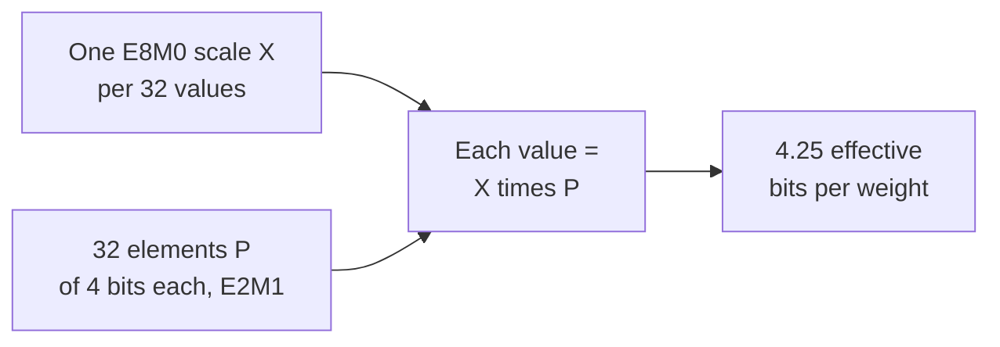

# Lección 3. Formatos de pocos bits

**Vínculo con la misión:** Cuantizar un modelo significa elegir uno de estos formatos, así que necesitas saber qué valores puede contener cada uno, cuánto cuesta por peso una vez contados los scales y por qué los estrechos no pueden funcionar sin un scale.
**Fuente principal:** [Paper: "FP8 Formats for Deep Learning", Micikevicius et al., 2022](https://arxiv.org/abs/2209.05433)
**Requisitos previos:** [Lección 2](0002-floating-point-formats.md), [Formato con scale por bloque](../GLOSSARY.md), [Scale](../GLOSSARY.md), [Ancho de bits](../GLOSSARY.md)

## Calentamiento

1. ▢ Un esquema de 4 bits almacena un scale de 16 bits por cada grupo de 32 pesos. ¿Cuántos son sus bits efectivos por peso?

<details markdown="1"><summary>Comprobación</summary>

4.5. El scale añade 16 / 32 = 0.5 bits por peso al ancho de bits de 4.

</details>

2. ▢ Una activación en bf16 tiene el valor 100,000. ¿Qué pasa cuando se convierte a fp16, y por qué bf16 no tiene el problema?

<details markdown="1"><summary>Comprobación</summary>

Se convierte en infinito, porque el mayor valor finito de fp16 es 65,504. bf16 tiene los 8 bits de exponente de fp32, así que su rango llega a unos 3.4 × 10^38, al precio de una mantisa de 7 bits.

</details>

## Qué debes saber

### fp8: dos disposiciones

[Micikevicius et al.](https://arxiv.org/abs/2209.05433) definen dos codificaciones de punto flotante de 8 bits, nombradas por sus conteos de bits de exponente y de mantisa. Cada una tiene además un bit de signo.

| | E4M3 | E5M2 |
|---|---|---|
| Bits de exponente / mantisa | 4 / 3 | 5 / 2 |
| Bias del exponente | 7 | 15 |
| Mayor valor finito | 448 | 57,344 |
| Menor valor normal | 2^-6 | 2^-14 |
| Menor valor subnormal | 2^-9 | 2^-16 |
| Infinitos | ninguno | estilo IEEE |
| NaN | un patrón de mantisa (S.1111.111) | varios (S.11111.01, .10, .11) |

E5M2 sigue las convenciones de IEEE 754 y puede verse como fp16 con menos bits de mantisa. E4M3 las rompe para ganar rango: elimina los infinitos y conserva un patrón de NaN por signo, lo que libera el exponente más alto para valores ordinarios y sube el mayor valor a 448. El uso recomendado es E4M3 para los tensores de pesos y de activaciones, y E5M2 para los tensores de gradientes. Es otra vez el intercambio de la lección 2: los gradientes abarcan un rango amplio, así que reciben el bit extra de exponente, mientras que los pesos y las activaciones reciben el bit extra de mantisa.

Ambos formatos tienen tan pocos valores que un tensor debe multiplicarse por un factor de escala antes de convertirse, para moverlo al rango que el formato puede representar. Los autores lo comparan con el propósito del escalado de la pérdida en el entrenamiento en fp16. Convertir los tensores de un modelo sin un factor de escala, informan, "dio como resultado una pérdida significativa de accuracy", con una perplexity de GPT de 11.0.

Con escalado, la cuantización post-entrenamiento a E4M3 se mantuvo cerca del baseline de 16 bits en sus pruebas mientras que int8 no, en los modelos que probaron. Para un modelo estilo GPT-3 de 6.7B la perplexity en wikitext103 fue 8.51 en punto flotante de 16 bits, 10.29 en int8 y 8.41 en E4M3, con factores de escala por canal para los pesos y por tensor para las activaciones. Es el resultado de un solo grupo, con sus elecciones de calibración: léelo como evidencia de que una rejilla de punto flotante se ajusta a estos tensores mejor que una rejilla de enteros, no como una clasificación general.

### int8 e int4: rejillas uniformes

Un formato entero no tiene exponente. Sus valores son números enteros igualmente espaciados: int8 contiene de -128 a 127, que son 256 niveles, e int4 contiene de -8 a 7, que son 16 niveles. La distancia entre vecinos es 1 en todas partes, a diferencia de un float, cuyas distancias se duplican en cada potencia de dos.

Por sí solos, los enteros solo pueden representar números enteros, así que un peso como 0.02 no se puede almacenar. Por eso un cuantizador almacena un entero junto con un **scale**, el paso de valor real entre niveles adyacentes, de modo que el valor real es aproximadamente el scale por el entero. Elegir ese scale, y qué hacer con los valores que no alcanza, es el tema de las lecciones 4 a 6. Por ahora quédate con un hecho: una rejilla de enteros tiene un espaciado fijo y ningún rango incorporado, así que su rango depende por completo del scale, mientras que una rejilla de punto flotante trae su propio rango y solo necesita un scale para colocar ese rango correctamente.

### Formatos con scale por bloque

Un único scale para todo un tensor encaja mal cuando los valores varían mucho. Un **formato con scale por bloque** da a un bloque pequeño de valores su propio scale compartido. Los formatos OCP Microscaling (MX), descritos por [Rouhani et al.](https://arxiv.org/abs/2310.10537), definen un bloque como k elementos con un scale compartido X, y el valor de cada elemento es X por su elemento almacenado P. En todos los formatos MX concretos que listan, el bloque tiene 32 elementos y el scale se almacena como E8M0, un exponente de 8 bits sin mantisa, de modo que el scale es siempre una potencia de dos. Nombran cada formato por su tipo de elemento:

| Formato | Tamaño de bloque | Formato del scale | Formato del elemento | Bits del elemento |
|---|---|---|---|---|
| MXFP8 | 32 | E8M0 | E4M3 o E5M2 | 8 |
| MXFP6 | 32 | E8M0 | E2M3 o E3M2 | 6 |
| MXFP4 | 32 | E8M0 | E2M1 | 4 |
| MXINT8 | 32 | E8M0 | int8 | 8 |

MXFP4 almacena 4 bits por elemento y un scale de 8 bits por cada 32, así que sus bits efectivos por peso son 4 + 8 / 32 = 4.25. Con la misma aritmética, MXFP8 y MXINT8 cuestan 8.25 y MXFP6 cuesta 6.25.



El tipo de elemento E2M1 tiene 1 bit de signo, 2 bits de exponente y 1 bit de mantisa. Son 16 patrones de bits y muy pocos valores. Los ocho no negativos son el conjunto exacto que lista NVIDIA, y los derivarás en el ejercicio 1 de la práctica.

[NVFP4 de NVIDIA](https://developer.nvidia.com/blog/introducing-nvfp4-for-efficient-and-accurate-low-precision-inference/) usa los mismos elementos E2M1 con dos cambios, tal como los describe el propio blog de NVIDIA, que es documentación del proveedor. El bloque es de 16 valores en lugar de 32, y su scale es un número FP8 E4M3 en lugar de una potencia de dos, de modo que el scale puede ser un múltiplo fraccionario y ajustarse más al bloque. Como un scale E4M3 tiene un rango estrecho, se aplica un segundo scale FP32 a todo el tensor. Eso da 4 + 8 / 16 = 4.5 bits efectivos por peso, ignorando el único escalar por tensor. NVIDIA dice que los scales E8M0 son más simples y pueden bastar para tensores menos sensibles a la precisión del scale.

| Esquema | Ancho de bits | Bits efectivos por peso | Modelo de 8B | Modelo de 70B |
|---|---|---|---|---|
| int8 (sin contar el costo del scale) | 8 | 8 | 8 GB | 70 GB |
| int4 (sin contar el costo del scale) | 4 | 4 | 4 GB | 35 GB |
| MXFP4 | 4 | 4.25 | 4.25 GB | unos 37.2 GB |
| NVFP4 | 4 | 4.5 | 4.5 GB | unos 39.4 GB |

## Práctica

1. ▢ E2M1 tiene 1 bit de signo, 2 bits de exponente y 1 bit de mantisa, con un bias de exponente de 1. Un campo `e` de 0 es subnormal y significa `m × 0.5`. En los demás casos el valor es `2^(e - 1) × (1 + m / 2)`. Lista los ocho valores no negativos que puede representar.

<details markdown="1"><summary>Pista</summary>

Hay cuatro campos de exponente y dos valores de mantisa, así que ocho combinaciones. Empieza con `e = 0` y los dos valores de `m`, y luego sube un exponente cada vez.

</details>

<details markdown="1"><summary>Comprobación</summary>

0, 0.5, 1, 1.5, 2, 3, 4 y 6. Con `e = 0`: 0 y 0.5. Con `e = 1`: 1 y 1.5. Con `e = 2`: 2 y 3. Con `e = 3`: 4 y 6. Coincide con la lista de NVIDIA, y 6 es el mayor valor. Reflejados con un bit de signo dan 15 valores distintos, porque el cero positivo y el negativo coinciden. Las distancias son 0.5 hasta 2, luego 1 y luego 2: incluso cuatro bits dan un espaciado de punto flotante.

</details>

2. ▢ Predice y luego ejecuta. La función decodifica un patrón de bits con la disposición y el bias que le des. Antes de ejecutar, calcula el mayor valor finito de E4M3 a partir del patrón 0 1111 110 y el menor valor positivo de E5M2 a partir de 0 00000 01.

    ```python
    def decode(code, ebits, mbits, bias):
        e = (code >> mbits) & ((1 << ebits) - 1)
        m = code & ((1 << mbits) - 1)
        if e == 0:
            return m / 2**mbits * 2.0 ** (1 - bias)
        return (1 + m / 2**mbits) * 2.0 ** (e - bias)

    print(decode(0b1111110, 4, 3, 7), decode(0b0000001, 4, 3, 7))
    print(decode(0b1111011, 5, 2, 15), decode(0b0000001, 5, 2, 15))
    ```

<details markdown="1"><summary>Pista</summary>

Para E4M3, 1111 es el campo de exponente 15, así que el scale es 2^(15 - 7) = 2^8, y 110 como mantisa es 1 + 6/8. El patrón 0 1111 111 está reservado para NaN, así que 110 es el mayor finito.

</details>

<details markdown="1"><summary>Comprobación</summary>

```text
448.0 0.001953125
57344.0 1.52587890625e-05
```

La primera línea es el mayor valor de E4M3, 448 = 1.75 × 2^8, y su menor subnormal, 2^-9. La segunda es el mayor de E5M2, 57,344 = 1.75 × 2^15, y su menor subnormal, 2^-16. Ambos coinciden con la tabla del paper. E5M2 llega unas 128 veces más alto que E4M3 y unas 128 veces más bajo, y lo paga con un bit de mantisa.

</details>

3. ▢ ¿Qué emparejamiento de formato fp8 y tipo de tensor recomienda el paper, y por qué?

    - a) E4M3 para gradientes, porque necesitan un espaciado más fino
    - b) E5M2 para gradientes, porque necesitan un rango más amplio
    - c) E5M2 para pesos, porque necesitan un espaciado más fino
    - d) E4M3 para pesos, porque necesitan un rango más amplio

<details markdown="1"><summary>Comprobación</summary>

**b)** La recomendación es E4M3 para pesos y activaciones y E5M2 para gradientes, y el razonamiento es el intercambio de la lección 2: los gradientes abarcan muchas potencias de dos, así que reciben el bit extra de exponente. (a) da a los gradientes el formato de rango estrecho. (d) atribuye a E4M3 un rango más amplio que no tiene. (c) empareja E5M2 con los pesos y afirma que tiene un espaciado más fino, pero E5M2 tiene el más grueso.

</details>

4. ▢ Predice y luego ejecuta. ¿Qué muestra el primer print, y qué muestra el segundo para la entrada 0.0004?

    ```python
    import numpy as np

    x = np.array([0.02, -0.31, 0.5, 0.0004])
    print(np.round(x).astype(np.int8))

    scale = np.abs(x).max() / 127
    q = np.round(x / scale).astype(np.int8)
    print(q, np.round(q * scale, 4))
    ```

<details markdown="1"><summary>Pista</summary>

La primera línea convierte directamente a int8, así que cada valor se redondea al número entero más cercano. En la segunda, el scale es la mayor magnitud dividida por 127, así que 0.5 debería caer en el nivel más alto.

</details>

<details markdown="1"><summary>Comprobación</summary>

```text
[0 0 0 0]
[  5 -79 127   0] [ 0.0197 -0.311   0.5     0.    ]
```

Sin scale todos los valores se redondean a cero. Con el scale, 0.5 se asigna a 127, -0.31 a -79 y 0.02 a 5, y los valores descuantizados quedan cerca. La última entrada sigue convirtiéndose en 0: 0.0004 es menos de medio paso de 0.0039, así que se redondea a cero. Un scale rescata el rango pero no los valores menores que la mitad de su paso.

</details>

5. ▢ Un modelo de 70B parámetros se almacena en MXFP4 y en NVFP4. Calcula la memoria de pesos de cada uno, y di por qué ninguno son simplemente 4 bits por parámetro.

<details markdown="1"><summary>Comprobación</summary>

MXFP4 son 4 + 8 / 32 = 4.25 bits efectivos, así que 70 × 4.25 / 8 = 37.1875, unos 37.2 GB. NVFP4 son 4 + 8 / 16 = 4.5 bits, así que 70 × 4.5 / 8 = 39.375, unos 39.4 GB, ignorando el escalar por tensor. Los scales se almacenan junto a los elementos y cuentan para la memoria, así que citar solo el ancho de 4 bits del elemento subestima el tamaño. El scale más fino y el bloque más pequeño de NVFP4 le cuestan unos 0.25 bits por peso más que a MXFP4.

</details>

6. ▢ Predice y luego ejecuta. Este esbozo sigue el Algoritmo 1 del paper de MX para un bloque FP4: el scale compartido es una potencia de dos elegida a partir de la mayor magnitud del bloque, y cada valor se redondea al valor E2M1 más cercano. Antes de ejecutar, di qué pasa con los valores pequeños del primer bloque, y compáralo con el segundo bloque, donde el valor grande se sustituye por 0.7.

    ```python
    import numpy as np

    pos = np.array([0, 0.5, 1, 1.5, 2, 3, 4, 6])
    grid = np.concatenate([-pos[:0:-1], pos])

    def mxfp4(v):
        shared_exp = np.floor(np.log2(np.abs(v).max())) - 2
        s = 2.0 ** shared_exp
        scaled = np.clip(v / s, -6, 6)
        idx = np.abs(scaled[:, None] - grid[None, :]).argmin(axis=1)
        return float(s), (grid[idx] * s).tolist()

    print(mxfp4(np.array([7.0, 0.9, 0.3, -0.12, 0.05])))
    print(mxfp4(np.array([0.7, 0.9, 0.3, -0.12, 0.05])))
    ```

<details markdown="1"><summary>Pista</summary>

El 2 de `- 2` es el exponente de 6, el mayor valor de E2M1 (6 = 1.5 × 2^2). Para el primer bloque, el scale es 2^(2 - 2). El menor nivel distinto de cero es entonces la mitad de ese scale.

</details>

<details markdown="1"><summary>Comprobación</summary>

```text
(1.0, [6.0, 1.0, 0.5, 0.0, 0.0])
(0.125, [0.75, 0.75, 0.25, -0.125, 0.0625])
```

En el primer bloque el scale es 1, el menor nivel distinto de cero es 0.5, y tanto -0.12 como 0.05 se redondean a 0, mientras que 7.0 se recorta a 6.0. En el segundo el scale es 0.125 y los cinco valores siguen siendo distintos de cero, con -0.12 y 0.05 reproducidos con un error de un paso como máximo. Un solo valor grande fija el scale de los 32 de su bloque, así que puede borrar a sus vecinos. Es el problema de los outliers de las lecciones 7 y 8, visto a escala de bloque.

</details>

## Prácticas en el mundo real

- [ ] Abre la model card o la configuración de cuantización de un checkpoint publicado en fp8 o en 4 bits y encuentra qué formato, qué tamaño de bloque o de grupo y qué tipo de scale usa. Calcula sus bits efectivos por peso.
- [ ] Mira la tabla de soporte de tensor cores o de tipos de datos de una GPU que podrías usar y anota cuáles de fp16, bf16, fp8 y fp4 lista como nativos.
- [ ] Mañana: sin apuntes, escribe los ocho valores no negativos de E2M1, el mayor valor de E4M3 y de E5M2, y los bits efectivos por peso de MXFP4.

## Para profundizar

- [Formatos numéricos](../reference/number-formats.md)
- [Paper: "FP8 Formats for Deep Learning", Micikevicius et al., 2022](https://arxiv.org/abs/2209.05433)
- [Paper: "Microscaling Data Formats for Deep Learning", Rouhani et al., 2023](https://arxiv.org/abs/2310.10537)
- [Article: "Introducing NVFP4 for Efficient and Accurate Low-Precision Inference", NVIDIA Technical Blog](https://developer.nvidia.com/blog/introducing-nvfp4-for-efficient-and-accurate-low-precision-inference/)
- [Recursos](../RESOURCES.md)

---

¿No termina de quedar claro? Vuelve a leer la fuente primaria de arriba, ya que esta lección la comprime y en la compresión es donde se escapa la comprensión. Consulta el [glosario](../GLOSSARY.md) por si algún término te resultó resbaladizo.

Si lo poco claro es la propia lección y no el material, eso es un defecto: [abre un issue](https://github.com/TokenCemetery/teach/issues).
