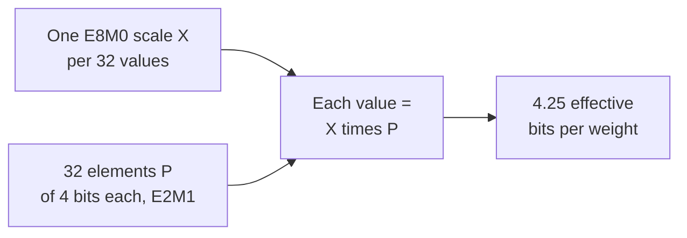

# Leçon 3. Les formats à faible nombre de bits

**Lien avec la mission :** Quantifier un modèle, c'est choisir l'un de ces formats, donc vous devez savoir quelles valeurs chacun peut contenir, ce qu'il coûte par poids une fois les scales comptés, et pourquoi les formats étroits ne peuvent pas fonctionner sans scale.
**Source primaire :** [Article : "FP8 Formats for Deep Learning", Micikevicius et al., 2022](https://arxiv.org/abs/2209.05433)
**Prérequis :** [Leçon 2](0002-floating-point-formats.md), [Format à échelle par bloc](../GLOSSARY.md), [Scale](../GLOSSARY.md), [Largeur en bits](../GLOSSARY.md)

## Échauffement

1. ▢ Un schéma en 4 bits stocke un scale de 16 bits pour chaque groupe de 32 poids. Quels sont ses bits effectifs par poids ?

<details markdown="1"><summary>Vérifier</summary>

4.5. Le scale ajoute 16 / 32 = 0.5 bit par poids à la largeur en bits de 4.

</details>

2. ▢ Une activation bf16 vaut 100,000. Que se passe-t-il quand on la convertit en fp16, et pourquoi le bf16 n'a-t-il pas ce problème ?

<details markdown="1"><summary>Vérifier</summary>

Elle devient l'infini, parce que la plus grande valeur finie du fp16 est 65,504. Le bf16 a les 8 bits d'exposant du fp32, donc sa plage atteint environ 3.4 × 10^38, au prix d'une mantisse de 7 bits.

</details>

## À savoir

### fp8 : deux agencements

[Micikevicius et al.](https://arxiv.org/abs/2209.05433) définissent deux encodages à virgule flottante sur 8 bits, nommés d'après leurs nombres de bits d'exposant et de mantisse. Chacun a aussi un bit de signe.

| | E4M3 | E5M2 |
|---|---|---|
| Bits d'exposant / de mantisse | 4 / 3 | 5 / 2 |
| Biais de l'exposant | 7 | 15 |
| Plus grande valeur finie | 448 | 57,344 |
| Plus petite valeur normale | 2^-6 | 2^-14 |
| Plus petite valeur subnormale | 2^-9 | 2^-16 |
| Infinis | aucun | style IEEE |
| NaN | un motif de mantisse (S.1111.111) | plusieurs (S.11111.01, .10, .11) |

Le E5M2 suit les conventions de l'IEEE 754 et peut être vu comme du fp16 avec moins de bits de mantisse. Le E4M3 les enfreint pour gagner en plage : il abandonne les infinis et garde un seul motif de NaN par signe, ce qui libère l'exposant le plus haut pour des valeurs ordinaires et porte la plus grande valeur à 448. L'usage recommandé est le E4M3 pour les tenseurs de poids et d'activations et le E5M2 pour les tenseurs de gradients. C'est de nouveau l'échange de la leçon 2 : les gradients couvrent une large plage, donc ils reçoivent le bit d'exposant supplémentaire, tandis que les poids et les activations reçoivent le bit de mantisse supplémentaire.

Les deux formats ont si peu de valeurs qu'un tenseur doit être multiplié par un facteur d'échelle avant d'être converti, pour le ramener dans la plage que le format sait représenter. Les auteurs rapprochent cela de l'objet du loss scaling dans l'entraînement en fp16. Convertir les tenseurs d'un modèle sans facteur d'échelle, rapportent-ils, « a entraîné une perte d'accuracy significative » (« resulted in a significant accuracy loss »), avec une perplexity GPT de 11.0.

Avec le scaling, la quantification post-entraînement en E4M3 est restée proche de la référence en 16 bits dans leurs tests alors que l'int8 ne l'a pas fait, sur les modèles qu'ils ont essayés. Pour un modèle de style GPT-3 de 6.7B, la perplexity sur wikitext103 était de 8.51 en virgule flottante 16 bits, 10.29 en int8 et 8.41 en E4M3, avec des facteurs d'échelle par canal pour les poids et par tenseur pour les activations. C'est le résultat d'un seul groupe, avec ses choix de calibration : lisez-le comme un indice qu'une grille flottante convient mieux à ces tenseurs qu'une grille entière, pas comme un classement général.

### int8 et int4 : des grilles uniformes

Un format entier n'a pas d'exposant. Ses valeurs sont des nombres entiers régulièrement espacés : l'int8 va de -128 à 127, soit 256 niveaux, et l'int4 de -8 à 7, soit 16 niveaux. L'écart entre voisins est partout de 1, contrairement à un flottant, dont les écarts doublent à chaque puissance de deux.

Seuls, les entiers ne peuvent représenter que des nombres entiers, donc un poids comme 0.02 ne peut pas être stocké. Un quantificateur stocke donc un entier avec un **scale**, le pas en valeur réelle entre deux niveaux adjacents, de sorte que la valeur réelle vaut approximativement le scale multiplié par l'entier. Choisir ce scale, et savoir quoi faire des valeurs qu'il ne peut pas atteindre, c'est l'objet des leçons 4 à 6. Pour l'instant, retenez un fait : une grille entière a un espacement fixe et aucune plage intégrée, donc sa plage est entièrement l'affaire du scale, alors qu'une grille flottante apporte sa propre plage et n'a besoin d'un scale que pour placer correctement cette plage.

### Formats à échelle par bloc

Un seul scale pour tout un tenseur convient mal quand les valeurs varient beaucoup. Un **format à échelle par bloc** donne à un petit bloc de valeurs son propre scale partagé. Les formats OCP Microscaling (MX), décrits par [Rouhani et al.](https://arxiv.org/abs/2310.10537), définissent un bloc comme k éléments avec un scale partagé X, et la valeur de chaque élément est X multiplié par son élément stocké P. Dans chaque format MX concret qu'ils listent, le bloc a 32 éléments et le scale est stocké en E8M0, un exposant sur 8 bits sans mantisse, donc le scale est toujours une puissance de deux. Ils nomment chaque format d'après son type d'élément :

| Format | Taille de bloc | Format du scale | Format de l'élément | Bits de l'élément |
|---|---|---|---|---|
| MXFP8 | 32 | E8M0 | E4M3 ou E5M2 | 8 |
| MXFP6 | 32 | E8M0 | E2M3 ou E3M2 | 6 |
| MXFP4 | 32 | E8M0 | E2M1 | 4 |
| MXINT8 | 32 | E8M0 | int8 | 8 |

Le MXFP4 stocke 4 bits par élément et un scale de 8 bits pour 32, donc ses bits effectifs par poids valent 4 + 8 / 32 = 4.25. Par la même arithmétique, le MXFP8 et le MXINT8 coûtent 8.25 et le MXFP6 coûte 6.25.



Le type d'élément E2M1 a 1 bit de signe, 2 bits d'exposant et 1 bit de mantisse. Cela fait 16 motifs de bits et très peu de valeurs. Les huit valeurs non négatives sont exactement l'ensemble que NVIDIA liste, et vous les dériverez à l'exercice 1 de la pratique.

[Le NVFP4 de NVIDIA](https://developer.nvidia.com/blog/introducing-nvfp4-for-efficient-and-accurate-low-precision-inference/) utilise les mêmes éléments E2M1 avec deux changements, tels que les décrit le billet de blog de NVIDIA lui-même, qui est de la documentation de fournisseur. Le bloc est de 16 valeurs plutôt que 32, et son scale est un nombre FP8 E4M3 plutôt qu'une puissance de deux, donc le scale peut être un multiple fractionnaire et s'ajuster plus finement à chaque bloc. Comme un scale E4M3 a une plage étroite, un second scale FP32 est appliqué à tout le tenseur. Cela donne 4 + 8 / 16 = 4.5 bits effectifs par poids, en ignorant le scalaire unique par tenseur. NVIDIA dit que les scales E8M0 sont plus simples et peuvent suffire pour les tenseurs moins sensibles à la précision du scale.

| Schéma | Largeur en bits | Bits effectifs par poids | Modèle 8B | Modèle 70B |
|---|---|---|---|---|
| int8 (coût du scale ignoré) | 8 | 8 | 8 GB | 70 GB |
| int4 (coût du scale ignoré) | 4 | 4 | 4 GB | 35 GB |
| MXFP4 | 4 | 4.25 | 4.25 GB | environ 37.2 GB |
| NVFP4 | 4 | 4.5 | 4.5 GB | environ 39.4 GB |

## Pratique

1. ▢ Le E2M1 a 1 bit de signe, 2 bits d'exposant et 1 bit de mantisse, avec un biais d'exposant de 1. Un champ `e` valant 0 est subnormal et signifie `m × 0.5`. Sinon, la valeur est `2^(e - 1) × (1 + m / 2)`. Listez les huit valeurs non négatives qu'il peut représenter.

<details markdown="1"><summary>Indice</summary>

Il y a quatre champs d'exposant et deux valeurs de mantisse, donc huit combinaisons. Commencez par `e = 0` et les deux valeurs de `m`, puis montez d'un exposant à la fois.

</details>

<details markdown="1"><summary>Vérifier</summary>

0, 0.5, 1, 1.5, 2, 3, 4 et 6. Avec `e = 0` : 0 et 0.5. Avec `e = 1` : 1 et 1.5. Avec `e = 2` : 2 et 3. Avec `e = 3` : 4 et 6. Cela correspond à la liste de NVIDIA, et 6 est la plus grande valeur. En miroir avec un bit de signe, cela donne 15 valeurs distinctes, puisque zéro positif et zéro négatif coïncident. Les écarts sont de 0.5 jusqu'à 2, puis de 1, puis de 2 : même sur quatre bits, on obtient un espacement de virgule flottante.

</details>

2. ▢ Prédisez, puis exécutez. La fonction décode un motif de bits avec l'agencement et le biais que vous lui donnez. Avant d'exécuter, calculez la plus grande valeur finie du E4M3 à partir du motif 0 1111 110 et la plus petite valeur positive du E5M2 à partir de 0 00000 01.

    ```python
    def decode(code, ebits, mbits, bias):
        e = (code >> mbits) & ((1 << ebits) - 1)
        m = code & ((1 << mbits) - 1)
        if e == 0:
            return m / 2**mbits * 2.0 ** (1 - bias)
        return (1 + m / 2**mbits) * 2.0 ** (e - bias)

    print(decode(0b1111110, 4, 3, 7), decode(0b0000001, 4, 3, 7))
    print(decode(0b1111011, 5, 2, 15), decode(0b0000001, 5, 2, 15))
    ```

<details markdown="1"><summary>Indice</summary>

Pour le E4M3, 1111 est le champ d'exposant 15, donc le facteur est 2^(15 - 7) = 2^8, et 110 comme mantisse vaut 1 + 6/8. Le motif 0 1111 111 est réservé au NaN, donc 110 est la plus grande valeur finie.

</details>

<details markdown="1"><summary>Vérifier</summary>

```text
448.0 0.001953125
57344.0 1.52587890625e-05
```

La première ligne donne la plus grande valeur du E4M3, 448 = 1.75 × 2^8, et sa plus petite valeur subnormale, 2^-9. La seconde donne la plus grande du E5M2, 57,344 = 1.75 × 2^15, et sa plus petite valeur subnormale, 2^-16. Les deux concordent avec le tableau de l'article. Le E5M2 monte environ 128 fois plus haut que le E4M3 et descend environ 128 fois plus bas, et le paie d'un bit de mantisse.

</details>

3. ▢ Quel appariement de format fp8 et de type de tenseur l'article recommande-t-il, et pourquoi ?

    - a) E4M3 pour les gradients, parce qu'ils ont besoin d'un espacement plus fin
    - b) E5M2 pour les gradients, parce qu'ils ont besoin d'une plage plus large
    - c) E5M2 pour les poids, parce qu'ils ont besoin d'un espacement plus fin
    - d) E4M3 pour les poids, parce qu'ils ont besoin d'une plage plus large

<details markdown="1"><summary>Vérifier</summary>

**b)** La recommandation est E4M3 pour les poids et les activations et E5M2 pour les gradients, et le raisonnement est l'échange de la leçon 2 : les gradients couvrent beaucoup de puissances de deux, donc ils reçoivent le bit d'exposant supplémentaire. (a) donne aux gradients le format à plage étroite. (d) attribue au E4M3 une plage plus large qu'il n'a pas. (c) apparie le E5M2 aux poids et lui prête un espacement plus fin, alors que celui du E5M2 est le plus grossier.

</details>

4. ▢ Prédisez, puis exécutez. Que montre le premier print, et que montre le second pour l'entrée 0.0004 ?

    ```python
    import numpy as np

    x = np.array([0.02, -0.31, 0.5, 0.0004])
    print(np.round(x).astype(np.int8))

    scale = np.abs(x).max() / 127
    q = np.round(x / scale).astype(np.int8)
    print(q, np.round(q * scale, 4))
    ```

<details markdown="1"><summary>Indice</summary>

La première ligne convertit directement en int8, donc chaque valeur est arrondie au nombre entier le plus proche. Dans la seconde, le scale est la plus grande grandeur divisée par 127, donc 0.5 devrait tomber sur le niveau le plus haut.

</details>

<details markdown="1"><summary>Vérifier</summary>

```text
[0 0 0 0]
[  5 -79 127   0] [ 0.0197 -0.311   0.5     0.    ]
```

Sans scale, chaque valeur est arrondie à zéro. Avec le scale, 0.5 devient 127, -0.31 devient -79 et 0.02 devient 5, et les valeurs déquantifiées sont proches. La dernière entrée devient quand même 0 : 0.0004 est inférieur à la moitié d'un pas de 0.0039, donc elle est arrondie à néant. Un scale sauve la plage mais pas les valeurs plus petites que la moitié de son pas.

</details>

5. ▢ Un modèle de 70B paramètres est stocké en MXFP4 et en NVFP4. Calculez la mémoire des poids de chacun, et dites pourquoi ni l'un ni l'autre ne fait simplement 4 bits par paramètre.

<details markdown="1"><summary>Vérifier</summary>

Le MXFP4 fait 4 + 8 / 32 = 4.25 bits effectifs, donc 70 × 4.25 / 8 = 37.1875, soit environ 37.2 GB. Le NVFP4 fait 4 + 8 / 16 = 4.5 bits, donc 70 × 4.5 / 8 = 39.375, soit environ 39.4 GB, en ignorant le scalaire par tenseur. Les scales sont stockés à côté des éléments et comptent dans la mémoire, donc citer la seule largeur de 4 bits des éléments sous-estime la taille. Le scale plus fin et le bloc plus petit du NVFP4 lui coûtent environ 0.25 bit par poids de plus que le MXFP4.

</details>

6. ▢ Prédisez, puis exécutez. Cette esquisse suit l'algorithme 1 de l'article MX pour un bloc FP4 : le scale partagé est une puissance de deux choisie d'après la plus grande grandeur du bloc, et chaque valeur est arrondie à la valeur E2M1 la plus proche. Avant d'exécuter, dites ce qui arrive aux petites valeurs du premier bloc, puis comparez avec le second bloc, où la grande valeur est remplacée par 0.7.

    ```python
    import numpy as np

    pos = np.array([0, 0.5, 1, 1.5, 2, 3, 4, 6])
    grid = np.concatenate([-pos[:0:-1], pos])

    def mxfp4(v):
        shared_exp = np.floor(np.log2(np.abs(v).max())) - 2
        s = 2.0 ** shared_exp
        scaled = np.clip(v / s, -6, 6)
        idx = np.abs(scaled[:, None] - grid[None, :]).argmin(axis=1)
        return float(s), (grid[idx] * s).tolist()

    print(mxfp4(np.array([7.0, 0.9, 0.3, -0.12, 0.05])))
    print(mxfp4(np.array([0.7, 0.9, 0.3, -0.12, 0.05])))
    ```

<details markdown="1"><summary>Indice</summary>

Le 2 de `- 2` est l'exposant de 6, la plus grande valeur E2M1 (6 = 1.5 × 2^2). Pour le premier bloc, le scale est 2^(2 - 2). Le plus petit niveau non nul vaut alors la moitié de ce scale.

</details>

<details markdown="1"><summary>Vérifier</summary>

```text
(1.0, [6.0, 1.0, 0.5, 0.0, 0.0])
(0.125, [0.75, 0.75, 0.25, -0.125, 0.0625])
```

Dans le premier bloc, le scale est 1, le plus petit niveau non nul est 0.5, et -0.12 comme 0.05 sont arrondis à 0, tandis que 7.0 est écrêté à 6.0. Dans le second, le scale est 0.125 et les cinq valeurs restent non nulles, avec -0.12 et 0.05 reproduits à un pas près. Une seule grande valeur fixe le scale des 32 de son bloc, donc elle peut effacer ses voisines. C'est le problème des outliers des leçons 7 et 8, vu à l'échelle du bloc.

</details>

## Exercices en situation réelle

- [ ] Ouvrez la fiche du modèle ou la config de quantification d'un checkpoint publié en fp8 ou en 4 bits et trouvez quel format, quelle taille de bloc ou de groupe et quel type de scale il utilise. Calculez ses bits effectifs par poids.
- [ ] Regardez le tableau de prise en charge des tensor cores ou des types de données d'un GPU que vous pourriez utiliser et notez lesquels parmi fp16, bf16, fp8 et fp4 il liste comme natifs.
- [ ] Demain : sans notes, écrivez les huit valeurs non négatives du E2M1, la plus grande valeur du E4M3 et du E5M2, et les bits effectifs par poids du MXFP4.

## Pour aller plus loin

- [Formats de nombres](../reference/number-formats.md)
- [Article : "FP8 Formats for Deep Learning", Micikevicius et al., 2022](https://arxiv.org/abs/2209.05433)
- [Article : "Microscaling Data Formats for Deep Learning", Rouhani et al., 2023](https://arxiv.org/abs/2310.10537)
- [Billet : "Introducing NVFP4 for Efficient and Accurate Low-Precision Inference", NVIDIA Technical Blog](https://developer.nvidia.com/blog/introducing-nvfp4-for-efficient-and-accurate-low-precision-inference/)
- [Ressources](../RESOURCES.md)

---

Ça ne passe pas ? Relisez la source primaire en haut de page, car cette leçon la condense et c'est dans la condensation que la compréhension s'échappe. Consultez le [glossaire](../GLOSSARY.md) pour tout terme qui vous a paru glissant.

Si c'est la leçon elle-même qui n'est pas claire plutôt que la matière, c'est un défaut : [ouvrez une issue](https://github.com/TokenCemetery/teach/issues).
