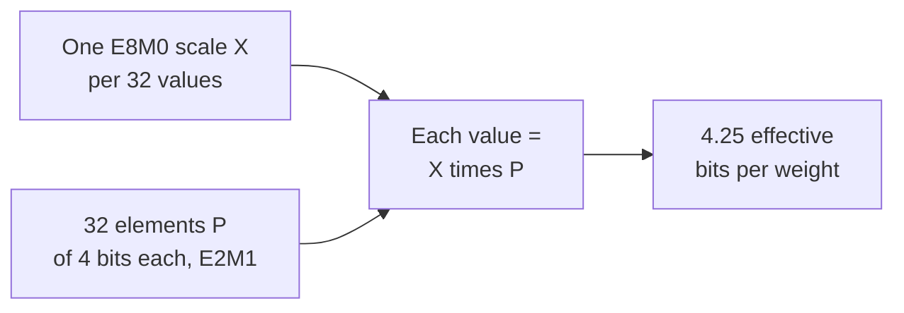

# पाठ 3. Low-Bit Formats

**मिशन से संबंध:** Model को quantize करने का मतलब इन्हीं formats में से एक चुनना है, इसलिए आपको जानना होगा कि हर एक कौन-सी values रख सकता है, scales गिनने के बाद प्रति weight उसकी क्या लागत है, और संकरे formats बिना scale के क्यों काम नहीं कर सकते।
**मुख्य स्रोत:** [पेपर: "FP8 Formats for Deep Learning", Micikevicius et al., 2022](https://arxiv.org/abs/2209.05433)
**पूर्व-आवश्यकताएँ:** [पाठ 2](0002-floating-point-formats.md), [Block-scaled format](../GLOSSARY.md), [Scale](../GLOSSARY.md), [Bit width](../GLOSSARY.md)

## वार्म-अप

1. ▢ एक 4-bit scheme हर 32 weights के group के लिए एक 16-bit scale store करती है। उसके effective bits per weight क्या हैं?

<details markdown="1"><summary>जाँचें</summary>

4.5। Scale 4-bit की bit width में हर weight पर 16 / 32 = 0.5 bits जोड़ता है।

</details>

2. ▢ किसी bf16 activation की value 100,000 है। उसे fp16 में cast करने पर क्या होता है, और bf16 को यह समस्या क्यों नहीं होती?

<details markdown="1"><summary>जाँचें</summary>

वह infinity बन जाती है, क्योंकि fp16 की सबसे बड़ी finite value 65,504 है। bf16 में fp32 के 8 exponent bits हैं, इसलिए उसकी range लगभग 3.4 × 10^38 तक पहुँचती है, 7-bit mantissa की क़ीमत पर।

</details>

## यह जानें

### fp8: दो layouts

[Micikevicius et al.](https://arxiv.org/abs/2209.05433) दो 8-bit floating-point encodings परिभाषित करते हैं, जिनके नाम उनके exponent और mantissa bits की संख्या से रखे गए हैं। हर एक में एक sign bit भी होता है।

| | E4M3 | E5M2 |
|---|---|---|
| Exponent / mantissa bits | 4 / 3 | 5 / 2 |
| Exponent bias | 7 | 15 |
| सबसे बड़ी finite value | 448 | 57,344 |
| सबसे छोटी normal value | 2^-6 | 2^-14 |
| सबसे छोटी subnormal value | 2^-9 | 2^-16 |
| Infinities | कोई नहीं | IEEE की तरह |
| NaN | एक mantissa pattern (S.1111.111) | कई (S.11111.01, .10, .11) |

E5M2 IEEE 754 की परिपाटियों का पालन करता है और उसे ऐसे fp16 की तरह देखा जा सकता है जिसमें mantissa bits कम हों। E4M3 range पाने के लिए उन्हें तोड़ता है: वह infinities हटा देता है और हर sign के लिए एक NaN pattern रखता है, जिससे सबसे ऊपर का exponent आम values के लिए ख़ाली हो जाता है और सबसे बड़ी value 448 तक पहुँच जाती है। सुझाया गया इस्तेमाल है weight और activation tensors के लिए E4M3 और gradient tensors के लिए E5M2। यह पाठ 2 वाला ही सौदा है: gradients की range चौड़ी होती है, इसलिए उन्हें अतिरिक्त exponent bit मिलता है, जबकि weights और activations को अतिरिक्त mantissa bit।

दोनों formats में इतनी कम values हैं कि cast करने से पहले tensor को एक scaling factor से गुणा करना पड़ता है, ताकि वह उस range में आ जाए जो format represent कर सकता है। लेखक इसकी तुलना fp16 training में loss scaling के मक़सद से करते हैं। वे बताते हैं कि scaling factor के बिना model के tensors को cast करने से "accuracy में काफ़ी गिरावट आई", GPT की perplexity 11.0 रही।

Scaling के साथ, उनके परीक्षणों में E4M3 पर post-training quantization 16-bit baseline के क़रीब रहा जबकि int8 नहीं, उन models पर जो उन्होंने आज़माए। 6.7B GPT-3 जैसे model के लिए wikitext103 perplexity 16-bit floating point में 8.51 थी, int8 में 10.29 और E4M3 में 8.41, weights के लिए per-channel और activations के लिए per-tensor scaling factors के साथ। यह एक समूह का नतीजा है, उनके calibration चुनावों के साथ: इसे इस सबूत की तरह पढ़ें कि float grid इन tensors पर integer grid से बेहतर बैठता है, किसी सामान्य रैंकिंग की तरह नहीं।

### int8 और int4: एकसमान grids

Integer format में कोई exponent नहीं होता। उसकी values बराबर दूरी पर रखी पूर्ण संख्याएँ हैं: int8 में -128 से 127 तक हैं, यानी 256 levels, और int4 में -8 से 7 तक, यानी 16 levels। पड़ोसियों के बीच फ़ासला हर जगह 1 है, float से उलट, जिसके फ़ासले हर घात पर दुगुने होते हैं।

अकेले, integers सिर्फ़ पूर्ण संख्याएँ represent कर सकते हैं, इसलिए 0.02 जैसा weight store नहीं हो सकता। इसलिए quantizer integer के साथ एक **scale** store करता है, यानी आसन्न levels के बीच का real-valued step, ताकि real value लगभग scale गुणा integer हो। वह scale चुनना, और जिन values तक वह नहीं पहुँचता उनका क्या करना है, यह पाठ 4 से 6 का विषय है। अभी एक तथ्य याद रखें: integer grid की दूरी तय है और उसमें कोई built-in range नहीं, इसलिए उसकी range पूरी तरह scale की देन है, जबकि float grid अपनी range ख़ुद लाता है और उस range को सही जगह रखने के लिए ही उसे scale चाहिए।

### Block-scaled formats

पूरे tensor के लिए एक अकेला scale तब ख़राब बैठता है जब values में बहुत फ़र्क़ हो। **Block-scaled format** values के छोटे block को अपना साझा scale देता है। OCP Microscaling (MX) formats, जिनका वर्णन [Rouhani et al.](https://arxiv.org/abs/2310.10537) करते हैं, block को k elements और एक साझा scale X के रूप में परिभाषित करते हैं, और हर element की value X गुणा उसका store किया गया element P होती है। उनके सूचीबद्ध हर ठोस MX format में block में 32 elements हैं और scale E8M0 के रूप में store होता है, यानी बिना mantissa का 8-bit exponent, इसलिए scale हमेशा दो की घात होता है। वे हर format का नाम उसके element type से रखते हैं:

| Format | Block size | Scale format | Element format | Element bits |
|---|---|---|---|---|
| MXFP8 | 32 | E8M0 | E4M3 या E5M2 | 8 |
| MXFP6 | 32 | E8M0 | E2M3 या E3M2 | 6 |
| MXFP4 | 32 | E8M0 | E2M1 | 4 |
| MXINT8 | 32 | E8M0 | int8 | 8 |

MXFP4 प्रति element 4 bits और हर 32 पर एक 8-bit scale store करता है, इसलिए उसके effective bits per weight 4 + 8 / 32 = 4.25 हैं। इसी हिसाब से MXFP8 और MXINT8 की लागत 8.25 और MXFP6 की 6.25 है।



Element type E2M1 में 1 sign bit, 2 exponent bits और 1 mantissa bit हैं। यानी 16 bit patterns और बहुत कम values। आठ non-negative values वही हैं जो NVIDIA सूचीबद्ध करता है, और आप उन्हें अभ्यास के पहले सवाल में ख़ुद निकालेंगे।

[NVIDIA का NVFP4](https://developer.nvidia.com/blog/introducing-nvfp4-for-efficient-and-accurate-low-precision-inference/) वही E2M1 elements दो बदलावों के साथ इस्तेमाल करता है, जैसा NVIDIA के अपने blog post में बताया गया है, जो vendor documentation है। Block 32 की जगह 16 values का है, और उसका scale दो की घात की जगह FP8 E4M3 संख्या है, इसलिए scale भिन्नात्मक गुणज हो सकता है और हर block पर ज़्यादा क़रीब से बैठ सकता है। क्योंकि E4M3 scale की range संकरी है, पूरे tensor पर एक दूसरा FP32 scale भी लगाया जाता है। इससे effective bits per weight 4 + 8 / 16 = 4.5 होते हैं, अकेले per-tensor scalar को छोड़कर। NVIDIA कहता है कि E8M0 scales सरल हैं और उन tensors के लिए पर्याप्त हो सकते हैं जो scale की precision के प्रति कम संवेदनशील हैं।

| Scheme | Bit width | Effective bits per weight | 8B model | 70B model |
|---|---|---|---|---|
| int8 (scale की लागत छोड़कर) | 8 | 8 | 8 GB | 70 GB |
| int4 (scale की लागत छोड़कर) | 4 | 4 | 4 GB | 35 GB |
| MXFP4 | 4 | 4.25 | 4.25 GB | लगभग 37.2 GB |
| NVFP4 | 4 | 4.5 | 4.5 GB | लगभग 39.4 GB |

## अभ्यास

1. ▢ E2M1 में 1 sign bit, 2 exponent bits और 1 mantissa bit है, और exponent bias 1 है। Field `e` का 0 होना subnormal है और उसका मतलब `m × 0.5` है। वरना value `2^(e - 1) × (1 + m / 2)` है। वे आठ non-negative values सूचीबद्ध करें जो वह represent कर सकता है।

<details markdown="1"><summary>संकेत</summary>

चार exponent fields हैं और दो mantissa values, इसलिए आठ संयोजन। `e = 0` और `m` की दो values से शुरू करें, फिर एक-एक exponent ऊपर चढ़ें।

</details>

<details markdown="1"><summary>जाँचें</summary>

0, 0.5, 1, 1.5, 2, 3, 4 और 6। `e = 0` के साथ: 0 और 0.5। `e = 1` के साथ: 1 और 1.5। `e = 2` के साथ: 2 और 3। `e = 3` के साथ: 4 और 6। यह NVIDIA की सूची से मेल खाता है, और 6 सबसे बड़ी value है। Sign bit से प्रतिबिंबित करने पर 15 अलग values मिलती हैं, क्योंकि धनात्मक और ऋणात्मक zero एक ही हैं। फ़ासले 2 तक 0.5 हैं, फिर 1, फिर 2: चार bits में भी floating-point वाली दूरी मिलती है।

</details>

2. ▢ पहले अनुमान लगाएँ, फिर चलाएँ। यह function किसी bit pattern को उस layout और bias से decode करता है जो आप उसे दें। चलाने से पहले pattern 0 1111 110 से E4M3 की सबसे बड़ी finite value और 0 00000 01 से E5M2 की सबसे छोटी धनात्मक value निकालें।

    ```python
    def decode(code, ebits, mbits, bias):
        e = (code >> mbits) & ((1 << ebits) - 1)
        m = code & ((1 << mbits) - 1)
        if e == 0:
            return m / 2**mbits * 2.0 ** (1 - bias)
        return (1 + m / 2**mbits) * 2.0 ** (e - bias)

    print(decode(0b1111110, 4, 3, 7), decode(0b0000001, 4, 3, 7))
    print(decode(0b1111011, 5, 2, 15), decode(0b0000001, 5, 2, 15))
    ```

<details markdown="1"><summary>संकेत</summary>

E4M3 के लिए, 1111 exponent field 15 है, इसलिए scale 2^(15 - 7) = 2^8 है, और mantissa के रूप में 110 का मतलब 1 + 6/8। Pattern 0 1111 111 NaN के लिए आरक्षित है, इसलिए 110 सबसे बड़ी finite value है।

</details>

<details markdown="1"><summary>जाँचें</summary>

```text
448.0 0.001953125
57344.0 1.52587890625e-05
```

पहली line E4M3 की सबसे बड़ी value है, 448 = 1.75 × 2^8, और उसकी सबसे छोटी subnormal, 2^-9। दूसरी E5M2 की सबसे बड़ी है, 57,344 = 1.75 × 2^15, और उसकी सबसे छोटी subnormal, 2^-16। दोनों पेपर की table से मेल खाती हैं। E5M2 E4M3 से लगभग 128 गुना ऊपर और लगभग 128 गुना नीचे तक पहुँचता है, और इसकी क़ीमत एक mantissa bit से चुकाता है।

</details>

3. ▢ पेपर fp8 format और tensor type की कौन-सी जोड़ी सुझाता है, और क्यों?

    - a) gradients के लिए E4M3, क्योंकि उन्हें बारीक दूरी चाहिए
    - b) gradients के लिए E5M2, क्योंकि उन्हें चौड़ी range चाहिए
    - c) weights के लिए E5M2, क्योंकि उन्हें बारीक दूरी चाहिए
    - d) weights के लिए E4M3, क्योंकि उन्हें चौड़ी range चाहिए

<details markdown="1"><summary>जाँचें</summary>

**b)** सुझाव है weights और activations के लिए E4M3 और gradients के लिए E5M2, और तर्क पाठ 2 का सौदा है: gradients दो की कई घातों में फैले होते हैं, इसलिए उन्हें अतिरिक्त exponent bit मिलता है। (a) gradients को संकरी range वाला format देता है। (d) E4M3 को ऐसी चौड़ी range का श्रेय देता है जो उसके पास नहीं है। (c) E5M2 को weights से जोड़ता है और कहता है कि उसकी दूरी बारीक है, पर E5M2 की दूरी मोटी है।

</details>

4. ▢ पहले अनुमान लगाएँ, फिर चलाएँ। पहला print क्या दिखाता है, और दूसरा entry 0.0004 के लिए क्या दिखाता है?

    ```python
    import numpy as np

    x = np.array([0.02, -0.31, 0.5, 0.0004])
    print(np.round(x).astype(np.int8))

    scale = np.abs(x).max() / 127
    q = np.round(x / scale).astype(np.int8)
    print(q, np.round(q * scale, 4))
    ```

<details markdown="1"><summary>संकेत</summary>

पहली line सीधे int8 में cast करती है, इसलिए हर value सबसे नज़दीकी पूर्ण संख्या पर round होती है। दूसरी में scale सबसे बड़ी magnitude को 127 से भाग देकर बनता है, इसलिए 0.5 सबसे ऊपर के level पर गिरना चाहिए।

</details>

<details markdown="1"><summary>जाँचें</summary>

```text
[0 0 0 0]
[  5 -79 127   0] [ 0.0197 -0.311   0.5     0.    ]
```

Scale के बिना हर value zero पर round होती है। Scale के साथ, 0.5, 127 पर map होता है, -0.31, -79 पर और 0.02, 5 पर, और dequantize की गई values क़रीब हैं। आख़िरी entry फिर भी 0 बनती है: 0.0004, 0.0039 के एक step के आधे से कम है, इसलिए round होकर ग़ायब हो जाती है। Scale range को बचा लेता है पर उन values को नहीं जो उसके step के आधे से छोटी हैं।

</details>

5. ▢ 70B-parameter model MXFP4 और NVFP4 में store है। दोनों की weight memory निकालें, और बताएँ कि दोनों में से कोई भी सीधे प्रति parameter 4 bits क्यों नहीं है।

<details markdown="1"><summary>जाँचें</summary>

MXFP4 में 4 + 8 / 32 = 4.25 effective bits हैं, इसलिए 70 × 4.25 / 8 = 37.1875, लगभग 37.2 GB। NVFP4 में 4 + 8 / 16 = 4.5 bits हैं, इसलिए 70 × 4.5 / 8 = 39.375, लगभग 39.4 GB, per-tensor scalar को छोड़कर। Scales elements के साथ store होते हैं और memory में गिने जाते हैं, इसलिए सिर्फ़ 4-bit element width बताने से आकार कम आँका जाता है। NVFP4 का बारीक scale और छोटा block उसे MXFP4 से प्रति weight लगभग 0.25 bits ज़्यादा पड़ता है।

</details>

6. ▢ पहले अनुमान लगाएँ, फिर चलाएँ। यह sketch FP4 block के लिए MX पेपर के Algorithm 1 का अनुसरण करती है: साझा scale block की सबसे बड़ी magnitude से चुनी गई दो की घात है, और हर value सबसे नज़दीकी E2M1 value पर round होती है। चलाने से पहले बताएँ कि पहले block की छोटी values का क्या होता है, और उसकी तुलना दूसरे block से करें, जहाँ बड़ी value की जगह 0.7 रखा गया है।

    ```python
    import numpy as np

    pos = np.array([0, 0.5, 1, 1.5, 2, 3, 4, 6])
    grid = np.concatenate([-pos[:0:-1], pos])

    def mxfp4(v):
        shared_exp = np.floor(np.log2(np.abs(v).max())) - 2
        s = 2.0 ** shared_exp
        scaled = np.clip(v / s, -6, 6)
        idx = np.abs(scaled[:, None] - grid[None, :]).argmin(axis=1)
        return float(s), (grid[idx] * s).tolist()

    print(mxfp4(np.array([7.0, 0.9, 0.3, -0.12, 0.05])))
    print(mxfp4(np.array([0.7, 0.9, 0.3, -0.12, 0.05])))
    ```

<details markdown="1"><summary>संकेत</summary>

`- 2` वाला 2, E2M1 की सबसे बड़ी value 6 का exponent है (6 = 1.5 × 2^2)। पहले block के लिए scale 2^(2 - 2) है। सबसे छोटा nonzero level तब उस scale का आधा है।

</details>

<details markdown="1"><summary>जाँचें</summary>

```text
(1.0, [6.0, 1.0, 0.5, 0.0, 0.0])
(0.125, [0.75, 0.75, 0.25, -0.125, 0.0625])
```

पहले block में scale 1 है, सबसे छोटा nonzero level 0.5 है, और -0.12 तथा 0.05 दोनों 0 पर round होते हैं, जबकि 7.0 clamp होकर 6.0 बन जाता है। दूसरे में scale 0.125 है और पाँचों values nonzero रहती हैं, -0.12 और 0.05 एक step के भीतर तक दोबारा बन जाते हैं। एक बड़ी value अपने block की सभी 32 के लिए scale तय करती है, इसलिए वह अपने पड़ोसियों को मिटा सकती है। यह पाठ 7 और 8 की outlier समस्या है, block के पैमाने पर देखी गई।

</details>

## असली दुनिया का अभ्यास

- [ ] किसी जारी किए गए fp8 या 4-bit checkpoint का model card या quantization config खोलें और पता करें कि वह कौन-सा format, block या group size और scale type इस्तेमाल करता है। उसके effective bits per weight निकालें।
- [ ] किसी ऐसे GPU की tensor-core या datatype support table देखें जिसे आप इस्तेमाल कर सकते हैं, और ध्यान दें कि fp16, bf16, fp8 और fp4 में से किन्हें वह native के रूप में सूचीबद्ध करती है।
- [ ] कल: बिना नोट्स के आठ non-negative E2M1 values, E4M3 और E5M2 की सबसे बड़ी value, और MXFP4 के effective bits per weight लिखें।

## आगे बढ़ने के लिए

- [Number Formats शीट](../reference/number-formats.md)
- [पेपर: "FP8 Formats for Deep Learning", Micikevicius et al., 2022](https://arxiv.org/abs/2209.05433)
- [पेपर: "Microscaling Data Formats for Deep Learning", Rouhani et al., 2023](https://arxiv.org/abs/2310.10537)
- [लेख: "Introducing NVFP4 for Efficient and Accurate Low-Precision Inference", NVIDIA Technical Blog](https://developer.nvidia.com/blog/introducing-nvfp4-for-efficient-and-accurate-low-precision-inference/)
- [संसाधन](../RESOURCES.md)

---

बात नहीं बन रही? ऊपर दिए मुख्य स्रोत को दोबारा पढ़ें, क्योंकि यह पाठ उसे संक्षिप्त करता है और समझ संक्षेप में ही रिसती है। जो शब्द फिसलन भरा लगे, उसके लिए [शब्दावली](../GLOSSARY.md) देखें।

अगर दिक़्क़त सामग्री की नहीं बल्कि पाठ की ही है, तो वह एक खोट है: [issue खोलें](https://github.com/TokenCemetery/teach/issues)।
