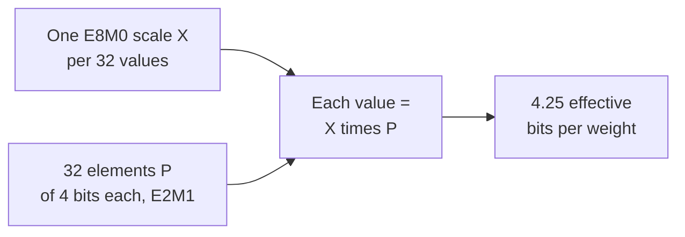

# Lesson 3. Low-Bit Formats

**Mission link:** Quantizing a model means choosing one of these formats, so you need to know which values each can hold, what it costs per weight once scales are counted, and why the narrow ones cannot work without a scale.
**Primary source:** [Paper: "FP8 Formats for Deep Learning", Micikevicius et al., 2022](https://arxiv.org/abs/2209.05433)
**Prerequisites:** [Lesson 2](0002-floating-point-formats.md), [Block-scaled format](../GLOSSARY.md), [Scale](../GLOSSARY.md), [Bit width](../GLOSSARY.md)

## Warm-up

1. ▢ A 4-bit scheme stores one 16-bit scale for every group of 32 weights. What are its effective bits per weight?

<details markdown="1"><summary>Check</summary>

4.5. The scale adds 16 / 32 = 0.5 bits per weight to the 4-bit bit width.

</details>

2. ▢ A bf16 activation has the value 100,000. What happens when it is cast to fp16, and why does bf16 not have the problem?

<details markdown="1"><summary>Check</summary>

It becomes infinity, because the largest finite fp16 value is 65,504. bf16 has fp32's 8 exponent bits, so its range reaches about 3.4 × 10^38, at the price of a 7-bit mantissa.

</details>

## Know this

### fp8: two layouts

[Micikevicius et al.](https://arxiv.org/abs/2209.05433) define two 8-bit floating-point encodings, named by their exponent and mantissa bit counts. Each also has one sign bit.

| | E4M3 | E5M2 |
|---|---|---|
| Exponent / mantissa bits | 4 / 3 | 5 / 2 |
| Exponent bias | 7 | 15 |
| Largest finite value | 448 | 57,344 |
| Smallest normal value | 2^-6 | 2^-14 |
| Smallest subnormal value | 2^-9 | 2^-16 |
| Infinities | none | IEEE style |
| NaN | one mantissa pattern (S.1111.111) | several (S.11111.01, .10, .11) |

E5M2 follows the IEEE 754 conventions and can be viewed as fp16 with fewer mantissa bits. E4M3 breaks them to gain range: it drops infinities and keeps one NaN pattern per sign, which frees the top exponent for ordinary values and raises the largest value to 448. The recommended use is E4M3 for weight and activation tensors and E5M2 for gradient tensors. This is the lesson 2 trade again: gradients span a wide range, so they get the extra exponent bit, while weights and activations get the extra mantissa bit.

Both formats have so few values that a tensor must be multiplied by a scaling factor before it is cast, to move it into the range the format can represent. The authors compare this to the purpose of loss scaling in fp16 training. Casting a model's tensors without a scaling factor, they report, "resulted in a significant accuracy loss", with a GPT perplexity of 11.0.

With scaling, post-training quantization to E4M3 stayed close to the 16-bit baseline in their tests while int8 did not, on the models they tried. For a 6.7B GPT-3 style model the wikitext103 perplexity was 8.51 in 16-bit floating point, 10.29 in int8 and 8.41 in E4M3, with per-channel scaling factors for weights and per-tensor ones for activations. That is one group's result, with their calibration choices: read it as evidence that a float grid fits these tensors better than an integer grid, not as a general ranking.

### int8 and int4: uniform grids

An integer format has no exponent. Its values are evenly spaced whole numbers: int8 holds -128 to 127, which is 256 levels, and int4 holds -8 to 7, which is 16 levels. The gap between neighbours is 1 everywhere, unlike a float, whose gaps double at each power of two.

On their own, integers can only represent whole numbers, so a weight such as 0.02 cannot be stored. A quantizer therefore stores an integer together with a **scale**, the real-valued step between adjacent levels, so that the real value is approximately the scale times the integer. Picking that scale, and what to do with the values it cannot reach, is the subject of lessons 4 to 6. For now keep one fact: an integer grid has fixed spacing and no built-in range, so its range is entirely the scale's doing, while a float grid brings its own range and only needs a scale to place that range correctly.

### Block-scaled formats

A single scale for a whole tensor is a poor fit when values vary a lot. A **block-scaled format** gives a small block of values its own shared scale. The OCP Microscaling (MX) formats, described by [Rouhani et al.](https://arxiv.org/abs/2310.10537), define a block as k elements with one shared scale X, and the value of each element is X times its stored element P. In every concrete MX format they list, the block has 32 elements and the scale is stored as E8M0, an 8-bit exponent with no mantissa, so the scale is always a power of two. They name each format by its element type:

| Format | Block size | Scale format | Element format | Element bits |
|---|---|---|---|---|
| MXFP8 | 32 | E8M0 | E4M3 or E5M2 | 8 |
| MXFP6 | 32 | E8M0 | E2M3 or E3M2 | 6 |
| MXFP4 | 32 | E8M0 | E2M1 | 4 |
| MXINT8 | 32 | E8M0 | int8 | 8 |

MXFP4 stores 4 bits per element and one 8-bit scale per 32, so its effective bits per weight is 4 + 8 / 32 = 4.25. By the same arithmetic MXFP8 and MXINT8 cost 8.25 and MXFP6 costs 6.25.



The element type E2M1 has 1 sign bit, 2 exponent bits and 1 mantissa bit. That is 16 bit patterns and very few values. The eight non-negative ones are the exact set NVIDIA lists, and you will derive them in practice item 1.

[NVIDIA's NVFP4](https://developer.nvidia.com/blog/introducing-nvfp4-for-efficient-and-accurate-low-precision-inference/) uses the same E2M1 elements with two changes, as described in NVIDIA's own blog post, which is vendor documentation. The block is 16 values rather than 32, and its scale is an FP8 E4M3 number rather than a power of two, so the scale can be a fractional multiple and fit each block more closely. Because an E4M3 scale has a narrow range, a second FP32 scale is applied to the whole tensor. That gives 4 + 8 / 16 = 4.5 effective bits per weight, ignoring the single per-tensor scalar. NVIDIA says E8M0 scales are simpler and can be adequate for tensors that are less sensitive to the precision of the scale.

| Scheme | Bit width | Effective bits per weight | 8B model | 70B model |
|---|---|---|---|---|
| int8 (scale cost ignored) | 8 | 8 | 8 GB | 70 GB |
| int4 (scale cost ignored) | 4 | 4 | 4 GB | 35 GB |
| MXFP4 | 4 | 4.25 | 4.25 GB | about 37.2 GB |
| NVFP4 | 4 | 4.5 | 4.5 GB | about 39.4 GB |

## Practice

1. ▢ E2M1 has 1 sign bit, 2 exponent bits and 1 mantissa bit, with an exponent bias of 1. A field `e` of 0 is subnormal and means `m × 0.5`. Otherwise the value is `2^(e - 1) × (1 + m / 2)`. List the eight non-negative values it can represent.

<details markdown="1"><summary>Hint</summary>

There are four exponent fields and two mantissa values, so eight combinations. Start with `e = 0` and the two values of `m`, then move up one exponent at a time.

</details>

<details markdown="1"><summary>Check</summary>

0, 0.5, 1, 1.5, 2, 3, 4 and 6. With `e = 0`: 0 and 0.5. With `e = 1`: 1 and 1.5. With `e = 2`: 2 and 3. With `e = 3`: 4 and 6. This matches NVIDIA's list, and 6 is the largest value. Mirrored with a sign bit that gives 15 distinct values, since positive and negative zero coincide. The gaps are 0.5 up to 2, then 1, then 2: even four bits give floating-point spacing.

</details>

2. ▢ Predict, then run. The function decodes a bit pattern with the layout and bias you give it. Before running, compute the largest finite E4M3 value from the pattern 0 1111 110 and the smallest positive E5M2 value from 0 00000 01.

    ```python
    def decode(code, ebits, mbits, bias):
        e = (code >> mbits) & ((1 << ebits) - 1)
        m = code & ((1 << mbits) - 1)
        if e == 0:
            return m / 2**mbits * 2.0 ** (1 - bias)
        return (1 + m / 2**mbits) * 2.0 ** (e - bias)

    print(decode(0b1111110, 4, 3, 7), decode(0b0000001, 4, 3, 7))
    print(decode(0b1111011, 5, 2, 15), decode(0b0000001, 5, 2, 15))
    ```

<details markdown="1"><summary>Hint</summary>

For E4M3, 1111 is exponent field 15, so the scale is 2^(15 - 7) = 2^8, and 110 as a mantissa is 1 + 6/8. The pattern 0 1111 111 is reserved for NaN, so 110 is the largest finite one.

</details>

<details markdown="1"><summary>Check</summary>

```text
448.0 0.001953125
57344.0 1.52587890625e-05
```

The first line is E4M3's largest value, 448 = 1.75 × 2^8, and its smallest subnormal, 2^-9. The second is E5M2's largest, 57,344 = 1.75 × 2^15, and its smallest subnormal, 2^-16. Both agree with the table in the paper. E5M2 reaches about 128 times as high as E4M3 and about 128 times as low, and pays for it with one mantissa bit.

</details>

3. ▢ Which pairing of fp8 format and tensor type does the paper recommend, and why?

    - a) E4M3 for gradients, since they need finer spacing
    - b) E5M2 for gradients, since they need wider range
    - c) E5M2 for weights, since they need finer spacing
    - d) E4M3 for weights, since they need wider range

<details markdown="1"><summary>Check</summary>

**b)** The recommendation is E4M3 for weights and activations and E5M2 for gradients, and the reasoning is the lesson 2 trade: gradients span many powers of two, so they get the extra exponent bit. (a) gives gradients the narrow-range format. (d) credits E4M3 with a wider range it does not have. (c) pairs E5M2 with weights and claims it has finer spacing, but E5M2 has the coarser one.

</details>

4. ▢ Predict, then run. What does the first print show, and what does the second show for the entry 0.0004?

    ```python
    import numpy as np

    x = np.array([0.02, -0.31, 0.5, 0.0004])
    print(np.round(x).astype(np.int8))

    scale = np.abs(x).max() / 127
    q = np.round(x / scale).astype(np.int8)
    print(q, np.round(q * scale, 4))
    ```

<details markdown="1"><summary>Hint</summary>

The first line casts straight to int8, so each value is rounded to the nearest whole number. In the second, the scale is the largest magnitude divided by 127, so 0.5 should land on the top level.

</details>

<details markdown="1"><summary>Check</summary>

```text
[0 0 0 0]
[  5 -79 127   0] [ 0.0197 -0.311   0.5     0.    ]
```

Without a scale every value rounds to zero. With the scale, 0.5 maps to 127, -0.31 to -79 and 0.02 to 5, and the dequantized values are close. The last entry still becomes 0: 0.0004 is less than half a step of 0.0039, so it is rounded away. A scale rescues the range but not values smaller than half its step.

</details>

5. ▢ A 70B-parameter model is stored in MXFP4 and in NVFP4. Compute the weight memory of each, and say why neither is simply 4 bits per parameter.

<details markdown="1"><summary>Check</summary>

MXFP4 is 4 + 8 / 32 = 4.25 effective bits, so 70 × 4.25 / 8 = 37.1875, about 37.2 GB. NVFP4 is 4 + 8 / 16 = 4.5 bits, so 70 × 4.5 / 8 = 39.375, about 39.4 GB, ignoring the per-tensor scalar. The scales are stored alongside the elements and count toward memory, so quoting the 4-bit element width alone understates the size. NVFP4's finer scale and smaller block cost it about 0.25 bits per weight over MXFP4.

</details>

6. ▢ Predict, then run. This sketch follows Algorithm 1 of the MX paper for an FP4 block: the shared scale is a power of two chosen from the block's largest magnitude, and each value is rounded to the nearest E2M1 value. Before running, say what happens to the small values in the first block, and compare with the second block, where the large value is replaced by 0.7.

    ```python
    import numpy as np

    pos = np.array([0, 0.5, 1, 1.5, 2, 3, 4, 6])
    grid = np.concatenate([-pos[:0:-1], pos])

    def mxfp4(v):
        shared_exp = np.floor(np.log2(np.abs(v).max())) - 2
        s = 2.0 ** shared_exp
        scaled = np.clip(v / s, -6, 6)
        idx = np.abs(scaled[:, None] - grid[None, :]).argmin(axis=1)
        return float(s), (grid[idx] * s).tolist()

    print(mxfp4(np.array([7.0, 0.9, 0.3, -0.12, 0.05])))
    print(mxfp4(np.array([0.7, 0.9, 0.3, -0.12, 0.05])))
    ```

<details markdown="1"><summary>Hint</summary>

The 2 in `- 2` is the exponent of 6, the largest E2M1 value (6 = 1.5 × 2^2). For the first block, the scale is 2^(2 - 2). The smallest nonzero level is then half of that scale.

</details>

<details markdown="1"><summary>Check</summary>

```text
(1.0, [6.0, 1.0, 0.5, 0.0, 0.0])
(0.125, [0.75, 0.75, 0.25, -0.125, 0.0625])
```

In the first block the scale is 1, the smallest nonzero level is 0.5, and both -0.12 and 0.05 round to 0, while 7.0 is clamped to 6.0. In the second the scale is 0.125 and all five values stay nonzero, with -0.12 and 0.05 reproduced to within one step. One large value sets the scale for all 32 in its block, so it can erase its neighbours. That is the outlier problem of lessons 7 and 8, seen at block scale.

</details>

## Real-world reps

- [ ] Open the model card or quantization config of one released fp8 or 4-bit checkpoint and find which format, block or group size and scale type it uses. Compute its effective bits per weight.
- [ ] Look at the tensor-core or datatype support table for a GPU you might use and note which of fp16, bf16, fp8 and fp4 it lists as native.
- [ ] Tomorrow: without notes, write the eight non-negative E2M1 values, the largest value of E4M3 and E5M2, and the effective bits per weight of MXFP4.

## Going further

- [Number Formats](../reference/number-formats.md)
- [Paper: "FP8 Formats for Deep Learning", Micikevicius et al., 2022](https://arxiv.org/abs/2209.05433)
- [Paper: "Microscaling Data Formats for Deep Learning", Rouhani et al., 2023](https://arxiv.org/abs/2310.10537)
- [Article: "Introducing NVFP4 for Efficient and Accurate Low-Precision Inference", NVIDIA Technical Blog](https://developer.nvidia.com/blog/introducing-nvfp4-for-efficient-and-accurate-low-precision-inference/)
- [Resources](../RESOURCES.md)

---

Not landing? Reread the primary source at the top, since this lesson compresses it and compression is where understanding leaks. Check the [glossary](../GLOSSARY.md) for any term that felt slippery.

If the lesson itself is unclear rather than the material, that is a defect: [open an issue](https://github.com/TokenCemetery/teach/issues).
