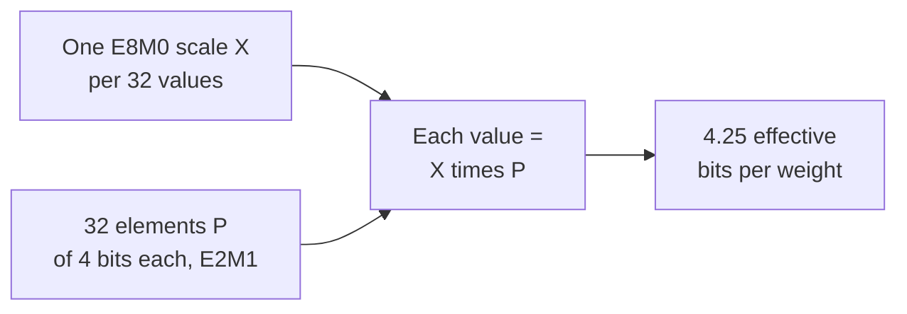

# Lição 3. Formatos de poucos bits

**Ligação com a missão:** Quantizar um modelo significa escolher um destes formatos, então você precisa saber quais valores cada um consegue guardar, quanto ele custa por peso depois de contadas as scales e por que os estreitos não funcionam sem uma scale.
**Fonte principal:** [Artigo científico: "FP8 Formats for Deep Learning", Micikevicius et al., 2022](https://arxiv.org/abs/2209.05433)
**Pré-requisitos:** [Lição 2](0002-floating-point-formats.md), [Formato com escala por bloco](../GLOSSARY.md), [Scale](../GLOSSARY.md), [Largura em bits](../GLOSSARY.md)

## Aquecimento

1. ▢ Um esquema de 4 bits armazena uma scale de 16 bits para cada grupo de 32 pesos. Quais são os seus bits efetivos por peso?

<details markdown="1"><summary>Verificação</summary>

4.5. A scale acrescenta 16 / 32 = 0.5 bit por peso à largura em bits de 4.

</details>

2. ▢ Uma ativação em bf16 tem o valor 100.000. O que acontece quando ela é convertida para fp16, e por que o bf16 não tem esse problema?

<details markdown="1"><summary>Verificação</summary>

Ela vira infinito, porque o maior valor finito do fp16 é 65.504. O bf16 tem os 8 bits de expoente do fp32, então a sua faixa chega a cerca de 3.4 × 10^38, ao preço de uma mantissa de 7 bits.

</details>

## Saiba isto

### fp8: dois layouts

[Micikevicius et al.](https://arxiv.org/abs/2209.05433) definem duas codificações de ponto flutuante de 8 bits, nomeadas pelas contagens de bits de expoente e de mantissa. Cada uma também tem um bit de sinal.

| | E4M3 | E5M2 |
|---|---|---|
| Bits de expoente / mantissa | 4 / 3 | 5 / 2 |
| Bias do expoente | 7 | 15 |
| Maior valor finito | 448 | 57.344 |
| Menor valor normal | 2^-6 | 2^-14 |
| Menor valor subnormal | 2^-9 | 2^-16 |
| Infinitos | nenhum | estilo IEEE |
| NaN | um padrão de mantissa (S.1111.111) | vários (S.11111.01, .10, .11) |

O E5M2 segue as convenções do IEEE 754 e pode ser visto como um fp16 com menos bits de mantissa. O E4M3 as quebra para ganhar faixa: descarta os infinitos e mantém um padrão de NaN por sinal, o que libera o expoente mais alto para valores comuns e eleva o maior valor para 448. O uso recomendado é E4M3 para tensores de pesos e de ativações e E5M2 para tensores de gradientes. É a troca da lição 2 de novo: os gradientes cobrem uma faixa larga, então recebem o bit extra de expoente, enquanto os pesos e as ativações recebem o bit extra de mantissa.

Os dois formatos têm tão poucos valores que um tensor precisa ser multiplicado por um fator de escala antes de ser convertido, para movê-lo para a faixa que o formato consegue representar. Os autores comparam isso com a finalidade do loss scaling no treinamento em fp16. Converter os tensores de um modelo sem um fator de escala, relatam eles, "resultou em uma perda significativa de acurácia", com uma perplexity de GPT de 11.0.

Com escala, a quantização pós-treinamento para E4M3 ficou próxima do baseline de 16 bits nos testes deles enquanto o int8 não ficou, nos modelos que testaram. Para um modelo estilo GPT-3 de 6.7B, a perplexity no wikitext103 foi 8.51 em ponto flutuante de 16 bits, 10.29 em int8 e 8.41 em E4M3, com fatores de escala por canal para os pesos e por tensor para as ativações. Esse é o resultado de um grupo, com as escolhas de calibração deles: leia-o como evidência de que uma grade de ponto flutuante se ajusta melhor a esses tensores do que uma grade de inteiros, não como um ranking geral.

### int8 e int4: grades uniformes

Um formato de inteiros não tem expoente. Os seus valores são números inteiros igualmente espaçados: o int8 guarda de -128 a 127, que são 256 níveis, e o int4 guarda de -8 a 7, que são 16 níveis. A distância entre vizinhos é 1 em toda parte, ao contrário de um float, cujas distâncias dobram a cada potência de dois.

Por conta própria, inteiros só conseguem representar números inteiros, então um peso como 0.02 não pode ser armazenado. Um quantizador armazena, portanto, um inteiro junto com uma **scale**, o passo em valor real entre níveis adjacentes, de modo que o valor real é aproximadamente a scale vezes o inteiro. Escolher essa scale, e o que fazer com os valores que ela não alcança, é o assunto das lições 4 a 6. Por ora, guarde um fato: uma grade de inteiros tem espaçamento fixo e nenhuma faixa embutida, então a sua faixa é inteiramente obra da scale, enquanto uma grade de ponto flutuante traz a sua própria faixa e só precisa de uma scale para posicionar essa faixa corretamente.

### Formatos com escala por bloco

Uma única scale para um tensor inteiro é um mau ajuste quando os valores variam muito. Um **formato com escala por bloco** dá a um pequeno bloco de valores a sua própria scale compartilhada. Os formatos OCP Microscaling (MX), descritos por [Rouhani et al.](https://arxiv.org/abs/2310.10537), definem um bloco como k elementos com uma scale X compartilhada, e o valor de cada elemento é X vezes o seu elemento armazenado P. Em todo formato MX concreto que eles listam, o bloco tem 32 elementos e a scale é armazenada como E8M0, um expoente de 8 bits sem mantissa, então a scale é sempre uma potência de dois. Eles nomeiam cada formato pelo seu tipo de elemento:

| Formato | Tamanho do bloco | Formato da scale | Formato do elemento | Bits do elemento |
|---|---|---|---|---|
| MXFP8 | 32 | E8M0 | E4M3 ou E5M2 | 8 |
| MXFP6 | 32 | E8M0 | E2M3 ou E3M2 | 6 |
| MXFP4 | 32 | E8M0 | E2M1 | 4 |
| MXINT8 | 32 | E8M0 | int8 | 8 |

O MXFP4 armazena 4 bits por elemento e uma scale de 8 bits por 32, então os seus bits efetivos por peso são 4 + 8 / 32 = 4.25. Pela mesma aritmética, o MXFP8 e o MXINT8 custam 8.25 e o MXFP6 custa 6.25.



O tipo de elemento E2M1 tem 1 bit de sinal, 2 bits de expoente e 1 bit de mantissa. São 16 padrões de bits e pouquíssimos valores. Os oito não negativos são exatamente o conjunto que a NVIDIA lista, e você vai derivá-los no item 1 da prática.

O [NVFP4 da NVIDIA](https://developer.nvidia.com/blog/introducing-nvfp4-for-efficient-and-accurate-low-precision-inference/) usa os mesmos elementos E2M1 com duas mudanças, como descrito no próprio post de blog da NVIDIA, que é documentação de fornecedor. O bloco tem 16 valores em vez de 32, e a sua scale é um número FP8 E4M3 em vez de uma potência de dois, então a scale pode ser um múltiplo fracionário e ajustar cada bloco mais de perto. Como uma scale E4M3 tem faixa estreita, uma segunda scale FP32 é aplicada ao tensor inteiro. Isso dá 4 + 8 / 16 = 4.5 bits efetivos por peso, ignorando o único escalar por tensor. A NVIDIA diz que as scales E8M0 são mais simples e podem ser adequadas para tensores menos sensíveis à precisão da scale.

| Esquema | Largura em bits | Bits efetivos por peso | Modelo de 8B | Modelo de 70B |
|---|---|---|---|---|
| int8 (custo da scale ignorado) | 8 | 8 | 8 GB | 70 GB |
| int4 (custo da scale ignorado) | 4 | 4 | 4 GB | 35 GB |
| MXFP4 | 4 | 4.25 | 4.25 GB | cerca de 37.2 GB |
| NVFP4 | 4 | 4.5 | 4.5 GB | cerca de 39.4 GB |

## Prática

1. ▢ O E2M1 tem 1 bit de sinal, 2 bits de expoente e 1 bit de mantissa, com um bias de expoente de 1. Um campo `e` igual a 0 é subnormal e significa `m × 0.5`. Caso contrário, o valor é `2^(e - 1) × (1 + m / 2)`. Liste os oito valores não negativos que ele consegue representar.

<details markdown="1"><summary>Dica</summary>

Há quatro campos de expoente e dois valores de mantissa, então oito combinações. Comece com `e = 0` e os dois valores de `m`, depois suba um expoente por vez.

</details>

<details markdown="1"><summary>Verificação</summary>

0, 0.5, 1, 1.5, 2, 3, 4 e 6. Com `e = 0`: 0 e 0.5. Com `e = 1`: 1 e 1.5. Com `e = 2`: 2 e 3. Com `e = 3`: 4 e 6. Isso coincide com a lista da NVIDIA, e 6 é o maior valor. Espelhado com um bit de sinal, isso dá 15 valores distintos, já que o zero positivo e o negativo coincidem. As distâncias são 0.5 até 2, depois 1, depois 2: até quatro bits dão espaçamento de ponto flutuante.

</details>

2. ▢ Preveja e depois execute. A função decodifica um padrão de bits com o layout e o bias que você der a ela. Antes de executar, calcule o maior valor finito do E4M3 a partir do padrão 0 1111 110 e o menor valor positivo do E5M2 a partir de 0 00000 01.

    ```python
    def decode(code, ebits, mbits, bias):
        e = (code >> mbits) & ((1 << ebits) - 1)
        m = code & ((1 << mbits) - 1)
        if e == 0:
            return m / 2**mbits * 2.0 ** (1 - bias)
        return (1 + m / 2**mbits) * 2.0 ** (e - bias)

    print(decode(0b1111110, 4, 3, 7), decode(0b0000001, 4, 3, 7))
    print(decode(0b1111011, 5, 2, 15), decode(0b0000001, 5, 2, 15))
    ```

<details markdown="1"><summary>Dica</summary>

Para o E4M3, 1111 é o campo de expoente 15, então a escala é 2^(15 - 7) = 2^8, e 110 como mantissa é 1 + 6/8. O padrão 0 1111 111 é reservado para NaN, então 110 é o maior finito.

</details>

<details markdown="1"><summary>Verificação</summary>

```text
448.0 0.001953125
57344.0 1.52587890625e-05
```

A primeira linha é o maior valor do E4M3, 448 = 1.75 × 2^8, e o seu menor subnormal, 2^-9. A segunda é o maior do E5M2, 57.344 = 1.75 × 2^15, e o seu menor subnormal, 2^-16. Ambas concordam com a tabela do artigo. O E5M2 chega a cerca de 128 vezes mais alto que o E4M3 e a cerca de 128 vezes mais baixo, e paga por isso com um bit de mantissa.

</details>

3. ▢ Qual pareamento de formato fp8 e tipo de tensor o artigo recomenda, e por quê?

    - a) E4M3 para gradientes, já que eles precisam de espaçamento mais fino
    - b) E5M2 para gradientes, já que eles precisam de faixa mais larga
    - c) E5M2 para pesos, já que eles precisam de espaçamento mais fino
    - d) E4M3 para pesos, já que eles precisam de faixa mais larga

<details markdown="1"><summary>Verificação</summary>

**b)** A recomendação é E4M3 para pesos e ativações e E5M2 para gradientes, e o raciocínio é a troca da lição 2: os gradientes cobrem muitas potências de dois, então recebem o bit extra de expoente. (a) dá aos gradientes o formato de faixa estreita. (d) atribui ao E4M3 uma faixa mais larga que ele não tem. (c) pareia o E5M2 com os pesos e afirma que ele tem espaçamento mais fino, mas o E5M2 tem o mais grosseiro.

</details>

4. ▢ Preveja e depois execute. O que mostra a primeira impressão, e o que a segunda mostra para a entrada 0.0004?

    ```python
    import numpy as np

    x = np.array([0.02, -0.31, 0.5, 0.0004])
    print(np.round(x).astype(np.int8))

    scale = np.abs(x).max() / 127
    q = np.round(x / scale).astype(np.int8)
    print(q, np.round(q * scale, 4))
    ```

<details markdown="1"><summary>Dica</summary>

A primeira linha converte direto para int8, então cada valor é arredondado para o número inteiro mais próximo. Na segunda, a scale é a maior magnitude dividida por 127, então 0.5 deve cair no nível mais alto.

</details>

<details markdown="1"><summary>Verificação</summary>

```text
[0 0 0 0]
[  5 -79 127   0] [ 0.0197 -0.311   0.5     0.    ]
```

Sem uma scale, todo valor arredonda para zero. Com a scale, 0.5 mapeia para 127, -0.31 para -79 e 0.02 para 5, e os valores dequantizados ficam próximos. A última entrada ainda vira 0: 0.0004 é menor que meio passo de 0.0039, então é arredondada para longe. Uma scale resgata a faixa, mas não valores menores que metade do seu passo.

</details>

5. ▢ Um modelo de 70B parâmetros é armazenado em MXFP4 e em NVFP4. Calcule a memória dos pesos de cada um e diga por que nenhum dos dois são simplesmente 4 bits por parâmetro.

<details markdown="1"><summary>Verificação</summary>

O MXFP4 tem 4 + 8 / 32 = 4.25 bits efetivos, então 70 × 4.25 / 8 = 37.1875, cerca de 37.2 GB. O NVFP4 tem 4 + 8 / 16 = 4.5 bits, então 70 × 4.5 / 8 = 39.375, cerca de 39.4 GB, ignorando o escalar por tensor. As scales são armazenadas junto com os elementos e contam para a memória, então citar apenas a largura de 4 bits do elemento subestima o tamanho. A scale mais fina e o bloco menor do NVFP4 custam a ele cerca de 0.25 bit por peso a mais que o MXFP4.

</details>

6. ▢ Preveja e depois execute. Este esboço segue o Algoritmo 1 do artigo do MX para um bloco FP4: a scale compartilhada é uma potência de dois escolhida a partir da maior magnitude do bloco, e cada valor é arredondado para o valor E2M1 mais próximo. Antes de executar, diga o que acontece com os valores pequenos do primeiro bloco e compare com o segundo bloco, em que o valor grande é substituído por 0.7.

    ```python
    import numpy as np

    pos = np.array([0, 0.5, 1, 1.5, 2, 3, 4, 6])
    grid = np.concatenate([-pos[:0:-1], pos])

    def mxfp4(v):
        shared_exp = np.floor(np.log2(np.abs(v).max())) - 2
        s = 2.0 ** shared_exp
        scaled = np.clip(v / s, -6, 6)
        idx = np.abs(scaled[:, None] - grid[None, :]).argmin(axis=1)
        return float(s), (grid[idx] * s).tolist()

    print(mxfp4(np.array([7.0, 0.9, 0.3, -0.12, 0.05])))
    print(mxfp4(np.array([0.7, 0.9, 0.3, -0.12, 0.05])))
    ```

<details markdown="1"><summary>Dica</summary>

O 2 em `- 2` é o expoente de 6, o maior valor E2M1 (6 = 1.5 × 2^2). Para o primeiro bloco, a scale é 2^(2 - 2). O menor nível não nulo é então metade dessa scale.

</details>

<details markdown="1"><summary>Verificação</summary>

```text
(1.0, [6.0, 1.0, 0.5, 0.0, 0.0])
(0.125, [0.75, 0.75, 0.25, -0.125, 0.0625])
```

No primeiro bloco a scale é 1, o menor nível não nulo é 0.5, e tanto -0.12 quanto 0.05 arredondam para 0, enquanto 7.0 é limitado a 6.0. No segundo, a scale é 0.125 e os cinco valores continuam não nulos, com -0.12 e 0.05 reproduzidos a menos de um passo. Um valor grande define a scale de todos os 32 do seu bloco, então pode apagar os vizinhos. Esse é o problema dos outliers das lições 7 e 8, visto em escala de bloco.

</details>

## Prática no mundo real

- [ ] Abra o model card ou a configuração de quantização de um checkpoint publicado em fp8 ou 4 bits e encontre qual formato, qual tamanho de bloco ou de grupo e qual tipo de scale ele usa. Calcule os seus bits efetivos por peso.
- [ ] Olhe a tabela de suporte de tensor cores ou de tipos de dados de uma GPU que você poderia usar e anote quais entre fp16, bf16, fp8 e fp4 ela lista como nativos.
- [ ] Amanhã: sem consultar anotações, escreva os oito valores não negativos do E2M1, o maior valor do E4M3 e do E5M2, e os bits efetivos por peso do MXFP4.

## Para ir além

- [Formatos Numéricos](../reference/number-formats.md)
- [Artigo científico: "FP8 Formats for Deep Learning", Micikevicius et al., 2022](https://arxiv.org/abs/2209.05433)
- [Artigo científico: "Microscaling Data Formats for Deep Learning", Rouhani et al., 2023](https://arxiv.org/abs/2310.10537)
- [Artigo: "Introducing NVFP4 for Efficient and Accurate Low-Precision Inference", NVIDIA Technical Blog](https://developer.nvidia.com/blog/introducing-nvfp4-for-efficient-and-accurate-low-precision-inference/)
- [Recursos](../RESOURCES.md)

---

Não ficou claro? Releia a fonte principal no topo, já que esta lição a comprime e é na compressão que o entendimento escapa. Consulte o [glossário](../GLOSSARY.md) para qualquer termo que pareceu escorregadio.

Se o problema é a lição em si, e não o material, isso é um defeito: [abra uma issue](https://github.com/TokenCemetery/teach/issues).
