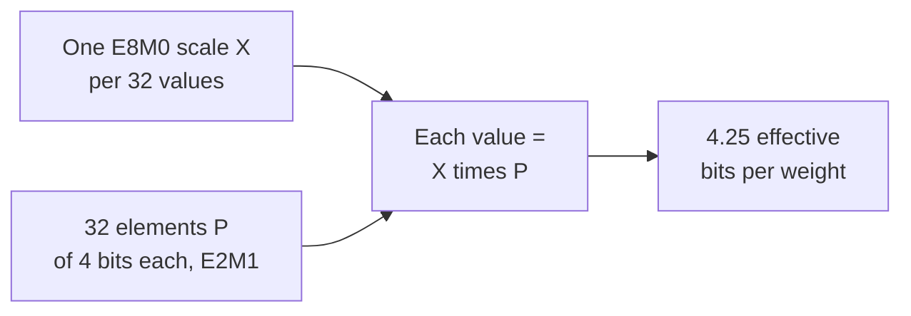

# Урок 3. Форматы с малой разрядностью

**Связь с целью курса:** Квантизовать модель значит выбрать один из этих форматов, поэтому нужно знать, какие значения каждый из них способен хранить, сколько он стоит на вес с учётом масштабов и почему узкие форматы не могут работать без масштаба.
**Первоисточник:** [Научная статья: "FP8 Formats for Deep Learning", Micikevicius et al., 2022](https://arxiv.org/abs/2209.05433)
**Предварительные требования:** [Урок 2](0002-floating-point-formats.md), [Блочно-масштабируемый формат](../GLOSSARY.md), [Масштаб](../GLOSSARY.md), [Разрядность](../GLOSSARY.md)

## Разминка

1. ▢ 4-битная схема хранит один 16-битный масштаб на каждую группу из 32 весов. Каково её эффективное число бит на вес?

<details markdown="1"><summary>Проверка</summary>

4,5. Масштаб добавляет 16 / 32 = 0,5 бита на вес к разрядности в 4 бита.

</details>

2. ▢ Активация в bf16 имеет значение 100 000. Что происходит при приведении к fp16 и почему у bf16 нет этой проблемы?

<details markdown="1"><summary>Проверка</summary>

Она становится бесконечностью, потому что наибольшее конечное значение fp16 равно 65 504. У bf16 те же 8 бит экспоненты, что у fp32, поэтому его диапазон достигает примерно 3,4 × 10^38 ценой 7-битной мантиссы.

</details>

## Что нужно знать

### fp8: две раскладки

[Micikevicius и соавторы](https://arxiv.org/abs/2209.05433) определяют две 8-битные кодировки с плавающей точкой, названные по числу бит экспоненты и мантиссы. У каждой есть ещё один бит знака.

| | E4M3 | E5M2 |
|---|---|---|
| Биты экспоненты / мантиссы | 4 / 3 | 5 / 2 |
| Смещение экспоненты | 7 | 15 |
| Наибольшее конечное значение | 448 | 57 344 |
| Наименьшее нормальное значение | 2^-6 | 2^-14 |
| Наименьшее субнормальное значение | 2^-9 | 2^-16 |
| Бесконечности | нет | как в IEEE |
| NaN | один шаблон мантиссы (S.1111.111) | несколько (S.11111.01, .10, .11) |

E5M2 следует соглашениям IEEE 754 и его можно рассматривать как fp16 с меньшим числом бит мантиссы. E4M3 нарушает их ради диапазона: он отказывается от бесконечностей и оставляет один шаблон NaN на знак, что освобождает старшую экспоненту для обычных значений и поднимает наибольшее значение до 448. Рекомендуется использовать E4M3 для тензоров весов и активаций, а E5M2 для тензоров градиентов. Это снова компромисс из урока 2: градиенты охватывают широкий диапазон, поэтому они получают лишний бит экспоненты, а веса и активации получают лишний бит мантиссы.

В обоих форматах так мало значений, что тензор перед приведением нужно умножить на масштабирующий множитель, чтобы сдвинуть его в диапазон, который формат способен представить. Авторы сравнивают это с назначением масштабирования потерь при обучении в fp16. Приведение тензоров модели без масштабирующего множителя, сообщают они, «привело к существенной потере точности», с перплексией GPT, равной 11,0.

С масштабированием посттренировочная квантизация в E4M3 в их тестах оставалась близкой к 16-битной базе, а int8 нет, на моделях, которые они пробовали. Для модели в стиле GPT-3 на 6,7 млрд перплексия на wikitext103 составила 8,51 в 16-битном формате с плавающей точкой, 10,29 в int8 и 8,41 в E4M3, с множителями масштаба по каналам для весов и по тензору для активаций. Это результат одной группы с её выбором калибровки: читайте его как свидетельство того, что сетка с плавающей точкой подходит этим тензорам лучше целочисленной, а не как общий рейтинг.

### int8 и int4: равномерные сетки

У целочисленного формата нет экспоненты. Его значения это равномерно расположенные целые числа: int8 хранит от -128 до 127, то есть 256 уровней, а int4 хранит от -8 до 7, то есть 16 уровней. Шаг между соседями везде равен 1, в отличие от формата с плавающей точкой, шаги которого удваиваются на каждой степени двойки.

Сами по себе целые числа могут представлять только целые, поэтому вес вроде 0,02 хранить нельзя. Поэтому квантизатор хранит целое число вместе с **масштабом**, вещественным шагом между соседними уровнями, так что вещественное значение приближённо равно масштабу, умноженному на целое. Выбор этого масштаба и то, что делать со значениями, до которых он не дотягивается, составляют предмет уроков с 4 по 6. Пока запомните один факт: у целочисленной сетки фиксированный шаг и нет встроенного диапазона, поэтому её диапазон целиком определяется масштабом, а сетка с плавающей точкой приносит свой диапазон и нуждается в масштабе лишь для того, чтобы правильно этот диапазон расположить.

### Блочно-масштабируемые форматы

Один масштаб на весь тензор плохо подходит, когда значения сильно различаются. **Блочно-масштабируемый формат** даёт небольшому блоку значений собственный общий масштаб. Форматы OCP Microscaling (MX), описанные [Rouhani и соавторами](https://arxiv.org/abs/2310.10537), определяют блок как k элементов с одним общим масштабом X, а значение каждого элемента равно X, умноженному на хранимый элемент P. В каждом конкретном формате MX из их перечня блок состоит из 32 элементов, а масштаб хранится как E8M0, 8-битная экспонента без мантиссы, так что масштаб всегда степень двойки. Каждый формат они называют по типу его элемента:

| Формат | Размер блока | Формат масштаба | Формат элемента | Бит на элемент |
|---|---|---|---|---|
| MXFP8 | 32 | E8M0 | E4M3 или E5M2 | 8 |
| MXFP6 | 32 | E8M0 | E2M3 или E3M2 | 6 |
| MXFP4 | 32 | E8M0 | E2M1 | 4 |
| MXINT8 | 32 | E8M0 | int8 | 8 |

MXFP4 хранит 4 бита на элемент и один 8-битный масштаб на 32 элемента, поэтому его эффективное число бит на вес равно 4 + 8 / 32 = 4,25. По той же арифметике MXFP8 и MXINT8 стоят 8,25, а MXFP6 стоит 6,25.



Тип элемента E2M1 имеет 1 бит знака, 2 бита экспоненты и 1 бит мантиссы. Это 16 шаблонов бит и очень мало значений. Восемь неотрицательных из них это в точности набор, который приводит NVIDIA, и вы выведете их в упражнении 1 практики.

[NVFP4 от NVIDIA](https://developer.nvidia.com/blog/introducing-nvfp4-for-efficient-and-accurate-low-precision-inference/) использует те же элементы E2M1 с двумя изменениями, как описано в собственном блоге NVIDIA, который является документацией производителя. Блок состоит из 16 значений, а не из 32, а его масштаб это число FP8 E4M3, а не степень двойки, поэтому масштаб может быть дробным множителем и точнее подходить каждому блоку. Поскольку у масштаба E4M3 узкий диапазон, ко всему тензору применяется второй масштаб FP32. Это даёт 4 + 8 / 16 = 4,5 эффективных бит на вес, не считая единственного скаляра на тензор. NVIDIA говорит, что масштабы E8M0 проще и могут быть достаточны для тензоров, менее чувствительных к точности масштаба.

| Схема | Разрядность | Эффективное число бит на вес | Модель на 8 млрд | Модель на 70 млрд |
|---|---|---|---|---|
| int8 (стоимость масштаба не учтена) | 8 | 8 | 8 ГБ | 70 ГБ |
| int4 (стоимость масштаба не учтена) | 4 | 4 | 4 ГБ | 35 ГБ |
| MXFP4 | 4 | 4,25 | 4,25 ГБ | около 37,2 ГБ |
| NVFP4 | 4 | 4,5 | 4,5 ГБ | около 39,4 ГБ |

## Практика

1. ▢ У E2M1 1 бит знака, 2 бита экспоненты и 1 бит мантиссы, со смещением экспоненты 1. Поле `e`, равное 0, субнормально и означает `m × 0.5`. В остальных случаях значение равно `2^(e - 1) × (1 + m / 2)`. Перечислите восемь неотрицательных значений, которые он может представить.

<details markdown="1"><summary>Подсказка</summary>

Есть четыре поля экспоненты и два значения мантиссы, то есть восемь сочетаний. Начните с `e = 0` и двух значений `m`, затем поднимайтесь на одну экспоненту за раз.

</details>

<details markdown="1"><summary>Проверка</summary>

0, 0,5, 1, 1,5, 2, 3, 4 и 6. При `e = 0`: 0 и 0,5. При `e = 1`: 1 и 1,5. При `e = 2`: 2 и 3. При `e = 3`: 4 и 6. Это совпадает со списком NVIDIA, и 6 это наибольшее значение. Зеркально отражённые с битом знака, они дают 15 различных значений, потому что положительный и отрицательный нуль совпадают. Шаги равны 0,5 до 2, затем 1, затем 2: даже четыре бита дают шаг, как у формата с плавающей точкой.

</details>

2. ▢ Предскажите, затем запустите. Функция декодирует шаблон бит с заданными вами раскладкой и смещением. Перед запуском вычислите наибольшее конечное значение E4M3 по шаблону 0 1111 110 и наименьшее положительное значение E5M2 по шаблону 0 00000 01.

    ```python
    def decode(code, ebits, mbits, bias):
        e = (code >> mbits) & ((1 << ebits) - 1)
        m = code & ((1 << mbits) - 1)
        if e == 0:
            return m / 2**mbits * 2.0 ** (1 - bias)
        return (1 + m / 2**mbits) * 2.0 ** (e - bias)

    print(decode(0b1111110, 4, 3, 7), decode(0b0000001, 4, 3, 7))
    print(decode(0b1111011, 5, 2, 15), decode(0b0000001, 5, 2, 15))
    ```

<details markdown="1"><summary>Подсказка</summary>

Для E4M3 1111 это поле экспоненты 15, так что масштаб равен 2^(15 - 7) = 2^8, а 110 как мантисса это 1 + 6/8. Шаблон 0 1111 111 зарезервирован под NaN, поэтому 110 это наибольший конечный.

</details>

<details markdown="1"><summary>Проверка</summary>

```text
448.0 0.001953125
57344.0 1.52587890625e-05
```

Первая строка это наибольшее значение E4M3, 448 = 1,75 × 2^8, и его наименьшее субнормальное, 2^-9. Вторая это наибольшее значение E5M2, 57 344 = 1,75 × 2^15, и его наименьшее субнормальное, 2^-16. Оба совпадают с таблицей в статье. E5M2 достигает примерно в 128 раз выше, чем E4M3, и примерно в 128 раз ниже, и платит за это одним битом мантиссы.

</details>

3. ▢ Какую пару формата fp8 и типа тензора рекомендует статья и почему?

    - a) E4M3 для градиентов, так как им нужен более мелкий шаг
    - b) E5M2 для градиентов, так как им нужен более широкий диапазон
    - c) E5M2 для весов, так как им нужен более мелкий шаг
    - d) E4M3 для весов, так как им нужен более широкий диапазон

<details markdown="1"><summary>Проверка</summary>

**b)** Рекомендация такова: E4M3 для весов и активаций и E5M2 для градиентов, а обоснование это компромисс из урока 2: градиенты охватывают много степеней двойки, поэтому им достаётся лишний бит экспоненты. (a) отдаёт градиентам формат с узким диапазоном. (d) приписывает E4M3 более широкий диапазон, которого у него нет. (c) ставит в пару E5M2 и веса и утверждает, что у него более мелкий шаг, но у E5M2 шаг более грубый.

</details>

4. ▢ Предскажите, затем запустите. Что показывает первая печать и что показывает вторая для элемента 0.0004?

    ```python
    import numpy as np

    x = np.array([0.02, -0.31, 0.5, 0.0004])
    print(np.round(x).astype(np.int8))

    scale = np.abs(x).max() / 127
    q = np.round(x / scale).astype(np.int8)
    print(q, np.round(q * scale, 4))
    ```

<details markdown="1"><summary>Подсказка</summary>

Первая строка приводит прямо к int8, так что каждое значение округляется до ближайшего целого. Во второй масштаб равен наибольшей величине, делённой на 127, поэтому 0,5 должно попасть на верхний уровень.

</details>

<details markdown="1"><summary>Проверка</summary>

```text
[0 0 0 0]
[  5 -79 127   0] [ 0.0197 -0.311   0.5     0.    ]
```

Без масштаба каждое значение округляется до нуля. С масштабом 0,5 отображается в 127, -0,31 в -79, а 0,02 в 5, и деквантизованные значения близки. Последний элемент всё равно становится 0: 0,0004 меньше половины шага 0,0039, поэтому округляется прочь. Масштаб спасает диапазон, но не значения меньше половины его шага.

</details>

5. ▢ Модель на 70 млрд параметров хранится в MXFP4 и в NVFP4. Посчитайте память весов в каждом случае и скажите, почему ни один из них не равен просто 4 битам на параметр.

<details markdown="1"><summary>Проверка</summary>

MXFP4 это 4 + 8 / 32 = 4,25 эффективных бита, так что 70 × 4,25 / 8 = 37,1875, около 37,2 ГБ. NVFP4 это 4 + 8 / 16 = 4,5 бита, так что 70 × 4,5 / 8 = 39,375, около 39,4 ГБ, не считая скаляра на тензор. Масштабы хранятся вместе с элементами и входят в память, поэтому назвать одну только 4-битную ширину элемента значит занизить размер. Более тонкий масштаб и меньший блок NVFP4 стоят ему около 0,25 бита на вес по сравнению с MXFP4.

</details>

6. ▢ Предскажите, затем запустите. Этот набросок следует алгоритму 1 из статьи о MX для блока FP4: общий масштаб это степень двойки, выбранная по наибольшей величине в блоке, а каждое значение округляется до ближайшего значения E2M1. Перед запуском скажите, что происходит с малыми значениями в первом блоке, и сравните со вторым блоком, где большое значение заменено на 0,7.

    ```python
    import numpy as np

    pos = np.array([0, 0.5, 1, 1.5, 2, 3, 4, 6])
    grid = np.concatenate([-pos[:0:-1], pos])

    def mxfp4(v):
        shared_exp = np.floor(np.log2(np.abs(v).max())) - 2
        s = 2.0 ** shared_exp
        scaled = np.clip(v / s, -6, 6)
        idx = np.abs(scaled[:, None] - grid[None, :]).argmin(axis=1)
        return float(s), (grid[idx] * s).tolist()

    print(mxfp4(np.array([7.0, 0.9, 0.3, -0.12, 0.05])))
    print(mxfp4(np.array([0.7, 0.9, 0.3, -0.12, 0.05])))
    ```

<details markdown="1"><summary>Подсказка</summary>

Двойка в `- 2` это экспонента числа 6, наибольшего значения E2M1 (6 = 1,5 × 2^2). Для первого блока масштаб равен 2^(2 - 2). Наименьший ненулевой уровень тогда равен половине этого масштаба.

</details>

<details markdown="1"><summary>Проверка</summary>

```text
(1.0, [6.0, 1.0, 0.5, 0.0, 0.0])
(0.125, [0.75, 0.75, 0.25, -0.125, 0.0625])
```

В первом блоке масштаб равен 1, наименьший ненулевой уровень 0,5, и и -0,12, и 0,05 округляются до 0, а 7,0 обрезается до 6,0. Во втором масштаб равен 0,125 и все пять значений остаются ненулевыми, причём -0,12 и 0,05 воспроизводятся с точностью до одного шага. Одно большое значение задаёт масштаб для всех 32 в своём блоке, поэтому может стереть соседей. Это проблема выбросов из уроков 7 и 8, увиденная в масштабе блока.

</details>

## Практика в реальной работе

- [ ] Откройте карточку модели или конфигурацию квантизации одного выпущенного чекпоинта в fp8 или в 4 бита и найдите, какой формат, размер блока или группы и тип масштаба он использует. Посчитайте его эффективное число бит на вес.
- [ ] Посмотрите таблицу поддержки тензорных ядер или типов данных для GPU, который вы могли бы использовать, и отметьте, какие из fp16, bf16, fp8 и fp4 она указывает как нативные.
- [ ] Завтра, без заметок, запишите восемь неотрицательных значений E2M1, наибольшее значение E4M3 и E5M2 и эффективное число бит на вес у MXFP4.

## Что почитать дальше

- [Числовые форматы](../reference/number-formats.md)
- [Научная статья: "FP8 Formats for Deep Learning", Micikevicius et al., 2022](https://arxiv.org/abs/2209.05433)
- [Научная статья: "Microscaling Data Formats for Deep Learning", Rouhani et al., 2023](https://arxiv.org/abs/2310.10537)
- [Статья: "Introducing NVFP4 for Efficient and Accurate Low-Precision Inference", NVIDIA Technical Blog](https://developer.nvidia.com/blog/introducing-nvfp4-for-efficient-and-accurate-low-precision-inference/)
- [Ресурсы](../RESOURCES.md)

---

Не доходит? Перечитайте первоисточник в начале: этот урок его сжимает, а при сжатии понимание как раз и теряется. Загляните в [глоссарий](../GLOSSARY.md), если какой-то термин показался скользким.

Если неясен сам урок, а не материал, это дефект: [откройте issue](https://github.com/TokenCemetery/teach/issues).
