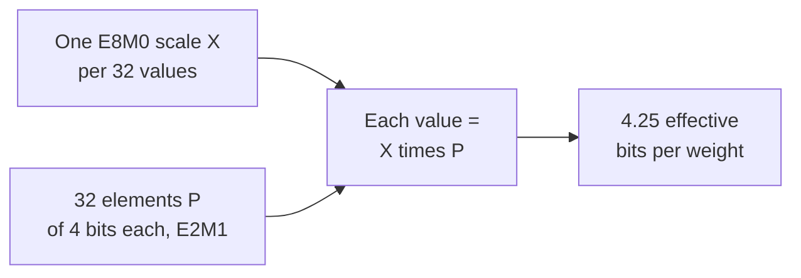

# 第 3 课：低位格式

**使命关联:** 量化一个模型，就是在这些格式里选一种，所以你需要知道每种格式能装下哪些值，把缩放因子算进去之后每个权重要花多少位，以及为什么这些窄格式离了缩放因子就没法用。
**主要来源:** [论文：“FP8 Formats for Deep Learning”，Micikevicius 等，2022](https://arxiv.org/abs/2209.05433)
**前置知识:** [第 2 课](0002-floating-point-formats.md)、[块缩放格式](../GLOSSARY.md)、[缩放因子](../GLOSSARY.md)、[位宽](../GLOSSARY.md)

## 热身

1. ▢ 一个 4 位方案为每组 32 个权重存一个 16 位缩放因子。它的每个权重的有效位数是多少？

<details markdown="1"><summary>检查</summary>

4.5。缩放因子在 4 位的位宽之上，使每个权重多出 16 / 32 = 0.5 位。

</details>

2. ▢ 一个 bf16 的激活值是 100,000。把它转成 fp16 会发生什么？为什么 bf16 没有这个问题？

<details markdown="1"><summary>检查</summary>

它会变成无穷大，因为 fp16 的最大有限值是 65,504。bf16 有 fp32 的 8 个指数位，所以它的范围可达约 3.4 × 10^38，代价是 7 位的尾数。

</details>

## 要点

### fp8：两种布局

[Micikevicius 等人](https://arxiv.org/abs/2209.05433)定义了两种 8 位浮点编码，名字由指数位数和尾数位数构成。每种另有一个符号位。

| | E4M3 | E5M2 |
|---|---|---|
| 指数 / 尾数位数 | 4 / 3 | 5 / 2 |
| 指数偏置 | 7 | 15 |
| 最大有限值 | 448 | 57,344 |
| 最小规格化值 | 2^-6 | 2^-14 |
| 最小非规格化值 | 2^-9 | 2^-16 |
| 无穷大 | 无 | IEEE 风格 |
| NaN | 一种尾数模式（S.1111.111） | 多种（S.11111.01、.10、.11） |

E5M2 遵循 IEEE 754 的约定，可以看作尾数位更少的 fp16。E4M3 为了换取范围而打破了这些约定：它去掉了无穷大，每个符号只保留一种 NaN 模式，这就腾出了最高的指数给普通的值使用，并把最大值提高到 448。推荐的用法是权重和激活值张量用 E4M3，梯度张量用 E5M2。这又是第 2 课的那笔权衡：梯度跨越很宽的范围，所以给它多的那一位指数，而权重和激活值得到的是多的那一位尾数。

这两种格式能表示的值都非常少，所以一个张量在转换之前，必须先乘以一个缩放因子，把它移到格式能表示的范围里。作者把这与 fp16 训练中损失缩放的目的做了类比。他们报告说，不加缩放因子就转换一个模型的张量，“造成了显著的精度损失”，GPT 的困惑度为 11.0。

加上缩放之后，在他们尝试的模型上，训练后量化到 E4M3 的结果与 16 位基线很接近，而 int8 则不然。对一个 6.7B 的 GPT-3 式模型，wikitext103 上的困惑度，16 位浮点是 8.51，int8 是 10.29，E4M3 是 8.41，其中权重用逐通道缩放因子，激活值用逐张量缩放因子。这是一个团队在他们自己的校准选择下得到的结果：请把它读作浮点网格比整数网格更贴合这些张量的证据，而不是一个通用的排名。

### int8 和 int4：均匀网格

整数格式没有指数。它的值是等间距的整数：int8 能装下 -128 到 127，共 256 个档位，int4 能装下 -8 到 7，共 16 个档位。相邻值之间的间隔处处是 1，不像浮点数，间隔在每个 2 的幂处翻倍。

整数自己只能表示整数，所以像 0.02 这样的权重存不进去。因此量化器把一个整数连同一个**缩放因子**一起存起来，缩放因子是相邻档位之间的实数步长，使实数值近似等于缩放因子乘以这个整数。怎样选这个缩放因子，以及它够不到的那些值怎么办，是第 4 到第 6 课的主题。现在先记住一个事实：整数网格的间隔固定，也没有内置的范围，所以它的范围完全由缩放因子决定，而浮点网格自带范围，只需要一个缩放因子把这个范围放到正确的位置。

### 块缩放格式

当各个值相差很大时，整个张量只用一个缩放因子是不合适的。**块缩放格式**给一小块值各配一个共用的缩放因子。[Rouhani 等人](https://arxiv.org/abs/2310.10537)描述的 OCP 微缩放（MX）格式，把一个块定义为 k 个元素共用一个缩放因子 X，每个元素的值是 X 乘以它所存的元素 P。在他们列出的每一种具体 MX 格式中，块都是 32 个元素，缩放因子以 E8M0 存储，也就是只有指数、没有尾数的 8 位数，所以缩放因子永远是 2 的幂。他们按元素类型来命名每种格式：

| 格式 | 块大小 | 缩放因子格式 | 元素格式 | 元素位数 |
|---|---|---|---|---|
| MXFP8 | 32 | E8M0 | E4M3 或 E5M2 | 8 |
| MXFP6 | 32 | E8M0 | E2M3 或 E3M2 | 6 |
| MXFP4 | 32 | E8M0 | E2M1 | 4 |
| MXINT8 | 32 | E8M0 | int8 | 8 |

MXFP4 每个元素存 4 位，每 32 个元素存一个 8 位缩放因子，所以它的每个权重的有效位数是 4 + 8 / 32 = 4.25。按同样的算法，MXFP8 和 MXINT8 是 8.25，MXFP6 是 6.25。



元素类型 E2M1 有 1 个符号位、2 个指数位和 1 个尾数位。这是 16 种位模式，能表示的值非常少。其中八个非负值正是 NVIDIA 所列出的那一组，你会在练习第 1 题中把它们推导出来。

[NVIDIA 的 NVFP4](https://developer.nvidia.com/blog/introducing-nvfp4-for-efficient-and-accurate-low-precision-inference/) 用的是同样的 E2M1 元素，但有两处改动，以下是 NVIDIA 自己的博客文章中的说法，那是厂商文档。块是 16 个值而不是 32 个，它的缩放因子是一个 FP8 E4M3 数而不是 2 的幂，所以缩放因子可以是分数倍，更贴合每一个块。由于 E4M3 缩放因子的范围很窄，还要对整个张量再施加一个第二层的 FP32 缩放因子。这样每个权重的有效位数是 4 + 8 / 16 = 4.5，不计那唯一一个逐张量的标量。NVIDIA 说，E8M0 缩放因子更简单，对于不那么在意缩放因子精度的张量，也可以够用。

| 方案 | 位宽 | 每个权重的有效位数 | 8B 模型 | 70B 模型 |
|---|---|---|---|---|
| int8（忽略缩放因子的开销） | 8 | 8 | 8 GB | 70 GB |
| int4（忽略缩放因子的开销） | 4 | 4 | 4 GB | 35 GB |
| MXFP4 | 4 | 4.25 | 4.25 GB | 约 37.2 GB |
| NVFP4 | 4 | 4.5 | 4.5 GB | 约 39.4 GB |

## 练习

1. ▢ E2M1 有 1 个符号位、2 个指数位和 1 个尾数位，指数偏置为 1。指数字段 `e` 为 0 时是非规格化值，值为 `m × 0.5`。否则值为 `2^(e - 1) × (1 + m / 2)`。列出它能表示的八个非负值。

<details markdown="1"><summary>提示</summary>

有四个指数字段，两个尾数取值，一共八种组合。从 `e = 0` 和 `m` 的两个取值开始，然后每次把指数加一。

</details>

<details markdown="1"><summary>检查</summary>

0、0.5、1、1.5、2、3、4 和 6。`e = 0` 时：0 和 0.5。`e = 1` 时：1 和 1.5。`e = 2` 时：2 和 3。`e = 3` 时：4 和 6。这与 NVIDIA 的列表一致，6 是最大值。再配上符号位做镜像，一共有 15 个不同的值，因为正零和负零是同一个。间隔到 2 之前是 0.5，然后是 1，再然后是 2：即使只有四位，也呈现出浮点式的间隔。

</details>

2. ▢ 先预测，再运行。这个函数用你给定的布局和偏置来解码一个位模式。运行之前，先根据位模式 0 1111 110 算出 E4M3 的最大有限值，再根据 0 00000 01 算出 E5M2 的最小正值。

    ```python
    def decode(code, ebits, mbits, bias):
        e = (code >> mbits) & ((1 << ebits) - 1)
        m = code & ((1 << mbits) - 1)
        if e == 0:
            return m / 2**mbits * 2.0 ** (1 - bias)
        return (1 + m / 2**mbits) * 2.0 ** (e - bias)

    print(decode(0b1111110, 4, 3, 7), decode(0b0000001, 4, 3, 7))
    print(decode(0b1111011, 5, 2, 15), decode(0b0000001, 5, 2, 15))
    ```

<details markdown="1"><summary>提示</summary>

对 E4M3 来说，1111 是指数字段 15，所以缩放是 2^(15 - 7) = 2^8，而 110 作为尾数是 1 + 6/8。位模式 0 1111 111 保留给 NaN，所以 110 是最大的有限值。

</details>

<details markdown="1"><summary>检查</summary>

```text
448.0 0.001953125
57344.0 1.52587890625e-05
```

第一行是 E4M3 的最大值 448 = 1.75 × 2^8，以及它的最小非规格化值 2^-9。第二行是 E5M2 的最大值 57,344 = 1.75 × 2^15，以及它的最小非规格化值 2^-16。两者都与论文中的表一致。E5M2 比 E4M3 高出约 128 倍，也低出约 128 倍，代价是少一位尾数。

</details>

3. ▢ 论文推荐的 fp8 格式与张量类型的搭配，是下面哪一种？为什么？

    - a) 梯度用 E4M3，因为它们需要更细的间隔
    - b) 梯度用 E5M2，因为它们需要更宽的范围
    - c) 权重用 E5M2，因为它们需要更细的间隔
    - d) 权重用 E4M3，因为它们需要更宽的范围

<details markdown="1"><summary>检查</summary>

**b)** 推荐的是权重和激活值用 E4M3，梯度用 E5M2，理由就是第 2 课的那笔权衡：梯度跨越许多个 2 的幂，所以给它多的那一位指数。(a) 把窄范围的格式给了梯度。(d) 把 E4M3 并不具备的更宽范围算在了它头上。(c) 把 E5M2 配给权重，并说它的间隔更细，但 E5M2 的间隔其实更粗。

</details>

4. ▢ 先预测，再运行。第一次打印显示什么？第二次打印中，条目 0.0004 显示什么？

    ```python
    import numpy as np

    x = np.array([0.02, -0.31, 0.5, 0.0004])
    print(np.round(x).astype(np.int8))

    scale = np.abs(x).max() / 127
    q = np.round(x / scale).astype(np.int8)
    print(q, np.round(q * scale, 4))
    ```

<details markdown="1"><summary>提示</summary>

第一行直接转换成 int8，所以每个值都被舍入到最近的整数。在第二行中，缩放因子是最大幅值除以 127，所以 0.5 应该落在最高档位上。

</details>

<details markdown="1"><summary>检查</summary>

```text
[0 0 0 0]
[  5 -79 127   0] [ 0.0197 -0.311   0.5     0.    ]
```

没有缩放因子时，每个值都舍入成零。有了缩放因子，0.5 映射到 127，-0.31 映射到 -79，0.02 映射到 5，反量化后的值与原值很接近。最后一项仍然变成了 0：0.0004 小于一个步长 0.0039 的一半，所以被舍入掉了。缩放因子挽救了范围，却挽救不了小于它半个步长的值。

</details>

5. ▢ 一个 70B 参数的模型分别以 MXFP4 和 NVFP4 存储。算出两者各自的权重内存，并说明为什么两者都不是简单的每个参数 4 位。

<details markdown="1"><summary>检查</summary>

MXFP4 的有效位数是 4 + 8 / 32 = 4.25，所以 70 × 4.25 / 8 = 37.1875，约 37.2 GB。NVFP4 是 4 + 8 / 16 = 4.5 位，所以 70 × 4.5 / 8 = 39.375，约 39.4 GB，不计逐张量的标量。缩放因子与元素存放在一起，要计入内存，所以只说 4 位的元素宽度，会低估大小。NVFP4 更精细的缩放因子和更小的块，使它比 MXFP4 每个权重多花约 0.25 位。

</details>

6. ▢ 先预测，再运行。这段示意代码按 MX 论文的算法 1，处理一个 FP4 的块：共用的缩放因子是根据块中最大幅值选出的 2 的幂，每个值都舍入到最近的 E2M1 值。运行之前，先说第一个块中的小值会怎样，再与第二个块比较，在第二个块里大的那个值被换成了 0.7。

    ```python
    import numpy as np

    pos = np.array([0, 0.5, 1, 1.5, 2, 3, 4, 6])
    grid = np.concatenate([-pos[:0:-1], pos])

    def mxfp4(v):
        shared_exp = np.floor(np.log2(np.abs(v).max())) - 2
        s = 2.0 ** shared_exp
        scaled = np.clip(v / s, -6, 6)
        idx = np.abs(scaled[:, None] - grid[None, :]).argmin(axis=1)
        return float(s), (grid[idx] * s).tolist()

    print(mxfp4(np.array([7.0, 0.9, 0.3, -0.12, 0.05])))
    print(mxfp4(np.array([0.7, 0.9, 0.3, -0.12, 0.05])))
    ```

<details markdown="1"><summary>提示</summary>

`- 2` 中的 2 是 6 的指数，6 是 E2M1 的最大值（6 = 1.5 × 2^2）。对第一个块，缩放因子是 2^(2 - 2)。于是最小的非零档位是这个缩放因子的一半。

</details>

<details markdown="1"><summary>检查</summary>

```text
(1.0, [6.0, 1.0, 0.5, 0.0, 0.0])
(0.125, [0.75, 0.75, 0.25, -0.125, 0.0625])
```

在第一个块里，缩放因子是 1，最小的非零档位是 0.5，-0.12 和 0.05 都舍入成 0，而 7.0 被钳制成 6.0。在第二个块里，缩放因子是 0.125，五个值都保持非零，-0.12 和 0.05 的还原误差在一个步长之内。一个大值就决定了它所在的块里全部 32 个值的缩放因子，所以它能把邻居抹掉。这就是第 7 和第 8 课讲的离群值问题，只是出现在块这个尺度上。

</details>

## 实战练习

- [ ] 打开某个已发布的 fp8 或 4 位检查点的模型卡或量化配置，找出它用了哪种格式、块大小或分组大小，以及缩放因子的类型。算出它的每个权重的有效位数。
- [ ] 查看你可能会用到的某块 GPU 的张量核心或数据类型支持表，记下其中把 fp16、bf16、fp8 和 fp4 里的哪些列为原生支持。
- [ ] 明天：不看笔记，写下 E2M1 的八个非负值、E4M3 和 E5M2 的最大值，以及 MXFP4 的每个权重的有效位数。

## 延伸阅读

- [数值格式](../reference/number-formats.md)
- [论文：“FP8 Formats for Deep Learning”，Micikevicius 等，2022](https://arxiv.org/abs/2209.05433)
- [论文：“Microscaling Data Formats for Deep Learning”，Rouhani 等，2023](https://arxiv.org/abs/2310.10537)
- [文章：“Introducing NVFP4 for Efficient and Accurate Low-Precision Inference”，NVIDIA Technical Blog](https://developer.nvidia.com/blog/introducing-nvfp4-for-efficient-and-accurate-low-precision-inference/)
- [资源](../RESOURCES.md)

---

没学明白？请重读顶部的主要来源，因为本课是对它的压缩，而理解正是在压缩中流失的。如果有哪个术语觉得含糊，可以查看[术语表](../GLOSSARY.md)。

如果问题出在课程本身，而不是学习材料，那就是一个缺陷：[提交 issue](https://github.com/TokenCemetery/teach/issues)。
