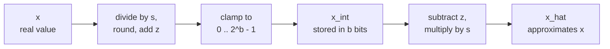

# Lección 4. Cuantizar y descuantizar

**Vínculo con la misión:** Cuantizar un tensor a mano y predecir de dónde viene su error empieza por el único mapeo sobre el que se construyen todos los métodos posteriores, así que esta lección te capacita para ejecutarlo hacia delante y hacia atrás y para acotar su error.
**Fuente principal:** [Paper: "A White Paper on Neural Network Quantization", Nagel et al., 2021](https://arxiv.org/abs/2106.08295), secciones 2.2 y 2.4.1
**Requisitos previos:** [Lección 3](0003-low-bit-formats.md), [Cuantización afín](../GLOSSARY.md), [Scale](../GLOSSARY.md), [Zero-point](../GLOSSARY.md)

## Calentamiento

1. ▢ Un modelo de 70B parámetros se almacena en int4 con un scale de 16 bits por grupo de 64 pesos. ¿Cuántos GB ocupan sus pesos?

<details markdown="1"><summary>Comprobación</summary>

Unos 37 GB. Cada peso cuesta 4 bits más 16 / 64 = 0.25 bits de scale, así que 4.25 bits efectivos por peso, y 70 mil millones × 4.25 / 8 bytes son unos 37 GB. Los 4 bits nominales darían 35 GB, que subestima el checkpoint.

</details>

2. ▢ fp16 y bf16 usan ambos 16 bits. ¿Cómo los reparten, y cuál conserva el rango de fp32?

<details markdown="1"><summary>Comprobación</summary>

fp16 usa 1 bit de signo, 5 bits de exponente y 10 bits de mantisa. bf16 usa 1, 8 y 7. bf16 tiene los mismos 8 bits de exponente que fp32, así que conserva el rango de fp32 y cede precisión.

</details>

3. ▢ ¿Cuántos valores distintos puede contener un entero de 4 bits con signo, y en qué rango?

<details markdown="1"><summary>Comprobación</summary>

Dieciséis valores, de -8 a 7. La cuenta es 2^4 sea cual sea la convención de signo, así que un cuantizador de 4 bits siempre tiene 16 niveles que colocar.

</details>

## Qué debes saber

### Dos operaciones

Un **cuantizador** asigna números reales a una lista corta de enteros y de vuelta. Nagel et al. definen la versión de **cuantización afín** con tres parámetros: un **scale** `s`, el paso real entre enteros vecinos, un **zero-point** `z`, el entero que representa el cero real, y el ancho de bits `b`. Cuantizar un valor real `x` sobre la rejilla de enteros sin signo de 0 a 2^b - 1 es la ecuación 4 del paper, y la **descuantización** es la ecuación 6:

```text
x_int = clamp(round(x / s) + z, 0, 2^b - 1)      quantize
x_hat = s * (x_int - z)                          dequantize
```

`round` es round-to-nearest, y `clamp` fija todo lo que queda fuera de la rejilla en su extremo más cercano. Solo se almacena `x_int`, como `b` bits por valor, junto con `s` y `z`. `x_hat` es con lo que calcula el modelo, y la diferencia `x_hat - x` es el error de cuantización.



La rejilla es una escalera de 2^b peldaños, separados `s`, y el zero-point decide dónde queda el cero real en ella. Los extremos de la escalera son los límites de la rejilla: `q_min = -s * z` y `q_max = s * (2^b - 1 - z)`. Un valor dentro de ellos se mueve al peldaño más cercano. Un valor fuera de ellos se recorta al extremo, lo que Nagel et al. llaman **error de recorte**.

### De dónde viene el error

Dentro de los límites de la rejilla, el **error de redondeo** es como mucho medio paso. Nagel et al. afirman que está en el rango de -s/2 a s/2. Fuera de los límites, el error de recorte es la distancia al límite, y puede ser tan grande como permitan los datos. Así que `s/2` acota el error solo para los valores que la rejilla cubre.

El mismo paper señala la tensión: ensanchar el rango reduce el error de recorte y aumenta el error de redondeo, porque un rango más ancho necesita un `s` mayor. La lección 5 trata de elegir el rango. Por ahora, toma la opción más ancha, el mínimo y el máximo del tensor, para que no se recorte nada:

```text
s = (max - min) / (2^b - 1)
z = round(-min / s)
```

El scale es el rango dividido por el número de pasos, y por eso importa cada bit que se quita: para un mismo rango, una rejilla de 4 bits tiene 15 pasos y una de 8 bits tiene 255, así que el paso de 4 bits es 17 veces mayor y también lo es su error de redondeo en el peor caso. Redondear `z` a un entero desplaza la rejilla como mucho medio paso, así que los valores en los extremos mismos del rango pueden recortarse hasta `s/2`, y el error total de cualquier valor dentro de `[min, max]` se mantiene en `s/2` o menos. Esto se deriva de las fórmulas, no lo afirma el paper, y el ejemplo de la práctica muestra que ocurre.

### Simétrica o afín, con signo o sin signo

La **cuantización simétrica** fija el zero-point en cero, así que solo se almacena un scale y la rejilla queda centrada en cero. La cuantización afín gasta un parámetro más para colocar la rejilla en cualquier parte. Nagel et al. dicen que entonces importa la elección entre rejilla entera con signo y sin signo:

| Rejilla | Enteros | Conviene a |
|---|---|---|
| Simétrica con signo | -2^(b-1) a 2^(b-1) - 1 | Valores aproximadamente simétricos respecto del cero |
| Simétrica sin signo | 0 a 2^b - 1 | Valores de una sola cola, como las salidas de ReLU |
| Afín (sin signo, con `z`) | 0 a 2^b - 1 | Valores repartidos de forma asimétrica en torno a cero |

Una rejilla simétrica sobre datos de un solo lado desperdicia niveles: todo nivel por debajo de cero no se usa nunca. Los cuantizadores simétricos con signo suelen escribirse con el umbral de recorte `c` y `s = c / (2^(b-1) - 1)`, así que int8 usa de -127 a 127 y deja sin usar -128. Es una convención, y es la que usa el código de las lecciones 5 a 8.

¿Por qué renunciar al parámetro extra? Nagel et al. muestran en la sección 2.4.1 qué produce multiplicar pesos asimétricos por activaciones asimétricas: cuatro términos, y uno de ellos depende de la entrada, así que debe calcularse para cada batch en tiempo de ejecución. Lo describen como una sobrecarga significativa de latencia y de potencia, "equivalente a añadir un canal extra", y señalan que usar cuantización asimétrica de activaciones con cuantización simétrica de pesos evita el término extra. Es la disposición habitual.

### El cero debe ser exactamente representable

El zero-point es un entero por una razón. Jacob et al. definen `z` como el valor cuantizado que corresponde al 0 real, lo que cumple el requisito de que el cero real sea exactamente representable, porque las implementaciones eficientes suelen necesitar relleno con ceros en los bordes de los arreglos ([Jacob et al., 2017](https://arxiv.org/abs/1712.05877)). Nagel et al. añaden que ReLU y el relleno con ceros no introducen entonces ningún error de cuantización. En un LLM, el mismo razonamiento protege cualquier cero estructural: una posición de relleno o un valor enmascarado debe seguir siendo exactamente cero tras la descuantización.

## Práctica

1. ▢ Un cuantizador afín de 8 bits cubre el rango de -1 a 3. Calcula `s`, `z`, el entero al que se asigna el 0 real y el mayor error de redondeo dentro del rango.

<details markdown="1"><summary>Comprobación</summary>

`s = 4 / 255 = 0.01569`, `z = round(1 / 0.01569) = round(63.75) = 64`. El cero real se asigna a `round(0 / s) + 64 = 64`, y descuantizar 64 da `s * (64 - 64) = 0` exactamente. El mayor error de redondeo es `s/2 = 0.0078`. Los límites de la rejilla son `q_min = -64 * s = -1.004` y `q_max = 191 * s = 2.996`, ligeramente desplazados respecto de -1 y 3 porque `z` se redondeó.

</details>

2. ▢ ¿Qué rejilla encaja con la salida de una ReLU, cuyos valores nunca son negativos, con el menor número de niveles desperdiciados?

    - a) Rejilla simétrica con signo, zero-point cero
    - b) Rejilla sin signo con zero-point cero
    - c) Rejilla con signo centrada en el promedio
    - d) Rejilla sin signo con zero-point máximo

<details markdown="1"><summary>Comprobación</summary>

**b)** Sin valores negativos, el cero pertenece al fondo de la rejilla, así que todos los niveles cubren valores reales. (a) pone la mitad de los niveles por debajo de cero, donde nunca cae ningún valor. (c) también gasta niveles en números negativos, porque el promedio de datos no negativos sigue estando por encima de cero. (d) pone el cero arriba del todo, así que cada nivel representa un número negativo y todos los datos se recortarían.

</details>

3. ▢ Predice y luego ejecuta. Esto cuantiza cinco valores a una rejilla afín de 4 bits. Antes de ejecutarlo, predice `z`, el entero para 0.0, si el 0.0 descuantizado es exactamente 0.0 y si algún error supera `s/2`.

    ```python
    import numpy as np

    x = np.array([-0.2, 0.0, 0.3, 0.9, 1.5])
    b = 4
    s = (x.max() - x.min()) / (2**b - 1)
    z = int(round(-x.min() / s))
    x_int = np.clip(np.round(x / s) + z, 0, 2**b - 1).astype(int)
    x_hat = s * (x_int - z)

    print("scale", round(s, 4), "zero point", z)
    print("x_int", x_int)
    print("x_hat", np.round(x_hat, 4))
    print("error", np.round(x_hat - x, 4))
    print("s/2  ", round(s / 2, 4))
    ```

<details markdown="1"><summary>Pista</summary>

`z` es `-min / s` redondeado, y `s` es 1.7 dividido por 15. Luego pregúntate qué valores quedan en los extremos de la rejilla.

</details>

<details markdown="1"><summary>Comprobación</summary>

```text
scale 0.1133 zero point 2
x_int [ 0  2  5 10 15]
x_hat [-0.2267  0.      0.34    0.9067  1.4733]
error [-0.0267  0.      0.04    0.0067 -0.0267]
s/2   0.0567
```

El entero para 0.0 es 2, y se descuantiza a exactamente 0.0, así que el cero se conserva. Ningún error supera `s/2 = 0.0567`. Los dos extremos muestran el efecto de redondear `z`: 1.7647 pasó a 2, lo que desplazó la rejilla hacia abajo, así que -0.2 cayó en -0.2267 y 1.5 se recortó a 1.4733. Ambos errores son 0.0267, dentro de la cota.

</details>

4. ▢ Una biblioteca usa un zero-point sin redondear de 63.75 con el scale del ejercicio 1, y rellena un tensor con el entero más cercano, 64. ¿A qué se descuantiza el relleno, y por qué es un defecto?

<details markdown="1"><summary>Comprobación</summary>

`s * (64 - 63.75) = 0.01569 * 0.25 = 0.0039`, un pequeño número distinto de cero en cada posición de relleno. El cero real deja de ser exactamente representable, que es la propiedad que el zero-point entero existe para garantizar, y el relleno con ceros es el caso que dan Jacob et al. para exigirla.

</details>

5. ▢ Un cuantizador simétrico con signo de 4 bits tiene `s = 0.1` y usa los enteros de -8 a 7. ¿Qué rango cubre, qué devuelve para 1.0 y por qué el resultado rompe la cota de `s/2`? ¿Qué scale evitaría que recortara 1.0 si la rejilla usara de -7 a 7?

<details markdown="1"><summary>Comprobación</summary>

Cubre de -0.8 a 0.7. Para 1.0, `round(1.0 / 0.1) = 10` se fija en 7, así que devuelve 0.7, un error de 0.3. Eso es tres veces `s` y seis veces la cota `s/2 = 0.05`, porque la cota vale solo dentro de los límites de la rejilla y 1.0 está fuera de ellos. Cubrir 1.0 con el entero más alto, 7, necesita `s = 1.0 / 7 = 0.143`, que ensancha cada paso, así que el costo de eliminar el recorte es más error de redondeo para todos los demás valores.

</details>

## Prácticas en el mundo real

- [ ] Escribe `quantize(x, s, z, b)` y `dequantize(x_int, s, z)` a partir de las dos fórmulas. Ejecútalas sobre un vector aleatorio y comprueba con un assert que cada error es como mucho `s/2` cuando el rango se toma del mínimo y el máximo del propio vector.
- [ ] Toma una matriz de pesos de un modelo abierto pequeño, imprime su mínimo, su máximo y su media, y decide a partir de los números si una rejilla simétrica con signo desperdicia niveles en ella.
- [ ] Mañana: sin apuntes, escribe las fórmulas de cuantizar y descuantizar, las fórmulas de `s` y `z` a partir de un mínimo y un máximo, y la cota del error de redondeo. Luego compáralas con las ecuaciones 4 y 6 de la fuente principal.

## Para profundizar

- [El mapeo de cuantización](../reference/quantization-mapping.md)
- [Paper: "A White Paper on Neural Network Quantization", Nagel et al., 2021](https://arxiv.org/abs/2106.08295)
- [Paper: "Quantization and Training of Neural Networks for Efficient Integer-Arithmetic-Only Inference", Jacob et al., 2017](https://arxiv.org/abs/1712.05877)
- [Recursos](../RESOURCES.md)

---

¿No termina de quedar claro? Vuelve a leer la fuente primaria de arriba, ya que esta lección la comprime y en la compresión es donde se escapa la comprensión. Consulta el [glosario](../GLOSSARY.md) por si algún término te resultó resbaladizo.

Si lo poco claro es la propia lección y no el material, eso es un defecto: [abre un issue](https://github.com/TokenCemetery/teach/issues).
