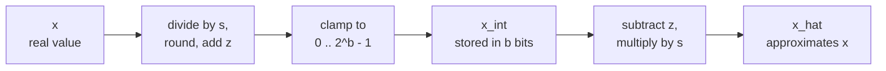

# Leçon 4. Quantifier et déquantifier

**Lien avec la mission :** Quantifier un tenseur à la main et prévoir d'où vient son erreur commence par la correspondance unique sur laquelle toutes les méthodes suivantes s'appuient, donc cette leçon vous rend capable de la dérouler dans les deux sens et d'en borner l'erreur.
**Source primaire :** [Article : "A White Paper on Neural Network Quantization", Nagel et al., 2021](https://arxiv.org/abs/2106.08295), sections 2.2 et 2.4.1
**Prérequis :** [Leçon 3](0003-low-bit-formats.md), [Quantification affine](../GLOSSARY.md), [Scale](../GLOSSARY.md), [Zero-point](../GLOSSARY.md)

## Échauffement

1. ▢ Un modèle de 70B paramètres est stocké en int4 avec un scale de 16 bits par groupe de 64 poids. Combien de GB ses poids prennent-ils ?

<details markdown="1"><summary>Vérifier</summary>

Environ 37 GB. Chaque poids coûte 4 bits plus 16 / 64 = 0.25 bit de scale, soit 4.25 bits effectifs par poids, et 70 milliards × 4.25 / 8 octets font environ 37 GB. Les 4 bits nominaux donneraient 35 GB, ce qui sous-estime le checkpoint.

</details>

2. ▢ Le fp16 et le bf16 utilisent tous deux 16 bits. Comment les répartissent-ils, et lequel garde la plage du fp32 ?

<details markdown="1"><summary>Vérifier</summary>

Le fp16 utilise 1 bit de signe, 5 bits d'exposant et 10 bits de mantisse. Le bf16 en utilise 1, 8 et 7. Le bf16 a les mêmes 8 bits d'exposant que le fp32, donc il garde la plage du fp32 et sacrifie la précision.

</details>

3. ▢ Combien de valeurs distinctes un entier signé sur 4 bits peut-il contenir, et sur quelle plage ?

<details markdown="1"><summary>Vérifier</summary>

Seize valeurs, de -8 à 7. Le compte est 2^4 quelle que soit la convention de signe, donc un quantificateur sur 4 bits a toujours 16 niveaux à placer.

</details>

## À savoir

### Deux opérations

Un **quantificateur** fait correspondre des nombres réels à une courte liste d'entiers, et inversement. Nagel et al. définissent la version de **quantification affine** avec trois paramètres : un **scale** `s`, le pas réel entre entiers voisins, un **zero-point** `z`, l'entier qui représente le zéro réel, et la largeur en bits `b`. Quantifier une valeur réelle `x` sur la grille d'entiers non signés de 0 à 2^b - 1 est l'équation 4 de l'article, et la **déquantification** est l'équation 6 :

```text
x_int = clamp(round(x / s) + z, 0, 2^b - 1)      quantize
x_hat = s * (x_int - z)                          dequantize
```

`round` est l'arrondi au plus proche, et `clamp` ramène tout ce qui sort de la grille à son extrémité la plus proche. Seul `x_int` est stocké, sur `b` bits par valeur, avec `s` et `z`. `x_hat` est ce avec quoi le modèle calcule, et l'écart `x_hat - x` est l'erreur de quantification.



La grille est une échelle de 2^b barreaux, espacés de `s`, et le zero-point décide où se trouve le zéro réel sur elle. Les extrémités de l'échelle sont les limites de la grille : `q_min = -s * z` et `q_max = s * (2^b - 1 - z)`. Une valeur située entre elles est déplacée vers le barreau le plus proche. Une valeur en dehors est écrêtée à l'extrémité, ce que Nagel et al. appellent l'**erreur d'écrêtage**.

### D'où vient l'erreur

À l'intérieur des limites de la grille, l'**erreur d'arrondi** vaut au plus un demi-pas. Nagel et al. indiquent qu'elle se situe entre -s/2 et s/2. En dehors des limites, l'erreur d'écrêtage est la distance à la limite, et elle peut être aussi grande que les données le permettent. Donc `s/2` ne borne l'erreur que pour les valeurs que la grille couvre.

Le même article note la tension : élargir la plage réduit l'erreur d'écrêtage et augmente l'erreur d'arrondi, parce qu'une plage plus large exige un `s` plus grand. La leçon 5 porte sur le choix de la plage. Pour l'instant, prenez le choix le plus large, le minimum et le maximum du tenseur, pour que rien ne soit écrêté :

```text
s = (max - min) / (2^b - 1)
z = round(-min / s)
```

Le scale est la plage divisée par le nombre de pas, ce qui explique que chaque bit retiré compte : pour une même plage, une grille de 4 bits a 15 pas et une grille de 8 bits en a 255, donc le pas de 4 bits est 17 fois plus grand et son erreur d'arrondi au pire cas aussi. Arrondir `z` à un entier décale la grille d'au plus un demi-pas, donc les valeurs aux extrémités mêmes de la plage peuvent être écrêtées de jusqu'à `s/2`, et l'erreur totale de toute valeur dans `[min, max]` reste inférieure ou égale à `s/2`. Cela est dérivé des formules, pas énoncé par l'article, et l'exemple de la Pratique le montre en action.

### Symétrique ou affine, signé ou non signé

La **quantification symétrique** fixe le zero-point à zéro, donc seul un scale est stocké et la grille est centrée sur zéro. La quantification affine dépense un paramètre de plus pour placer la grille n'importe où. Nagel et al. disent que le choix d'une grille d'entiers signés ou non signés compte alors :

| Grille | Entiers | Convient à |
|---|---|---|
| Symétrique signée | -2^(b-1) à 2^(b-1) - 1 | Valeurs à peu près symétriques autour de zéro |
| Symétrique non signée | 0 à 2^b - 1 | Valeurs d'un seul côté, comme les sorties de ReLU |
| Affine (non signée, avec `z`) | 0 à 2^b - 1 | Valeurs réparties de façon asymétrique autour de zéro |

Une grille symétrique sur des données d'un seul côté gaspille des niveaux : chaque niveau sous zéro n'est jamais utilisé. Les quantificateurs symétriques signés s'écrivent souvent avec le seuil d'écrêtage `c` et `s = c / (2^(b-1) - 1)`, donc l'int8 utilise -127 à 127 et laisse -128 inutilisé. C'est une convention, et c'est celle qu'emploie le code des leçons 5 à 8.

Pourquoi renoncerait-on au paramètre supplémentaire ? Nagel et al. montrent à la section 2.4.1 ce que produisent des poids asymétriques multipliés par des activations asymétriques : quatre termes, dont un dépend de l'entrée, donc il doit être calculé à l'exécution pour chaque batch. Ils décrivent cela comme un surcoût important en latence et en puissance, « équivalent à l'ajout d'un canal supplémentaire », et notent que la quantification asymétrique des activations avec une quantification symétrique des poids évite le terme supplémentaire. C'est l'arrangement courant.

### Zéro doit être exactement représentable

Le zero-point est un entier pour une raison. Jacob et al. définissent `z` comme la valeur quantifiée qui correspond au 0 réel, ce qui satisfait l'exigence que le zéro réel soit exactement représentable, parce que les implémentations efficaces ont souvent besoin d'un remplissage par des zéros autour des bords des tableaux ([Jacob et al., 2017](https://arxiv.org/abs/1712.05877)). Nagel et al. ajoutent que ReLU et le remplissage par des zéros n'introduisent alors aucune erreur de quantification. Dans un LLM, le même raisonnement protège tout zéro structurel : une position de padding ou une valeur masquée doit rester exactement zéro après déquantification.

## Pratique

1. ▢ Un quantificateur affine sur 8 bits couvre la plage de -1 à 3. Calculez `s`, `z`, l'entier auquel correspond le 0 réel, et la plus grande erreur d'arrondi dans la plage.

<details markdown="1"><summary>Vérifier</summary>

`s = 4 / 255 = 0.01569`, `z = round(1 / 0.01569) = round(63.75) = 64`. Le zéro réel correspond à `round(0 / s) + 64 = 64`, et déquantifier 64 donne `s * (64 - 64) = 0` exactement. La plus grande erreur d'arrondi est `s/2 = 0.0078`. Les limites de la grille sont `q_min = -64 * s = -1.004` et `q_max = 191 * s = 2.996`, légèrement décalées par rapport à -1 et 3 parce que `z` a été arrondi.

</details>

2. ▢ Quelle grille convient à la sortie d'un ReLU, dont les valeurs ne sont jamais négatives, en gaspillant le moins de niveaux ?

    - a) Grille symétrique signée, zero-point nul
    - b) Grille non signée avec un zero-point nul
    - c) Grille signée centrée sur la moyenne
    - d) Grille non signée avec un zero-point maximal

<details markdown="1"><summary>Vérifier</summary>

**b)** Sans valeur négative, le zéro se place en bas de la grille, donc tous les niveaux couvrent des valeurs réelles. (a) place la moitié des niveaux sous zéro, là où aucune valeur ne tombe jamais. (c) dépense aussi des niveaux sur des nombres négatifs, parce que la moyenne de données non négatives reste au-dessus de zéro. (d) place le zéro en haut, donc chaque niveau représente un nombre négatif et toutes les données seraient écrêtées.

</details>

3. ▢ Prédisez, puis exécutez. Ce code quantifie cinq valeurs sur une grille affine de 4 bits. Avant de l'exécuter, prédisez `z`, l'entier de 0.0, si le 0.0 déquantifié vaut exactement 0.0, et si une erreur dépasse `s/2`.

    ```python
    import numpy as np

    x = np.array([-0.2, 0.0, 0.3, 0.9, 1.5])
    b = 4
    s = (x.max() - x.min()) / (2**b - 1)
    z = int(round(-x.min() / s))
    x_int = np.clip(np.round(x / s) + z, 0, 2**b - 1).astype(int)
    x_hat = s * (x_int - z)

    print("scale", round(s, 4), "zero point", z)
    print("x_int", x_int)
    print("x_hat", np.round(x_hat, 4))
    print("error", np.round(x_hat - x, 4))
    print("s/2  ", round(s / 2, 4))
    ```

<details markdown="1"><summary>Indice</summary>

`z` est `-min / s` arrondi, et `s` vaut 1.7 divisé par 15. Demandez-vous ensuite quelles valeurs se trouvent aux extrémités de la grille.

</details>

<details markdown="1"><summary>Vérifier</summary>

```text
scale 0.1133 zero point 2
x_int [ 0  2  5 10 15]
x_hat [-0.2267  0.      0.34    0.9067  1.4733]
error [-0.0267  0.      0.04    0.0067 -0.0267]
s/2   0.0567
```

L'entier de 0.0 est 2, et il se déquantifie exactement en 0.0, donc le zéro est préservé. Aucune erreur ne dépasse `s/2 = 0.0567`. Les deux extrémités montrent l'effet de l'arrondi de `z` : 1.7647 est devenu 2, ce qui a décalé la grille vers le bas, si bien que -0.2 est tombé sur -0.2267 et que 1.5 a été écrêté à 1.4733. Les deux erreurs valent 0.0267, dans la borne.

</details>

4. ▢ Une bibliothèque utilise un zero-point non arrondi de 63.75 avec le scale de l'exercice 1, et remplit un tenseur avec l'entier le plus proche, 64. À quoi le remplissage se déquantifie-t-il, et pourquoi est-ce un défaut ?

<details markdown="1"><summary>Vérifier</summary>

`s * (64 - 63.75) = 0.01569 * 0.25 = 0.0039`, un petit nombre non nul à chaque position remplie. Le zéro réel n'est plus exactement représentable, ce qui est la propriété que le zero-point entier existe pour garantir, et le remplissage par des zéros est le cas que Jacob et al. donnent pour l'exiger.

</details>

5. ▢ Un quantificateur symétrique signé sur 4 bits a `s = 0.1` et utilise les entiers de -8 à 7. Quelle plage couvre-t-il, que renvoie-t-il pour 1.0, et pourquoi le résultat brise-t-il la borne `s/2` ? Quel scale l'empêcherait d'écrêter 1.0 si la grille utilisait -7 à 7 ?

<details markdown="1"><summary>Vérifier</summary>

Il couvre -0.8 à 0.7. Pour 1.0, `round(1.0 / 0.1) = 10` est ramené à 7, donc il renvoie 0.7, soit une erreur de 0.3. C'est trois fois `s` et six fois la borne `s/2 = 0.05`, parce que la borne ne vaut qu'à l'intérieur des limites de la grille et que 1.0 est en dehors. Couvrir 1.0 avec l'entier le plus haut 7 exige `s = 1.0 / 7 = 0.143`, ce qui élargit chaque pas, donc le prix de la suppression de l'écrêtage est davantage d'erreur d'arrondi pour toutes les autres valeurs.

</details>

## Exercices en situation réelle

- [ ] Écrivez `quantize(x, s, z, b)` et `dequantize(x_int, s, z)` à partir des deux formules. Exécutez-les sur un vecteur aléatoire et vérifiez par assertion que chaque erreur est au plus `s/2` quand la plage est prise sur le minimum et le maximum du vecteur lui-même.
- [ ] Prenez une matrice de poids d'un petit modèle ouvert, affichez son minimum, son maximum et sa moyenne, et décidez d'après les chiffres si une grille symétrique signée y gaspille des niveaux.
- [ ] Demain : sans notes, écrivez les formules de quantification et de déquantification, les formules de `s` et de `z` à partir d'un minimum et d'un maximum, et la borne de l'erreur d'arrondi. Vérifiez-les ensuite avec les équations 4 et 6 de la source primaire.

## Pour aller plus loin

- [La correspondance de quantification](../reference/quantization-mapping.md)
- [Article : "A White Paper on Neural Network Quantization", Nagel et al., 2021](https://arxiv.org/abs/2106.08295)
- [Article : "Quantization and Training of Neural Networks for Efficient Integer-Arithmetic-Only Inference", Jacob et al., 2017](https://arxiv.org/abs/1712.05877)
- [Ressources](../RESOURCES.md)

---

Ça ne passe pas ? Relisez la source primaire en haut de page, car cette leçon la condense et c'est dans la condensation que la compréhension s'échappe. Consultez le [glossaire](../GLOSSARY.md) pour tout terme qui vous a paru glissant.

Si c'est la leçon elle-même qui n'est pas claire plutôt que la matière, c'est un défaut : [ouvrez une issue](https://github.com/TokenCemetery/teach/issues).
