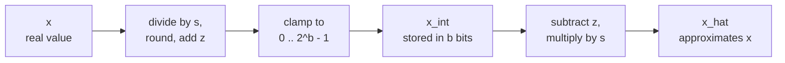

# पाठ 4. Quantize और Dequantize

**मिशन से संबंध:** हाथ से tensor को quantize करना और यह अनुमान लगाना कि उसकी error कहाँ से आती है, उस एक mapping से शुरू होता है जिस पर हर बाद का method टिका है, इसलिए यह पाठ आपको उसे आगे और पीछे दोनों दिशाओं में चलाना और उसकी error को बाँधना सिखाता है।
**मुख्य स्रोत:** [पेपर: "A White Paper on Neural Network Quantization", Nagel et al., 2021](https://arxiv.org/abs/2106.08295), sections 2.2 और 2.4.1
**पूर्व-आवश्यकताएँ:** [पाठ 3](0003-low-bit-formats.md), [Affine quantization](../GLOSSARY.md), [Scale](../GLOSSARY.md), [Zero point](../GLOSSARY.md)

## वार्म-अप

1. ▢ 70B-parameter model int4 में store है और हर 64 weights के group पर एक 16-bit scale है। उसके weights कितने GB लेते हैं?

<details markdown="1"><summary>जाँचें</summary>

लगभग 37 GB। हर weight की लागत 4 bits और 16 / 64 = 0.25 bits scale की है, यानी 4.25 effective bits per weight, और 70 अरब × 4.25 / 8 bytes लगभग 37 GB है। नाममात्र के 4 bits 35 GB देते, जो checkpoint को कम आँकता है।

</details>

2. ▢ fp16 और bf16 दोनों 16 bits इस्तेमाल करते हैं। वे उन्हें कैसे बाँटते हैं, और fp32 की range किसके पास रहती है?

<details markdown="1"><summary>जाँचें</summary>

fp16 में 1 sign bit, 5 exponent bits और 10 mantissa bits हैं। bf16 में 1, 8 और 7। bf16 के पास fp32 जैसे ही 8 exponent bits हैं, इसलिए वह fp32 की range रखता है और precision छोड़ देता है।

</details>

3. ▢ Signed 4-bit integer कितनी अलग values रख सकता है, और किस range में?

<details markdown="1"><summary>जाँचें</summary>

सोलह values, -8 से 7 तक। sign की परिपाटी कुछ भी हो, गिनती 2^4 ही रहती है, इसलिए 4-bit quantizer के पास हमेशा 16 levels होते हैं जिन्हें रखना है।

</details>

## यह जानें

### दो operations

**Quantizer** real संख्याओं को integers की छोटी सूची पर और वापस map करता है। Nagel et al. **affine quantization** वाला रूप तीन parameters के साथ परिभाषित करते हैं: **scale** `s`, यानी पड़ोसी integers के बीच का real step, **zero point** `z`, यानी वह integer जो real zero का प्रतिनिधित्व करता है, और bit width `b`। Real value `x` को unsigned integer grid 0 से 2^b - 1 पर quantize करना पेपर का equation 4 है, और **dequantization** equation 6 है:

```text
x_int = clamp(round(x / s) + z, 0, 2^b - 1)      quantize
x_hat = s * (x_int - z)                          dequantize
```

`round` round-to-nearest है, और `clamp` grid के बाहर की हर चीज़ को उसके सबसे नज़दीकी सिरे पर टिका देता है। सिर्फ़ `x_int` store होता है, हर value के लिए `b` bits में, `s` और `z` के साथ। `x_hat` वह है जिससे model compute करता है, और फ़ासला `x_hat - x` quantization error है।



Grid 2^b डंडों की सीढ़ी है, जो `s` की दूरी पर रखे हैं, और zero point तय करता है कि real zero उस पर कहाँ बैठता है। सीढ़ी के सिरे grid की सीमाएँ हैं: `q_min = -s * z` और `q_max = s * (2^b - 1 - z)`। उनके भीतर की value सबसे नज़दीकी डंडे पर खिसका दी जाती है। उनके बाहर की value सिरे पर clip हो जाती है, जिसे Nagel et al. **clipping error** कहते हैं।

### Error कहाँ से आती है

Grid की सीमाओं के भीतर **rounding error** ज़्यादा से ज़्यादा आधा step होती है। Nagel et al. बताते हैं कि वह -s/2 से s/2 की range में रहती है। सीमाओं के बाहर, clipping error सीमा तक की दूरी है, और वह उतनी बड़ी हो सकती है जितना data अनुमति दे। इसलिए `s/2` error को सिर्फ़ उन values के लिए बाँधता है जिन्हें grid ढकता है।

वही पेपर खिंचाव को दर्ज करता है: range चौड़ी करने से clipping error घटती है और rounding error बढ़ती है, क्योंकि चौड़ी range को बड़ा `s` चाहिए। Range चुनना पाठ 5 का विषय है। अभी सबसे चौड़ा चुनाव लें, यानी tensor का minimum और maximum, ताकि कुछ भी clip न हो:

```text
s = (max - min) / (2^b - 1)
z = round(-min / s)
```

Scale, range को steps की संख्या से भाग देने पर मिलता है, इसीलिए हटाया गया हर bit मायने रखता है: एक ही range के लिए 4-bit grid में 15 steps हैं और 8-bit grid में 255, इसलिए 4-bit का step 17 गुना बड़ा है और उसकी सबसे ख़राब हालत की rounding error भी। `z` को integer में round करने से grid ज़्यादा से ज़्यादा आधा step खिसकता है, इसलिए range के बिल्कुल सिरों की values `s/2` तक clip हो सकती हैं, और `[min, max]` के भीतर किसी भी value की कुल error `s/2` पर या उससे नीचे रहती है। यह formulas से निकाला गया है, पेपर ने इसे नहीं कहा है, और अभ्यास का उदाहरण इसे होते हुए दिखाता है।

### Symmetric या affine, signed या unsigned

**Symmetric quantization** zero point को zero पर तय कर देता है, इसलिए सिर्फ़ scale store होता है और grid zero के चारों ओर केंद्रित रहती है। Affine quantization grid को कहीं भी रखने के लिए एक और parameter ख़र्च करता है। Nagel et al. कहते हैं कि तब signed या unsigned integer grid का चुनाव मायने रखता है:

| Grid | Integers | किसके लिए ठीक है |
|---|---|---|
| Signed symmetric | -2^(b-1) से 2^(b-1) - 1 | ऐसी values जो zero के आसपास लगभग symmetric हों |
| Unsigned symmetric | 0 से 2^b - 1 | एक तरफ़ा values, जैसे ReLU के outputs |
| Affine (unsigned, `z` के साथ) | 0 से 2^b - 1 | ऐसी values जो zero के आसपास असमान रूप से फैली हों |

एक तरफ़ा data पर symmetric grid levels बर्बाद करती है: zero से नीचे का हर level कभी इस्तेमाल नहीं होता। Signed symmetric quantizers अक्सर clipping threshold `c` और `s = c / (2^(b-1) - 1)` के साथ लिखे जाते हैं, इसलिए int8 -127 से 127 इस्तेमाल करता है और -128 अनछुआ छोड़ देता है। यह एक परिपाटी है, और पाठ 5 से 8 का code यही इस्तेमाल करता है।

कोई अतिरिक्त parameter क्यों छोड़ेगा? Nagel et al. section 2.4.1 में दिखाते हैं कि असमान weights को असमान activations से गुणा करने पर क्या बनता है: चार terms, और उनमें से एक input पर निर्भर करता है, इसलिए उसे हर batch के लिए run time पर compute करना पड़ता है। वे इसे latency और power में काफ़ी overhead बताते हैं, "एक अतिरिक्त channel जोड़ने के बराबर", और कहते हैं कि asymmetric activation quantization को symmetric weight quantization के साथ इस्तेमाल करने से अतिरिक्त term से बचा जा सकता है। यही आम व्यवस्था है।

### Zero का बिल्कुल represent होना ज़रूरी है

Zero point का integer होना एक वजह से है। Jacob et al. `z` को real 0 के अनुरूप quantized value के रूप में परिभाषित करते हैं, जो इस ज़रूरत को पूरा करता है कि real zero बिल्कुल represent हो सके, क्योंकि कुशल implementations को अक्सर array की सीमाओं के चारों ओर zero-padding चाहिए होती है ([Jacob et al., 2017](https://arxiv.org/abs/1712.05877))। Nagel et al. जोड़ते हैं कि तब ReLU और zero padding कोई quantization error नहीं लाते। LLM में यही तर्क हर संरचनात्मक zero को बचाता है: padded position या masked value dequantization के बाद भी ठीक zero रहनी चाहिए।

## अभ्यास

1. ▢ 8-bit affine quantizer -1 से 3 की range ढकता है। `s`, `z`, वह integer जिस पर real 0 map होता है, और range के भीतर सबसे बड़ी rounding error निकालें।

<details markdown="1"><summary>जाँचें</summary>

`s = 4 / 255 = 0.01569`, `z = round(1 / 0.01569) = round(63.75) = 64`। Real zero `round(0 / s) + 64 = 64` पर map होता है, और 64 को dequantize करने पर `s * (64 - 64) = 0` ठीक मिलता है। सबसे बड़ी rounding error `s/2 = 0.0078` है। Grid की सीमाएँ `q_min = -64 * s = -1.004` और `q_max = 191 * s = 2.996` हैं, -1 और 3 से थोड़ी खिसकी हुई क्योंकि `z` round किया गया था।

</details>

2. ▢ ReLU के output के लिए, जिसकी values कभी negative नहीं होतीं, कौन-सी grid सबसे कम levels बर्बाद करके बैठती है?

    - a) Signed symmetric grid, zero point zero
    - b) Unsigned grid जिसका zero point zero हो
    - c) औसत पर केंद्रित signed grid
    - d) अधिकतम zero point वाली unsigned grid

<details markdown="1"><summary>जाँचें</summary>

**b)** जब कोई negative value नहीं है, तो zero का स्थान grid के सबसे नीचे है, इसलिए सारे levels real values ढकते हैं। (a) आधे levels को zero से नीचे रखता है जहाँ कोई value कभी नहीं गिरती। (c) भी negative संख्याओं पर levels ख़र्च करता है, क्योंकि non-negative data का औसत फिर भी zero से ऊपर है। (d) zero को सबसे ऊपर रखता है, इसलिए हर level negative संख्या का प्रतिनिधित्व करता है और पूरा data clip हो जाएगा।

</details>

3. ▢ पहले अनुमान लगाएँ, फिर चलाएँ। यह पाँच values को 4-bit affine grid पर quantize करता है। चलाने से पहले अनुमान लगाएँ `z`, 0.0 का integer, क्या dequantize हुआ 0.0 ठीक 0.0 है, और क्या कोई error `s/2` से ज़्यादा है।

    ```python
    import numpy as np

    x = np.array([-0.2, 0.0, 0.3, 0.9, 1.5])
    b = 4
    s = (x.max() - x.min()) / (2**b - 1)
    z = int(round(-x.min() / s))
    x_int = np.clip(np.round(x / s) + z, 0, 2**b - 1).astype(int)
    x_hat = s * (x_int - z)

    print("scale", round(s, 4), "zero point", z)
    print("x_int", x_int)
    print("x_hat", np.round(x_hat, 4))
    print("error", np.round(x_hat - x, 4))
    print("s/2  ", round(s / 2, 4))
    ```

<details markdown="1"><summary>संकेत</summary>

`z`, `-min / s` को round करके बनता है, और `s` 1.7 को 15 से भाग देने पर। फिर पूछें कि कौन-सी values grid के सिरों पर बैठती हैं।

</details>

<details markdown="1"><summary>जाँचें</summary>

```text
scale 0.1133 zero point 2
x_int [ 0  2  5 10 15]
x_hat [-0.2267  0.      0.34    0.9067  1.4733]
error [-0.0267  0.      0.04    0.0067 -0.0267]
s/2   0.0567
```

0.0 का integer 2 है, और वह ठीक 0.0 पर dequantize होता है, इसलिए zero सुरक्षित रहता है। कोई error `s/2 = 0.0567` से ज़्यादा नहीं है। दोनों सिरे `z` को round करने का असर दिखाते हैं: 1.7647, 2 बन गया, जिससे grid नीचे खिसक गई, इसलिए -0.2, -0.2267 पर गिरा और 1.5, 1.4733 पर clip हुआ। दोनों errors 0.0267 हैं, सीमा के भीतर।

</details>

4. ▢ कोई library सवाल 1 वाले scale के साथ बिना round किया zero point 63.75 इस्तेमाल करती है, और tensor को सबसे नज़दीकी integer 64 से pad करती है। Padding dequantize होकर क्या बनती है, और वह खोट क्यों है?

<details markdown="1"><summary>जाँचें</summary>

`s * (64 - 63.75) = 0.01569 * 0.25 = 0.0039`, हर padded position पर एक छोटी non-zero संख्या। Real zero अब ठीक-ठीक represent नहीं हो सकता, जबकि integer zero point इसी गुण की गारंटी देने के लिए है, और zero-padding वही मामला है जो Jacob et al. इसे ज़रूरी बताने के लिए देते हैं।

</details>

5. ▢ Signed symmetric 4-bit quantizer में `s = 0.1` है और वह integers -8 से 7 इस्तेमाल करता है। वह कौन-सी range ढकता है, 1.0 के लिए क्या लौटाता है, और यह नतीजा `s/2` की सीमा क्यों तोड़ता है? अगर grid -7 से 7 इस्तेमाल करती, तो 1.0 को clip होने से रोकने वाला scale क्या होता?

<details markdown="1"><summary>जाँचें</summary>

वह -0.8 से 0.7 ढकता है। 1.0 के लिए, `round(1.0 / 0.1) = 10` clamp होकर 7 बन जाता है, इसलिए वह 0.7 लौटाता है, यानी 0.3 की error। यह `s` का तीन गुना है और सीमा `s/2 = 0.05` का छह गुना, क्योंकि सीमा सिर्फ़ grid की सीमाओं के भीतर लागू होती है और 1.0 उनके बाहर है। सबसे ऊपर के integer 7 से 1.0 को ढकने के लिए `s = 1.0 / 7 = 0.143` चाहिए, जो हर step को चौड़ा कर देता है, इसलिए clipping हटाने की क़ीमत हर दूसरी value के लिए ज़्यादा rounding error है।

</details>

## असली दुनिया का अभ्यास

- [ ] दो formulas से `quantize(x, s, z, b)` और `dequantize(x_int, s, z)` लिखें। उन्हें किसी random vector पर चलाएँ और assert करें कि जब range vector के अपने minimum और maximum से ली जाए तो हर error ज़्यादा से ज़्यादा `s/2` है।
- [ ] किसी छोटे open model से एक weight matrix लें, उसका minimum, maximum और mean print करें, और संख्याओं से तय करें कि क्या signed symmetric grid उस पर levels बर्बाद करती है।
- [ ] कल: बिना नोट्स के quantize और dequantize के formulas, minimum और maximum से `s` और `z` के formulas, और rounding error की सीमा लिखें। फिर उन्हें मुख्य स्रोत के equations 4 और 6 से मिलाएँ।

## आगे बढ़ने के लिए

- [Quantization Mapping शीट](../reference/quantization-mapping.md)
- [पेपर: "A White Paper on Neural Network Quantization", Nagel et al., 2021](https://arxiv.org/abs/2106.08295)
- [पेपर: "Quantization and Training of Neural Networks for Efficient Integer-Arithmetic-Only Inference", Jacob et al., 2017](https://arxiv.org/abs/1712.05877)
- [संसाधन](../RESOURCES.md)

---

बात नहीं बन रही? ऊपर दिए मुख्य स्रोत को दोबारा पढ़ें, क्योंकि यह पाठ उसे संक्षिप्त करता है और समझ संक्षेप में ही रिसती है। जो शब्द फिसलन भरा लगे, उसके लिए [शब्दावली](../GLOSSARY.md) देखें।

अगर दिक़्क़त सामग्री की नहीं बल्कि पाठ की ही है, तो वह एक खोट है: [issue खोलें](https://github.com/TokenCemetery/teach/issues)।
