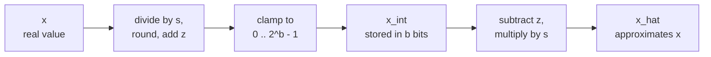

# Lesson 4. Quantize and Dequantize

**Mission link:** Quantizing a tensor by hand and predicting where its error comes from starts with the one mapping every later method builds on, so this lesson makes you able to run it forward and backward and bound its error.
**Primary source:** [Paper: "A White Paper on Neural Network Quantization", Nagel et al., 2021](https://arxiv.org/abs/2106.08295), sections 2.2 and 2.4.1
**Prerequisites:** [Lesson 3](0003-low-bit-formats.md), [Affine quantization](../GLOSSARY.md), [Scale](../GLOSSARY.md), [Zero point](../GLOSSARY.md)

## Warm-up

1. ▢ A 70B-parameter model is stored in int4 with one 16-bit scale per group of 64 weights. How many GB do its weights take?

<details markdown="1"><summary>Check</summary>

About 37 GB. Each weight costs 4 bits plus 16 / 64 = 0.25 bits of scale, so 4.25 effective bits per weight, and 70 billion × 4.25 / 8 bytes is about 37 GB. The nominal 4 bits would give 35 GB, which understates the checkpoint.

</details>

2. ▢ fp16 and bf16 both use 16 bits. How do they split them, and which keeps fp32's range?

<details markdown="1"><summary>Check</summary>

fp16 uses 1 sign bit, 5 exponent bits and 10 mantissa bits. bf16 uses 1, 8 and 7. bf16 has the same 8 exponent bits as fp32, so it keeps fp32's range and gives up precision.

</details>

3. ▢ How many distinct values can a signed 4-bit integer hold, and over what range?

<details markdown="1"><summary>Check</summary>

Sixteen values, from -8 to 7. The count is 2^4 whatever the sign convention, so a 4-bit quantizer always has 16 levels to place.

</details>

## Know this

### Two operations

A **quantizer** maps real numbers onto a short list of integers and back. Nagel et al. define the **affine quantization** version with three parameters: a **scale** `s`, the real step between neighbouring integers, a **zero point** `z`, the integer that stands for real zero, and the bit width `b`. Quantizing a real value `x` onto the unsigned integer grid 0 to 2^b - 1 is equation 4 of the paper, and **dequantization** is equation 6:

```text
x_int = clamp(round(x / s) + z, 0, 2^b - 1)      quantize
x_hat = s * (x_int - z)                          dequantize
```

`round` is round-to-nearest, and `clamp` pins anything outside the grid to its nearest end. Only `x_int` is stored, as `b` bits per value, together with `s` and `z`. `x_hat` is what the model computes with, and the gap `x_hat - x` is the quantization error.



The grid is a ladder of 2^b rungs, spaced `s` apart, and the zero point decides where real zero sits on it. The ends of the ladder are the grid limits: `q_min = -s * z` and `q_max = s * (2^b - 1 - z)`. A value inside them is moved to the nearest rung. A value outside them is clipped to the end, which Nagel et al. call **clipping error**.

### Where the error comes from

Inside the grid limits, the **rounding error** is at most half a step. Nagel et al. state that it lies in the range from -s/2 to s/2. Outside the limits, the clipping error is the distance to the limit, and it can be as large as the data allows. So `s/2` bounds the error only for values the grid covers.

The same paper notes the tension: widening the range lowers clipping error and raises rounding error, because a wider range needs a bigger `s`. Lesson 5 is about picking the range. For now, take the widest choice, the tensor's minimum and maximum, so nothing is clipped:

```text
s = (max - min) / (2^b - 1)
z = round(-min / s)
```

The scale is the range divided by the number of steps, which is why every bit removed matters: for one range, a 4-bit grid has 15 steps and an 8-bit grid has 255, so the 4-bit step is 17 times larger and so is its worst-case rounding error. Rounding `z` to an integer shifts the grid by at most half a step, so values at the very ends of the range can be clipped by up to `s/2`, and the total error for any value inside `[min, max]` stays at or below `s/2`. This is derived from the formulas, not stated by the paper, and the example in Practice shows it happening.

### Symmetric or affine, signed or unsigned

**Symmetric quantization** fixes the zero point at zero, so only a scale is stored and the grid is centred on zero. Affine quantization spends one more parameter to place the grid anywhere. Nagel et al. say the choice of signed or unsigned integer grid then matters:

| Grid | Integers | Suits |
|---|---|---|
| Signed symmetric | -2^(b-1) to 2^(b-1) - 1 | Values roughly symmetric about zero |
| Unsigned symmetric | 0 to 2^b - 1 | One-tailed values, such as ReLU outputs |
| Affine (unsigned, with `z`) | 0 to 2^b - 1 | Values spread asymmetrically around zero |

A symmetric grid on one-sided data wastes levels: every level below zero is never used. Signed symmetric quantizers are often written with the clipping threshold `c` and `s = c / (2^(b-1) - 1)`, so int8 uses -127 to 127 and leaves -128 unused. That is a convention, and it is what the code in lessons 5 to 8 uses.

Why would anyone give up the extra parameter? Nagel et al. show in section 2.4.1 what asymmetric weights multiplied by asymmetric activations produce: four terms, and one of them depends on the input, so it must be computed for every batch at run time. They describe that as significant overhead in latency and power, "equivalent to adding an extra channel", and note that using asymmetric activation quantization with symmetric weight quantization avoids the extra term. That is the common arrangement.

### Zero must be exactly representable

The zero point is an integer for a reason. Jacob et al. define `z` as the quantized value corresponding to real 0, which meets the requirement that real zero be exactly representable, because efficient implementations often need zero-padding around array boundaries ([Jacob et al., 2017](https://arxiv.org/abs/1712.05877)). Nagel et al. add that ReLU and zero padding then introduce no quantization error. In an LLM the same reasoning protects any structural zero: a padded position or a masked value must stay exactly zero after dequantization.

## Practice

1. ▢ An 8-bit affine quantizer covers the range -1 to 3. Compute `s`, `z`, the integer that real 0 maps to, and the largest rounding error inside the range.

<details markdown="1"><summary>Check</summary>

`s = 4 / 255 = 0.01569`, `z = round(1 / 0.01569) = round(63.75) = 64`. Real zero maps to `round(0 / s) + 64 = 64`, and dequantizing 64 gives `s * (64 - 64) = 0` exactly. The largest rounding error is `s/2 = 0.0078`. The grid limits are `q_min = -64 * s = -1.004` and `q_max = 191 * s = 2.996`, slightly shifted from -1 and 3 because `z` was rounded.

</details>

2. ▢ Which grid fits the output of a ReLU, whose values are never negative, with the fewest wasted levels?

    - a) Signed symmetric grid, zero point zero
    - b) Unsigned grid with zero point zero
    - c) Signed grid centred on the average
    - d) Unsigned grid with maximum zero point

<details markdown="1"><summary>Check</summary>

**b)** With no negative values, zero belongs at the bottom of the grid, so all levels cover real values. (a) puts half the levels below zero where no value ever lands. (c) also spends levels on negative numbers, because the average of non-negative data is still above zero. (d) puts zero at the top, so every level represents a negative number and the data would all be clipped.

</details>

3. ▢ Predict, then run. This quantizes five values to a 4-bit affine grid. Before running it, predict `z`, the integer for 0.0, whether the dequantized 0.0 is exactly 0.0, and whether any error exceeds `s/2`.

    ```python
    import numpy as np

    x = np.array([-0.2, 0.0, 0.3, 0.9, 1.5])
    b = 4
    s = (x.max() - x.min()) / (2**b - 1)
    z = int(round(-x.min() / s))
    x_int = np.clip(np.round(x / s) + z, 0, 2**b - 1).astype(int)
    x_hat = s * (x_int - z)

    print("scale", round(s, 4), "zero point", z)
    print("x_int", x_int)
    print("x_hat", np.round(x_hat, 4))
    print("error", np.round(x_hat - x, 4))
    print("s/2  ", round(s / 2, 4))
    ```

<details markdown="1"><summary>Hint</summary>

`z` is `-min / s` rounded, and `s` is 1.7 divided by 15. Then ask which values sit at the ends of the grid.

</details>

<details markdown="1"><summary>Check</summary>

```text
scale 0.1133 zero point 2
x_int [ 0  2  5 10 15]
x_hat [-0.2267  0.      0.34    0.9067  1.4733]
error [-0.0267  0.      0.04    0.0067 -0.0267]
s/2   0.0567
```

The integer for 0.0 is 2, and it dequantizes to exactly 0.0, so the zero is preserved. No error exceeds `s/2 = 0.0567`. The two ends show the effect of rounding `z`: 1.7647 became 2, which shifted the grid down, so -0.2 landed on -0.2267 and 1.5 was clipped to 1.4733. Both errors are 0.0267, inside the bound.

</details>

4. ▢ A library uses an unrounded zero point of 63.75 with the scale from item 1, and pads a tensor with the nearest integer, 64. What does the padding dequantize to, and why is that a defect?

<details markdown="1"><summary>Check</summary>

`s * (64 - 63.75) = 0.01569 * 0.25 = 0.0039`, a small non-zero number at every padded position. Real zero is no longer exactly representable, which is the property the integer zero point exists to guarantee, and zero-padding is the case Jacob et al. give for requiring it.

</details>

5. ▢ A signed symmetric 4-bit quantizer has `s = 0.1` and uses the integers -8 to 7. What range does it cover, what does it return for 1.0, and why does the result break the `s/2` bound? What scale would stop it clipping 1.0 if the grid used -7 to 7?

<details markdown="1"><summary>Check</summary>

It covers -0.8 to 0.7. For 1.0, `round(1.0 / 0.1) = 10` is clamped to 7, so it returns 0.7, an error of 0.3. That is three times `s` and six times the bound `s/2 = 0.05`, because the bound holds only inside the grid limits and 1.0 is outside them. Covering 1.0 with the top integer 7 needs `s = 1.0 / 7 = 0.143`, which widens every step, so the cost of removing the clipping is more rounding error for every other value.

</details>

## Real-world reps

- [ ] Write `quantize(x, s, z, b)` and `dequantize(x_int, s, z)` from the two formulas. Run them on a random vector and assert that every error is at most `s/2` when the range is taken from the vector's own minimum and maximum.
- [ ] Take one weight matrix from a small open model, print its minimum, maximum and mean, and decide from the numbers whether a signed symmetric grid wastes levels on it.
- [ ] Tomorrow: without notes, write the quantize and dequantize formulas, the formulas for `s` and `z` from a minimum and maximum, and the bound on rounding error. Then check them against equations 4 and 6 of the primary source.

## Going further

- [The Quantization Mapping](../reference/quantization-mapping.md)
- [Paper: "A White Paper on Neural Network Quantization", Nagel et al., 2021](https://arxiv.org/abs/2106.08295)
- [Paper: "Quantization and Training of Neural Networks for Efficient Integer-Arithmetic-Only Inference", Jacob et al., 2017](https://arxiv.org/abs/1712.05877)
- [Resources](../RESOURCES.md)

---

Not landing? Reread the primary source at the top, since this lesson compresses it and compression is where understanding leaks. Check the [glossary](../GLOSSARY.md) for any term that felt slippery.

If the lesson itself is unclear rather than the material, that is a defect: [open an issue](https://github.com/TokenCemetery/teach/issues).
