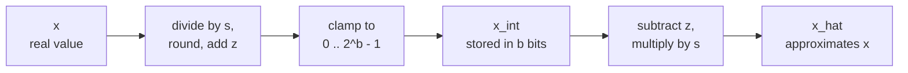

# Lição 4. Quantizar e dequantizar

**Ligação com a missão:** Quantizar um tensor à mão e prever de onde vem o seu erro começa com o único mapeamento sobre o qual todo método posterior se constrói, então esta lição faz de você alguém capaz de executá-lo nos dois sentidos e de limitar o seu erro.
**Fonte principal:** [Artigo científico: "A White Paper on Neural Network Quantization", Nagel et al., 2021](https://arxiv.org/abs/2106.08295), seções 2.2 e 2.4.1
**Pré-requisitos:** [Lição 3](0003-low-bit-formats.md), [Quantização afim](../GLOSSARY.md), [Scale](../GLOSSARY.md), [Zero-point](../GLOSSARY.md)

## Aquecimento

1. ▢ Um modelo de 70B parâmetros é armazenado em int4 com uma scale de 16 bits por grupo de 64 pesos. Quantos GB os seus pesos ocupam?

<details markdown="1"><summary>Verificação</summary>

Cerca de 37 GB. Cada peso custa 4 bits mais 16 / 64 = 0.25 bit de scale, então 4.25 bits efetivos por peso, e 70 bilhões × 4.25 / 8 bytes dá cerca de 37 GB. Os 4 bits nominais dariam 35 GB, o que subestima o checkpoint.

</details>

2. ▢ fp16 e bf16 usam ambos 16 bits. Como eles os dividem, e qual mantém a faixa do fp32?

<details markdown="1"><summary>Verificação</summary>

O fp16 usa 1 bit de sinal, 5 bits de expoente e 10 bits de mantissa. O bf16 usa 1, 8 e 7. O bf16 tem os mesmos 8 bits de expoente do fp32, então mantém a faixa do fp32 e abre mão de precisão.

</details>

3. ▢ Quantos valores distintos um inteiro de 4 bits com sinal consegue guardar, e em que faixa?

<details markdown="1"><summary>Verificação</summary>

Dezesseis valores, de -8 a 7. A contagem é 2^4 qualquer que seja a convenção de sinal, então um quantizador de 4 bits sempre tem 16 níveis para posicionar.

</details>

## Saiba isto

### Duas operações

Um **quantizador** mapeia números reais para uma curta lista de inteiros e de volta. Nagel et al. definem a versão de **quantização afim** com três parâmetros: uma **scale** `s`, o passo real entre inteiros vizinhos, um **zero-point** `z`, o inteiro que representa o zero real, e a largura em bits `b`. Quantizar um valor real `x` para a grade de inteiros sem sinal de 0 a 2^b - 1 é a equação 4 do artigo, e a **dequantização** é a equação 6:

```text
x_int = clamp(round(x / s) + z, 0, 2^b - 1)      quantize
x_hat = s * (x_int - z)                          dequantize
```

`round` é o round-to-nearest, e `clamp` prende o que está fora da grade à extremidade mais próxima dela. Só `x_int` é armazenado, em `b` bits por valor, junto com `s` e `z`. `x_hat` é com o que o modelo calcula, e a diferença `x_hat - x` é o erro de quantização.



A grade é uma escada de 2^b degraus, espaçados de `s`, e o zero-point decide onde o zero real fica nela. As pontas da escada são os limites da grade: `q_min = -s * z` e `q_max = s * (2^b - 1 - z)`. Um valor dentro deles é movido para o degrau mais próximo. Um valor fora deles sofre clipping até a ponta, o que Nagel et al. chamam de **erro de clipping**.

### De onde vem o erro

Dentro dos limites da grade, o **erro de arredondamento** é de no máximo meio passo. Nagel et al. afirmam que ele fica na faixa de -s/2 a s/2. Fora dos limites, o erro de clipping é a distância até o limite, e pode ser tão grande quanto os dados permitirem. Então `s/2` limita o erro apenas para valores que a grade cobre.

O mesmo artigo observa a tensão: ampliar a faixa reduz o erro de clipping e aumenta o erro de arredondamento, porque uma faixa mais ampla precisa de um `s` maior. A lição 5 trata de escolher a faixa. Por ora, tome a escolha mais ampla, o mínimo e o máximo do tensor, para que nada sofra clipping:

```text
s = (max - min) / (2^b - 1)
z = round(-min / s)
```

A scale é a faixa dividida pelo número de passos, e é por isso que cada bit removido importa: para uma mesma faixa, uma grade de 4 bits tem 15 passos e uma de 8 bits tem 255, então o passo de 4 bits é 17 vezes maior e o seu erro de arredondamento no pior caso também. Arredondar `z` para um inteiro desloca a grade em no máximo meio passo, então valores nas pontas da faixa podem sofrer clipping de até `s/2`, e o erro total para qualquer valor dentro de `[min, max]` fica em `s/2` ou abaixo. Isso é derivado das fórmulas, não afirmado pelo artigo, e o exemplo na Prática mostra isso acontecendo.

### Simétrica ou afim, com sinal ou sem sinal

A **quantização simétrica** fixa o zero-point em zero, então só uma scale é armazenada e a grade fica centrada no zero. A quantização afim gasta mais um parâmetro para posicionar a grade em qualquer lugar. Nagel et al. dizem que a escolha entre grade de inteiros com sinal ou sem sinal passa então a importar:

| Grade | Inteiros | Serve para |
|---|---|---|
| Simétrica com sinal | -2^(b-1) a 2^(b-1) - 1 | Valores aproximadamente simétricos em torno do zero |
| Simétrica sem sinal | 0 a 2^b - 1 | Valores de uma só cauda, como saídas de ReLU |
| Afim (sem sinal, com `z`) | 0 a 2^b - 1 | Valores distribuídos de forma assimétrica em torno do zero |

Uma grade simétrica em dados de um só lado desperdiça níveis: todo nível abaixo de zero nunca é usado. Os quantizadores simétricos com sinal costumam ser escritos com o limiar de clipping `c` e `s = c / (2^(b-1) - 1)`, então o int8 usa de -127 a 127 e deixa o -128 sem uso. Isso é uma convenção, e é a que o código das lições 5 a 8 usa.

Por que alguém abriria mão do parâmetro extra? Nagel et al. mostram na seção 2.4.1 o que pesos assimétricos multiplicados por ativações assimétricas produzem: quatro termos, e um deles depende da entrada, então precisa ser calculado para cada batch em tempo de execução. Eles descrevem isso como um overhead significativo em latência e energia, "equivalente a adicionar um canal extra", e observam que usar quantização assimétrica das ativações com quantização simétrica dos pesos evita o termo extra. Esse é o arranjo comum.

### O zero precisa ser exatamente representável

O zero-point é um inteiro por um motivo. Jacob et al. definem `z` como o valor quantizado correspondente ao 0 real, o que atende ao requisito de que o zero real seja exatamente representável, porque implementações eficientes frequentemente precisam de zero padding nas bordas dos arrays ([Jacob et al., 2017](https://arxiv.org/abs/1712.05877)). Nagel et al. acrescentam que o ReLU e o zero padding então não introduzem erro de quantização. Em um LLM, o mesmo raciocínio protege qualquer zero estrutural: uma posição com padding ou um valor mascarado precisa continuar exatamente zero depois da dequantização.

## Prática

1. ▢ Um quantizador afim de 8 bits cobre a faixa de -1 a 3. Calcule `s`, `z`, o inteiro para o qual o 0 real mapeia e o maior erro de arredondamento dentro da faixa.

<details markdown="1"><summary>Verificação</summary>

`s = 4 / 255 = 0.01569`, `z = round(1 / 0.01569) = round(63.75) = 64`. O zero real mapeia para `round(0 / s) + 64 = 64`, e dequantizar 64 dá `s * (64 - 64) = 0` exatamente. O maior erro de arredondamento é `s/2 = 0.0078`. Os limites da grade são `q_min = -64 * s = -1.004` e `q_max = 191 * s = 2.996`, ligeiramente deslocados de -1 e 3 porque `z` foi arredondado.

</details>

2. ▢ Qual grade se ajusta à saída de um ReLU, cujos valores nunca são negativos, com o menor número de níveis desperdiçados?

    - a) Grade simétrica com sinal, zero-point zero
    - b) Grade sem sinal com zero-point zero
    - c) Grade com sinal centrada na média
    - d) Grade sem sinal com zero-point máximo

<details markdown="1"><summary>Verificação</summary>

**b)** Sem valores negativos, o zero fica na base da grade, então todos os níveis cobrem valores reais. (a) coloca metade dos níveis abaixo de zero, onde nenhum valor jamais cai. (c) também gasta níveis em números negativos, porque a média de dados não negativos continua acima de zero. (d) coloca o zero no topo, então todo nível representa um número negativo e todos os dados sofreriam clipping.

</details>

3. ▢ Preveja e depois execute. Isto quantiza cinco valores para uma grade afim de 4 bits. Antes de executar, preveja `z`, o inteiro para 0.0, se o 0.0 dequantizado é exatamente 0.0 e se algum erro excede `s/2`.

    ```python
    import numpy as np

    x = np.array([-0.2, 0.0, 0.3, 0.9, 1.5])
    b = 4
    s = (x.max() - x.min()) / (2**b - 1)
    z = int(round(-x.min() / s))
    x_int = np.clip(np.round(x / s) + z, 0, 2**b - 1).astype(int)
    x_hat = s * (x_int - z)

    print("scale", round(s, 4), "zero point", z)
    print("x_int", x_int)
    print("x_hat", np.round(x_hat, 4))
    print("error", np.round(x_hat - x, 4))
    print("s/2  ", round(s / 2, 4))
    ```

<details markdown="1"><summary>Dica</summary>

`z` é `-min / s` arredondado, e `s` é 1.7 dividido por 15. Depois pergunte quais valores ficam nas pontas da grade.

</details>

<details markdown="1"><summary>Verificação</summary>

```text
scale 0.1133 zero point 2
x_int [ 0  2  5 10 15]
x_hat [-0.2267  0.      0.34    0.9067  1.4733]
error [-0.0267  0.      0.04    0.0067 -0.0267]
s/2   0.0567
```

O inteiro para 0.0 é 2, e ele dequantiza para exatamente 0.0, então o zero é preservado. Nenhum erro excede `s/2 = 0.0567`. As duas pontas mostram o efeito de arredondar `z`: 1.7647 virou 2, o que deslocou a grade para baixo, então -0.2 caiu em -0.2267 e 1.5 sofreu clipping para 1.4733. Os dois erros são 0.0267, dentro do limite.

</details>

4. ▢ Uma biblioteca usa um zero-point não arredondado de 63.75 com a scale do item 1 e faz padding de um tensor com o inteiro mais próximo, 64. Para o que o padding dequantiza, e por que isso é um defeito?

<details markdown="1"><summary>Verificação</summary>

`s * (64 - 63.75) = 0.01569 * 0.25 = 0.0039`, um pequeno número não nulo em cada posição com padding. O zero real deixa de ser exatamente representável, que é a propriedade que o zero-point inteiro existe para garantir, e o zero padding é o caso que Jacob et al. dão para exigi-la.

</details>

5. ▢ Um quantizador simétrico com sinal de 4 bits tem `s = 0.1` e usa os inteiros de -8 a 7. Que faixa ele cobre, o que ele devolve para 1.0 e por que o resultado quebra o limite de `s/2`? Qual scale impediria o clipping de 1.0 se a grade usasse de -7 a 7?

<details markdown="1"><summary>Verificação</summary>

Ele cobre de -0.8 a 0.7. Para 1.0, `round(1.0 / 0.1) = 10` é limitado a 7, então ele devolve 0.7, um erro de 0.3. Isso é três vezes `s` e seis vezes o limite `s/2 = 0.05`, porque o limite vale só dentro dos limites da grade e 1.0 está fora deles. Cobrir 1.0 com o inteiro máximo 7 exige `s = 1.0 / 7 = 0.143`, o que alarga cada passo, então o custo de remover o clipping é mais erro de arredondamento para todos os outros valores.

</details>

## Prática no mundo real

- [ ] Escreva `quantize(x, s, z, b)` e `dequantize(x_int, s, z)` a partir das duas fórmulas. Execute-as em um vetor aleatório e afirme com um assert que todo erro é de no máximo `s/2` quando a faixa é tirada do mínimo e do máximo do próprio vetor.
- [ ] Pegue uma matriz de pesos de um modelo aberto pequeno, imprima o seu mínimo, o seu máximo e a sua média e decida, a partir dos números, se uma grade simétrica com sinal desperdiça níveis nela.
- [ ] Amanhã: sem consultar anotações, escreva as fórmulas de quantizar e dequantizar, as fórmulas de `s` e `z` a partir de um mínimo e um máximo, e o limite do erro de arredondamento. Depois confira-as com as equações 4 e 6 da fonte principal.

## Para ir além

- [O Mapeamento de Quantização](../reference/quantization-mapping.md)
- [Artigo científico: "A White Paper on Neural Network Quantization", Nagel et al., 2021](https://arxiv.org/abs/2106.08295)
- [Artigo científico: "Quantization and Training of Neural Networks for Efficient Integer-Arithmetic-Only Inference", Jacob et al., 2017](https://arxiv.org/abs/1712.05877)
- [Recursos](../RESOURCES.md)

---

Não ficou claro? Releia a fonte principal no topo, já que esta lição a comprime e é na compressão que o entendimento escapa. Consulte o [glossário](../GLOSSARY.md) para qualquer termo que pareceu escorregadio.

Se o problema é a lição em si, e não o material, isso é um defeito: [abra uma issue](https://github.com/TokenCemetery/teach/issues).
