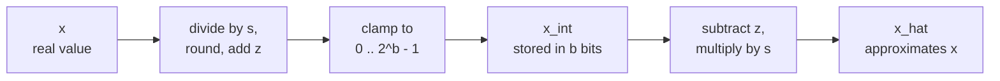

# Урок 4. Квантизация и деквантизация

**Связь с целью курса:** Квантизация тензора вручную и предсказание того, откуда берётся её ошибка, начинаются с одного отображения, на котором строится каждый последующий метод, поэтому этот урок учит вас прогонять его вперёд и назад и ограничивать его ошибку.
**Первоисточник:** [Научная статья: "A White Paper on Neural Network Quantization", Nagel et al., 2021](https://arxiv.org/abs/2106.08295), разделы 2.2 и 2.4.1
**Предварительные требования:** [Урок 3](0003-low-bit-formats.md), [Аффинная квантизация](../GLOSSARY.md), [Масштаб](../GLOSSARY.md), [Нулевая точка](../GLOSSARY.md)

## Разминка

1. ▢ Модель на 70 млрд параметров хранится в int4 с одним 16-битным масштабом на группу из 64 весов. Сколько гигабайт занимают её веса?

<details markdown="1"><summary>Проверка</summary>

Около 37 ГБ. Каждый вес стоит 4 бита плюс 16 / 64 = 0,25 бита масштаба, то есть 4,25 эффективных бита на вес, а 70 миллиардов × 4,25 / 8 байт это около 37 ГБ. Номинальные 4 бита дали бы 35 ГБ, что занижает размер чекпоинта.

</details>

2. ▢ fp16 и bf16 оба используют 16 бит. Как они их делят и какой сохраняет диапазон fp32?

<details markdown="1"><summary>Проверка</summary>

fp16 использует 1 бит знака, 5 бит экспоненты и 10 бит мантиссы. bf16 использует 1, 8 и 7. У bf16 те же 8 бит экспоненты, что у fp32, поэтому он сохраняет диапазон fp32 и отдаёт точность.

</details>

3. ▢ Сколько различных значений может хранить знаковое 4-битное целое и в каком диапазоне?

<details markdown="1"><summary>Проверка</summary>

Шестнадцать значений, от -8 до 7. Их число равно 2^4 при любом соглашении о знаке, так что у 4-битного квантизатора всегда есть 16 уровней, которые нужно расставить.

</details>

## Что нужно знать

### Две операции

**Квантизатор** отображает вещественные числа на короткий список целых чисел и обратно. Nagel и соавторы определяют версию с **аффинной квантизацией** с тремя параметрами: **масштаб** `s`, вещественный шаг между соседними целыми, **нулевая точка** `z`, целое число, обозначающее вещественный ноль, и разрядность `b`. Квантизация вещественного значения `x` на беззнаковую целочисленную сетку от 0 до 2^b - 1 это уравнение 4 статьи, а **деквантизация** это уравнение 6:

```text
x_int = clamp(round(x / s) + z, 0, 2^b - 1)      quantize
x_hat = s * (x_int - z)                          dequantize
```

`round` это округление к ближайшему, а `clamp` прижимает всё, что за пределами сетки, к ближайшему её концу. Хранится только `x_int`, по `b` бит на значение, вместе с `s` и `z`. `x_hat` это то, с чем считает модель, а разность `x_hat - x` это ошибка квантизации.



Сетка это лестница из 2^b ступеней с шагом `s`, а нулевая точка решает, где на ней находится вещественный ноль. Концы лестницы это пределы сетки: `q_min = -s * z` и `q_max = s * (2^b - 1 - z)`. Значение внутри них сдвигается к ближайшей ступени. Значение вне них отсекается до конца, что Nagel и соавторы называют **ошибкой отсечения**.

### Откуда берётся ошибка

Внутри пределов сетки **ошибка округления** не превышает половины шага. Nagel и соавторы указывают, что она лежит в диапазоне от -s/2 до s/2. Вне пределов ошибка отсечения равна расстоянию до предела и может быть настолько большой, насколько позволяют данные. Поэтому `s/2` ограничивает ошибку только для значений, которые сетка покрывает.

Та же статья отмечает противоречие: расширение диапазона уменьшает ошибку отсечения и увеличивает ошибку округления, потому что более широкому диапазону нужен больший `s`. Урок 5 посвящён выбору диапазона. Пока возьмите самый широкий вариант, минимум и максимум тензора, чтобы ничего не отсекалось:

```text
s = (max - min) / (2^b - 1)
z = round(-min / s)
```

Масштаб равен диапазону, делённому на число шагов, поэтому каждый убранный бит имеет значение: при одном и том же диапазоне у 4-битной сетки 15 шагов, а у 8-битной 255, так что 4-битный шаг в 17 раз больше, как и его наихудшая ошибка округления. Округление `z` до целого сдвигает сетку не более чем на полшага, поэтому значения на самых концах диапазона могут отсекаться до `s/2`, а полная ошибка для любого значения внутри `[min, max]` остаётся не выше `s/2`. Это выведено из формул, а не заявлено в статье, и пример в практике показывает, как это происходит.

### Симметричная или аффинная, знаковая или беззнаковая

**Симметричная квантизация** фиксирует нулевую точку в нуле, так что хранится только масштаб, а сетка центрирована на нуле. Аффинная квантизация тратит ещё один параметр, чтобы поместить сетку где угодно. Nagel и соавторы говорят, что тогда важен выбор знаковой или беззнаковой целочисленной сетки:

| Сетка | Целые числа | Подходит для |
|---|---|---|
| Знаковая симметричная | от -2^(b-1) до 2^(b-1) - 1 | Значения примерно симметричны относительно нуля |
| Беззнаковая симметричная | от 0 до 2^b - 1 | Односторонние значения, например выходы ReLU |
| Аффинная (беззнаковая, с `z`) | от 0 до 2^b - 1 | Значения, асимметрично распределённые вокруг нуля |

Симметричная сетка на односторонних данных тратит уровни впустую: каждый уровень ниже нуля никогда не используется. Знаковые симметричные квантизаторы часто записывают через порог отсечения `c` и `s = c / (2^(b-1) - 1)`, так что int8 использует от -127 до 127 и оставляет -128 неиспользованным. Это соглашение, и именно его использует код в уроках с 5 по 8.

Зачем кому-то отказываться от дополнительного параметра? Nagel и соавторы показывают в разделе 2.4.1, что даёт умножение асимметричных весов на асимметричные активации: четыре слагаемых, и одно из них зависит от входа, поэтому его нужно вычислять для каждого батча во время выполнения. Они описывают это как значительные накладные расходы по задержке и энергии, «эквивалентные добавлению лишнего канала», и отмечают, что асимметричная квантизация активаций с симметричной квантизацией весов позволяет избежать лишнего слагаемого. Это распространённое сочетание.

### Ноль должен представляться точно

Нулевая точка целая не случайно. Jacob и соавторы определяют `z` как квантизованное значение, соответствующее вещественному 0, что удовлетворяет требованию точной представимости вещественного нуля, потому что эффективные реализации часто нуждаются в дополнении нулями вокруг границ массивов ([Jacob et al., 2017](https://arxiv.org/abs/1712.05877)). Nagel и соавторы добавляют, что тогда ReLU и дополнение нулями не вносят ошибки квантизации. В LLM то же рассуждение защищает любой структурный ноль: дополненная позиция или замаскированное значение после деквантизации должны остаться ровно нулём.

## Практика

1. ▢ 8-битный аффинный квантизатор покрывает диапазон от -1 до 3. Вычислите `s`, `z`, целое число, в которое отображается вещественный 0, и наибольшую ошибку округления внутри диапазона.

<details markdown="1"><summary>Проверка</summary>

`s = 4 / 255 = 0.01569`, `z = round(1 / 0.01569) = round(63.75) = 64`. Вещественный ноль отображается в `round(0 / s) + 64 = 64`, а деквантизация 64 даёт `s * (64 - 64) = 0` точно. Наибольшая ошибка округления равна `s/2 = 0.0078`. Пределы сетки равны `q_min = -64 * s = -1.004` и `q_max = 191 * s = 2.996`, чуть сдвинутые относительно -1 и 3, потому что `z` был округлён.

</details>

2. ▢ Какая сетка подходит выходу ReLU, значения которого никогда не бывают отрицательными, с наименьшим числом потраченных впустую уровней?

    - a) Знаковая симметричная сетка, нулевая точка ноль
    - b) Беззнаковая сетка с нулевой точкой, равной нулю
    - c) Знаковая сетка, центрированная на среднем
    - d) Беззнаковая сетка с максимальной нулевой точкой

<details markdown="1"><summary>Проверка</summary>

**b)** Если отрицательных значений нет, ноль принадлежит нижнему краю сетки, и все уровни покрывают вещественные значения. (a) помещает половину уровней ниже нуля, куда не попадает ни одно значение. (c) тоже тратит уровни на отрицательные числа, потому что среднее неотрицательных данных всё равно выше нуля. (d) помещает ноль на вершину, так что каждый уровень представляет отрицательное число, и все данные были бы отсечены.

</details>

3. ▢ Предскажите, затем запустите. Код квантизует пять значений на 4-битную аффинную сетку. Перед запуском предскажите `z`, целое число для 0,0, равно ли деквантизованное 0,0 в точности 0,0 и превышает ли какая-либо ошибка `s/2`.

    ```python
    import numpy as np

    x = np.array([-0.2, 0.0, 0.3, 0.9, 1.5])
    b = 4
    s = (x.max() - x.min()) / (2**b - 1)
    z = int(round(-x.min() / s))
    x_int = np.clip(np.round(x / s) + z, 0, 2**b - 1).astype(int)
    x_hat = s * (x_int - z)

    print("scale", round(s, 4), "zero point", z)
    print("x_int", x_int)
    print("x_hat", np.round(x_hat, 4))
    print("error", np.round(x_hat - x, 4))
    print("s/2  ", round(s / 2, 4))
    ```

<details markdown="1"><summary>Подсказка</summary>

`z` это округлённое `-min / s`, а `s` это 1,7, делённое на 15. Затем спросите, какие значения находятся на концах сетки.

</details>

<details markdown="1"><summary>Проверка</summary>

```text
scale 0.1133 zero point 2
x_int [ 0  2  5 10 15]
x_hat [-0.2267  0.      0.34    0.9067  1.4733]
error [-0.0267  0.      0.04    0.0067 -0.0267]
s/2   0.0567
```

Целое число для 0,0 равно 2, и оно деквантизуется ровно в 0,0, так что нуль сохраняется. Ни одна ошибка не превышает `s/2 = 0.0567`. Два конца показывают эффект округления `z`: 1,7647 стало 2, что сдвинуло сетку вниз, так что -0,2 попало в -0,2267, а 1,5 было отсечено до 1,4733. Обе ошибки равны 0,0267, в пределах границы.

</details>

4. ▢ Библиотека использует неокруглённую нулевую точку 63,75 с масштабом из упражнения 1 и дополняет тензор ближайшим целым, 64. Во что деквантизуется дополнение и почему это дефект?

<details markdown="1"><summary>Проверка</summary>

`s * (64 - 63.75) = 0.01569 * 0.25 = 0.0039`, небольшое ненулевое число в каждой дополненной позиции. Вещественный ноль больше не представим точно, а это как раз то свойство, которое должна гарантировать целая нулевая точка, и дополнение нулями это тот случай, который приводят Jacob и соавторы как причину этого требования.

</details>

5. ▢ Знаковый симметричный 4-битный квантизатор имеет `s = 0.1` и использует целые от -8 до 7. Какой диапазон он покрывает, что возвращает для 1,0 и почему результат нарушает границу `s/2`? Какой масштаб остановил бы отсечение 1,0, если бы сетка использовала от -7 до 7?

<details markdown="1"><summary>Проверка</summary>

Он покрывает от -0,8 до 0,7. Для 1,0 `round(1.0 / 0.1) = 10` ограничивается до 7, поэтому возвращается 0,7, ошибка 0,3. Это втрое больше `s` и в шесть раз больше границы `s/2 = 0.05`, потому что граница действует только внутри пределов сетки, а 1,0 лежит вне них. Чтобы покрыть 1,0 верхним целым 7, нужен `s = 1.0 / 7 = 0.143`, что расширяет каждый шаг, так что цена устранения отсечения это большая ошибка округления для всех остальных значений.

</details>

## Практика в реальной работе

- [ ] Напишите `quantize(x, s, z, b)` и `dequantize(x_int, s, z)` по двум формулам. Запустите их на случайном векторе и убедитесь через assert, что каждая ошибка не больше `s/2`, когда диапазон взят из собственного минимума и максимума вектора.
- [ ] Возьмите одну матрицу весов из небольшой открытой модели, напечатайте её минимум, максимум и среднее и решите по этим числам, тратит ли знаковая симметричная сетка на неё уровни впустую.
- [ ] Завтра, без заметок, запишите формулы квантизации и деквантизации, формулы для `s` и `z` по минимуму и максимуму и границу ошибки округления. Затем сверьте их с уравнениями 4 и 6 первоисточника.

## Что почитать дальше

- [Отображение квантизации](../reference/quantization-mapping.md)
- [Научная статья: "A White Paper on Neural Network Quantization", Nagel et al., 2021](https://arxiv.org/abs/2106.08295)
- [Научная статья: "Quantization and Training of Neural Networks for Efficient Integer-Arithmetic-Only Inference", Jacob et al., 2017](https://arxiv.org/abs/1712.05877)
- [Ресурсы](../RESOURCES.md)

---

Не доходит? Перечитайте первоисточник в начале: этот урок его сжимает, а при сжатии понимание как раз и теряется. Загляните в [глоссарий](../GLOSSARY.md), если какой-то термин показался скользким.

Если неясен сам урок, а не материал, это дефект: [откройте issue](https://github.com/TokenCemetery/teach/issues).
