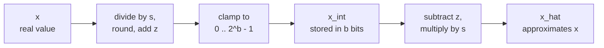

# 第 4 课：量化与反量化

**使命关联:** 要手工量化一个张量并预测它的误差来自哪里，得从后面每一种方法都建立在其上的那一个映射开始，所以这一课让你能把它正着算、反着算，并给它的误差定界。
**主要来源:** [论文：“A White Paper on Neural Network Quantization”，Nagel 等，2021](https://arxiv.org/abs/2106.08295)，第 2.2 节和第 2.4.1 节
**前置知识:** [第 3 课](0003-low-bit-formats.md)、[仿射量化](../GLOSSARY.md)、[缩放因子](../GLOSSARY.md)、[零点](../GLOSSARY.md)

## 热身

1. ▢ 一个 70B 参数的模型以 int4 存储，每 64 个权重配一个 16 位缩放因子。它的权重占多少 GB？

<details markdown="1"><summary>检查</summary>

约 37 GB。每个权重花 4 位，加上缩放因子的 16 / 64 = 0.25 位，所以每个权重的有效位数是 4.25，700 亿 × 4.25 / 8 字节约为 37 GB。按名义上的 4 位算会得到 35 GB，低估了检查点的大小。

</details>

2. ▢ fp16 和 bf16 都用 16 位。它们各是怎么分配这些位的？哪一个保持了 fp32 的范围？

<details markdown="1"><summary>检查</summary>

fp16 用 1 个符号位、5 个指数位和 10 个尾数位。bf16 用 1、8 和 7。bf16 的 8 个指数位与 fp32 相同，所以它保持了 fp32 的范围，放弃了精度。

</details>

3. ▢ 一个有符号的 4 位整数能装下多少个不同的值，范围是多少？

<details markdown="1"><summary>检查</summary>

十六个值，从 -8 到 7。不管符号怎么约定，个数都是 2^4，所以 4 位量化器永远有 16 个档位要安放。

</details>

## 要点

### 两种运算

**量化器**把实数映射到一小串整数上，也能映射回来。Nagel 等人给出的**仿射量化**版本有三个参数：**缩放因子** `s`，即相邻整数之间的实数步长；**零点** `z`，即代表实数零的那个整数；以及位宽 `b`。把一个实数值 `x` 量化到无符号整数网格 0 到 2^b - 1 上，是论文的公式 4，而**反量化**是公式 6：

```text
x_int = clamp(round(x / s) + z, 0, 2^b - 1)      quantize
x_hat = s * (x_int - z)                          dequantize
```

`round` 是就近舍入，`clamp` 把网格之外的任何值钳制到离它最近的一端。只有 `x_int` 被存储下来，每个值 `b` 位，同时存下 `s` 和 `z`。模型用来计算的是 `x_hat`，而差值 `x_hat - x` 就是量化误差。



网格是一架有 2^b 级横档的梯子，横档间距为 `s`，而零点决定实数零落在这架梯子的什么位置。梯子的两端就是网格的界限：`q_min = -s * z` 和 `q_max = s * (2^b - 1 - z)`。落在界限之内的值被移到最近的一级横档。落在界限之外的值被截断到端点，Nagel 等人把这叫作**截断误差**。

### 误差从哪里来

在网格界限之内，**舍入误差**最多是半个步长。Nagel 等人指出，它落在 -s/2 到 s/2 的范围内。在界限之外，截断误差是到界限的距离，数据允许多大它就可以多大。所以 `s/2` 只对网格覆盖得到的值才构成误差的界。

同一篇论文指出了其中的矛盾：把范围放宽，截断误差降低，舍入误差升高，因为更宽的范围需要更大的 `s`。第 5 课讲的就是怎么选择范围。现在先取最宽的选择，即张量的最小值和最大值，这样就没有任何东西被截断：

```text
s = (max - min) / (2^b - 1)
z = round(-min / s)
```

缩放因子就是范围除以步数，这正是为什么每去掉一位都很要紧：对同一个范围，4 位网格有 15 步，8 位网格有 255 步，所以 4 位的步长大 17 倍，最坏情况下的舍入误差也大 17 倍。把 `z` 舍入成整数，最多让网格偏移半个步长，所以位于范围最两端的值，最多可能被截断 `s/2`，对 `[min, max]` 之内任意一个值，总误差仍然不超过 `s/2`。这是由公式推导出来的，不是论文说的，练习里的例子展示了这一现象。

### 对称还是仿射，有符号还是无符号

**对称量化**把零点固定为零，所以只需要存缩放因子，网格以零为中心。仿射量化多花一个参数，可以把网格放在任何位置。Nagel 等人说，这时选有符号还是无符号的整数网格就有讲究了：

| 网格 | 整数 | 适用于 |
|---|---|---|
| 有符号对称 | -2^(b-1) 到 2^(b-1) - 1 | 大致关于零对称的值 |
| 无符号对称 | 0 到 2^b - 1 | 单侧的值，例如 ReLU 的输出 |
| 仿射（无符号，带 `z`） | 0 到 2^b - 1 | 围绕零不对称分布的值 |

对称网格用在单侧的数据上会浪费档位：零以下的每一档永远用不上。有符号对称量化器常常用截断阈值 `c` 来写，`s = c / (2^(b-1) - 1)`，所以 int8 用 -127 到 127，不用 -128。这是一种约定，第 5 到第 8 课的代码用的就是它。

为什么有人愿意放弃多出来的那个参数？Nagel 等人在第 2.4.1 节中展示了非对称权重乘以非对称激活值会得到什么：四项，其中一项取决于输入，所以每一批在运行时都得算一遍。他们把这描述为延迟和功耗上的显著开销，“相当于增加了一个额外的通道”，并指出，激活值用非对称量化而权重用对称量化，可以避开这个额外的项。这是常见的搭配。

### 零必须能被精确表示

零点是整数是有理由的。Jacob 等人把 `z` 定义为对应于实数 0 的量化值，这满足了实数零必须能被精确表示的要求，因为高效的实现常常需要在数组边界周围做零填充（[Jacob 等，2017](https://arxiv.org/abs/1712.05877)）。Nagel 等人补充说，这样 ReLU 和零填充就不会引入量化误差。在 LLM 中，同样的道理保护着任何结构性的零：填充位置或被掩码的值，在反量化之后必须仍然恰好是零。

## 练习

1. ▢ 一个 8 位仿射量化器覆盖 -1 到 3 的范围。算出 `s`、`z`、实数 0 映射到的整数，以及范围之内最大的舍入误差。

<details markdown="1"><summary>检查</summary>

`s = 4 / 255 = 0.01569`，`z = round(1 / 0.01569) = round(63.75) = 64`。实数零映射到 `round(0 / s) + 64 = 64`，对 64 做反量化得到 `s * (64 - 64) = 0`，恰好是零。最大的舍入误差是 `s/2 = 0.0078`。网格的界限是 `q_min = -64 * s = -1.004` 和 `q_max = 191 * s = 2.996`，与 -1 和 3 略有偏移，因为 `z` 被舍入了。

</details>

2. ▢ ReLU 的输出永远不会是负数，哪一种网格最适合它，浪费的档位最少？

    - a) 有符号对称网格，零点为零
    - b) 无符号网格，零点为零
    - c) 以平均值为中心的有符号网格
    - d) 无符号网格，零点取最大值

<details markdown="1"><summary>检查</summary>

**b)** 没有负值，零就该在网格的底端，所以所有档位都覆盖着实数值。(a) 把一半的档位放在零以下，而那里不会落任何一个值。(c) 同样把档位花在负数上，因为非负数据的平均值仍然在零之上。(d) 把零放在顶端，于是每个档位都代表一个负数，数据会全部被截断。

</details>

3. ▢ 先预测，再运行。这段代码把五个值量化到一个 4 位仿射网格上。运行之前，先预测 `z`、0.0 对应的整数、反量化后的 0.0 是否恰好等于 0.0，以及有没有哪个误差超过 `s/2`。

    ```python
    import numpy as np

    x = np.array([-0.2, 0.0, 0.3, 0.9, 1.5])
    b = 4
    s = (x.max() - x.min()) / (2**b - 1)
    z = int(round(-x.min() / s))
    x_int = np.clip(np.round(x / s) + z, 0, 2**b - 1).astype(int)
    x_hat = s * (x_int - z)

    print("scale", round(s, 4), "zero point", z)
    print("x_int", x_int)
    print("x_hat", np.round(x_hat, 4))
    print("error", np.round(x_hat - x, 4))
    print("s/2  ", round(s / 2, 4))
    ```

<details markdown="1"><summary>提示</summary>

`z` 是 `-min / s` 舍入后的结果，`s` 是 1.7 除以 15。然后想想哪些值位于网格的两端。

</details>

<details markdown="1"><summary>检查</summary>

```text
scale 0.1133 zero point 2
x_int [ 0  2  5 10 15]
x_hat [-0.2267  0.      0.34    0.9067  1.4733]
error [-0.0267  0.      0.04    0.0067 -0.0267]
s/2   0.0567
```

0.0 对应的整数是 2，反量化后恰好是 0.0，所以零被保住了。没有任何误差超过 `s/2 = 0.0567`。两端显示了舍入 `z` 的影响：1.7647 变成了 2，使网格下移，所以 -0.2 落在了 -0.2267，而 1.5 被截断成了 1.4733。两个误差都是 0.0267，在界限之内。

</details>

4. ▢ 某个库使用未经舍入的零点 63.75，缩放因子取第 1 题的那个，并用最近的整数 64 来填充一个张量。这个填充反量化后是多少？为什么这是个缺陷？

<details markdown="1"><summary>检查</summary>

`s * (64 - 63.75) = 0.01569 * 0.25 = 0.0039`，每个填充位置上都是一个很小的非零数。实数零不再能被精确表示，而整数零点的存在，正是为了保证这一性质，Jacob 等人要求这一性质的理由，就是零填充。

</details>

5. ▢ 一个有符号对称的 4 位量化器，`s = 0.1`，使用整数 -8 到 7。它覆盖什么范围？对 1.0 它返回什么？为什么这个结果打破了 `s/2` 的界？如果网格用的是 -7 到 7，什么样的缩放因子能让它不再截断 1.0？

<details markdown="1"><summary>检查</summary>

它覆盖 -0.8 到 0.7。对 1.0，`round(1.0 / 0.1) = 10` 被钳制到 7，所以返回 0.7，误差为 0.3。这是 `s` 的三倍，是界 `s/2 = 0.05` 的六倍，因为这个界只在网格界限之内成立，而 1.0 在界限之外。要用最高的整数 7 覆盖 1.0，需要 `s = 1.0 / 7 = 0.143`，这会让每一个步长都变宽，所以去掉截断的代价，是其余每个值的舍入误差都变大。

</details>

## 实战练习

- [ ] 根据这两个公式写出 `quantize(x, s, z, b)` 和 `dequantize(x_int, s, z)`。在一个随机向量上运行，并断言当范围取自该向量自己的最小值和最大值时，每个误差都不超过 `s/2`。
- [ ] 从一个小型开源模型里取一个权重矩阵，打印它的最小值、最大值和均值，并根据这些数字判断有符号对称网格在它上面是否浪费档位。
- [ ] 明天：不看笔记，写出量化和反量化的公式、由最小值和最大值得到 `s` 和 `z` 的公式，以及舍入误差的界。然后对照主要来源的公式 4 和公式 6 检查。

## 延伸阅读

- [量化映射](../reference/quantization-mapping.md)
- [论文：“A White Paper on Neural Network Quantization”，Nagel 等，2021](https://arxiv.org/abs/2106.08295)
- [论文：“Quantization and Training of Neural Networks for Efficient Integer-Arithmetic-Only Inference”，Jacob 等，2017](https://arxiv.org/abs/1712.05877)
- [资源](../RESOURCES.md)

---

没学明白？请重读顶部的主要来源，因为本课是对它的压缩，而理解正是在压缩中流失的。如果有哪个术语觉得含糊，可以查看[术语表](../GLOSSARY.md)。

如果问题出在课程本身，而不是学习材料，那就是一个缺陷：[提交 issue](https://github.com/TokenCemetery/teach/issues)。
