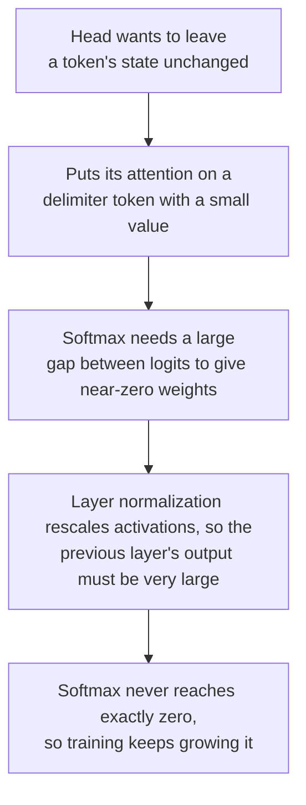

# Lección 7. Por qué los LLM tienen outliers

**Vínculo con la misión:** Decir por qué un LLM en int8 ingenuo se rompe, y qué solución aplica, empieza por saber qué son los valores grandes, dónde están y por qué los produce el modelo.
**Fuente principal:** [Paper: "LLM.int8(): 8-bit Matrix Multiplication for Transformers at Scale", Dettmers et al., 2022](https://arxiv.org/abs/2208.07339), secciones 3 y 4
**Requisitos previos:** [Lección 6](0006-granularity.md), [Outlier feature](../GLOSSARY.md), [Activación masiva](../GLOSSARY.md), [Activación](../GLOSSARY.md)

## Calentamiento

1. ▢ Con una rejilla simétrica con signo de 4 bits de -7 a 7, el mayor valor de un tensor es 1.506. ¿Cuál es el paso, y qué valores se redondean a cero?

<details markdown="1"><summary>Comprobación</summary>

`s = 1.506 / 7 = 0.215`, y todo valor con valor absoluto por debajo de `s/2 = 0.108` se redondea a cero (lección 5). Un valor grande vuelve la rejilla demasiado gruesa para los muchos pequeños.

</details>

2. ▢ ¿Por qué un scale por token no rescata un tensor de activaciones cuyos valores grandes están en una sola dimensión de features?

<details markdown="1"><summary>Comprobación</summary>

Un scale por token lo fija el mayor valor de cada token, y una dimensión de features que es grande en todos los tokens es el mayor valor de casi todas las filas. El scale de cada fila se infla de la misma manera (lección 6).

</details>

3. ▢ ¿Qué eje separaría una dimensión de features así, y por qué una multiplicación de matrices entera no puede usarlo de forma barata?

<details markdown="1"><summary>Comprobación</summary>

Un scale por feature de entrada, que es la cuantización per-channel de las activaciones. Cambia dentro de la suma sobre las features de entrada, así que el acumulador entero tendría que reescalarse en cada canal de entrada (lección 6).

</details>

## Qué debes saber

### Outlier features

Dettmers et al. examinaron los hidden states que entran en las proyecciones de atención y en la primera capa feed-forward, en transformers de 125M a 13B parámetros, y encontraron valores grandes en un pequeño conjunto de dimensiones ocultas. Definieron una **outlier feature** con tres umbrales: una magnitud de al menos 6.0, en al menos el 25 por ciento de las capas y en al menos el 6 por ciento de las posiciones de la secuencia.

Lo que informan, según el propio texto del paper:

| Hallazgo | Valor |
|---|---|
| Tamaño de los outliers | Hasta 20 veces mayores que las demás dimensiones |
| Parte de las features | Cerca del 0.1 por ciento |
| Dónde | Unas pocas dimensiones ocultas fijas: 6 dimensiones en un modelo de 6.7B, como máximo 7 hasta 13B |
| Cuántos valores | Unos 150,000 valores atípicos por secuencia de 2048 tokens a 6.7B, concentrados en esas pocas dimensiones |
| Emergencia | Entre 6B y 6.7B parámetros, la parte de capas afectadas pasa del 65 al 100 por ciento y la de posiciones de la secuencia del 35 al 75 por ciento |
| Qué pasa al eliminarlos | La probabilidad media de atención top-1 cae de cerca del 40 a cerca del 20 por ciento, y la perplexity sube entre un 600 y un 1000 por ciento |
| Control | Eliminar 7 dimensiones aleatorias cambia la perplexity en cerca de un 0.1 por ciento |

Del mismo paper salen dos cautelas. El salto repentino es en el tamaño del modelo, pero cuando lo grafican contra la perplexity, la emergencia es suave y exponencial, y sugieren que la perplexity, y no solo el tamaño, fija el cambio. Y int8 con un scale absmax por tensor ya es peor que el punto flotante a tamaños pequeños en su Tabla 1: 87.76 frente a 25.65 de perplexity en C4 a 125M, y 19.08 frente a 12.45 a 13B. El punto de 6.7B es donde los outliers se vuelven sistemáticos, no un tamaño por debajo del cual el int8 ingenuo es seguro.

### Activaciones masivas

[Sun et al.](https://arxiv.org/abs/2402.17762) encontraron un segundo patrón. Una **activación masiva** es un único valor en un hidden state, definido de forma laxa como superior a 100 y al menos unas 1,000 veces la magnitud mediana de su hidden state. En LLaMA2-7B la mayor es 2622 frente a una mediana de 0.2, y en LLaMA2-70B hay valores que superan 15,000. Son extremadamente raras, a menudo menos de 10 entre decenas de millones de activaciones. Están en dimensiones de features fijas, 1415 y 2533 en LLaMA2-7B, y en tokens concretos: el token inicial y el primer punto o salto de línea.

No son ruido. Poner a cero solo cuatro de ellas en LLaMA2-7B colapsa el modelo, mientras que ponerlas en sus valores medios no lo daña, así que se comportan como términos de sesgo fijos. Tampoco son lo mismo que las outlier features, y el paper lo comprueba: en LLaMA2-7B y 13B encontraron 10 y 25 outlier features según la definición de Dettmers et al., y ninguna coincidió con la dimensión de una activación masiva.

| | Outlier feature | Activación masiva |
|---|---|---|
| Forma | Una dimensión: grande en la mayoría de los tokens | Una entrada: un token, una dimensión |
| Cuántas | Un puñado de dimensiones | A menudo menos de 10 valores en total |
| Quién la encontró | Dettmers et al., 2022 | Sun et al., 2024 |

Según esta tabla, un scale por token confina una activación masiva a la fila de su propio token, ya que está en unos pocos tokens, lo que es una inferencia a partir de su forma y no un resultado de ninguno de los dos papers. No ayuda contra una outlier feature, que está en todas las filas.

### Por qué el modelo las produce

[Bondarenko et al.](https://arxiv.org/abs/2306.12929) vinculan los outliers con cabezas de atención que intentan aprender un "no-op". En BERT-base, más del 97 por ciento de los outliers que registraron coinciden con tokens delimitadores como el separador, un punto o una coma, y la cabeza correspondiente pone casi toda su atención en esos tokens, cuyos vectores de value son pequeños. Atender a un token de poca información con un value diminuto es una manera suave de no actualizar el hidden state. Su hipótesis, que respaldan en BERT y en un vision transformer, se desarrolla como una cadena:



Sun et al. llegan a una imagen compatible desde el otro lado: las activaciones masivas atraen la atención hacia sus tokens y actúan como sesgos implícitos en la autoatención. Ambas son explicaciones que defienden sus autores, no una teoría asentada de todos los modelos.

### Un valor, un scale

Ahora, la aritmética de la lección 4. Toma absmax simétrico de 8 bits con un scale para todo el tensor, y una dimensión de features de magnitud 60 entre valores de desviación estándar 1. El paso es `60 / 127 = 0.47`, así que todo valor por debajo de `0.24` se redondea a cero, cerca del 19 por ciento de una normal estándar. A 4 bits el paso es `60 / 7 = 8.6` y todo lo que está por debajo de 4.3 se redondea a cero, que es prácticamente todo. Dettmers et al. describen el mismo mecanismo: el rango es tan grande que la mayoría de los bins de cuantización quedan vacíos y los valores pequeños se cuantizan a cero, extinguiendo la información.

## Práctica

1. ▢ Enuncia los tres umbrales de Dettmers et al. para llamar a una feature outlier feature.

<details markdown="1"><summary>Comprobación</summary>

Magnitud de al menos 6.0, presente en al menos el 25 por ciento de las capas y en al menos el 6 por ciento de las posiciones de la secuencia. Los tres importan: los umbrales de capas y de posiciones son lo que separa una dimensión de features sistemática de un valor grande ocasional.

</details>

2. ▢ Una dimensión de features tiene magnitud 60 en todos los tokens y las demás tienen desviación estándar 1. Para absmax simétrico de 8 bits y de 4 bits con un scale por tensor, da el paso y la magnitud por debajo de la cual un valor se redondea a cero.

<details markdown="1"><summary>Comprobación</summary>

8 bits: `s = 60 / 127 = 0.47`, así que los valores por debajo de 0.24 se redondean a cero, cerca del 19 por ciento de una normal estándar. 4 bits: `s = 60 / 7 = 8.6`, así que los valores por debajo de 4.3 se redondean a cero, que es más del 99.99 por ciento de una normal estándar. El mismo outlier es una molestia a 8 bits y fatal a 4.

</details>

3. ▢ ¿Qué afirmación separa correctamente una activación masiva de una outlier feature?

    - a) Una activación masiva es una única entrada, mientras que una outlier feature abarca una dimensión
    - b) Una activación masiva abarca la mayoría de los tokens, mientras que una outlier feature abarca solo un token
    - c) Una activación masiva vive en los pesos, mientras que una outlier feature vive en las activaciones
    - d) Una activación masiva se reduce con la escala del modelo, mientras que una outlier feature se mantiene bastante plana

<details markdown="1"><summary>Comprobación</summary>

**a)** Una activación masiva es un escalar en un token y una dimensión, y una outlier feature es una dimensión que es grande en la mayoría de los tokens, como afirman Sun et al. cuando separan ambas. (b) intercambia las dos formas. (c) es incorrecta porque ambas son valores en hidden states, que son activaciones. (d) no es lo que informa ninguno de los dos papers: Dettmers et al. informan de outlier features que crecen a medida que escalan los modelos.

</details>

4. ▢ Predice y luego ejecuta. Un tensor de 128 tokens y 512 features tiene una outlier feature de magnitud cercana a 60 en todos los tokens. Antes de ejecutar, predice con qué ancho de bits y con cuál de los tres ejes de scale el error en las features normales cae por debajo del 5 por ciento.

    ```python
    import numpy as np

    rng = np.random.default_rng(0)
    tokens, features = 128, 512
    X = rng.normal(size=(tokens, features))
    X[:, 7] = 60 * rng.uniform(0.8, 1.2, size=tokens)  # one outlier feature, large at every token
    normal = np.arange(features) != 7


    def quantize(X, axis, bits):
        qmax = 2 ** (bits - 1) - 1
        s = np.abs(X).max(axis=axis, keepdims=True) / qmax
        return s * np.clip(np.round(X / s), -qmax, qmax)


    print("scheme        bits  error on normal features  share rounded to zero")
    for bits in (8, 4):
        for name, axis in [("per-tensor", None), ("per-token", 1), ("per-channel", 0)]:
            Q = quantize(X, axis, bits)
            err = np.mean((Q - X)[:, normal] ** 2) / np.mean(X[:, normal] ** 2)
            zero = np.mean(Q[:, normal] == 0)
            print(f"{name:12s}  {bits}     {err:8.4f}                  {zero:6.1%}")
    ```

<details markdown="1"><summary>Pista</summary>

En el código, `axis=1` toma el máximo a lo largo de cada fila, que es un scale por token, y `axis=0` lo toma por cada columna, que es un scale por feature.

</details>

<details markdown="1"><summary>Comprobación</summary>

```text
scheme        bits  error on normal features  share rounded to zero
per-tensor    8       0.0269                   22.2%
per-token     8       0.0190                   18.5%
per-channel   8       0.0000                    0.8%
per-tensor    4       1.0000                  100.0%
per-token     4       0.9998                  100.0%
per-channel   4       0.0138                   15.8%
```

A 8 bits todos los ejes quedan por debajo del 5 por ciento, pero per-tensor y per-token siguen redondeando a cero cerca de una quinta parte de los valores normales. A 4 bits solo funciona el scale per-channel: per-tensor y per-token lo pierden todo, con un error cercano a 1.0 y todos los valores normales redondeados a cero. El scale per-channel es el que la multiplicación de matrices entera no puede aplicar de forma barata, y por eso la lección 8 necesita otras soluciones. El tensor es sintético.

</details>

5. ▢ Explica en cuatro eslabones por qué una cabeza de atención que quiere dejar un token sin cambios puede acabar produciendo una activación grande.

<details markdown="1"><summary>Comprobación</summary>

La cabeza pone casi toda su atención en un token de poca información, como un delimitador, cuyo vector de value es pequeño, así que la cabeza no añade casi nada. Para que el softmax ponga un peso casi nulo en todo lo demás, los logits necesitan una gran diferencia, lo que necesita entradas grandes. La layer normalization reescala las activaciones, así que la salida de la capa anterior debe ser muy grande para sobrevivirla. El softmax nunca llega exactamente a cero, así que el entrenamiento sigue empujando los valores hacia arriba. Esta es la hipótesis de Bondarenko et al., respaldada en BERT y en un vision transformer, y explica los outliers en los tokens delimitadores de forma más directa de lo que explica todo outlier en todo LLM.

</details>

6. ▢ Un equipo lee que los outliers emergen a los 6.7B parámetros y decide que un modelo de 3B es seguro para int8 per-tensor. ¿Qué hay en los propios resultados de Dettmers et al. que argumente en contra?

<details markdown="1"><summary>Comprobación</summary>

Su Tabla 1 muestra que int8 absmax ya es peor que el punto flotante de 32 bits en todos los tamaños que probaron: 16.55 frente a 15.91 de perplexity en C4 a 1.3B y 15.11 frente a 14.43 a 2.7B, con 87.76 frente a 25.65 a 125M. También informan de que la emergencia es suave cuando se grafica contra la perplexity, y de que el número de outlier features sube de forma monótona a medida que cae la perplexity, así que el tamaño del modelo es una covariable entre varias. La cifra de 6.7B marca dónde los outliers se vuelven sistemáticos en todas las capas, no un umbral por debajo del cual el int8 ingenuo es seguro.

</details>

## Prácticas en el mundo real

- [ ] Carga un modelo abierto pequeño, registra un forward hook en una capa del decoder e imprime el mayor valor absoluto de su hidden state de salida con el token y la dimensión donde ocurre, junto a la mediana del valor absoluto. Anota si algún valor pasa la prueba de Sun et al. de superar 100 y unas 1,000 veces la mediana, y si ninguno lo hace, anota eso.
- [ ] En el código de la Práctica 4, cambia la magnitud del outlier de 60 a 6 y luego a 20, y encuentra la magnitud a la que per-tensor a 4 bits deja por primera vez de redondear a cero todos los valores normales. Explícalo con la fórmula del paso de la lección 4.
- [ ] Mañana: sin apuntes, nombra los dos patrones de outliers, cómo se encuentra cada uno, qué eje separa a cada uno y la cadena de la cabeza de atención que proponen Bondarenko et al.

## Para profundizar

- [El mapeo de cuantización](../reference/quantization-mapping.md)
- [Paper: "LLM.int8(): 8-bit Matrix Multiplication for Transformers at Scale", Dettmers et al., 2022](https://arxiv.org/abs/2208.07339)
- [Paper: "Massive Activations in Large Language Models", Sun et al., 2024](https://arxiv.org/abs/2402.17762)
- [Paper: "Quantizable Transformers: Removing Outliers by Helping Attention Heads Do Nothing", Bondarenko et al., 2023](https://arxiv.org/abs/2306.12929)
- [Recursos](../RESOURCES.md)

---

¿No termina de quedar claro? Vuelve a leer la fuente primaria de arriba, ya que esta lección la comprime y en la compresión es donde se escapa la comprensión. Consulta el [glosario](../GLOSSARY.md) por si algún término te resultó resbaladizo.

Si lo poco claro es la propia lección y no el material, eso es un defecto: [abre un issue](https://github.com/TokenCemetery/teach/issues).
