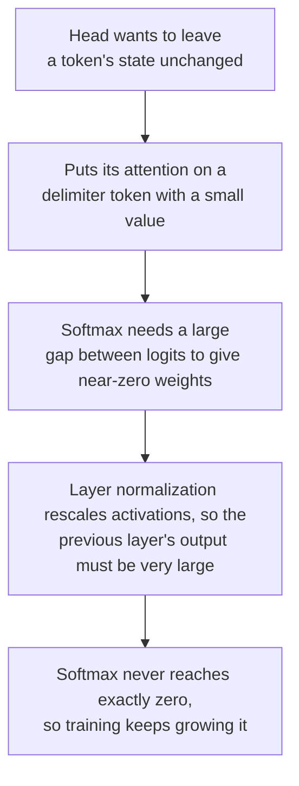

# Leçon 7. Pourquoi les LLM ont des outliers

**Lien avec la mission :** Dire pourquoi un LLM en int8 naïf casse, et quelle parade s'applique, commence par savoir ce que sont les grandes valeurs, où elles se trouvent et pourquoi le modèle les produit.
**Source primaire :** [Article : "LLM.int8(): 8-bit Matrix Multiplication for Transformers at Scale", Dettmers et al., 2022](https://arxiv.org/abs/2208.07339), sections 3 et 4
**Prérequis :** [Leçon 6](0006-granularity.md), [Feature outlier](../GLOSSARY.md), [Activation massive](../GLOSSARY.md), [Activation](../GLOSSARY.md)

## Échauffement

1. ▢ Avec une grille symétrique signée de 4 bits de -7 à 7, la plus grande valeur d'un tenseur est 1.506. Quel est le pas, et quelles valeurs sont arrondies à zéro ?

<details markdown="1"><summary>Vérifier</summary>

`s = 1.506 / 7 = 0.215`, et toute valeur de valeur absolue inférieure à `s/2 = 0.108` est arrondie à zéro (leçon 5). Une seule grande valeur rend la grille trop grossière pour les nombreuses petites.

</details>

2. ▢ Pourquoi un scale par token ne sauve-t-il pas un tenseur d'activations dont les grandes valeurs se trouvent dans une seule dimension de feature ?

<details markdown="1"><summary>Vérifier</summary>

Un scale par token est fixé par la plus grande valeur propre à chaque token, et une dimension de feature qui est grande à chaque token est la plus grande valeur de presque chaque ligne. Le scale de chaque ligne est gonflé de la même façon (leçon 6).

</details>

3. ▢ Quel axe séparerait une telle dimension de feature, et pourquoi une multiplication de matrices entière ne peut-elle pas l'utiliser à bon compte ?

<details markdown="1"><summary>Vérifier</summary>

Un scale par feature d'entrée, c'est-à-dire la quantification par canal des activations. Il change à l'intérieur de la somme sur les features d'entrée, donc l'accumulateur entier devrait être remis à l'échelle à chaque canal d'entrée (leçon 6).

</details>

## À savoir

### Les features outlier

Dettmers et al. ont examiné les états cachés qui entrent dans les projections d'attention et dans la première couche feed-forward, dans des transformers de 125M à 13B paramètres, et ont trouvé de grandes valeurs dans un petit ensemble de dimensions cachées. Ils ont défini une **feature outlier** par trois seuils : une grandeur d'au moins 6.0, dans au moins 25 pour cent des couches, et au moins 6 pour cent des positions de la séquence.

Ce qu'ils rapportent, d'après le texte même de l'article :

| Constat | Valeur |
|---|---|
| Taille des outliers | Jusqu'à 20 fois plus grands que les autres dimensions |
| Part des features | Environ 0.1 pour cent |
| Où | Quelques dimensions cachées fixes : 6 dimensions dans un modèle 6.7B, au plus 7 jusqu'à 13B |
| Combien de valeurs | Environ 150,000 valeurs aberrantes par séquence de 2048 tokens à 6.7B, concentrées dans ces quelques dimensions |
| Émergence | Entre 6B et 6.7B paramètres, la part des couches touchées passe de 65 à 100 pour cent et la part des positions de séquence de 35 à 75 pour cent |
| Ce que les retirer provoque | La probabilité d'attention top-1 moyenne tombe d'environ 40 à environ 20 pour cent, et la perplexity monte de 600 à 1000 pour cent |
| Contrôle | Retirer 7 dimensions aléatoires change la perplexity d'environ 0.1 pour cent |

Deux mises en garde viennent du même article. Le saut brutal se produit en fonction de la taille du modèle, mais quand ils tracent plutôt en fonction de la perplexity, l'émergence est lisse et exponentielle, et ils suggèrent que c'est la perplexity, pas la taille seule, qui fixe le basculement. Et l'int8 avec un seul scale absmax par tenseur est déjà pire que le flottant aux petites tailles dans leur tableau 1 : 87.76 contre 25.65 de perplexity sur C4 à 125M, et 19.08 contre 12.45 à 13B. Le point à 6.7B est celui où les outliers deviennent systématiques, pas une taille en dessous de laquelle l'int8 naïf est sûr.

### Les activations massives

[Sun et al.](https://arxiv.org/abs/2402.17762) ont trouvé un second motif. Une **activation massive** est une valeur isolée dans un état caché, définie de façon lâche comme supérieure à 100 et d'au moins environ 1,000 fois la grandeur médiane de son état caché. Dans LLaMA2-7B, la plus grande vaut 2622 contre une médiane de 0.2, et dans LLaMA2-70B des valeurs dépassent 15,000. Elles sont extrêmement rares, souvent moins de 10 parmi des dizaines de millions d'activations. Elles se trouvent à des dimensions de features fixes, 1415 et 2533 dans LLaMA2-7B, et à des tokens précis : le token de départ et le premier point ou saut de ligne.

Ce n'est pas du bruit. En mettre à zéro seulement quatre dans LLaMA2-7B fait s'effondrer le modèle, alors que les mettre à leurs valeurs moyennes ne lui nuit pas, donc elles se comportent comme des termes de biais fixes. Ce n'est pas non plus la même chose que les features outlier, et l'article le vérifie : dans LLaMA2-7B et 13B, ils ont trouvé 10 et 25 features outlier selon la définition de Dettmers et al., et aucune ne correspondait à la dimension d'une activation massive.

| | Feature outlier | Activation massive |
|---|---|---|
| Forme | Une dimension : grande à la plupart des tokens | Une entrée : un token, une dimension |
| Nombre | Une poignée de dimensions | Souvent moins de 10 valeurs au total |
| Découverte par | Dettmers et al., 2022 | Sun et al., 2024 |

D'après ce tableau, un scale par token confine une activation massive à la ligne de son propre token, puisqu'elle se trouve à quelques tokens, ce qui est une inférence tirée de leur forme et pas un résultat de l'un ou l'autre article. Il n'aide pas contre une feature outlier, qui est dans chaque ligne.

### Pourquoi le modèle en fabrique

[Bondarenko et al.](https://arxiv.org/abs/2306.12929) relient les outliers à des têtes d'attention qui essaient d'apprendre un « no-op ». Dans BERT-base, plus de 97 pour cent des outliers qu'ils ont enregistrés coïncident avec des tokens délimiteurs comme le séparateur, un point ou une virgule, et la tête correspondante met presque toute son attention sur ces tokens, dont les vecteurs de valeur sont petits. Porter son attention sur un token pauvre en information avec une valeur minuscule est une façon douce de ne pas mettre à jour l'état caché. Leur hypothèse, qu'ils étayent sur BERT et sur un transformer de vision, se déroule en chaîne :



Sun et al. arrivent à une image compatible par l'autre côté : les activations massives attirent l'attention vers leurs tokens et jouent le rôle de biais implicites dans l'auto-attention. Ce sont deux explications que leurs auteurs défendent, pas une théorie établie de tous les modèles.

### Une valeur, un scale

Passons à l'arithmétique de la leçon 4. Prenons de l'absmax symétrique sur 8 bits avec un seul scale pour tout le tenseur, et une dimension de feature de grandeur 60 parmi des valeurs d'écart type 1. Le pas est `60 / 127 = 0.47`, donc toute valeur inférieure à `0.24` est arrondie à zéro, soit environ 19 pour cent d'une loi normale standard. En 4 bits, le pas est `60 / 7 = 8.6` et tout ce qui est inférieur à 4.3 est arrondi à zéro, c'est-à-dire pratiquement tout. Dettmers et al. décrivent le même mécanisme : la plage est si grande que la plupart des bins de quantification sont vides et que les petites valeurs sont quantifiées à zéro, ce qui éteint l'information.

## Pratique

1. ▢ Énoncez les trois seuils de Dettmers et al. pour qualifier une feature de feature outlier.

<details markdown="1"><summary>Vérifier</summary>

Une grandeur d'au moins 6.0, présente dans au moins 25 pour cent des couches, et au moins 6 pour cent des positions de séquence. Les trois comptent : les seuils de couches et de positions sont ce qui sépare une dimension de feature systématique d'une grande valeur occasionnelle.

</details>

2. ▢ Une dimension de feature a une grandeur de 60 à chaque token et les autres ont un écart type de 1. Pour de l'absmax symétrique en 8 bits et en 4 bits avec un scale par tenseur, donnez le pas et la grandeur en dessous de laquelle une valeur est arrondie à zéro.

<details markdown="1"><summary>Vérifier</summary>

8 bits : `s = 60 / 127 = 0.47`, donc les valeurs inférieures à 0.24 sont arrondies à zéro, environ 19 pour cent d'une loi normale standard. 4 bits : `s = 60 / 7 = 8.6`, donc les valeurs inférieures à 4.3 sont arrondies à zéro, soit plus de 99.99 pour cent d'une loi normale standard. Le même outlier est une nuisance en 8 bits et fatal en 4.

</details>

3. ▢ Quelle affirmation sépare correctement une activation massive d'une feature outlier ?

    - a) Une activation massive est une entrée isolée, alors qu'une feature outlier couvre une dimension
    - b) Une activation massive couvre la plupart des tokens, alors qu'une feature outlier ne couvre qu'un token
    - c) Une activation massive vit dans les poids, alors qu'une feature outlier vit dans les activations
    - d) Une activation massive décroît avec l'échelle du modèle, alors qu'une feature outlier reste assez stable

<details markdown="1"><summary>Vérifier</summary>

**a)** Une activation massive est un scalaire à un token et une dimension, et une feature outlier est une dimension grande sur la plupart des tokens, ce que Sun et al. énoncent quand ils séparent les deux. (b) échange les deux formes. (c) est faux parce que les deux sont des valeurs d'états cachés, c'est-à-dire des activations. (d) n'est ce que rapporte aucun des deux articles : Dettmers et al. rapportent que les features outlier croissent avec l'échelle des modèles.

</details>

4. ▢ Prédisez, puis exécutez. Un tenseur de 128 tokens et 512 features a une feature outlier de grandeur environ 60 à chaque token. Avant d'exécuter, prédisez à quelle largeur en bits et avec lequel des trois axes de scale l'erreur sur les features normales passe sous 5 pour cent.

    ```python
    import numpy as np

    rng = np.random.default_rng(0)
    tokens, features = 128, 512
    X = rng.normal(size=(tokens, features))
    X[:, 7] = 60 * rng.uniform(0.8, 1.2, size=tokens)  # one outlier feature, large at every token
    normal = np.arange(features) != 7


    def quantize(X, axis, bits):
        qmax = 2 ** (bits - 1) - 1
        s = np.abs(X).max(axis=axis, keepdims=True) / qmax
        return s * np.clip(np.round(X / s), -qmax, qmax)


    print("scheme        bits  error on normal features  share rounded to zero")
    for bits in (8, 4):
        for name, axis in [("per-tensor", None), ("per-token", 1), ("per-channel", 0)]:
            Q = quantize(X, axis, bits)
            err = np.mean((Q - X)[:, normal] ** 2) / np.mean(X[:, normal] ** 2)
            zero = np.mean(Q[:, normal] == 0)
            print(f"{name:12s}  {bits}     {err:8.4f}                  {zero:6.1%}")
    ```

<details markdown="1"><summary>Indice</summary>

Dans le code, `axis=1` prend le maximum le long de chaque ligne, soit un scale par token, et `axis=0` le prend dans chaque colonne, soit un scale par feature.

</details>

<details markdown="1"><summary>Vérifier</summary>

```text
scheme        bits  error on normal features  share rounded to zero
per-tensor    8       0.0269                   22.2%
per-token     8       0.0190                   18.5%
per-channel   8       0.0000                    0.8%
per-tensor    4       1.0000                  100.0%
per-token     4       0.9998                  100.0%
per-channel   4       0.0138                   15.8%
```

En 8 bits, chaque axe est sous 5 pour cent, mais le par-tenseur et le par-token arrondissent quand même environ un cinquième des valeurs normales à zéro. En 4 bits, seul le scale par canal fonctionne : le par-tenseur et le par-token perdent tout, avec une erreur proche de 1.0 et chaque valeur normale arrondie à zéro. Le scale par canal est celui qu'une multiplication de matrices entière ne peut pas appliquer à bon compte, ce qui explique que la leçon 8 ait besoin d'autres parades. Le tenseur est synthétique.

</details>

5. ▢ Expliquez en quatre maillons pourquoi une tête d'attention qui veut laisser un token inchangé peut finir par produire une grande activation.

<details markdown="1"><summary>Vérifier</summary>

La tête met presque toute son attention sur un token pauvre en information, comme un délimiteur, dont le vecteur de valeur est petit, donc la tête n'ajoute presque rien. Pour que le softmax mette un poids proche de zéro sur tout le reste, les logits ont besoin d'un grand écart, ce qui demande de grandes entrées. La layer normalization remet les activations à l'échelle, donc la sortie de la couche précédente doit être très grande pour y survivre. Le softmax n'atteint jamais exactement zéro, donc l'entraînement continue de pousser les valeurs plus haut. C'est l'hypothèse de Bondarenko et al., étayée sur BERT et sur un transformer de vision, et elle explique les outliers aux tokens délimiteurs plus directement qu'elle n'explique chaque outlier de chaque LLM.

</details>

6. ▢ Une équipe lit que les outliers émergent à 6.7B paramètres et décide qu'un modèle de 3B est sûr pour de l'int8 par tenseur. Qu'y a-t-il, dans les résultats mêmes de Dettmers et al., qui s'y oppose ?

<details markdown="1"><summary>Vérifier</summary>

Leur tableau 1 montre l'int8 absmax déjà pire que le float 32 bits à chaque taille testée : 16.55 contre 15.91 de perplexity sur C4 à 1.3B et 15.11 contre 14.43 à 2.7B, avec 87.76 contre 25.65 à 125M. Ils rapportent aussi que l'émergence est lisse quand on la trace en fonction de la perplexity, et que le nombre de features outlier croît de façon monotone quand la perplexity baisse, donc la taille du modèle est une covariable parmi d'autres. Le chiffre de 6.7B marque l'endroit où les outliers deviennent systématiques sur toutes les couches, pas un seuil en dessous duquel l'int8 naïf est sûr.

</details>

## Exercices en situation réelle

- [ ] Chargez un petit modèle ouvert, enregistrez un forward hook sur une couche de décodeur, et affichez la plus grande valeur absolue de son état caché de sortie avec le token et la dimension où elle se trouve, à côté de la valeur absolue médiane. Notez si une valeur passe le test de Sun et al., au-dessus de 100 et d'environ 1,000 fois la médiane, et si aucune ne le passe, notez-le.
- [ ] Dans le code de la Pratique 4, changez la grandeur de l'outlier de 60 à 6 puis à 20, et trouvez la grandeur à laquelle le par-tenseur en 4 bits cesse pour la première fois d'arrondir à zéro chaque valeur normale. Expliquez-le avec la formule du pas de la leçon 4.
- [ ] Demain : sans notes, nommez les deux motifs d'outliers, comment chacun est trouvé, quel axe sépare chacun, et la chaîne de la tête d'attention que proposent Bondarenko et al.

## Pour aller plus loin

- [La correspondance de quantification](../reference/quantization-mapping.md)
- [Article : "LLM.int8(): 8-bit Matrix Multiplication for Transformers at Scale", Dettmers et al., 2022](https://arxiv.org/abs/2208.07339)
- [Article : "Massive Activations in Large Language Models", Sun et al., 2024](https://arxiv.org/abs/2402.17762)
- [Article : "Quantizable Transformers: Removing Outliers by Helping Attention Heads Do Nothing", Bondarenko et al., 2023](https://arxiv.org/abs/2306.12929)
- [Ressources](../RESOURCES.md)

---

Ça ne passe pas ? Relisez la source primaire en haut de page, car cette leçon la condense et c'est dans la condensation que la compréhension s'échappe. Consultez le [glossaire](../GLOSSARY.md) pour tout terme qui vous a paru glissant.

Si c'est la leçon elle-même qui n'est pas claire plutôt que la matière, c'est un défaut : [ouvrez une issue](https://github.com/TokenCemetery/teach/issues).
