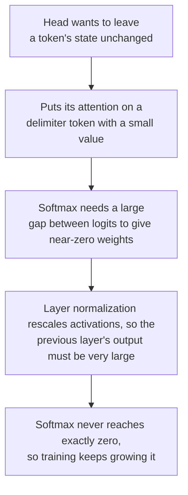

# पाठ 7. LLMs में Outliers क्यों होते हैं

**मिशन से संबंध:** यह बताना कि naive int8 LLM क्यों टूटता है और कौन-सा इलाज लागू होता है, इससे शुरू होता है कि बड़ी values क्या हैं, कहाँ बैठती हैं और model उन्हें क्यों बनाता है।
**मुख्य स्रोत:** [पेपर: "LLM.int8(): 8-bit Matrix Multiplication for Transformers at Scale", Dettmers et al., 2022](https://arxiv.org/abs/2208.07339), sections 3 और 4
**पूर्व-आवश्यकताएँ:** [पाठ 6](0006-granularity.md), [Outlier feature](../GLOSSARY.md), [Massive activation](../GLOSSARY.md), [Activation](../GLOSSARY.md)

## वार्म-अप

1. ▢ -7 से 7 की 4-bit signed symmetric grid के साथ, किसी tensor की सबसे बड़ी value 1.506 है। Step क्या है, और कौन-सी values zero पर round होती हैं?

<details markdown="1"><summary>जाँचें</summary>

`s = 1.506 / 7 = 0.215`, और जिस value का absolute value `s/2 = 0.108` से नीचे है वह zero पर round होती है (पाठ 5)। एक बड़ी value grid को कई छोटी values के लिए बहुत मोटा बना देती है।

</details>

2. ▢ Per-token scale उस activation tensor को क्यों नहीं बचाता जिसकी बड़ी values एक feature dimension में बैठी हैं?

<details markdown="1"><summary>जाँचें</summary>

Per-token scale हर token की अपनी सबसे बड़ी value से तय होता है, और जो feature dimension हर token पर बड़ी है वह लगभग हर row की सबसे बड़ी value है। हर row का scale एक ही तरह फूल जाता है (पाठ 6)।

</details>

3. ▢ कौन-सा axis ऐसी feature dimension को अलग करता, और integer matrix multiplication उसे सस्ते में क्यों इस्तेमाल नहीं कर सकता?

<details markdown="1"><summary>जाँचें</summary>

हर input feature के लिए एक scale, यानी activations का per-channel quantization। वह input features पर योग के भीतर बदलता है, इसलिए integer accumulator को हर input channel पर दोबारा scale करना पड़ेगा (पाठ 6)।

</details>

## यह जानें

### Outlier features

Dettmers et al. ने 125M से 13B parameters के transformers में attention projections और पहली feed-forward layer में जाने वाली hidden states देखीं, और hidden dimensions के एक छोटे सेट में बड़ी values पाईं। उन्होंने **outlier feature** को तीन थ्रेशोल्ड से परिभाषित किया: कम से कम 6.0 की magnitude, कम से कम 25 प्रतिशत layers में, और कम से कम 6 प्रतिशत sequence positions पर।

पेपर के अपने पाठ से, वे जो बताते हैं:

| निष्कर्ष | Value |
|---|---|
| Outliers का आकार | बाक़ी dimensions से 20 गुना तक बड़े |
| Features का हिस्सा | लगभग 0.1 प्रतिशत |
| कहाँ | कुछ तय hidden dimensions: 6.7B model में 6 dimensions, 13B तक ज़्यादा से ज़्यादा 7 |
| कितनी values | 6.7B पर प्रति 2048-token sequence लगभग 150,000 outlying values, उन्हीं कुछ dimensions में केंद्रित |
| उभरना | 6B और 6.7B parameters के बीच, प्रभावित layers का हिस्सा 65 से 100 प्रतिशत और sequence positions का हिस्सा 35 से 75 प्रतिशत हो जाता है |
| उन्हें हटाने का असर | Mean top-1 attention probability लगभग 40 से घटकर लगभग 20 प्रतिशत रह जाती है, और perplexity 600 से 1000 प्रतिशत बढ़ती है |
| Control | 7 random dimensions हटाने से perplexity लगभग 0.1 प्रतिशत बदलती है |

उसी पेपर से दो सावधानियाँ आती हैं। अचानक छलाँग model के आकार में है, पर जब वे आकार की जगह perplexity के सामने plot करते हैं, तो उभार सहज और घातांकीय है, और वे सुझाते हैं कि बदलाव अकेले आकार से नहीं बल्कि perplexity से तय होता है। और उनकी Table 1 में प्रति tensor एक absmax scale वाला int8 छोटे आकारों पर ही float से बदतर है: 125M पर 87.76 बनाम 25.65 C4 perplexity, और 13B पर 19.08 बनाम 12.45। 6.7B वह बिंदु है जहाँ outliers व्यवस्थित हो जाते हैं, ऐसा आकार नहीं जिसके नीचे naive int8 सुरक्षित हो।

### Massive activations

[Sun et al.](https://arxiv.org/abs/2402.17762) ने दूसरा pattern पाया। **Massive activation** hidden state में एक अकेली value है, जिसे ढीले ढंग से 100 से ऊपर और अपनी hidden state की median magnitude से कम से कम लगभग 1,000 गुना के रूप में परिभाषित किया गया है। LLaMA2-7B में सबसे बड़ी 2622 है जबकि median 0.2, और LLaMA2-70B में values 15,000 से ऊपर जाती हैं। वे बेहद दुर्लभ हैं, अक्सर करोड़ों activations में 10 से कम। वे तय feature dimensions पर बैठती हैं, LLaMA2-7B में 1415 और 2533, और ख़ास tokens पर: शुरुआती token और पहला पूर्ण विराम या newline।

वे noise नहीं हैं। LLaMA2-7B में सिर्फ़ उनमें से चार को zero कर देने से model ढह जाता है, जबकि उन्हें उनके mean values पर रखने से उसे कोई नुक़सान नहीं होता, यानी वे तय bias terms की तरह बर्ताव करती हैं। वे outlier features जैसी चीज़ भी नहीं हैं, और पेपर इसे जाँचता है: LLaMA2-7B और 13B में उन्हें Dettmers et al. की परिभाषा से 10 और 25 outlier features मिले, और कोई भी massive activation की dimension से नहीं मिला।

| | Outlier feature | Massive activation |
|---|---|---|
| आकार | एक dimension: ज़्यादातर tokens पर बड़ी | एक entry: एक token, एक dimension |
| गिनती | मुट्ठी भर dimensions | अक्सर कुल मिलाकर 10 से कम values |
| किसने खोजा | Dettmers et al., 2022 | Sun et al., 2024 |

इस table के हिसाब से, per-token scale massive activation को उसके अपने token की row तक सीमित कर देता है, क्योंकि वह कुछ ही tokens पर बैठती है, जो उनके आकार से निकाला गया अनुमान है, किसी भी पेपर का नतीजा नहीं। यह outlier feature के ख़िलाफ़ मदद नहीं करता, जो हर row में है।

### Model उन्हें क्यों बनाता है

[Bondarenko et al.](https://arxiv.org/abs/2306.12929) outliers को उन attention heads से जोड़ते हैं जो "no-op" सीखने की कोशिश करते हैं। BERT-base में, उनके दर्ज किए गए 97 प्रतिशत से ज़्यादा outliers separator, पूर्ण विराम या अल्पविराम जैसे delimiter tokens से मेल खाते हैं, और संबंधित head अपना लगभग सारा attention उन्हीं tokens पर रखता है, जिनके value vectors छोटे हैं। बहुत छोटी value वाले कम-जानकारी token पर attend करना hidden state को अपडेट न करने का नरम तरीक़ा है। उनकी परिकल्पना, जिसे वे BERT और एक vision transformer पर समर्थन देते हैं, एक श्रृंखला की तरह चलती है:



Sun et al. दूसरी ओर से एक संगत तस्वीर पर पहुँचते हैं: massive activations अपने tokens की ओर attention खींचती हैं और self-attention में निहित biases की तरह काम करती हैं। दोनों ऐसी व्याख्याएँ हैं जिनके पक्ष में उनके लेखक तर्क देते हैं, हर model का तय किया हुआ सिद्धांत नहीं।

### एक value, एक scale

अब पाठ 4 का हिसाब। 8-bit symmetric absmax लें जिसमें पूरे tensor के लिए एक scale है, और standard deviation 1 वाली values के बीच magnitude 60 की एक feature dimension। Step `60 / 127 = 0.47` है, इसलिए `0.24` से नीचे की हर value zero पर round होती है, जो standard normal का लगभग 19 प्रतिशत है। 4 bits पर step `60 / 7 = 8.6` है और 4.3 से नीचे सब कुछ zero पर round होता है, जो व्यावहारिक रूप से सारा है। Dettmers et al. यही तंत्र बताते हैं: range इतनी बड़ी है कि ज़्यादातर quantization bins ख़ाली हैं और छोटी values zero पर quantize हो जाती हैं, जानकारी बुझ जाती है।

## अभ्यास

1. ▢ Dettmers et al. के वे तीन थ्रेशोल्ड बताएँ जिनसे किसी feature को outlier feature कहा जाता है।

<details markdown="1"><summary>जाँचें</summary>

कम से कम 6.0 की magnitude, कम से कम 25 प्रतिशत layers में मौजूद, और कम से कम 6 प्रतिशत sequence positions पर। तीनों मायने रखते हैं: layer और position के थ्रेशोल्ड ही किसी व्यवस्थित feature dimension को यदा-कदा आने वाली बड़ी value से अलग करते हैं।

</details>

2. ▢ एक feature dimension की magnitude हर token पर 60 है और बाक़ी का standard deviation 1 है। प्रति tensor एक scale वाले 8-bit और 4-bit symmetric absmax के लिए, step और वह magnitude बताएँ जिससे नीचे कोई value zero पर round होती है।

<details markdown="1"><summary>जाँचें</summary>

8-bit: `s = 60 / 127 = 0.47`, इसलिए 0.24 से नीचे की values zero पर round होती हैं, जो standard normal का लगभग 19 प्रतिशत है। 4-bit: `s = 60 / 7 = 8.6`, इसलिए 4.3 से नीचे की values zero पर round होती हैं, जो standard normal का 99.99 प्रतिशत से ज़्यादा है। वही outlier 8 bits पर परेशानी है और 4 पर घातक।

</details>

3. ▢ कौन-सा कथन massive activation को outlier feature से सही ढंग से अलग करता है?

    - a) Massive activation एक अकेली entry है, जबकि outlier feature पूरी dimension में फैला है
    - b) Massive activation ज़्यादातर tokens में फैली है, जबकि outlier feature सिर्फ़ एक token में
    - c) Massive activation weights में रहती है, जबकि outlier feature activations में
    - d) Massive activation model के बड़े होने के साथ घटती है, जबकि outlier feature लगभग स्थिर रहता है

<details markdown="1"><summary>जाँचें</summary>

**a)** Massive activation एक token और एक dimension पर scalar है, और outlier feature वह dimension है जो ज़्यादातर tokens पर बड़ी है, जो Sun et al. दोनों को अलग करते हुए कहते हैं। (b) दोनों आकार उलट देता है। (c) ग़लत है क्योंकि दोनों hidden states की values हैं, जो activations हैं। (d) वह नहीं है जो कोई भी पेपर बताता है: Dettmers et al. बताते हैं कि outlier features models के scale होने के साथ बढ़ते हैं।

</details>

4. ▢ पहले अनुमान लगाएँ, फिर चलाएँ। 128 tokens और 512 features के tensor में हर token पर लगभग 60 magnitude वाला एक outlier feature है। चलाने से पहले अनुमान लगाएँ कि किस bit width पर और तीन scale axes में से किसके साथ सामान्य features पर error 5 प्रतिशत से नीचे आती है।

    ```python
    import numpy as np

    rng = np.random.default_rng(0)
    tokens, features = 128, 512
    X = rng.normal(size=(tokens, features))
    X[:, 7] = 60 * rng.uniform(0.8, 1.2, size=tokens)  # one outlier feature, large at every token
    normal = np.arange(features) != 7


    def quantize(X, axis, bits):
        qmax = 2 ** (bits - 1) - 1
        s = np.abs(X).max(axis=axis, keepdims=True) / qmax
        return s * np.clip(np.round(X / s), -qmax, qmax)


    print("scheme        bits  error on normal features  share rounded to zero")
    for bits in (8, 4):
        for name, axis in [("per-tensor", None), ("per-token", 1), ("per-channel", 0)]:
            Q = quantize(X, axis, bits)
            err = np.mean((Q - X)[:, normal] ** 2) / np.mean(X[:, normal] ** 2)
            zero = np.mean(Q[:, normal] == 0)
            print(f"{name:12s}  {bits}     {err:8.4f}                  {zero:6.1%}")
    ```

<details markdown="1"><summary>संकेत</summary>

Code में, `axis=1` हर row के साथ maximum लेता है, जो हर token के लिए एक scale है, और `axis=0` उसे हर column के नीचे लेता है, जो हर feature के लिए एक scale है।

</details>

<details markdown="1"><summary>जाँचें</summary>

```text
scheme        bits  error on normal features  share rounded to zero
per-tensor    8       0.0269                   22.2%
per-token     8       0.0190                   18.5%
per-channel   8       0.0000                    0.8%
per-tensor    4       1.0000                  100.0%
per-token     4       0.9998                  100.0%
per-channel   4       0.0138                   15.8%
```

8 bits पर हर axis 5 प्रतिशत से नीचे है, पर per-tensor और per-token फिर भी सामान्य values का लगभग पाँचवाँ हिस्सा zero पर round कर देते हैं। 4 bits पर सिर्फ़ per-channel scale काम करता है: per-tensor और per-token सब कुछ खो देते हैं, error 1.0 के पास और हर सामान्य value zero पर round। Per-channel scale वही है जिसे integer matrix multiplication सस्ते में लागू नहीं कर सकता, इसीलिए पाठ 8 को दूसरे इलाज चाहिए। Tensor synthetic है।

</details>

5. ▢ चार कड़ियों में समझाएँ कि जो attention head किसी token को अपरिवर्तित छोड़ना चाहता है वह बड़ी activation क्यों बना सकता है।

<details markdown="1"><summary>जाँचें</summary>

Head अपना लगभग सारा attention किसी कम-जानकारी वाले token पर रखता है, जैसे delimiter, जिसका value vector छोटा है, इसलिए head लगभग कुछ नहीं जोड़ता। Softmax से बाक़ी सब पर लगभग zero वज़न दिलवाने के लिए logits में बड़ा फ़ासला चाहिए, जिसके लिए बड़े inputs चाहिए। Layer normalization activations को दोबारा scale करता है, इसलिए पहले की layer का output उससे बच निकलने के लिए बहुत बड़ा होना चाहिए। Softmax कभी ठीक zero तक नहीं पहुँचता, इसलिए training values को और बड़ा करती रहती है। यह Bondarenko et al. की परिकल्पना है, जिसे BERT और एक vision transformer पर समर्थन मिला है, और यह delimiter tokens पर outliers को हर LLM के हर outlier की तुलना में ज़्यादा सीधे समझाती है।

</details>

6. ▢ कोई team पढ़ती है कि outliers 6.7B parameters पर उभरते हैं और तय करती है कि 3B model per-tensor int8 के लिए सुरक्षित है। Dettmers et al. के अपने नतीजों में ऐसा क्या है जो इसके ख़िलाफ़ तर्क देता है?

<details markdown="1"><summary>जाँचें</summary>

उनकी Table 1 दिखाती है कि int8 absmax उनके परखे हर आकार पर 32-bit float से पहले ही बदतर है: 1.3B पर 16.55 बनाम 15.91 C4 perplexity और 2.7B पर 15.11 बनाम 14.43, जबकि 125M पर 87.76 बनाम 25.65। वे यह भी बताते हैं कि perplexity के सामने plot करने पर उभार सहज है, और perplexity घटने के साथ outlier features की संख्या एकदिशीय रूप से बढ़ती है, इसलिए model का आकार कई सह-चरों में से एक है। 6.7B की संख्या वह जगह बताती है जहाँ outliers सभी layers में व्यवस्थित हो जाते हैं, ऐसी सीमा नहीं जिसके नीचे naive int8 सुरक्षित हो।

</details>

## असली दुनिया का अभ्यास

- [ ] कोई छोटा open model load करें, किसी एक decoder layer पर forward hook लगाएँ, और उसकी output hidden state की सबसे बड़ी absolute value को उस token और dimension के साथ print करें जहाँ वह आती है, median absolute value के बग़ल में। दर्ज करें कि क्या कोई value Sun et al. की 100 से ऊपर और median के लगभग 1,000 गुना वाली कसौटी पास करती है, और अगर कोई नहीं करती, तो वह भी दर्ज करें।
- [ ] अभ्यास 4 के code में outlier की magnitude 60 से बदलकर 6 और फिर 20 करें, और वह magnitude खोजें जिस पर 4-bit per-tensor पहली बार हर सामान्य value को zero पर round करना बंद करता है। इसे पाठ 4 के step formula से समझाएँ।
- [ ] कल: बिना नोट्स के दोनों outlier patterns के नाम बताएँ, हर एक कैसे खोजा जाता है, कौन-सा axis हर एक को अलग करता है, और वह attention-head श्रृंखला जो Bondarenko et al. प्रस्तावित करते हैं।

## आगे बढ़ने के लिए

- [Quantization Mapping शीट](../reference/quantization-mapping.md)
- [पेपर: "LLM.int8(): 8-bit Matrix Multiplication for Transformers at Scale", Dettmers et al., 2022](https://arxiv.org/abs/2208.07339)
- [पेपर: "Massive Activations in Large Language Models", Sun et al., 2024](https://arxiv.org/abs/2402.17762)
- [पेपर: "Quantizable Transformers: Removing Outliers by Helping Attention Heads Do Nothing", Bondarenko et al., 2023](https://arxiv.org/abs/2306.12929)
- [संसाधन](../RESOURCES.md)

---

बात नहीं बन रही? ऊपर दिए मुख्य स्रोत को दोबारा पढ़ें, क्योंकि यह पाठ उसे संक्षिप्त करता है और समझ संक्षेप में ही रिसती है। जो शब्द फिसलन भरा लगे, उसके लिए [शब्दावली](../GLOSSARY.md) देखें।

अगर दिक़्क़त सामग्री की नहीं बल्कि पाठ की ही है, तो वह एक खोट है: [issue खोलें](https://github.com/TokenCemetery/teach/issues)।
