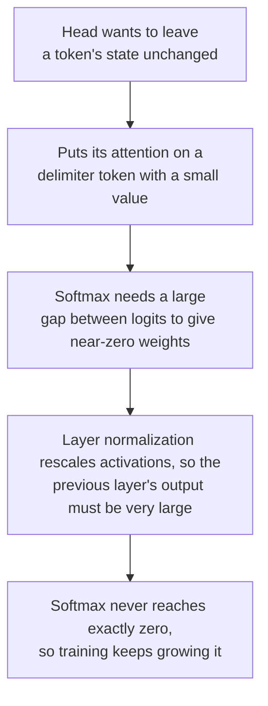

# Lesson 7. Why LLMs Have Outliers

**Mission link:** Saying why a naive int8 LLM breaks, and which fix applies, starts with knowing what the large values are, where they sit and why the model produces them.
**Primary source:** [Paper: "LLM.int8(): 8-bit Matrix Multiplication for Transformers at Scale", Dettmers et al., 2022](https://arxiv.org/abs/2208.07339), sections 3 and 4
**Prerequisites:** [Lesson 6](0006-granularity.md), [Outlier feature](../GLOSSARY.md), [Massive activation](../GLOSSARY.md), [Activation](../GLOSSARY.md)

## Warm-up

1. ▢ With a 4-bit signed symmetric grid of -7 to 7, a tensor's largest value is 1.506. What is the step, and which values round to zero?

<details markdown="1"><summary>Check</summary>

`s = 1.506 / 7 = 0.215`, and any value with absolute value below `s/2 = 0.108` rounds to zero (lesson 5). One large value makes the grid too coarse for the many small ones.

</details>

2. ▢ Why does a per-token scale not rescue an activation tensor whose large values sit in one feature dimension?

<details markdown="1"><summary>Check</summary>

A per-token scale is set by each token's own largest value, and a feature dimension that is large at every token is the largest value of nearly every row. Every row's scale is inflated the same way (lesson 6).

</details>

3. ▢ Which axis would separate such a feature dimension, and why can an integer matrix multiplication not use it cheaply?

<details markdown="1"><summary>Check</summary>

A scale per input feature, which is per-channel quantization of the activations. It changes inside the sum over input features, so the integer accumulator would have to be rescaled at every input channel (lesson 6).

</details>

## Know this

### Outlier features

Dettmers et al. looked at the hidden states going into the attention projections and the first feed-forward layer, in transformers from 125M to 13B parameters, and found large values in a small set of hidden dimensions. They defined an **outlier feature** by three thresholds: a magnitude of at least 6.0, in at least 25 percent of layers, and at least 6 percent of the sequence positions.

What they report, from the paper's own text:

| Finding | Value |
|---|---|
| Size of the outliers | Up to 20 times larger than the other dimensions |
| Share of features | About 0.1 percent |
| Where | A few fixed hidden dimensions: 6 dimensions in a 6.7B model, at most 7 up to 13B |
| How many values | About 150,000 outlying values per 2048-token sequence at 6.7B, concentrated in those few dimensions |
| Emergence | Between 6B and 6.7B parameters, the share of layers affected goes from 65 to 100 percent and the share of sequence positions from 35 to 75 percent |
| What removing them does | Mean top-1 attention probability falls from about 40 to about 20 percent, and perplexity rises 600 to 1000 percent |
| Control | Removing 7 random dimensions changes perplexity by about 0.1 percent |

Two cautions come from the same paper. The sudden jump is in model size, but when they plot against perplexity instead, emergence is smooth and exponential, and they suggest that perplexity, not size alone, sets the shift. And int8 with one absmax scale per tensor is already worse than float at small sizes in their Table 1: 87.76 against 25.65 C4 perplexity at 125M, and 19.08 against 12.45 at 13B. The 6.7B point is where the outliers become systematic, not a size below which naive int8 is safe.

### Massive activations

[Sun et al.](https://arxiv.org/abs/2402.17762) found a second pattern. A **massive activation** is a single value in a hidden state, defined loosely as above 100 and at least about 1,000 times the median magnitude of its hidden state. In LLaMA2-7B the largest is 2622 against a median of 0.2, and in LLaMA2-70B values exceed 15,000. They are extremely rare, often fewer than 10 among tens of millions of activations. They sit at fixed feature dimensions, 1415 and 2533 in LLaMA2-7B, and at specific tokens: the starting token and the first period or newline.

They are not noise. Setting just four of them to zero in LLaMA2-7B collapses the model, while setting them to their mean values does not hurt it, so they behave like fixed bias terms. They are also not the same thing as outlier features, and the paper checks it: in LLaMA2-7B and 13B they found 10 and 25 outlier features by Dettmers et al.'s definition, and none matched a massive activation's dimension.

| | Outlier feature | Massive activation |
|---|---|---|
| Shape | A dimension: large at most tokens | One entry: one token, one dimension |
| Count | A handful of dimensions | Often fewer than 10 values in total |
| Found by | Dettmers et al., 2022 | Sun et al., 2024 |

By this table, a per-token scale confines a massive activation to its own token's row, since it sits at a few tokens, which is an inference from their shape and not a result of either paper. It does not help against an outlier feature, which is in every row.

### Why the model makes them

[Bondarenko et al.](https://arxiv.org/abs/2306.12929) tie outliers to attention heads that try to learn a "no-op". In BERT-base, more than 97 percent of the outliers they recorded line up with delimiter tokens such as the separator, a period or a comma, and the matching head puts nearly all its attention on those tokens, whose value vectors are small. Attending to a low-information token with a tiny value is a soft way of not updating the hidden state. Their hypothesis, which they support on BERT and a vision transformer, runs as a chain:



Sun et al. reach a compatible picture from the other side: massive activations attract attention to their tokens and act as implicit biases in self-attention. Both are explanations their authors argue for, not a settled theory of every model.

### One value, one scale

Now the lesson 4 arithmetic. Take 8-bit symmetric absmax with one scale for the whole tensor, and a feature dimension of magnitude 60 among values of standard deviation 1. The step is `60 / 127 = 0.47`, so every value below `0.24` rounds to zero, about 19 percent of a standard normal. At 4 bits the step is `60 / 7 = 8.6` and everything below 4.3 rounds to zero, which is practically all of it. Dettmers et al. describe the same mechanism: the range is so large that most quantization bins are empty and small values are quantized to zero, extinguishing information.

## Practice

1. ▢ State Dettmers et al.'s three thresholds for calling a feature an outlier feature.

<details markdown="1"><summary>Check</summary>

Magnitude of at least 6.0, present in at least 25 percent of layers, and at least 6 percent of sequence positions. All three matter: the layer and position thresholds are what separate a systematic feature dimension from an occasional large value.

</details>

2. ▢ One feature dimension has magnitude 60 at every token and the rest have standard deviation 1. For 8-bit and for 4-bit symmetric absmax with one scale per tensor, give the step and the magnitude below which a value rounds to zero.

<details markdown="1"><summary>Check</summary>

8-bit: `s = 60 / 127 = 0.47`, so values below 0.24 round to zero, about 19 percent of a standard normal. 4-bit: `s = 60 / 7 = 8.6`, so values below 4.3 round to zero, which is more than 99.99 percent of a standard normal. The same outlier is a nuisance at 8 bits and fatal at 4.

</details>

3. ▢ Which statement correctly separates a massive activation from an outlier feature?

    - a) A massive activation is a single entry, while an outlier feature spans a dimension
    - b) A massive activation spans most tokens, while an outlier feature spans just one token
    - c) A massive activation lives in weights, while an outlier feature lives in the activations
    - d) A massive activation shrinks with model scale, while an outlier feature stays quite flat

<details markdown="1"><summary>Check</summary>

**a)** A massive activation is a scalar at one token and one dimension, and an outlier feature is a dimension that is large across most tokens, which Sun et al. state when they separate the two. (b) swaps the two shapes. (c) is wrong because both are values in hidden states, which are activations. (d) is not what either paper reports: Dettmers et al. report outlier features growing as models scale.

</details>

4. ▢ Predict, then run. A tensor of 128 tokens and 512 features has one outlier feature of magnitude about 60 at every token. Before running, predict at which bit width and with which of the three scale axes the error on the normal features drops below 5 percent.

    ```python
    import numpy as np

    rng = np.random.default_rng(0)
    tokens, features = 128, 512
    X = rng.normal(size=(tokens, features))
    X[:, 7] = 60 * rng.uniform(0.8, 1.2, size=tokens)  # one outlier feature, large at every token
    normal = np.arange(features) != 7


    def quantize(X, axis, bits):
        qmax = 2 ** (bits - 1) - 1
        s = np.abs(X).max(axis=axis, keepdims=True) / qmax
        return s * np.clip(np.round(X / s), -qmax, qmax)


    print("scheme        bits  error on normal features  share rounded to zero")
    for bits in (8, 4):
        for name, axis in [("per-tensor", None), ("per-token", 1), ("per-channel", 0)]:
            Q = quantize(X, axis, bits)
            err = np.mean((Q - X)[:, normal] ** 2) / np.mean(X[:, normal] ** 2)
            zero = np.mean(Q[:, normal] == 0)
            print(f"{name:12s}  {bits}     {err:8.4f}                  {zero:6.1%}")
    ```

<details markdown="1"><summary>Hint</summary>

In the code, `axis=1` takes the maximum along each row, which is one scale per token, and `axis=0` takes it down each column, which is one scale per feature.

</details>

<details markdown="1"><summary>Check</summary>

```text
scheme        bits  error on normal features  share rounded to zero
per-tensor    8       0.0269                   22.2%
per-token     8       0.0190                   18.5%
per-channel   8       0.0000                    0.8%
per-tensor    4       1.0000                  100.0%
per-token     4       0.9998                  100.0%
per-channel   4       0.0138                   15.8%
```

At 8 bits every axis is under 5 percent, but per-tensor and per-token still round about a fifth of the normal values to zero. At 4 bits only the per-channel scale works: per-tensor and per-token lose everything, with error near 1.0 and every normal value rounded to zero. The per-channel scale is the one the integer matrix multiplication cannot apply cheaply, which is why lesson 8 needs other fixes. The tensor is synthetic.

</details>

5. ▢ Explain in four links why an attention head that wants to leave a token unchanged can end up producing a large activation.

<details markdown="1"><summary>Check</summary>

The head puts almost all of its attention on a low-information token, such as a delimiter, whose value vector is small, so the head adds almost nothing. To make softmax put near-zero weight on everything else, the logits need a large gap, which needs large inputs. Layer normalization rescales activations, so the earlier layer's output must be very large to survive it. Softmax never reaches exactly zero, so training keeps pushing the values larger. This is Bondarenko et al.'s hypothesis, supported on BERT and a vision transformer, and it explains outliers at delimiter tokens more directly than it explains every outlier in every LLM.

</details>

6. ▢ A team reads that outliers emerge at 6.7B parameters and decides a 3B model is safe for per-tensor int8. What in Dettmers et al.'s own results argues against that?

<details markdown="1"><summary>Check</summary>

Their Table 1 shows int8 absmax already worse than 32-bit float at every size they tested: 16.55 against 15.91 C4 perplexity at 1.3B and 15.11 against 14.43 at 2.7B, with 87.76 against 25.65 at 125M. They also report that emergence is smooth when plotted against perplexity, and that the number of outlier features rises monotonically as perplexity falls, so model size is one covariate among several. The 6.7B figure marks where outliers become systematic across all layers, not a threshold below which naive int8 is safe.

</details>

## Real-world reps

- [ ] Load a small open model, register a forward hook on one decoder layer, and print the largest absolute value of its output hidden state with the token and the dimension where it occurs, next to the median absolute value. Record whether any value passes Sun et al.'s test of above 100 and about 1,000 times the median, and if none does, record that.
- [ ] In the Practice 4 code, change the outlier magnitude from 60 to 6 and then to 20, and find the magnitude at which 4-bit per-tensor first stops rounding every normal value to zero. Explain it with the lesson 4 step formula.
- [ ] Tomorrow: without notes, name the two outlier patterns, how each is found, which axis separates each, and the attention-head chain that Bondarenko et al. propose.

## Going further

- [The Quantization Mapping](../reference/quantization-mapping.md)
- [Paper: "LLM.int8(): 8-bit Matrix Multiplication for Transformers at Scale", Dettmers et al., 2022](https://arxiv.org/abs/2208.07339)
- [Paper: "Massive Activations in Large Language Models", Sun et al., 2024](https://arxiv.org/abs/2402.17762)
- [Paper: "Quantizable Transformers: Removing Outliers by Helping Attention Heads Do Nothing", Bondarenko et al., 2023](https://arxiv.org/abs/2306.12929)
- [Resources](../RESOURCES.md)

---

Not landing? Reread the primary source at the top, since this lesson compresses it and compression is where understanding leaks. Check the [glossary](../GLOSSARY.md) for any term that felt slippery.

If the lesson itself is unclear rather than the material, that is a defect: [open an issue](https://github.com/TokenCemetery/teach/issues).
