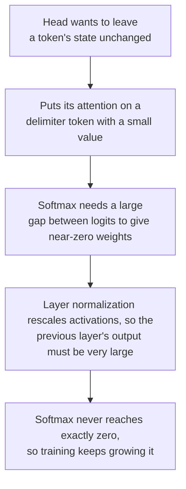

# Lição 7. Por que os LLMs têm outliers

**Ligação com a missão:** Dizer por que um LLM em int8 ingênuo quebra, e qual correção se aplica, começa por saber o que são os valores grandes, onde eles ficam e por que o modelo os produz.
**Fonte principal:** [Artigo científico: "LLM.int8(): 8-bit Matrix Multiplication for Transformers at Scale", Dettmers et al., 2022](https://arxiv.org/abs/2208.07339), seções 3 e 4
**Pré-requisitos:** [Lição 6](0006-granularity.md), [Feature outlier](../GLOSSARY.md), [Ativação massiva](../GLOSSARY.md), [Ativação](../GLOSSARY.md)

## Aquecimento

1. ▢ Com uma grade simétrica com sinal de 4 bits de -7 a 7, o maior valor de um tensor é 1.506. Qual é o passo, e quais valores arredondam para zero?

<details markdown="1"><summary>Verificação</summary>

`s = 1.506 / 7 = 0.215`, e qualquer valor com valor absoluto abaixo de `s/2 = 0.108` arredonda para zero (lição 5). Um valor grande deixa a grade grosseira demais para os muitos pequenos.

</details>

2. ▢ Por que uma scale per-token não resgata um tensor de ativações cujos valores grandes ficam em uma dimensão de feature?

<details markdown="1"><summary>Verificação</summary>

Uma scale per-token é definida pelo maior valor do próprio token, e uma dimensão de feature que é grande em todo token é o maior valor de quase toda linha. A scale de toda linha é inflada do mesmo jeito (lição 6).

</details>

3. ▢ Qual eixo separaria essa dimensão de feature, e por que uma multiplicação de matrizes de inteiros não consegue usá-lo de forma barata?

<details markdown="1"><summary>Verificação</summary>

Uma scale por feature de entrada, que é a quantização per-channel das ativações. Ela muda dentro da soma sobre as features de entrada, então o acumulador de inteiros teria de ser reescalado a cada canal de entrada (lição 6).

</details>

## Saiba isto

### Features outliers

Dettmers et al. examinaram os hidden states que entram nas projeções de atenção e na primeira camada feed-forward, em transformers de 125M a 13B de parâmetros, e encontraram valores grandes em um pequeno conjunto de dimensões do hidden state. Eles definiram uma **feature outlier** por três limiares: uma magnitude de pelo menos 6.0, em pelo menos 25 por cento das camadas e em pelo menos 6 por cento das posições da sequência.

O que eles relatam, do texto do próprio artigo:

| Achado | Valor |
|---|---|
| Tamanho dos outliers | Até 20 vezes maiores que as outras dimensões |
| Fração das features | Cerca de 0.1 por cento |
| Onde | Algumas dimensões fixas do hidden state: 6 dimensões em um modelo de 6.7B, no máximo 7 até 13B |
| Quantos valores | Cerca de 150.000 valores outliers por sequência de 2048 tokens em 6.7B, concentrados nessas poucas dimensões |
| Emergência | Entre 6B e 6.7B de parâmetros, a fração de camadas afetadas vai de 65 a 100 por cento e a fração de posições da sequência de 35 a 75 por cento |
| O que removê-los faz | A probabilidade média de atenção top-1 cai de cerca de 40 para cerca de 20 por cento, e a perplexity sobe de 600 a 1000 por cento |
| Controle | Remover 7 dimensões aleatórias muda a perplexity em cerca de 0.1 por cento |

Duas ressalvas vêm do mesmo artigo. O salto repentino é no tamanho do modelo, mas quando eles plotam contra a perplexity, a emergência é suave e exponencial, e eles sugerem que a perplexity, e não só o tamanho, define a mudança. E o int8 com uma scale absmax por tensor já é pior que o float em tamanhos pequenos na Tabela 1 deles: 87.76 contra 25.65 de perplexity no C4 em 125M, e 19.08 contra 12.45 em 13B. O ponto de 6.7B é onde os outliers se tornam sistemáticos, não um tamanho abaixo do qual o int8 ingênuo é seguro.

### Ativações massivas

[Sun et al.](https://arxiv.org/abs/2402.17762) encontraram um segundo padrão. Uma **ativação massiva** é um único valor em um hidden state, definido de forma frouxa como acima de 100 e pelo menos cerca de 1.000 vezes a magnitude mediana do seu hidden state. No LLaMA2-7B o maior é 2622 contra uma mediana de 0.2, e no LLaMA2-70B há valores acima de 15.000. Elas são extremamente raras, muitas vezes menos de 10 entre dezenas de milhões de ativações. Ficam em dimensões de feature fixas, 1415 e 2533 no LLaMA2-7B, e em tokens específicos: o token inicial e o primeiro ponto final ou quebra de linha.

Elas não são ruído. Zerar apenas quatro delas no LLaMA2-7B colapsa o modelo, enquanto defini-las como os seus valores médios não o prejudica, então elas se comportam como termos de bias fixos. Elas também não são a mesma coisa que as features outliers, e o artigo confere isso: no LLaMA2-7B e no 13B eles encontraram 10 e 25 features outliers pela definição de Dettmers et al., e nenhuma coincidia com a dimensão de uma ativação massiva.

| | Feature outlier | Ativação massiva |
|---|---|---|
| Forma | Uma dimensão: grande na maioria dos tokens | Uma entrada: um token, uma dimensão |
| Contagem | Um punhado de dimensões | Muitas vezes menos de 10 valores no total |
| Encontrada por | Dettmers et al., 2022 | Sun et al., 2024 |

Por esta tabela, uma scale per-token confina uma ativação massiva à linha do seu próprio token, já que ela fica em poucos tokens, o que é uma inferência a partir da forma delas e não um resultado de nenhum dos dois artigos. Ela não ajuda contra uma feature outlier, que está em toda linha.

### Por que o modelo as produz

[Bondarenko et al.](https://arxiv.org/abs/2306.12929) ligam os outliers a cabeças de atenção que tentam aprender um "no-op". No BERT-base, mais de 97 por cento dos outliers que eles registraram se alinham com tokens delimitadores, como o separador, um ponto final ou uma vírgula, e a cabeça correspondente põe quase toda a sua atenção nesses tokens, cujos vetores de value são pequenos. Atender a um token de pouca informação com um value minúsculo é uma maneira suave de não atualizar o hidden state. A hipótese deles, que sustentam no BERT e em um vision transformer, segue como uma cadeia:



Sun et al. chegam a um quadro compatível pelo outro lado: as ativações massivas atraem atenção para os seus tokens e agem como biases implícitos na autoatenção. Ambas são explicações que os seus autores defendem, não uma teoria assentada de todo modelo.

### Um valor, uma scale

Agora a aritmética da lição 4. Tome o absmax simétrico de 8 bits com uma scale para o tensor inteiro e uma dimensão de feature de magnitude 60 entre valores de desvio padrão 1. O passo é `60 / 127 = 0.47`, então todo valor abaixo de `0.24` arredonda para zero, cerca de 19 por cento de uma normal padrão. Em 4 bits o passo é `60 / 7 = 8.6` e tudo abaixo de 4.3 arredonda para zero, o que é praticamente tudo. Dettmers et al. descrevem o mesmo mecanismo: a faixa é tão grande que a maioria dos bins de quantização fica vazia e os valores pequenos são quantizados para zero, extinguindo informação.

## Prática

1. ▢ Enuncie os três limiares de Dettmers et al. para chamar uma feature de feature outlier.

<details markdown="1"><summary>Verificação</summary>

Magnitude de pelo menos 6.0, presente em pelo menos 25 por cento das camadas e em pelo menos 6 por cento das posições da sequência. Os três importam: os limiares de camada e de posição são o que separa uma dimensão de feature sistemática de um valor grande ocasional.

</details>

2. ▢ Uma dimensão de feature tem magnitude 60 em todo token e as demais têm desvio padrão 1. Para o absmax simétrico de 8 bits e de 4 bits com uma scale por tensor, dê o passo e a magnitude abaixo da qual um valor arredonda para zero.

<details markdown="1"><summary>Verificação</summary>

8 bits: `s = 60 / 127 = 0.47`, então valores abaixo de 0.24 arredondam para zero, cerca de 19 por cento de uma normal padrão. 4 bits: `s = 60 / 7 = 8.6`, então valores abaixo de 4.3 arredondam para zero, o que é mais de 99.99 por cento de uma normal padrão. O mesmo outlier é um incômodo em 8 bits e fatal em 4.

</details>

3. ▢ Qual afirmação separa corretamente uma ativação massiva de uma feature outlier?

    - a) Uma ativação massiva é uma única entrada, enquanto uma feature outlier abrange uma dimensão
    - b) Uma ativação massiva abrange a maioria dos tokens, enquanto uma feature outlier abrange apenas um token
    - c) Uma ativação massiva vive nos pesos, enquanto uma feature outlier vive nas ativações
    - d) Uma ativação massiva diminui com a escala do modelo, enquanto uma feature outlier fica bem estável

<details markdown="1"><summary>Verificação</summary>

**a)** Uma ativação massiva é um escalar em um token e uma dimensão, e uma feature outlier é uma dimensão que é grande na maioria dos tokens, o que Sun et al. afirmam quando separam as duas. (b) troca as duas formas. (c) está errada porque ambas são valores em hidden states, que são ativações. (d) não é o que nenhum dos artigos relata: Dettmers et al. relatam features outliers crescendo conforme os modelos escalam.

</details>

4. ▢ Preveja e depois execute. Um tensor de 128 tokens e 512 features tem uma feature outlier de magnitude cerca de 60 em todo token. Antes de executar, preveja em qual largura em bits e com qual dos três eixos de scale o erro nas features normais cai abaixo de 5 por cento.

    ```python
    import numpy as np

    rng = np.random.default_rng(0)
    tokens, features = 128, 512
    X = rng.normal(size=(tokens, features))
    X[:, 7] = 60 * rng.uniform(0.8, 1.2, size=tokens)  # one outlier feature, large at every token
    normal = np.arange(features) != 7


    def quantize(X, axis, bits):
        qmax = 2 ** (bits - 1) - 1
        s = np.abs(X).max(axis=axis, keepdims=True) / qmax
        return s * np.clip(np.round(X / s), -qmax, qmax)


    print("scheme        bits  error on normal features  share rounded to zero")
    for bits in (8, 4):
        for name, axis in [("per-tensor", None), ("per-token", 1), ("per-channel", 0)]:
            Q = quantize(X, axis, bits)
            err = np.mean((Q - X)[:, normal] ** 2) / np.mean(X[:, normal] ** 2)
            zero = np.mean(Q[:, normal] == 0)
            print(f"{name:12s}  {bits}     {err:8.4f}                  {zero:6.1%}")
    ```

<details markdown="1"><summary>Dica</summary>

No código, `axis=1` toma o máximo ao longo de cada linha, que é uma scale por token, e `axis=0` o toma ao longo de cada coluna, que é uma scale por feature.

</details>

<details markdown="1"><summary>Verificação</summary>

```text
scheme        bits  error on normal features  share rounded to zero
per-tensor    8       0.0269                   22.2%
per-token     8       0.0190                   18.5%
per-channel   8       0.0000                    0.8%
per-tensor    4       1.0000                  100.0%
per-token     4       0.9998                  100.0%
per-channel   4       0.0138                   15.8%
```

Em 8 bits todo eixo fica abaixo de 5 por cento, mas per-tensor e per-token ainda arredondam cerca de um quinto dos valores normais para zero. Em 4 bits só a scale per-channel funciona: per-tensor e per-token perdem tudo, com erro perto de 1.0 e todo valor normal arredondado para zero. A scale per-channel é a que a multiplicação de matrizes de inteiros não consegue aplicar barato, e é por isso que a lição 8 precisa de outras correções. O tensor é sintético.

</details>

5. ▢ Explique em quatro elos por que uma cabeça de atenção que quer deixar um token inalterado pode acabar produzindo uma ativação grande.

<details markdown="1"><summary>Verificação</summary>

A cabeça põe quase toda a sua atenção em um token de pouca informação, como um delimitador, cujo vetor de value é pequeno, então a cabeça não acrescenta quase nada. Para fazer o softmax pôr peso quase zero em todo o resto, os logits precisam de uma grande diferença, o que exige entradas grandes. A layer normalization reescala as ativações, então a saída da camada anterior precisa ser muito grande para sobreviver a ela. O softmax nunca chega exatamente a zero, então o treinamento continua empurrando os valores para cima. Essa é a hipótese de Bondarenko et al., sustentada no BERT e em um vision transformer, e ela explica os outliers em tokens delimitadores de forma mais direta do que explica todo outlier em todo LLM.

</details>

6. ▢ Uma equipe lê que os outliers emergem em 6.7B de parâmetros e decide que um modelo de 3B é seguro para int8 per-tensor. O que, nos próprios resultados de Dettmers et al., argumenta contra isso?

<details markdown="1"><summary>Verificação</summary>

A Tabela 1 deles mostra o int8 absmax já pior que o float de 32 bits em todo tamanho testado: 16.55 contra 15.91 de perplexity no C4 em 1.3B e 15.11 contra 14.43 em 2.7B, com 87.76 contra 25.65 em 125M. Eles também relatam que a emergência é suave quando plotada contra a perplexity, e que o número de features outliers sobe monotonicamente conforme a perplexity cai, então o tamanho do modelo é uma covariável entre várias. O número de 6.7B marca onde os outliers se tornam sistemáticos em todas as camadas, não um limiar abaixo do qual o int8 ingênuo é seguro.

</details>

## Prática no mundo real

- [ ] Carregue um modelo aberto pequeno, registre um forward hook em uma camada do decoder e imprima o maior valor absoluto do hidden state de saída dela com o token e a dimensão em que ocorre, ao lado do valor absoluto mediano. Registre se algum valor passa no teste de Sun et al. de acima de 100 e cerca de 1.000 vezes a mediana e, se nenhum passar, registre isso.
- [ ] No código da Prática 4, mude a magnitude do outlier de 60 para 6 e depois para 20, e encontre a magnitude em que o per-tensor de 4 bits deixa de arredondar todo valor normal para zero pela primeira vez. Explique usando a fórmula do passo da lição 4.
- [ ] Amanhã: sem consultar anotações, nomeie os dois padrões de outliers, como cada um é encontrado, qual eixo separa cada um e a cadeia de cabeças de atenção que Bondarenko et al. propõem.

## Para ir além

- [O Mapeamento de Quantização](../reference/quantization-mapping.md)
- [Artigo científico: "LLM.int8(): 8-bit Matrix Multiplication for Transformers at Scale", Dettmers et al., 2022](https://arxiv.org/abs/2208.07339)
- [Artigo científico: "Massive Activations in Large Language Models", Sun et al., 2024](https://arxiv.org/abs/2402.17762)
- [Artigo científico: "Quantizable Transformers: Removing Outliers by Helping Attention Heads Do Nothing", Bondarenko et al., 2023](https://arxiv.org/abs/2306.12929)
- [Recursos](../RESOURCES.md)

---

Não ficou claro? Releia a fonte principal no topo, já que esta lição a comprime e é na compressão que o entendimento escapa. Consulte o [glossário](../GLOSSARY.md) para qualquer termo que pareceu escorregadio.

Se o problema é a lição em si, e não o material, isso é um defeito: [abra uma issue](https://github.com/TokenCemetery/teach/issues).
