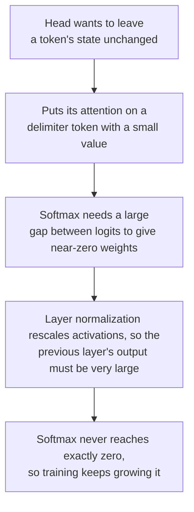

# Урок 7. Почему у LLM есть выбросы

**Связь с целью курса:** Чтобы сказать, почему наивная LLM в int8 ломается и какое исправление применимо, нужно начать с того, что такое большие значения, где они находятся и почему модель их порождает.
**Первоисточник:** [Научная статья: "LLM.int8(): 8-bit Matrix Multiplication for Transformers at Scale", Dettmers et al., 2022](https://arxiv.org/abs/2208.07339), разделы 3 и 4
**Предварительные требования:** [Урок 6](0006-granularity.md), [Признак-выброс](../GLOSSARY.md), [Массивная активация](../GLOSSARY.md), [Активация](../GLOSSARY.md)

## Разминка

1. ▢ При 4-битной знаковой симметричной сетке от -7 до 7 наибольшее значение тензора равно 1,506. Каков шаг и какие значения округляются до нуля?

<details markdown="1"><summary>Проверка</summary>

`s = 1.506 / 7 = 0.215`, и любое значение с абсолютной величиной ниже `s/2 = 0.108` округляется до нуля (урок 5). Одно большое значение делает сетку слишком грубой для множества малых.

</details>

2. ▢ Почему масштаб per-token не спасает тензор активаций, у которого большие значения сидят в одном измерении признака?

<details markdown="1"><summary>Проверка</summary>

Масштаб per-token задаётся наибольшим значением самого токена, а измерение признака, которое велико на каждом токене, это наибольшее значение почти каждой строки. Масштаб каждой строки раздувается одинаково (урок 6).

</details>

3. ▢ Какая ось отделила бы такое измерение признака и почему целочисленное умножение матриц не может использовать её дёшево?

<details markdown="1"><summary>Проверка</summary>

Масштаб на входной признак, то есть per-channel-квантизация активаций. Он меняется внутри суммы по входным признакам, поэтому целочисленный аккумулятор пришлось бы перемасштабировать на каждом входном канале (урок 6).

</details>

## Что нужно знать

### Признаки-выбросы

Dettmers и соавторы изучали скрытые состояния, поступающие на проекции внимания и в первый слой прямого распространения, в трансформерах от 125 млн до 13 млрд параметров и обнаружили большие значения в небольшом наборе скрытых измерений. Они определили **признак-выброс** тремя порогами: величина не менее 6,0, не менее чем в 25% слоёв и не менее чем в 6% позиций последовательности.

Что они сообщают, по собственному тексту статьи:

| Находка | Значение |
|---|---|
| Размер выбросов | До 20 раз больше остальных измерений |
| Доля признаков | Около 0,1% |
| Где | Несколько фиксированных скрытых измерений: 6 измерений в модели на 6,7 млрд, не более 7 вплоть до 13 млрд |
| Сколько значений | Около 150 000 выбивающихся значений на последовательность из 2048 токенов при 6,7 млрд, сосредоточенных в этих немногих измерениях |
| Возникновение | Между 6 и 6,7 млрд параметров доля затронутых слоёв растёт с 65 до 100%, а доля позиций последовательности с 35 до 75% |
| Что даёт их удаление | Средняя top-1-вероятность внимания падает примерно с 40 до примерно 20%, а перплексия растёт на 600-1000% |
| Контроль | Удаление 7 случайных измерений меняет перплексию примерно на 0,1% |

Из той же статьи следуют две оговорки. Внезапный скачок происходит по размеру модели, но если построить график по перплексии, возникновение плавное и экспоненциальное, и они предполагают, что сдвиг определяет перплексия, а не один лишь размер. А int8 с одним масштабом absmax на тензор уже хуже формата с плавающей точкой на малых размерах в их таблице 1: перплексия на C4 87,76 против 25,65 при 125 млн и 19,08 против 12,45 при 13 млрд. Точка 6,7 млрд это место, где выбросы становятся систематическими, а не размер, ниже которого наивный int8 безопасен.

### Массивные активации

[Sun и соавторы](https://arxiv.org/abs/2402.17762) нашли второй паттерн. **Массивная активация** это одно значение в скрытом состоянии, определяемое нестрого как превышающее 100 и по меньшей мере примерно в 1000 раз большее медианной величины своего скрытого состояния. В LLaMA2-7B наибольшая равна 2622 при медиане 0,2, а в LLaMA2-70B значения превышают 15 000. Они крайне редки, часто меньше 10 среди десятков миллионов активаций. Они сидят в фиксированных измерениях признаков, 1415 и 2533 в LLaMA2-7B, и на определённых токенах: стартовом токене и первой точке или переводе строки.

Это не шум. Обнуление всего четырёх из них в LLaMA2-7B обрушивает модель, а замена их средними значениями ей не вредит, так что они ведут себя как фиксированные члены смещения. Они также не то же самое, что признаки-выбросы, и статья это проверяет: в LLaMA2-7B и 13B они нашли 10 и 25 признаков-выбросов по определению Dettmers и соавторов, и ни один не совпал с измерением массивной активации.

| | Признак-выброс | Массивная активация |
|---|---|---|
| Форма | Измерение: велико на большинстве токенов | Одна запись: один токен, одно измерение |
| Число | Горстка измерений | Часто меньше 10 значений в сумме |
| Найден в | Dettmers et al., 2022 | Sun et al., 2024 |

По этой таблице масштаб per-token ограничивает массивную активацию строкой её собственного токена, поскольку она сидит на нескольких токенах, а это вывод из их формы, а не результат какой-либо из двух статей. Против признака-выброса, который есть в каждой строке, это не помогает.

### Почему модель их порождает

[Bondarenko и соавторы](https://arxiv.org/abs/2306.12929) связывают выбросы с головами внимания, которые пытаются выучить «no-op». В BERT-base более 97% зафиксированных ими выбросов совпадают с токенами-разделителями, такими как сепаратор, точка или запятая, а соответствующая голова отдаёт почти всё внимание этим токенам, чьи векторы значений малы. Обращение внимания на малоинформативный токен с крошечным значением это мягкий способ не обновлять скрытое состояние. Их гипотеза, которую они подкрепляют на BERT и на зрительном трансформере, образует цепочку:



Sun и соавторы приходят к совместимой картине с другой стороны: массивные активации привлекают внимание к своим токенам и действуют как неявные смещения в самовнимании. Обе картины это объяснения, за которые выступают их авторы, а не устоявшаяся теория для каждой модели.

### Одно значение, один масштаб

Теперь арифметика урока 4. Возьмём 8-битный симметричный absmax с одним масштабом на весь тензор и измерение признака величиной 60 среди значений со стандартным отклонением 1. Шаг равен `60 / 127 = 0.47`, поэтому каждое значение ниже `0.24` округляется до нуля, это около 19% стандартного нормального распределения. В 4 битах шаг равен `60 / 7 = 8.6`, и всё ниже 4,3 округляется до нуля, то есть практически всё. Dettmers и соавторы описывают тот же механизм: диапазон так велик, что большинство корзин квантизации пусты, а малые значения квантизуются в нуль, гася информацию.

## Практика

1. ▢ Назовите три порога Dettmers и соавторов для того, чтобы назвать признак признаком-выбросом.

<details markdown="1"><summary>Проверка</summary>

Величина не менее 6,0, присутствие не менее чем в 25% слоёв и не менее чем в 6% позиций последовательности. Важны все три: пороги по слоям и позициям отличают систематическое измерение признака от случайного большого значения.

</details>

2. ▢ Одно измерение признака имеет величину 60 на каждом токене, а у остальных стандартное отклонение 1. Для 8-битного и 4-битного симметричного absmax с одним масштабом на тензор укажите шаг и величину, ниже которой значение округляется до нуля.

<details markdown="1"><summary>Проверка</summary>

8 бит: `s = 60 / 127 = 0.47`, поэтому значения ниже 0,24 округляются до нуля, около 19% стандартного нормального распределения. 4 бита: `s = 60 / 7 = 8.6`, поэтому значения ниже 4,3 округляются до нуля, а это более 99,99% стандартного нормального распределения. Тот же выброс в 8 битах досадная помеха, а в 4 фатален.

</details>

3. ▢ Какое утверждение верно отличает массивную активацию от признака-выброса?

    - a) Массивная активация это одна запись, а признак-выброс охватывает измерение
    - b) Массивная активация охватывает большинство токенов, а признак-выброс всего один токен
    - c) Массивная активация живёт в весах, а признак-выброс в активациях
    - d) Массивная активация уменьшается с масштабом модели, а признак-выброс остаётся довольно ровным

<details markdown="1"><summary>Проверка</summary>

**a)** Массивная активация это скаляр на одном токене и одном измерении, а признак-выброс это измерение, большое на большинстве токенов; это утверждают Sun и соавторы, разделяя их. (b) меняет две формы местами. (c) неверно, потому что оба это значения в скрытых состояниях, то есть активации. (d) не то, о чём сообщает ни одна статья: Dettmers и соавторы сообщают, что признаки-выбросы растут с масштабом моделей.

</details>

4. ▢ Предскажите, затем запустите. В тензоре из 128 токенов и 512 признаков есть один признак-выброс величиной около 60 на каждом токене. Перед запуском предскажите, при какой разрядности и с какой из трёх осей масштаба ошибка на нормальных признаках опускается ниже 5%.

    ```python
    import numpy as np

    rng = np.random.default_rng(0)
    tokens, features = 128, 512
    X = rng.normal(size=(tokens, features))
    X[:, 7] = 60 * rng.uniform(0.8, 1.2, size=tokens)  # one outlier feature, large at every token
    normal = np.arange(features) != 7


    def quantize(X, axis, bits):
        qmax = 2 ** (bits - 1) - 1
        s = np.abs(X).max(axis=axis, keepdims=True) / qmax
        return s * np.clip(np.round(X / s), -qmax, qmax)


    print("scheme        bits  error on normal features  share rounded to zero")
    for bits in (8, 4):
        for name, axis in [("per-tensor", None), ("per-token", 1), ("per-channel", 0)]:
            Q = quantize(X, axis, bits)
            err = np.mean((Q - X)[:, normal] ** 2) / np.mean(X[:, normal] ** 2)
            zero = np.mean(Q[:, normal] == 0)
            print(f"{name:12s}  {bits}     {err:8.4f}                  {zero:6.1%}")
    ```

<details markdown="1"><summary>Подсказка</summary>

В коде `axis=1` берёт максимум вдоль каждой строки, то есть один масштаб на токен, а `axis=0` берёт его вниз по каждому столбцу, то есть один масштаб на признак.

</details>

<details markdown="1"><summary>Проверка</summary>

```text
scheme        bits  error on normal features  share rounded to zero
per-tensor    8       0.0269                   22.2%
per-token     8       0.0190                   18.5%
per-channel   8       0.0000                    0.8%
per-tensor    4       1.0000                  100.0%
per-token     4       0.9998                  100.0%
per-channel   4       0.0138                   15.8%
```

В 8 битах каждая ось ниже 5%, но per-tensor и per-token всё равно округляют до нуля около пятой части нормальных значений. В 4 битах работает только масштаб per-channel: per-tensor и per-token теряют всё, с ошибкой около 1,0 и каждым нормальным значением, округлённым до нуля. Масштаб per-channel это тот, который целочисленное умножение матриц не может применить дёшево, поэтому урок 8 нуждается в других исправлениях. Тензор синтетический.

</details>

5. ▢ Объясните в четыре звена, почему голова внимания, которая хочет оставить токен без изменений, может в итоге породить большую активацию.

<details markdown="1"><summary>Проверка</summary>

Голова отдаёт почти всё своё внимание малоинформативному токену, например разделителю, вектор значения которого мал, поэтому голова почти ничего не добавляет. Чтобы softmax дал почти нулевой вес всему остальному, нужен большой разрыв между логитами, а для него нужны большие входы. Нормализация слоя перемасштабирует активации, поэтому выход более раннего слоя должен быть очень большим, чтобы её пережить. Softmax никогда не достигает ровно нуля, поэтому обучение продолжает увеличивать значения. Это гипотеза Bondarenko и соавторов, подкреплённая на BERT и зрительном трансформере, и она объясняет выбросы на токенах-разделителях более прямо, чем каждый выброс в каждой LLM.

</details>

6. ▢ Команда читает, что выбросы возникают при 6,7 млрд параметров, и решает, что модель на 3 млрд безопасна для int8 per-tensor. Что в собственных результатах Dettmers и соавторов говорит против этого?

<details markdown="1"><summary>Проверка</summary>

Их таблица 1 показывает, что int8 absmax уже хуже 32-битного формата с плавающей точкой на каждом проверенном размере: перплексия на C4 16,55 против 15,91 при 1,3 млрд и 15,11 против 14,43 при 2,7 млрд, а при 125 млн 87,76 против 25,65. Они также сообщают, что возникновение плавное, если строить график по перплексии, и что число признаков-выбросов монотонно растёт по мере падения перплексии, так что размер модели это одна ковариата из нескольких. Цифра 6,7 млрд отмечает, где выбросы становятся систематическими по всем слоям, а не порог, ниже которого наивный int8 безопасен.

</details>

## Практика в реальной работе

- [ ] Загрузите небольшую открытую модель, зарегистрируйте прямой хук на одном слое декодера и напечатайте наибольшее абсолютное значение его выходного скрытого состояния с токеном и измерением, где оно встречается, рядом с медианным абсолютным значением. Запишите, проходит ли какое-либо значение тест Sun и соавторов (выше 100 и примерно в 1000 раз больше медианы), а если ни одно не проходит, запишите и это.
- [ ] В коде упражнения 4 практики измените величину выброса с 60 на 6, а затем на 20 и найдите величину, при которой 4-битный per-tensor впервые перестаёт округлять каждое нормальное значение до нуля. Объясните это формулой шага из урока 4.
- [ ] Завтра, без заметок, назовите два паттерна выбросов, как находят каждый, какая ось отделяет каждый и цепочку через головы внимания, которую предлагают Bondarenko и соавторы.

## Что почитать дальше

- [Отображение квантизации](../reference/quantization-mapping.md)
- [Научная статья: "LLM.int8(): 8-bit Matrix Multiplication for Transformers at Scale", Dettmers et al., 2022](https://arxiv.org/abs/2208.07339)
- [Научная статья: "Massive Activations in Large Language Models", Sun et al., 2024](https://arxiv.org/abs/2402.17762)
- [Научная статья: "Quantizable Transformers: Removing Outliers by Helping Attention Heads Do Nothing", Bondarenko et al., 2023](https://arxiv.org/abs/2306.12929)
- [Ресурсы](../RESOURCES.md)

---

Не доходит? Перечитайте первоисточник в начале: этот урок его сжимает, а при сжатии понимание как раз и теряется. Загляните в [глоссарий](../GLOSSARY.md), если какой-то термин показался скользким.

Если неясен сам урок, а не материал, это дефект: [откройте issue](https://github.com/TokenCemetery/teach/issues).
